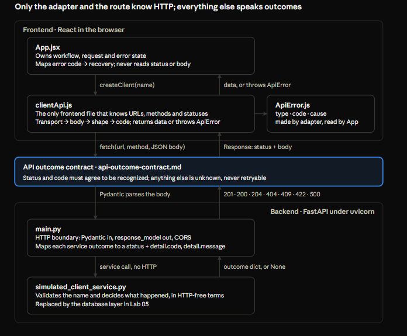

# HTTP Contract & API Boundary Patterns — Lab 04

Oct 23, 2026 · @zhe

## Scope

Lab 04 answered one question: how should React and FastAPI communicate authoritative mutation outcomes without unsafe retry assumptions? The answer is an explicit outcome contract, a frontend adapter that classifies every response through ordered checkpoints, and a UI whose next step is driven by a recovery field rather than by the error's category.

**What was built:** a minimal FastAPI service (`main.py` + `simulated_client_service.py`, in-memory data, no database) with GET, POST, PATCH and DELETE on `/clients`; a fetch-based adapter (`clientApi.js`) with a shared error type (`ApiError.js`); and the existing Lab 03 `App.jsx` rewired to consume classified outcomes. The written contract lives in `api-outcome-contract.md`.

**Spec coverage:** G-06 to G-08, §8 error classes, §10 backend error-contract requirements, §11.6 safe-retry decision (ADR-C018), AT-26, AT-32, AT-40.

**How to read this doc:** sections 3 to 7 hold the reusable patterns, each with the reason it exists. Section 8 collects the language and framework mechanics behind them. Section 9 is the failure log: every bug found during the lab and the lesson it produced. Lab 05 (database integrity) gets its own doc.

## Architecture map

One mutation crosses five files and one written contract. Only `clientApi.js` and `main.py` know about HTTP; every other piece speaks in outcomes.

Left arrows carry the request down; right arrows carry the response back up, getting more classified at each layer.

| Piece | Layer | Responsibility | Must not |
| --- | --- | --- | --- |
| `App.jsx` | Frontend orchestration | Workflow, request and error state; locks and generation guard; maps code to recovery | Read statuses or bodies; decide from message text |
| `clientApi.js` | Frontend adapter | URLs, methods, statuses, shapes; checkpoint classification into data or `ApiError` | Know UI recovery paths |
| `ApiError.js` | Shared vocabulary | `type`, `code`, `cause`, and the `unknownMutationOutcome` factory | Carry behavior |
| `api-outcome-contract.md` | Contract | Registry rows, commit guarantees, classification rules | Change without both sides changing with it |
| `main.py` | Backend HTTP boundary | Pydantic input, `response_model` output, CORS, outcome → status + envelope | Decide business outcomes |
| `simulated_client_service.py` | Business stand-in | Name validation, outcome decisions, in-memory store and IDs | Know about HTTP |

**One request traced: Add with a duplicate name.**

1. `submitModify` passes frontend validation and calls `runWrite(() => createClient(name))`, which sets pending and takes the request lock.
2. `createClient` sends `POST /clients` with `{"name": …}`. CORS preflight succeeds.
3. Pydantic parses the body into `ClientModifyRequest`; the route calls the service.
4. The service validates the name, then returns `{"outcome": "duplicated"}`.
5. The route raises `HTTPException(409, detail={code: "DUPLICATE_CLIENT", message: …})`.
6. `fetch` resolves; `.json()` parses; the adapter sees status 409 and a matching code, and throws `ApiError("non-retryable", "DUPLICATE_CLIENT", message)`.
7. `runWrite`'s `catch` checks the generation, maps the code to `return-to-draft`, and sets the error.
8. The dialog shows Close; clicking it clears the error and leaves the Add modal open with the draft intact (G-07).

## Transport outcome vs domain outcome

A resolved `fetch` means an HTTP exchange completed, not that the operation succeeded. Success is a rule the adapter applies on top of the response.

**What `fetch` actually reports.** It resolves for every status: 2xx, 3xx, 4xx and 5xx all resolve, with `response.ok` false outside 200 to 299. It rejects only when no usable response arrives: network down, DNS failure, CORS refusal, or abort. A database rejection therefore arrives as a resolved promise.

**Two async phases that fail independently.** `fetch` resolves as soon as the status line and headers arrive. Reading the body (`response.json()`, `response.text()`) is a second promise that can reject later: the body is not JSON, or the connection drops mid-body. A body can be consumed only once (`response.bodyUsed`), so to log a malformed body, read `.text()` first and parse it yourself.

**Parsing is not shape.** `"hello"`, `null` and `42` are all valid JSON. A body can parse and still be the wrong shape, so there are three distinct body failures: unreadable, not JSON, and JSON of the wrong shape.

**Rejections are indistinguishable by design.** A CORS block and an unreachable server both surface as a generic `TypeError`; an abort surfaces as `AbortError`. For classification they share one bucket: no authoritative answer.

**The checkpoint pipeline.** Classify a response through ordered checkpoints, where each failure point has its own meaning for commit certainty:

1. Transport: did a response arrive? No → unknown.
2. Body: could it be read and parsed (when this status has a body)? No → unknown.
3. Shape: does it match the contract for this status? No → unknown.
4. Domain: do status and code together name a registered outcome? That outcome, otherwise unknown.

**The tricky case.** A POST returning 201 with an unparseable body is classified unknown, even though the evidence leans toward committed. Both classifications lead to the same safe action (refresh, never retry), and unknown claims less. Rule: when two classifications lead to the same safe action, choose the one that claims less.

## The outcome contract

The contract is the agreement that makes `main.py`'s output and `clientApi.js`'s input the same thing. Its central rule: a 2xx is a backend promise of commit, and anything the frontend cannot confidently classify is unknown, never retryable.

**Four classifications** (by what the evidence establishes about the write):

| Classification | Required evidence | Behavior |
| --- | --- | --- |
| success | Recognized response carrying a commit guarantee | Refresh, then success reset |
| rejected (`non-retryable` in code) | Recognized status + code guaranteeing non-commit | Show reason; recovery by code |
| retryable | Allowlisted code guaranteeing non-commit and safe retry | Offer Retry |
| unknown | Anything else | No retry; offer a fresh read |

**Registry as built in Lab 04:**

| Operation | Scenario | HTTP | Code | Commit | Recovery |
| --- | --- | --- | --- | --- | --- |
| GET /clients | List returned | 200 | — | n/a | Show list |
| POST /clients | Created | 201 | — | Committed | Refresh |
| PATCH /clients/{id} | Updated | 200 | — | Committed | Refresh |
| DELETE /clients/{id} | Deleted | 204 | — | Committed | Refresh |
| POST, PATCH | Whitespace-only name | 422 | `INVALID_CLIENT_NAME` | Not committed | return-to-draft |
| POST, PATCH | Duplicate normalized name | 409 | `DUPLICATE_CLIENT` | Not committed | return-to-draft |
| PATCH, DELETE | Client no longer exists | 404 | `CLIENT_NOT_FOUND` | Not committed by this request | refresh |
| DELETE | Client referenced by dependents | 409 | `CLIENT_REFERENCED` | Not committed | return-to-table |
| Any mutation | Missing field / wrong type (FastAPI default 422) | 422 | — | Not committed, unrecognized | Unknown (frontend bug) |
| Any mutation | 5xx, plain-text body, network failure, malformed body | — | — | Unknown | refresh |

**Status and code must agree.** An outcome is recognized only when the status and the code both match a registry row. A 409 without a recognized code is unknown. Disagreement is itself evidence of an unknown outcome.

**A 5xx is not a confirmed non-commit.** A server can commit and then fail while building the response. Without an explicit code saying nothing was written, a 5xx is unknown.

**404 on DELETE is a rejection, not a success.** The state the user wanted holds (the client is gone), but this request did not cause it. Calling it success would claim a commit that did not happen and hide that another session changed the data.

**Retry safety lives in a frontend allowlist keyed by code.** A server-sent `retryable` flag would make safety depend on every future backend change setting it correctly. With an allowlist, an unrecognized code defaults to no Retry. In v1 the allowlist is empty: the retryable branch exists in the model, but nothing reaches it yet.

**Human text never decides.** `message` is for display. Every decision reads `type`, `code`, or `recovery`.

## Frontend adapter patterns (`clientApi.js`)

The adapter is the only frontend file that knows URLs, methods, statuses and body shapes. It turns every response into either returned data or a thrown `ApiError` with a `type` and a `code`.

**A `catch` catches by location, not by origin.** Any exception inside the `try` block lands in its `catch`, including ones you threw deliberately. The `catch` cannot tell them apart. So a `try` block's scope is a classification decision: keep it as narrow as the set of failures its `catch` is meant to interpret.

**Mutations: narrow `try`.** Wrap only `fetch` and `.json()`, whose failure means "no trustworthy response" → unknown. Do the status, shape and code checks after the `try`, so each deliberate `ApiError` propagates untouched. A wide `try` here would turn a 409 `DUPLICATE_CLIENT` into unknown.

**Reads: a wide `try` is acceptable.** Every read failure leads to the same action, retrying the read. `getClients` throws plain `Error`s inside and wraps everything once as `ApiError("refresh", "REFRESH_ERROR", …, { cause })`. Nothing a decision needs is lost; the specific reason survives in `cause` for diagnostics.

**Error format is a boundary contract.** Callers only ever see the outermost error, so that one must follow the `ApiError` format. Internal throws only need to serve diagnostics. Building a full `ApiError` that a wrapping `catch` immediately replaces is ceremony.

**Validate the success shape, including identity.** `isValidClient` checks `id` is a positive integer and `name`/`modified_by` are strings. `editClient` additionally requires `data.id === clientId`, so a 200 describing the wrong record becomes unknown. That is AT-40 enforced at the boundary.

**One helper defines "recognized".** `isValidErrorData(data, code)` requires `data.detail.code` to equal the expected code and `data.detail.message` to be a string. Optional chaining (`data?.detail?.code`) is justified because `response.json()` can return `null`, a string or a number.

**Choose what to read based on status.** DELETE returns 204 with no body, so calling `.json()` first would turn a successful delete into unknown. The adapter checks for 204 before parsing. Whether a response has a body is part of the contract.

**Do not guard invariants that cannot fail.** After the narrow `try`, `response` is always defined. Writing `response?.status` tells a future reader it might be undefined, which is false.

**Lab-only items to remove before reuse:** the `console.log` calls and the hard-coded `baseURL` (move it to configuration).

## Backend patterns (FastAPI)

The route translates; the service decides. `main.py` is the only backend layer that knows HTTP. The service reports what happened in HTTP-free terms (`created`, `duplicated`, `not_found`, …), and the route maps each outcome to a status and an error envelope.

**The fall-through `RuntimeError` is the backend's conservative default.** When the service returns `None` or an outcome the route does not recognize, the route raises, and FastAPI returns a 500. The route never guesses a status.

**`HTTPException` with a dict nests the envelope under `detail`.** The 409 body is `{"detail": {"code": …, "message": …}}`. The same `detail` key holds a string for `HTTPException("…")` and a list for FastAPI's automatic 422. A consumer must check that `detail` is an object before reading `detail.code`.

**A framework's default error responses are part of your API surface.** Two appear without you writing them:

- Request validation (missing field, wrong type): FastAPI's 422 with `{"detail": [...]}`.
- Unhandled exceptions: Starlette returns a 500 with a **plain-text** body. This is the most common source of non-JSON responses, and it comes from your own server.

**Where a rule is checked decides who can shape its error.** A Pydantic validator runs before the route function, so its failure always takes FastAPI's default 422 shape. To return `INVALID_CLIENT_NAME`, the whitespace check lives in the service, next to the other business rules. Pydantic keeps structural validation. Both produce status 422; status-and-code agreement tells them apart.

**Validate before any write.** The service checks the name before lookup or mutation. That ordering is what lets the registry say "not committed" for `INVALID_CLIENT_NAME`. It also sets precedence: an invalid name on a missing client returns 422, not 404.

**`response_model` enforces the success shape, but after the side effect.** If a created record did not match `Client`, FastAPI would refuse to serialize it and return a 500, after the append already ran. A validation failure on a mutation response is a committed-but-unconfirmed outcome, which the frontend correctly classifies as unknown.

**Validate in both layers; the backend is the authority.** JavaScript's `trim()` and Python's `strip()` disagree at the edges: Python strips the control characters `\x1c` to `\x1f`, JavaScript does not. A name made only of those passes the frontend and gets a clean 422 from the backend. Two implementations of one rule will drift; the authoritative layer must reject, and the contract must carry that rejection back.

**CORS misconfiguration looks exactly like a network failure.** The browser reports a refused preflight as a generic `TypeError`. A JSON POST, PATCH and DELETE all trigger a preflight, so each method must appear in `allow_methods`. When a request fails only from the frontend, suspect CORS first.

**`def` vs `async def` routes.** FastAPI runs a plain `def` route in a thread pool, so `time.sleep(15)` blocks only that request's thread. The Stop Waiting refresh still gets served. The same sleep inside `async def` would block the event loop and stall every request, including the refresh.

**Keep test doubles swappable without changing their callers.** In the final lab code, routes still pass `outcome="normal"` into the simulated service. Lab 05 replaces that service, so those arguments disappear then. In general, if a caller passes simulation controls, the double has leaked through the boundary; keep the switch inside the double.

**Copying a container does not copy its contents.** `db.copy()` is a shallow copy: the list is new, the client dicts are shared. Returning `db[idx]` hands out the live record. Harmless over HTTP, because responses are serialized, but any in-process caller could mutate the store.

## Consumer patterns (`App.jsx`)

What the user can do next is driven by an explicit `recovery` field, not by the error's category. Commit status and recovery path are separate dimensions: `type` answers whether the write happened, and the specific `code` chooses where the user goes.

**Why `type` alone failed.** All four rejection codes are `non-retryable`, yet they need three different exits:

| Recovery | Button | On click | Applies to |
| --- | --- | --- | --- |
| return-to-draft | Close | Clear the error; modal and draft stay (G-07) | frontend validation, `INVALID_CLIENT_NAME`, `DUPLICATE_CLIENT` |
| return-to-table | Close | Reset the workflow; no read needed | `CLIENT_REFERENCED` |
| refresh | Refresh Client List | Reset the workflow, fetch the list; on failure show a refresh error with the same recovery | `CLIENT_NOT_FOUND`, unknown, every refresh failure |
| retry | Retry / Dismiss | Resubmit the preserved payload | nothing in v1 |

With buttons keyed on `type`, unknown and refresh errors were dead ends (no button, Escape blocked, only a browser reload, which would also clear the root-owned username). `CLIENT_NOT_FOUND` and `CLIENT_REFERENCED` were loops back into a context that could only fail again. Every error state needs a defined exit.

**The code-to-recovery mapping lives in the frontend, not the adapter.** The adapter reports what the server said; "go back to the table" is a UI decision. It is the same place the retry allowlist belongs. Unmapped codes default to `refresh`.

**Normalize once, derive everything from the result.** `recovery` is computed during render: if `error.recovery` is one of the known values keep it, otherwise use `'refresh'`. Both the button label and `handleErrorRecovery` read that one variable, so they cannot disagree. The handler is created in the same render and closes over the same value. Unknown cases disappear from every downstream branch, which can end in a plain `else`.

**When a field drives behavior, every producer must set it, or the consumer must default safely.** Errors are built in at least six places (validation, initial load, abort, post-success refresh, rejection, unknown). Two of them initially omitted `recovery`, and one later misspelled it as `recover`. The consumer's default turned each into a working refresh instead of a dead end.

**A shared operation should not decide what its failure means.** `refresh` returns a result; each caller sets the error that fits its context. Before this change, a failed refresh after Stop Waiting told the user "Your change was accepted by the server," a commit nobody had confirmed.

**"Didn't run" is not "failed."** `refresh` returns `'succeeded'`, `'failed'` or `'skipped'` (lock held). The caller that actually ran the read reports it; a skipped caller stays silent. The exception is `runWrite`'s post-success refresh: there, only `'succeeded'` counts, because an in-flight read may have started before the commit and would not reflect it (G-06).

**Treat anything not a recognized `ApiError` as unknown.** `runWrite`'s `catch` sends non-`ApiError` exceptions to the unknown branch. A bug in the adapter (such as a `ReferenceError`) then degrades to a refresh, not a retry. Apply the conservative default at every layer that classifies.

**A native `<dialog>` can close itself.** `ErrorDialog` prevents `cancel` unconditionally because the action button is the only intended exit. Any closing path must be blocked or update React state; otherwise React's `error` stays set behind a closed dialog and silently blocks the app.

**Late responses from abandoned requests are asymmetric.** A late success shows a notice (the data changed after the user's refresh). A late rejection is silently ignored, because nothing was committed and nothing needs saying.

## Mechanics encountered

These are the language and framework behaviors the patterns above depend on, sorted by layer and by how deeply they need to be understood (tier 1: mechanically; tier 2: purpose and failure modes; tier 3: look up when needed).

| Mechanic | Layer | Tier | What to remember |
| --- | --- | --- | --- |
| `fetch` resolution | Browser API | 1 | Resolves for every HTTP status; rejects only without a usable response |
| Body as a second promise | Browser API | 1 | `.json()` / `.text()` can reject after `fetch` resolved; the body reads once |
| `try`/`catch` scope | JavaScript | 1 | `catch` receives everything thrown inside `try`, including your own throws |
| `return` inside `try` with `finally` | JavaScript | 1 | The value is held, `finally` runs, then the function completes. Locks released in `finally` are free before any caller resumes |
| `Error` `cause` option | JavaScript | 2 | `new Error(msg, { cause })` keeps the original error for diagnostics |
| Undeclared identifier | JavaScript | 1 | Reading an undeclared name, even inside `{ cause }`, throws `ReferenceError` before the surrounding expression runs |
| Optional chaining | JavaScript | 2 | Use where a value can really be missing (parsed JSON); not on proven invariants |
| Effect return value | React | 1 | An effect may return a cleanup function or nothing. An `async` callback returns a Promise, so define the async function inside and call it |
| StrictMode double effects | React | 2 | In development, mount effects run twice; refs survive the simulated remount, so a ref lock deduplicates |
| Cleanup `ignore` flag | React | 3 | For effects whose dependencies change. Combined with an in-flight lock on a `[]` effect, it can leave a failure nobody reports |
| Derived values during render | React | 1 | Compute from state on each render; handlers made in that render close over the same values |
| State updates queue | React | 1 | `setState` queues a value. Several updates to one state in one handler apply in order; the last wins, so earlier values never render |
| Native `<dialog>` cancel | Browser API | 2 | Escape fires `cancel`; unless prevented, the browser closes the dialog regardless of React state |
| CORS preflight | Browser API | 2 | JSON POST, PATCH and DELETE preflight; a refused preflight is a generic `TypeError` |
| `HTTPException(detail=dict)` | FastAPI | 1 | Body is `{"detail": <your dict>}` |
| Default 422 / unhandled 500 | FastAPI / Starlette | 2 | 422 is `{"detail": [...]}`; unhandled exceptions are plain-text 500s |
| `response_model` | FastAPI | 2 | Filters and validates output after the route runs, so after any side effect |
| `def` vs `async def` | FastAPI | 2 | `def` runs in a thread pool; blocking inside `async def` stalls the whole server |
| Status constant rename | Starlette | 3 | `HTTP_422_UNPROCESSABLE_ENTITY` is deprecated in newer versions in favor of `HTTP_422_UNPROCESSABLE_CONTENT` |
| `strip()` vs `trim()` | Python / JavaScript | 3 | Whitespace sets differ at the edges (control characters `\x1c` to `\x1f`) |
| Shallow `list.copy()` | Python | 2 | New list, same element objects |
| Generators for IDs | Python | 3 | `yield` keeps state between `next()` calls; replaced by the database in Lab 05 |

## Failure log

Every bug below sat on an error or recovery path, the code that runs least often. Most were found by review before they were exercised, and the safe defaults turned several of them into wrong-but-harmless behavior rather than trapped users.

| Bug | Where | What it would have done | Lesson |
| --- | --- | --- | --- |
| Every rejection labeled `retryable` | `runWrite` (Lab 03 carry-over) | Offered Retry after unknown outcomes | `catch` is not a classification; transport outcome ≠ domain outcome |
| `unknownMutationOutcome()` used an undeclared `cause` | `ApiError.js` | Threw `ReferenceError`; the old consumer would have labeled it retryable | Apply the conservative default at every classifying layer |
| Inner `ApiError`s re-wrapped by a wide `catch` | `getClients` | Specific codes only reachable through `cause` | A `try` block's scope is a classification decision |
| Unconditional `.json()` | Adapter, before DELETE | A successful 204 delete would become unknown | Decide whether to parse from the status |
| Unknown and refresh errors had no exit | `ErrorDialog` + `App.jsx` | Only a browser reload, which clears session identity | Every error state needs a defined exit |
| `CLIENT_NOT_FOUND` / `CLIENT_REFERENCED` returned to their modal | `dismissError` | Resubmit loop that could only fail again | Derive the exit from a recovery field, not the category |
| Refresh after Stop Waiting claimed the change was accepted | `refresh(initial=false)` | Told the user an unconfirmed commit had happened | The caller owns what a failure means |
| `DUPLICATED_CLIENT` vs `DUPLICATE_CLIENT` | `recoveryForError` | Duplicate names discarded the draft (G-07 violated) | Safe fallbacks fail silently; test each mapped case |
| Validation and initial-load errors without `recovery` | `validateClientName`, mount effect | Button that did nothing | Producers must set behavior fields, or the consumer defaults |
| `showClose` left in `onCancel` | `ErrorDialog` | `ReferenceError`, native close, invisible error blocking the app | Native dialog closes must be blocked or reflected in state |
| `useEffect(async () => …)` | Mount effect | Promise returned as cleanup; React warning | Define the async function inside the effect and call it |
| Skipped refresh read as failure | `refresh` returning `undefined` | Under StrictMode, "Initial Loading Failed" over a successful load | "Didn't run" and "failed" are different results |
| `recover` instead of `recovery` | Initial-load error | Mislabeled "Close" button, then a second dialog | Normalize once, derive label and action from one value |
| Diagnostic `setError` overwritten by `resetWorkflow` | `handleErrorRecovery` | Diagnostic silently lost; looked like it reported | `setState` queues; the last update to one state wins |

## Verification matrix

Each row drives one checkpoint or recovery path through the real UI and backend. The long-request rows were run and passed; tick the rest as the final pass confirms them.

| Scenario | How to trigger | Expected classification | Expected exit |
| --- | --- | --- | --- |
| Normal create / edit / delete | Ordinary use | success | Refresh, success dialog, workflow reset |
| Duplicate name | Force `duplicated` in the service | rejected, `DUPLICATE_CLIENT` | Close → modal with draft |
| Whitespace-only name (backend) | Bypass the frontend check, or a `\x1c`-only name | rejected, `INVALID_CLIENT_NAME` | Close → modal with draft |
| Client already deleted | Delete in tab A, edit or delete in stale tab B | rejected, `CLIENT_NOT_FOUND` | Refresh Client List |
| Referenced client | Force `referenced` on delete | rejected, `CLIENT_REFERENCED` | Close → table, client still present |
| Server crash | Unrecognized service outcome → plain-text 500 | unknown | Refresh Client List |
| Missing request field | Send a body without `name` | unknown (FastAPI default 422) | Refresh Client List |
| Server stopped | Stop uvicorn, then submit | unknown | Refresh Client List |
| Wrong origin | Serve Vite on a port not in `allow_origins` | unknown (same as server stopped) | Refresh Client List |
| Initial load fails | Stop uvicorn, reload the page | refresh failure | Refresh Client List, one step |
| Refresh fails after Stop Waiting | Sleep the mutation, stop waiting, stop uvicorn | refresh failure, no commit claimed | Refresh Client List |
| Unrecognized recovery value | Build an error with a bad `recovery` | normalized to refresh | One click refreshes; diagnostic logged |
| Escape on an error dialog | Press Escape | — | Dialog stays; React state unchanged |
| Long request, Keep Waiting | `time.sleep(15)` in the service | — | Same request observed again; no duplicate (passed) |
| Long request, Stop Waiting | Same, then Stop Waiting & Refresh | — | Fresh read while the POST still sleeps; late 201 shows the notice (passed) |

## Decisions, limitations and handoff to Lab 05

Lab 04 leaves a stable contract and adapter for Lab 05 to build under. Lab 05 changes what sits behind `main.py`; `clientApi.js`, `ApiError.js` and the recovery model should not need to change.

**Decisions to record in the contract doc:**

- 404 on PATCH or DELETE is a rejection, not a success.
- v1 has no allowlisted retryable codes; Retry exists in the model but nothing reaches it.
- Read path rule: any read failure offers retrying the read only, never the mutation (AT-26).
- Backend name validation lives in the service and returns 422 `INVALID_CLIENT_NAME`; Pydantic keeps structural validation with FastAPI's default 422.
- Recovery is chosen in the frontend by code; unmapped codes and missing recovery values default to refresh.

**Accepted or deferred:**

- FastAPI's default 422 (missing field) classifies as unknown. Only a frontend bug can send it.
- The outcome-to-HTTP mapping is duplicated per route. Revisit when Lab 05 turns outcomes into database exceptions; a domain exception plus a FastAPI exception handler may be the right shape.
- Routes still pass `outcome=` into the simulated service. This disappears when the service is replaced.
- Error codes are spelled in three files (`main.py`, `clientApi.js`, `App.jsx`). A shared constants object in `ApiError.js` would reduce the frontend to one spelling.
- Dismissing a validation error clears the name, a deliberate deviation from G-11 if kept.
- Lab settings to restore before reuse: long-wait timer at 5 s (spec says 10 s), `console.log` calls, hard-coded `baseURL`, stale comments in `refresh` and `runWrite`, unused `canExit`.

**Pending verification in Lab 05:**

- The commit guarantee depends on timing. Prove with a deliberately failing commit that the client never receives a 2xx for a write that did not persist. If the commit lives in a `yield` dependency's teardown, check when that teardown runs in the installed FastAPI version.
- `DUPLICATE_CLIENT` and `CLIENT_REFERENCED` must arise from real UNIQUE and foreign-key constraints, mapped from database errors to the same codes.
- ID assignment moves from the Python generator into the database.
