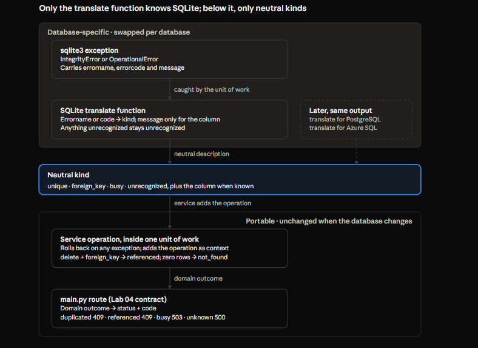

# SQLite Transactions & Integrity Patterns — Lab 05 Experiments A–G

Oct 26, 2026 · @zhe

## Reference

[complete-experiment](../backend/01-experiments-entry-level.md)

## Scope

Seven notebook experiments (A to G) established how SQLite, driven through Python's `sqlite3`, actually behaves on storage, visibility, identity, transactions, failures, contention and foreign keys, before any Lab 05 service code was written. Every design choice for the Lab 05 service rests on something observed here rather than remembered.

**Lab question:** which client invariants must the database enforce regardless of frontend behavior? These experiments answer the prerequisite: what does the database guarantee, what does the driver add, and what must the application do itself.

**How to read:** section 2 is the one-page summary. Sections 3 to 10 hold the patterns, each traced to the experiment that produced it. Section 11 sketches the error-translation design that follows from them. Section 12 marks what is SQLite-specific, since production may move to PostgreSQL or Azure SQL. Section 13 lists decisions and the checks still owed.

**Method used throughout:** a prediction written before each cell, the observation after it, and every contradiction noted. Each experiment used its own `.db` file, deleted at the start, and closed every connection at the end, because Jupyter keeps connections (and their locks) alive between cells.

## Experiments at a glance

| Exp | Question | What was observed | Lesson carried forward |
| --- | --- | --- | --- |
| A | Does data survive a close? What is `:memory:`? | File data survives once committed. Each `:memory:` connection is its own private database, gone on close. In `autocommit=False`, an uncommitted `CREATE TABLE` disappears on close | Use files for anything needing two connections; learn which behaviors are the driver's |
| B | Who sees uncommitted writes? | A connection sees its own uncommitted writes; others do not. A SELECT in `autocommit=False` left a read transaction open, and the writer's `commit()` then failed with `database is locked`; the write stayed pending and succeeded once the reader ended its transaction | End every transaction, reads included; one connection per request |
| C | Does rollback consume IDs? Can IDs be reused? | Rollback left no trace; the next insert took the rolled-back ID. Plain `INTEGER PRIMARY KEY` reused a deleted highest ID; `AUTOINCREMENT` never did | Identity = unique and never reassigned once committed |
| D | What belongs to one transaction? | Rollback undid every statement since the last commit; a commit in between fixed the earlier statement permanently | The transaction boundary is where `commit()` is called; place it per service operation |
| E | What does a failed statement undo? | `IntegrityError`, `SQLITE_CONSTRAINT_UNIQUE` (2067). Only the failed statement was undone; the transaction stayed open and usable | Database gives statement atomicity; only your rollback gives workflow atomicity |
| F | What does contention look like? | `OperationalError: database is locked` after the timeout. While the first writer was uncommitted, a duplicate attempt got a lock error, not a unique violation; after release, the retry surfaced the duplicate | A lock error means "not evaluated"; after rollback, retry is a fresh attempt |
| G | Are foreign keys enforced? | Off by default, per connection. Referenced delete with `ON DELETE RESTRICT`: 1811 `SQLITE_CONSTRAINT_TRIGGER`; orphan insert: 787 `SQLITE_CONSTRAINT_FOREIGNKEY`; same message. A connection without the PRAGMA deleted a referenced client unnoticed | Centralize connection creation, verify settings, fail closed |

## Library vs database: `sqlite3` transaction modes

Python's `sqlite3` module adds transaction behavior that SQLite itself does not have, so the first job was learning which behaviors belong to which layer. Portable code may depend only on the database's behavior and the DB-API's `commit()` / `rollback()`.

| `conn.autocommit` | What the module does | Seen in |
| --- | --- | --- |
| `-1` (`LEGACY_TRANSACTION_CONTROL`, the default on 3.12+) | Implicit `BEGIN` before INSERT, UPDATE, DELETE; none before SELECT or CREATE | A: `CREATE TABLE` ran with `in_transaction` False and persisted without `commit()` |
| `True` | Never issues `BEGIN`; every statement commits on its own | G, Cell 4: used briefly to set the FK PRAGMA |
| `False` | A transaction is always open; `commit()` and `rollback()` immediately open the next | A: `CREATE TABLE` left `in_transaction` True and vanished on close without commit |

**Chosen mode: `autocommit=False`.** It matches the default transaction model of psycopg (PostgreSQL) and pyodbc (Azure SQL): a transaction is open until the code explicitly commits or rolls back. It makes transaction boundaries explicit in application code, and it makes DDL transactional. The parameter name is `sqlite3`-specific; the model is portable.

**Instruments that made the experiments readable:** `sys.version` and `sqlite3.sqlite_version` (two different versions), `conn.isolation_level`, `conn.autocommit`, and `conn.in_transaction` printed after every statement. In `autocommit=False`, `in_transaction` is almost always True, so experiments from D onward used a second "observer" connection to see what was committed.

**Why not write `BEGIN` / `COMMIT` in SQL?** The keywords differ across databases (`BEGIN`, `START TRANSACTION`, `BEGIN TRANSACTION`), and they collide with driver-managed transactions: in `autocommit=False`, a SQL `BEGIN` fails with "cannot start a transaction within a transaction." The portable layer is the DB-API. What must be portable is the location of the boundary in service code, not the keywords.

**Other driver details worth keeping:**

- `with conn:` commits or rolls back, but does not close the connection.
- Parameters travel separately from SQL text. `?` is the placeholder for `sqlite3` and pyodbc; psycopg uses `%s`. A one-element parameter tuple needs its trailing comma: `("Farm A",)`.
- Placeholders carry values only, never SQL structure. Interpolating a column type or table name with an f-string is acceptable only for constants you wrote, never user input.
- `cur.lastrowid` is not reliably portable across drivers; `INSERT ... RETURNING id` works in SQLite 3.35+ and PostgreSQL, while SQL Server uses `OUTPUT`.

## Storage and connection lifetime (A)

The database is the file, not the connection: closing a file connection keeps everything that was committed. A `:memory:` database is the opposite: it belongs to one connection and disappears with it.

- `sqlite3.connect("experiment.db")` opens or creates a file. `sqlite3.connect(":memory:")` creates a brand-new database in RAM. `:memory:` replaces the filename; it is not an option added to it.
- Two connections to the same file share one database. Two `:memory:` connections are two unrelated databases: the second never saw the first's table, before or after a commit.
- In `autocommit=False`, an uncommitted `CREATE TABLE` vanished on close, and a second connection could not see the table until the first committed. DDL behaves like any other change in this mode.
- `sqlite_master` is SQLite's catalog: `SELECT name FROM sqlite_master WHERE type = 'table'` lists tables. Other databases expose their catalogs differently.

**What this means for testing:** `:memory:` gives a fresh, isolated database per connection, useful for single-connection test fixtures. Anything involving two connections to the same data (visibility, locking, contention) needs a file. A shared in-memory database exists through a URI (`file:...?mode=memory&cache=shared` with `uri=True`), but a file per test is simpler and behaves like the real thing.

## Visibility and locking (B)

In SQLite's default mode, a reader's stable view is bought by blocking writers' commits. An idle connection that has read something in `autocommit=False` keeps blocking every writer until it ends its transaction.

**What was observed, step by step:**

1. c1 inserted Farm A without committing; c1 saw it, c2 did not.
2. c2's SELECT in `autocommit=False` left c2 inside a read transaction holding a shared lock.
3. c1's `commit()` waited for its timeout, then raised `database is locked`. The change was not lost: c1's transaction stayed pending, and repeating the commit kept failing while c2's transaction was open.
4. After `c2.rollback()`, c1's commit succeeded and c2's next read saw Farm A.

**The lock levels behind it.** A reader holds a shared lock for the life of its transaction. A writer can still execute statements (it takes a reserved lock), but committing needs an exclusive lock, which waits until every shared lock is released. A lock blocks other writers and commits, not reads.

**Two strategies for one problem.** A reader needs a consistent view while others write. SQLite's default rollback-journal mode provides it by blocking: nobody may commit while a reader is inside a transaction. Snapshot isolation (MVCC) provides it by keeping versions: the reader keeps seeing the old version, and the writer commits without waiting. PostgreSQL uses versions; SQLite's WAL journal mode is version-like. Azure SQL Database is believed to enable a snapshot-style read-committed mode by default; verify before relying on it.

**Rules for the service:**

- Every transaction is ended explicitly, including transactions that only read.
- No long-lived shared connection. Each request opens (or borrows) a connection, does its work, commits or rolls back, and releases it.
- A `database is locked` at commit time leaves the transaction pending, not committed. Whether it becomes a confirmed non-commit depends on the code rolling it back (see Contention and safe retry).

## Identity and IDs (C)

The application's identity contract is: an ID is unique, and once committed it is never assigned to a different record. Gaps, ordering, and the fate of uncommitted IDs are database details the application must not rely on.

**What was observed:**

| Scenario | `INTEGER PRIMARY KEY` | `INTEGER PRIMARY KEY AUTOINCREMENT` |
| --- | --- | --- |
| Insert Farm B, roll back | Gone, no trace; next insert takes Farm B's attempted ID | Same |
| Delete the highest committed ID, insert a new client | New client receives the deleted ID | Deleted ID is never reused |

**Why reuse after deletion is a failure and reuse after rollback is not.** A rolled-back ID was never committed, so no response, list or browser tab ever saw it, and nobody can hold a reference to it. A committed ID may still sit in a stale tab. If it is reassigned, the stale tab's `PATCH /clients/<id>` silently renames a different client, a wrong-target mutation caused by nothing the user did wrong. With `AUTOINCREMENT`, the same request returns 404 `CLIENT_NOT_FOUND`, which the Lab 04 contract already handles.

**What the application assumes about IDs:** unique, and never reassigned once committed. Nothing else:

- Not gapless: PostgreSQL sequences are not rolled back, so failed inserts leave gaps; SQL Server `IDENTITY` is believed to jump (by about 1000) after a restart.
- Not next = max + 1: the database assigns IDs; the application only reads them back.
- Not commit-ordered: with concurrent sessions, ID 5 can commit after ID 6.
- Not meaningful: no counts or other facts derived from ID values.

The ID is an opaque handle, stored, sent, and compared for equality. The frontend already treats it that way (`data.id === clientId`).

**Declarations that provide the contract:** SQLite `INTEGER PRIMARY KEY AUTOINCREMENT`; PostgreSQL identity column or `serial`; Azure SQL `IDENTITY`. In each, a manual reseed or sequence reset can bring old IDs back, an operational caution worth one line in the schema notes.

**SQLite internals seen here:** `sqlite_sequence` exists only when a table uses `AUTOINCREMENT` and records the highest ID ever issued. `cur.lastrowid` returns the ID just assigned.

**Tier 3 for later:** JavaScript's `Number` represents integers exactly only up to 2^53, which is why some APIs send very large 64-bit IDs as strings.

## Transactions and atomicity (D, E)

The database makes each statement atomic; only the application's rollback makes a workflow atomic. Every service operation therefore runs inside exactly one unit of work that commits on success and rolls back on any exception.

**Boundaries (D).** Without a commit, any number of statements form one transaction, and `rollback()` undid all of them. With a commit between an UPDATE and a DELETE, the rollback undid only the DELETE. Commit is less a checkpoint than a closed door: it ends the transaction permanently, and rollback can only undo the transaction still open. (Partial undo inside an open transaction exists as `SAVEPOINT`; tier 3.)

**Two levels of atomicity (E).**

- Statement atomicity is the database's job. The failed duplicate INSERT left no trace, as if never attempted. A single statement touching many rows is undone entirely if it fails partway.
- Transaction atomicity is the application's job. After the failure, the earlier valid insert was still pending, the transaction remained open, and later statements ran normally. If a 5-statement workflow fails at statement 3 and something later commits, statements 1 and 2 persist: a partial workflow.

**The unit-of-work pattern that follows:**

- One helper owns the boundary: it provides the connection, commits on success, rolls back on any exception, and re-raises.
- Every service operation runs inside exactly one unit of work. Inserting a client and writing its audit row, when audit arrives, share one, so both persist or neither does.
- Error details live on the exception object, not the connection, so rolling back does not lose them.
- `rollback()` itself can raise (for example, a dead connection). The helper must not let that second error replace the original one, because the original explains what happened.
- Any SQLite-only setup (such as `BEGIN IMMEDIATE`, if ever needed) lives inside this helper and is marked as such.

**Atomicity removes partial states, not uncertainty.** It guarantees the outcome is all or nothing, but not which. If the connection drops while `COMMIT` is in flight, or the commit succeeds and the HTTP response is lost, the database is in exactly one of the two states and the caller does not know which. Retry is safe only after a confirmed rollback.

**Portability:** after an error, SQLite keeps the transaction open and usable; PostgreSQL marks the whole transaction aborted and refuses further statements until rollback. "Roll back on any exception" is correct for both.

## What SQLite reports on failure (E, F, G)

The exception class and message are too coarse to tell violations apart; `sqlite_errorname` and `sqlite_errorcode` (Python 3.11+) carry the kind, and the message is needed only to learn which column a unique violation hit.

| Situation | Class | `sqlite_errorname` | `sqlite_errorcode` | `str(err)` | Seen in |
| --- | --- | --- | --- | --- | --- |
| Duplicate on INSERT | `IntegrityError` | `SQLITE_CONSTRAINT_UNIQUE` | 2067 | `UNIQUE constraint failed: clients.name` | E |
| Duplicate on UPDATE | `IntegrityError` | expected same as above | expected 2067 | expected same | E, Cell 5 |
| Write while another connection holds the write lock | `OperationalError` | expected `SQLITE_BUSY` (confirm) | — | `database is locked` | B, F |
| Delete a referenced client, `ON DELETE RESTRICT` | `IntegrityError` | `SQLITE_CONSTRAINT_TRIGGER` | 1811 | `FOREIGN KEY constraint failed` | G |
| Insert a note for a missing client | `IntegrityError` | `SQLITE_CONSTRAINT_FOREIGNKEY` | 787 | `FOREIGN KEY constraint failed` | G |

**Reading the fields:**

- The kind comes from `sqlite_errorname` or `sqlite_errorcode`: stable, no parsing. Extended codes combine a base code with detail (2067 is base constraint code 19 extended with "unique").
- The message names the **column** (`clients.name`), never the constraint name you chose (`uq_clients_name`). On SQLite, the message is the only source for which unique constraint failed. Text parsing, where needed, stays inside the SQLite translation function.
- Both FK messages are identical, so the message cannot tell "referenced" from "parent missing."

**The 1811 vs 787 finding.** The codes differ, but most likely because of `ON DELETE RESTRICT`, not because one is a delete and the other an insert. SQLite is believed to enforce RESTRICT through an internal trigger-like action, so the violation surfaces as `SQLITE_CONSTRAINT_TRIGGER`. Under the default `NO ACTION`, a referenced delete is expected to report 787. This is still to be verified. Two reasons not to treat 1811 as meaning "client is referenced":

- It reflects how SQLite implements the rule, not what the rule means; changing the FK action would change the code.
- 1811 is also the code for a user-defined trigger that aborts, so a future business-rule trigger would produce the same code with a different meaning.

The translation function therefore maps 787, and 1811 with an FK message, to one neutral kind, `foreign_key`, and lets the operation supply the meaning.

## Contention and safe retry (F)

A lock error is not an answer: the database never evaluated the request. Once the backend has rolled back, the outcome is a confirmed non-commit, and a retry is a fresh attempt rather than a repeat. That makes contention the first candidate for the retry allowlist.

**What "database is locked" means.** Another connection holds the lock this operation needs (for a write, the write lock). Reads usually proceed in SQLite's default mode. The `timeout` argument sets how long `sqlite3` keeps retrying before raising; it defaults to 5 seconds and never waits forever. With `timeout=0`, the attempt fails immediately. The timeout is therefore a small server-side retry loop.

**Contention hides the business outcome.** While w1 held an uncommitted insert of Farm D, w2's insert of the same name got a lock error, not a unique violation: w2 learned only that it could not try. After w1 committed, the same retry surfaced the duplicate. Had w1 rolled back, the retry would have succeeded. A retry can come back as success, duplicate, or busy again, and each is already a classified outcome.

**When it is a confirmed non-commit.** In F, the INSERT itself failed, so nothing ran. In B, the lock error came at `commit()`, after statements had executed, leaving the transaction pending. In both cases the outcome becomes a confirmed non-commit only once the backend rolls back, which the unit of work does for every exception.

**Proposed contract entry (to confirm in design):**

| Scenario | HTTP | Code | Commit | Frontend recovery |
| --- | --- | --- | --- | --- |
| Write blocked by contention after the busy timeout | 503 | `SERVICE_BUSY` | Not committed (rolled back) | retry, with the draft preserved |

- The code says nothing about databases, keeping the contract independent of storage technology.
- The message describes a wait of seconds, not minutes; contention clears when the other transaction ends. A `Retry-After` header is optional.
- Status-code agreement is what makes this safe: proxies also emit bare 503s, which stay unknown. Only 503 with `SERVICE_BUSY` becomes retryable.
- Retry is offered to the user, not automatic, beyond the driver's own busy timeout.

**Timeouts stack.** The driver's busy timeout runs before the user is involved. It must stay well below the frontend's long-request threshold (10 s in the spec); otherwise the user sees Keep Waiting / Stop Waiting for what is really contention. Each inner layer must give up before the outer layer starts treating silence as uncertainty.

**Lost responses stay unknown.** If w2's commit succeeded and the HTTP response never reached the browser, the frontend cannot know, so the Lab 04 contract applies: unknown, refresh, never retry. A database can only confirm what happened up to the moment it answered.

**Not explored (tier 3):** both connections reading before writing (the lock-upgrade case `BEGIN IMMEDIATE` exists for), and WAL journal mode.

## Referential integrity in SQLite (G)

SQLite enforces foreign keys only on connections that opt in, and the opt-in is silently ignored inside an open transaction. An invariant each connection must opt into is only as strong as the weakest connection, so connection creation is centralized, verified, and fails closed.

**What was observed:**

- Enforcement is off by default. With it off, deleting a referenced client succeeded, leaving a note that points at nothing.
- Enforcement is set per connection with `PRAGMA foreign_keys = ON` and read back with `PRAGMA foreign_keys` (1 on, 0 off).
- With enforcement on: a referenced delete raised 1811 and an orphan insert raised 787 (see What SQLite reports on failure). An unreferenced delete succeeded.
- A second connection without the PRAGMA deleted a referenced client and committed while an enforced connection was open. The enforced connection did not notice; enforcement checks only changes made through that connection.

**Why `autocommit` matters to a PRAGMA.** `PRAGMA foreign_keys` is not a data change to commit; it is a connection setting, and SQLite refuses to change it while a transaction is open, without raising an error. In `autocommit=False`, the module keeps a transaction open at all times, so there is never a moment for the PRAGMA to take effect. The working order: connect with `autocommit=True`, set the PRAGMA, read it back, then switch `conn.autocommit = False` (settable on Python 3.12+). The setting survives the switch because it belongs to the connection.

**Rules for the service:**

- Every connection the application creates comes from one function, so no code path can forget the setup.
- That function sets the PRAGMA before any transaction, reads it back, and raises if it is not 1. A silently ignored setting is how the careless delete happened.
- Connections outside the application are careless too: the `sqlite3` command-line tool and GUI browsers also default to enforcement off. `PRAGMA foreign_key_check` lists every row currently violating a foreign key, regardless of enforcement; run it at startup or in tests to detect damage done elsewhere.
- The meaning of a foreign-key violation comes from the operation: during "delete client" it means referenced; during "insert note" it means the parent is missing.

**SQLite-specific:** the PRAGMA, its default, its transaction restriction, and `foreign_key_check`. PostgreSQL and Azure SQL always enforce foreign keys, so the weakest-link trap disappears there; the constraint design and error translation carry over.

## Translation layer

The design that follows from E, F and G: one small database-specific function turns a driver exception into a neutral kind, and everything after it stays the same when the database changes. Moving to PostgreSQL or Azure SQL means writing one more translate function with the same output shape.

The meaning of a kind comes from the operation that triggered it, never from the error alone.

| Neutral kind | Create | Update | Delete |
| --- | --- | --- | --- |
| `unique` | duplicated → 409 `DUPLICATE_CLIENT` | duplicated → 409 `DUPLICATE_CLIENT` | not expected |
| `foreign_key` | not expected for `clients` | not expected for `clients` | referenced → 409 `CLIENT_REFERENCED` |
| `busy` | busy → 503 `SERVICE_BUSY` (proposed) | same | same |
| unrecognized | re-raised → 500 → frontend unknown | same | same |
| zero rows affected (not an exception) | — | not\_found → 404 `CLIENT_NOT_FOUND` | not\_found → 404 `CLIENT_NOT_FOUND` |

What stays out of scope for now: a plugin system or abstract base class for future databases. The seam is the function's output shape; building more than the seam is speculative until a second database exists.

## Portability map

The concepts carry over unchanged; the spellings, defaults and error shapes do not. Everything in the SQLite column is to be clearly marked in Lab 05 code so it can be swapped.

| Concern | SQLite (via `sqlite3`) | PostgreSQL / Azure SQL | Portable rule |
| --- | --- | --- | --- |
| Transaction mode | `autocommit=False` (3.12+) | psycopg / pyodbc default to autocommit off | Explicit `commit()` / `rollback()` through the DB-API |
| Transaction boundary | One unit-of-work helper | Same helper, different driver | Boundary at the service-operation level |
| Readers vs writers | Default mode: readers block commits | Versions (PostgreSQL); Azure SQL believed snapshot-style by default | End every transaction, reads included |
| Identity | `INTEGER PRIMARY KEY AUTOINCREMENT` | Identity column / `serial`; `IDENTITY` | Unique, never reassigned once committed; nothing else assumed |
| After a failed statement | Transaction stays open and usable | PostgreSQL: transaction aborted until rollback | Roll back on any exception |
| Placeholder | `?` | `%s` (psycopg); `?` (pyodbc) | Values never formatted into SQL text |
| Inserted ID | `lastrowid` or `RETURNING` (3.35+) | `RETURNING` (PostgreSQL); `OUTPUT` (SQL Server) | Database assigns; application reads back |
| Unique violation | `SQLITE_CONSTRAINT_UNIQUE`; column in message | SQLSTATE `23505`, constraint name structured (PostgreSQL); error 2627 / 2601 (SQL Server) | Neutral kind `unique` |
| FK violation | 787, or 1811 with RESTRICT; message names nothing | SQLSTATE `23503` (PostgreSQL); error 547 (SQL Server) | Neutral kind `foreign_key`; meaning from operation |
| Contention | `OperationalError`, `database is locked` | Lock-timeout and deadlock errors with their own codes | Neutral kind `busy`; retry only after rollback |
| FK enforcement | Per-connection PRAGMA, off by default | Always on | Centralized connection creation |
| Catalog | `sqlite_master`, `sqlite_sequence` | Information schema / system catalogs | Not used by application logic |

The PostgreSQL and Azure SQL entries come from documentation knowledge, not from these experiments; each is verified when its translation function is written.

## Decisions and open items for the design

The experiments settle the connection, transaction and identity rules; the schema's remaining choices and four quick verifications are still open.

**Decided by the experiments:**

- Driver mode `autocommit=False`, with the FK PRAGMA set while `autocommit=True` and verified before switching (A, G).
- `INTEGER PRIMARY KEY AUTOINCREMENT` for `clients`: G-01 requires committed IDs never be reassigned; plain `INTEGER PRIMARY KEY` reuses the highest deleted ID (C).
- One connection per request; every transaction ended, reads included (B).
- One unit-of-work helper per service operation: commit on success, roll back on any exception, original error preserved (D, E).
- Translation to neutral kinds (`unique`, `foreign_key`, `busy`, unrecognized) from errorname or code; message parsed only for the column; meaning supplied by the operation (E, F, G).
- Connection creation centralized, PRAGMA read back, fail closed (G).

**Proposed, to confirm in design:**

- New contract row: 503 `SERVICE_BUSY`, not committed, recovery `retry`, the first entry in the retry allowlist (F).
- Driver busy timeout of a few seconds, well under the frontend's 10 s threshold (F).
- Audit records stay out of Lab 05 scope (roadmap), but the unit of work is ready for a second statement.

**Verifications still owed (quick notebook checks):**

- [ ] Print `conn.autocommit` on a default connection and confirm whether it reads `-1` or `True`.
- [ ] In `autocommit=False`, run the FK PRAGMA, call `commit()`, read it back: confirms that committing does not make it take effect.
- [ ] Recreate `client_notes` without `ON DELETE RESTRICT` and rerun the referenced delete: does it report 787 instead of 1811?
- [ ] Confirm the `sqlite_errorname` of the lock error (expected `SQLITE_BUSY`).

**Open design questions:**

- Where is the normalized name key computed: in Python and stored, or by the database? A database-computed key survives writers that bypass the service, but SQLite has no built-in regex replace and the expression differs per database.
- Is there a CHECK constraint for the whitespace-only rule, so even a careless connection cannot store a blank name?
- Which dependent table stands in for real dependents in the lab, and which FK action does it use?
- How is "not found" detected now that it no longer comes from a Python list, for example from an UPDATE or DELETE affecting zero rows?
