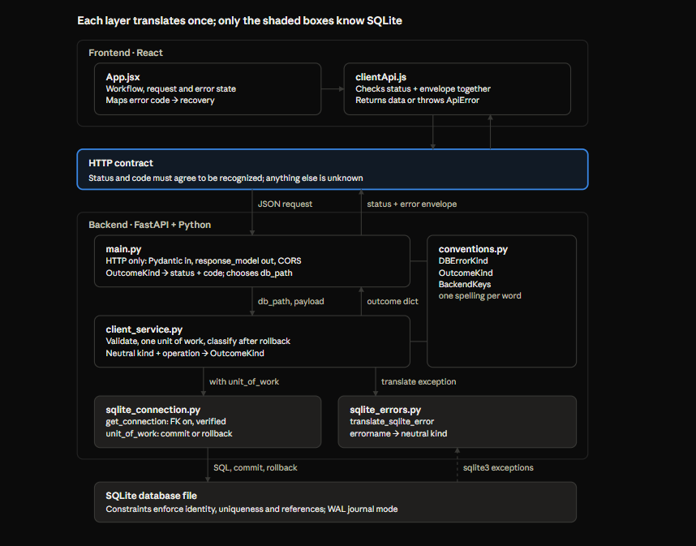

# Database Integrity & Backend Patterns — Lab 05

Oct 26, 2026 · @zhe

## Scope

Lab 05 answered: which client invariants must the database enforce regardless of frontend behavior, and how does the backend turn what the database reports into the outcomes the Lab 04 contract already defines? The answer is a small SQLite schema with named constraints, one connection and transaction helper, one database-specific error translator, a service layer that adds operation context, and routes that stayed almost unchanged from Lab 04.

**What was built:**

- A SQLite schema for `clients` with `AUTOINCREMENT` identity and a unique normalized-name key.
- `get_connection` and `unit_of_work`: connection setup with verified FK enforcement, commit on success, rollback on any exception.
- `translate_sqlite_error`: driver exception to neutral kind.
- `conventions.py`: `StrEnum` vocabularies for error kinds, service outcomes and dictionary keys.
- `client_service.py`: list, create, update and delete, each in one unit of work.
- `main.py` rewired from the simulated service to the real one, plus a `SERVICE_BUSY` (503) contract row.
- `init_db.py` to build and seed a database, with WAL journal mode.
- A pytest suite across the database, service and API layers.

**Companion docs:**

- *SQLite Transactions & Integrity Patterns — Lab 05 Experiments A–G*: the notebook experiments that established how SQLite behaves before any of this code was written. This doc builds on them rather than repeating them.
- *Python Unit Testing with pytest*: the mechanics and patterns of the test suite.
- *HTTP Contract & API Boundary Patterns — Lab 04*: the contract this lab's backend now fulfils with a real database.

**How to read:** section 2 is the map. Sections 3 to 7 follow one request from the schema up to the service. Section 8 joins all the layers into one protocol. Section 9 is what concurrency looked like in the running system. Sections 10 to 12 are the mechanics, the failure log, and what is handed forward.

## Architecture

A request now runs from the React UI through the HTTP contract into a three-layer backend that ends at a real SQLite file. Each layer translates the answer once on its way back up, and only the database layer knows it is talking to SQLite.



| File | Responsibility | Must not |
| --- | --- | --- |
| `main.py` | HTTP: request validation, response shape, CORS, outcome to status and code, choosing `db_path` | Contain SQL or decide business outcomes |
| `client_service.py` | Business rules: validation, one unit of work per operation, kind plus operation to outcome | Know HTTP or SQLite error details |
| `conventions.py` | The shared vocabulary: error kinds, outcomes, keys | Contain behavior |
| `sqlite_connection.py` | Connection setup and the transaction boundary | Know HTTP or domain outcomes |
| `sqlite_errors.py` | SQLite exception to neutral kind | Know which operation ran |
| `schema.sql` | Tables and named constraints | Hold test-only tables |
| `init_db.py` | Build a fresh database, set WAL, seed through `unit_of_work` | Bypass FK enforcement |

**Repo layout:**

```
backend/
├── pyproject.toml
├── init_db.py
├── main.py
├── app/
│   ├── config.py
│   ├── conventions.py
│   ├── services/   (client_service.py, naming.py)
│   └── db/         (sqlite_connection.py, sqlite_errors.py, schema.sql)
├── tests/          (conftest.py, helpers.py, test_*.py)
└── notebooks/      (experiments, kept as a record)
```

**Imports point one way:** `main` imports `services`, `services` imports `db` and `conventions`, never the reverse. Two text searches verify the boundaries: `import sqlite3` should appear only in `db/sqlite_*` files (and tests), and `fastapi` only in `main.py`. A violation is visible the moment it is written.

**Run everything from `backend/`** (uvicorn, pytest, Jupyter), so `from app...` imports resolve and relative paths point where you expect.

## Schema patterns

The schema enforces identity and uniqueness; non-blank names and key consistency are enforced by the service, under the documented assumption that the Python backend is the only writer.

```sql
CREATE TABLE clients (
    id INTEGER PRIMARY KEY AUTOINCREMENT,
    name TEXT NOT NULL,
    name_standardized TEXT NOT NULL,
    modified_by TEXT NOT NULL,
    CONSTRAINT uq_client_name UNIQUE (name_standardized)
)
```

**Identity: `AUTOINCREMENT`, because committed IDs must never be reassigned.** Plain `INTEGER PRIMARY KEY` reuses a deleted highest ID, so a stale tab's `PATCH /clients/<id>` could rename a different client. With `AUTOINCREMENT`, the same request returns 404. A test deletes the highest ID and checks the next one is larger, so dropping `AUTOINCREMENT` would fail the suite (G-01).

**Uniqueness lives on the normalized key, not the display name.** `name` keeps what the user typed (trimmed); `name_standardized` holds the comparison form, and the UNIQUE constraint is on it. Two clients cannot differ only by case or whitespace.

**The normalized key is computed in Python.** `string_normalize` lowercases, strips leading and trailing whitespace, and collapses each run of internal whitespace into one underscore:

```python
def string_normalize(text: str) -> str:
    return re.sub(r'\s+', '_', text.strip().lower())
```

Computing it in Python is portable and simple (SQLite has no built-in regex replace). The trade-off: a writer that bypasses the service could store a key that does not match its name. That is accepted while the backend is the only writer.

**What the database enforces, and what it does not:**

| Rule | Enforced by | Notes |
| --- | --- | --- |
| IDs never reassigned | Database (`AUTOINCREMENT`) | Tested |
| No duplicate normalized names | Database (UNIQUE) | Race-safe: two simultaneous creates cannot both succeed |
| Every column present | Database (NOT NULL) | A violation means a code bug, not user input |
| Referenced clients cannot be deleted | Database (FK, `ON DELETE RESTRICT`) | Requires the FK PRAGMA on every connection |
| Name is not blank | Service (`INVALID_NAME` before any write) | NOT NULL does not mean non-empty: `''` passes |
| Key matches the display name | Service | Accepted gap under the single-writer assumption |

**NOT NULL is not "non-empty".** `string_normalize("   ")` returns `''`, which NOT NULL accepts. Without the service check, the first blank client would be stored and every later one rejected as a duplicate of it. A `CHECK (name_standardized <> '')` would close this in the database; it was deferred by scoping.

**Schema hygiene:** no `IF NOT EXISTS` in the schema file, because it silently keeps an old table when the schema changes. Every constraint is named, which costs nothing and helps on databases that report constraint names.

**SQLite-specific:** `AUTOINCREMENT` (PostgreSQL uses identity columns, Azure SQL `IDENTITY`).

## Connection and unit-of-work patterns

Every database access goes through two functions: `get_connection` configures and verifies a connection, and `unit_of_work` owns the transaction boundary. Only `unit_of_work` may commit or roll back.

```python
def get_connection(db_path: str, timeout: float | None = None) -> sqlite3.Connection:
    if timeout is None:
        timeout = BUSY_TIMEOUT
    conn = sqlite3.connect(db_path, autocommit=True, timeout=timeout)
    conn.execute("PRAGMA foreign_keys = ON")
    if conn.execute("PRAGMA foreign_keys").fetchone()[0] != 1:
        conn.close()
        raise RuntimeError("Connection with FK constraint cannot be established.")
    conn.autocommit = False
    return conn

@contextmanager
def unit_of_work(db_path: str, timeout: float | None = None):
    conn = get_connection(db_path, timeout=timeout)
    try:
        yield conn
        conn.commit()
    except BaseException:
        try:
            conn.rollback()
        except sqlite3.Error:
            pass
        raise
    finally:
        conn.close()
```

**Why each part is there:**

- **Connect with `autocommit=True`, set the PRAGMA, then switch to `False`.** SQLite ignores `PRAGMA foreign_keys` inside an open transaction, and in `autocommit=False` a transaction is always open. The setting belongs to the connection, so it survives the switch.
- **Read the PRAGMA back and fail closed.** A silently ignored setting is how a careless connection deleted a referenced client in experiment G.
- **`timeout=None`, resolved inside.** A default argument is evaluated once at definition; resolving at call time lets tests shorten the busy timeout.
- **`commit()` sits inside the `try`.** A `database is locked` at commit goes to `except`, gets rolled back, and becomes a confirmed non-commit.
- **`except BaseException` with `raise`.** It never swallows; it only guarantees rollback for any kind of exit, including bugs (`KeyError`), domain exceptions and Ctrl+C.
- **Nested `try` around `rollback()`.** If rollback itself fails, the bare `raise` still re-raises the original exception, which explains what went wrong.
- **`finally: conn.close()`.** Cleanup that applies on every exit. `commit()` never goes in `finally`, because `finally` also runs after failures.

**How an exception reaches the unit of work.** A `@contextmanager` generator pauses at `yield` while the `with` body runs. If the body raises, the exception is thrown into the generator at the `yield` line, so the rollback runs. If the body ends normally, execution continues after `yield` and commits. An exception caught inside the `with` body never reaches the generator, so the block counts as a success and commits; that is how the first rollback test committed a partial transaction.

**Rules that follow:**

- Code inside a unit of work never swallows database exceptions; it lets them propagate, or catches, translates and re-raises.
- No helper that touches a connection calls `commit()` or `rollback()`. A transaction belongs to the connection, so a helper that ends "its" transaction ends everyone's.
- Reads run in a unit of work too, so the read transaction always ends.
- Return results after the `with` block, so nothing is reported until the commit succeeded.
- Never do slow work inside a unit of work (section 9).

**SQLite-specific:** the PRAGMA dance, `autocommit` as a parameter name, and `sqlite3.Error` in the rollback guard.

## Error translation patterns

One small function knows how SQLite reports errors and turns any exception into a neutral kind. Everything above it speaks only in neutral kinds, so moving to PostgreSQL or Azure SQL means writing one more translator with the same output.

```python
def translate_sqlite_error(err: BaseException) -> DBErrorKind:
    if not isinstance(err, sqlite3.Error):
        return DBErrorKind.UNRECOGNIZED
    error_name = getattr(err, "sqlite_errorname", None)
    if not error_name:
        return DBErrorKind.UNRECOGNIZED
    if "sqlite_busy" in error_name.lower():
        return DBErrorKind.BUSY
    match error_name:
        case "SQLITE_CONSTRAINT_UNIQUE": return DBErrorKind.UNIQUE
        case "SQLITE_CONSTRAINT_NOTNULL": return DBErrorKind.NOT_NULL
        case "SQLITE_CONSTRAINT_FOREIGNKEY": return DBErrorKind.FOREIGN_KEY
        case "SQLITE_CONSTRAINT_TRIGGER":
            if "foreign key" in str(err).lower():
                return DBErrorKind.FOREIGN_KEY
    return DBErrorKind.UNRECOGNIZED
```

**Reading order and why:**

- **The kind comes from `sqlite_errorname`,** stable and needing no parsing (Python 3.11+). The exception class and message are too coarse: both FK violations raise `IntegrityError` with the same message.
- **Busy matches by prefix,** because SQLite has extended busy names (`SQLITE_BUSY_SNAPSHOT` in WAL mode).
- **1811 counts as `FOREIGN_KEY` only with an FK message.** SQLite reports a RESTRICT delete as `SQLITE_CONSTRAINT_TRIGGER`, but 1811 is also the code for a user-defined trigger that aborts. The code reflects how SQLite implements the rule, not what the rule means.
- **Non-FK triggers go to `UNRECOGNIZED`.** There is no trigger contract yet, so the safe default applies instead of a category nobody handles.
- **Anything unknown is `UNRECOGNIZED`,** including non-SQLite exceptions, missing tables and future error kinds.

**Neutral kinds and what produces them:**

| Kind | SQLite signal | Meaning decided by |
| --- | --- | --- |
| `UNIQUE` | `SQLITE_CONSTRAINT_UNIQUE` (2067) | Create or update: duplicate name |
| `NOT_NULL` | `SQLITE_CONSTRAINT_NOTNULL` (1299) | Never mapped: only a code bug can cause it |
| `FOREIGN_KEY` | 787, or 1811 with an FK message | Delete: client is referenced |
| `BUSY` | `SQLITE_BUSY*` (5) | Any operation: contention, rolled back |
| `UNRECOGNIZED` | Everything else | Never mapped: becomes `UNKNOWN` |

**The operation supplies the meaning.** A foreign-key violation during "delete client" means referenced; during "insert note" it would mean the parent is missing. The translator does not know which operation ran, so it returns a kind, and the service decides.

**Deferred:** returning the column for unique violations. `clients` has one unique column, so it would carry no information yet.

## Shared vocabulary: `conventions.py`

Every word that one layer produces and another compares against is defined once, as a `StrEnum` member. A misspelled member fails loudly; a misspelled string fails silently.

```python
class DBErrorKind(StrEnum):
    UNIQUE = "unique"
    NOT_NULL = "not_null"
    FOREIGN_KEY = "foreign_key"
    BUSY = "busy"
    UNRECOGNIZED = "unrecognized"

class OutcomeKind(StrEnum):
    REFRESHED = "refreshed"
    CREATED = "created"
    UPDATED = "updated"
    DELETED = "deleted"
    DUPLICATED = "duplicated"
    INVALID_NAME = "invalid_name"
    NOT_FOUND = "not_found"
    REFERENCED = "referenced"
    DATABASE_BUSY = "database_busy"
    UNKNOWN = "unknown"

class BackendKeys(StrEnum):
    OUTCOME = "outcome"
    RESULT = "result"
```

**Why enums instead of strings.** The Lab 04 frontend had `"DUPLICATED_CLIENT"` in one file and `"DUPLICATE_CLIENT"` in another; the safe default absorbed the typo and duplicates silently lost their drafts. With enums, `OutcomeKind.DUPLICATD` raises `AttributeError` the first time the line runs, and editors autocomplete members before that.

**`StrEnum` members are also strings.** `OutcomeKind.CREATED == "created"` is True, members print as their value, and they hash like their value, so `result[BackendKeys.OUTCOME]` and `result["outcome"]` find the same entry. The convenience has a cost: comparing against a literal still works, so the protection holds only if code compares against members. The rule is "never write the literal."

**Each vocabulary belongs to one boundary:**

| Enum | Produced by | Consumed by |
| --- | --- | --- |
| `DBErrorKind` | `translate_sqlite_error` | Service operations |
| `OutcomeKind` | Service operations | Routes in `main.py` |
| `BackendKeys` | Service operations | Routes and tests |

**Words with two meanings.** `DBErrorKind.UNRECOGNIZED` means "an error the translator does not know." `OutcomeKind.UNKNOWN` is the service's catch-all outcome. Neither is the Lab 04 "unknown outcome" (commit uncertain): an unrecognized error inside a unit of work is usually followed by a rollback, a known non-commit. The route maps both to 500, which the frontend treats as unknown; that decision is made at the HTTP layer, not implied by the word.

**Kinds only exist if they can occur.** `TRIGGER` lingered in `DBErrorKind` after the translator stopped producing it, and belongs out of it; an enum listing impossible members invites code that handles them.

## Service operation patterns

Every service operation has the same shape: validate before touching the database, do the work in one unit of work, classify any failure after the rollback, and return an outcome dictionary only after the commit.

```python
def modify_client(db_path: str, client_id: int, name: str, modified_by: str = "Test User"):
    name_standardized = string_normalize(name)
    if name_standardized == "":
        return {BackendKeys.OUTCOME: OutcomeKind.INVALID_NAME}
    try:
        with unit_of_work(db_path) as conn:
            cur = conn.execute(
                """UPDATE clients SET name = ?, name_standardized = ?, modified_by = ?
                   WHERE id = ? RETURNING id, name, modified_by""",
                (name.strip(), name_standardized, modified_by, client_id),
            )
            cols = [c[0] for c in cur.description]
            rows = cur.fetchall()
        if not rows:
            return {BackendKeys.OUTCOME: OutcomeKind.NOT_FOUND}
        return {BackendKeys.OUTCOME: OutcomeKind.UPDATED,
                BackendKeys.RESULT: dict(zip(cols, rows[0]))}
    except Exception as err:
        kind = translate_sqlite_error(err)
        if kind == DBErrorKind.UNIQUE:
            return {BackendKeys.OUTCOME: OutcomeKind.DUPLICATED}
        if kind == DBErrorKind.BUSY:
            return {BackendKeys.OUTCOME: OutcomeKind.DATABASE_BUSY}
        return {BackendKeys.OUTCOME: OutcomeKind.UNKNOWN}
```

**The pattern, step by step:**

1. **Validate first.** A blank normalized name returns `INVALID_NAME` before any connection opens; that ordering is what lets the contract say "not committed." It also sets precedence: an invalid name on a missing client is 422, not 404.
2. **The `try` wraps the whole `with`.** Every error passes through the rollback before it is classified.
3. **`RETURNING` gives the stored row from the same statement.** No second query, and it answers "did a row match?": no rows means `NOT_FOUND`. That replaced the original `SELECT changes()` idea entirely.
4. **Read every `RETURNING` row with `fetchall()` before the block ends.** A `RETURNING` statement is not finished until its rows are read; committing while it is in progress can fail.
5. **Return after the `with` block.** Success is reported only once the commit succeeded.
6. **Classify with operation context.** Only the kinds this operation can meaningfully produce are mapped; everything else becomes `UNKNOWN`.

**Per operation:**

| Operation | SQL | Not found by | Mapped kinds |
| --- | --- | --- | --- |
| `client_list` | `SELECT id, name, modified_by ... ORDER BY id` | — | `BUSY` |
| `append_client` | `INSERT ... RETURNING id, name, modified_by` | — | `UNIQUE`, `BUSY` |
| `modify_client` | `UPDATE ... WHERE id = ? RETURNING ...` | No rows returned | `UNIQUE`, `BUSY` |
| `remove_client` | `DELETE ... WHERE id = ? RETURNING id` | No rows returned | `FOREIGN_KEY` → referenced, `BUSY` |

**`db_path` is required, never defaulted.** The caller decides which database to use; nothing silently falls back to a local file. That keeps the routes as the single place that chooses the database, which becomes a connection string in the cloud. Because it is required, it comes first in every signature: Python requires parameters without defaults before those with defaults.

**Rows to dictionaries through `cur.description`.** `[c[0] for c in cur.description]` gives the column names of the result, so `dict(zip(cols, row))` builds `{"id": ..., "name": ..., "modified_by": ...}` without hard-coding positions, and the response contains exactly the selected columns.

**Accepted for delivery, to tighten later:** `except Exception` converts unrecognized failures into `UNKNOWN` without logging. Adding `logger.exception(...)` before that return is the next reliability step; without it, a bug such as the `change()` typo is invisible except as "outcome unknown."

**SQLite-specific:** `RETURNING` (SQLite 3.35+ and PostgreSQL; Azure SQL uses `OUTPUT inserted.*`), the `?` placeholder, and the translator import.

## The complete communication protocol

With Lab 05, every failure has a defined path from the database row to the button the user sees. Each layer translates once: SQLite signal to neutral kind, kind plus operation to service outcome, outcome to HTTP status and code, code to frontend recovery.

| Situation | SQLite signal | Kind | Service outcome | Transaction | HTTP | Frontend type | Recovery |
| --- | --- | --- | --- | --- | --- | --- | --- |
| List loaded | rows | — | `REFRESHED` | read, ended | 200 | — | show list |
| Created | 1 row returned | — | `CREATED` | committed | 201 | success | refresh |
| Updated | 1 row returned | — | `UPDATED` | committed | 200 | success | refresh |
| Deleted | 1 row returned | — | `DELETED` | committed | 204 | success | refresh |
| Blank name | (no database call) | — | `INVALID_NAME` | none | 422 `INVALID_CLIENT_NAME` | non-retryable | return-to-draft, draft discarded |
| Duplicate name | 2067 | `UNIQUE` | `DUPLICATED` | rolled back | 409 `DUPLICATE_CLIENT` | non-retryable | return-to-draft |
| Client gone | 0 rows returned | — | `NOT_FOUND` | committed, no change | 404 `CLIENT_NOT_FOUND` | non-retryable | refresh |
| Client referenced | 1811 / 787 | `FOREIGN_KEY` | `REFERENCED` | rolled back | 409 `CLIENT_REFERENCED` | non-retryable | return-to-table |
| Contention | 5 `SQLITE_BUSY` | `BUSY` | `DATABASE_BUSY` | rolled back | 503 `SERVICE_BUSY` | non-retryable (v1) | refresh |
| Anything else | any | `UNRECOGNIZED` | `UNKNOWN` | rolled back | 500 | unknown | refresh |
| No response | — | — | — | unknown | none | unknown | refresh |

**How to read a row.** Left to right is the path of one request's answer. Each column is owned by one file: the SQLite signal by the database, the kind by `translate_sqlite_error`, the outcome by `client_service.py`, the status and code by `main.py`, the type by `clientApi.js`, and the recovery by `App.jsx`. Changing the database replaces only the first two columns' producers.

**Contract decisions recorded in this lab:**

- `SERVICE_BUSY` is a confirmed non-commit: the backend rolls back before responding. It is non-retryable in v1 only because Retry is not implemented; it is the first candidate for the retry allowlist.
- `return-to-draft` keeps the draft except for whitespace-only input, where the draft is discarded. The frontend should decide this by `code === "INVALID_CLIENT_NAME"`, which covers both the frontend check and the backend 422.
- A busy GET leads to a refresh: for a read there is nothing to reconcile.
- The adapter needs a 503 branch recognizing `SERVICE_BUSY`; without it, a busy response falls to unknown and tells the user the server may have completed an operation it is known not to have completed.

**A safe default at every layer.** Each translation step has a fallback for anything it does not recognize: `UNRECOGNIZED`, then `UNKNOWN`, then a 500, then the frontend's unknown classification and a refresh. A bug at any layer therefore degrades to "refresh and verify", never to a false success or an unsafe retry.

## Concurrency in practice

A deliberate delay in `unit_of_work` reproduced experiment B through the running system: a refresh's read transaction made a pending create fail at commit. Every layer reported the truth, but the episode showed that slow work inside a transaction turns into failures for other users.

**The simulation.** A `time.sleep(5)` between `yield` and `commit()` held every unit of work open for 5 seconds, with `BUSY_TIMEOUT = 1`.

- **Two simultaneous creates:** the second create's INSERT needed the write lock the first held, failed after 1 s, and returned 503. As designed.
- **Create, then Stop Waiting and Refresh after 2 s:** the create failed with 503 and the refresh succeeded.

**Why the second case failed:**

| Time | Create (POST) | Refresh (GET) |
| --- | --- | --- |
| 0 s | INSERT takes the write lock; sleeps before commit | — |
| 2 s | sleeping | SELECT takes a shared lock; sleeps before its own commit |
| 5 s | `commit()` needs the exclusive lock, which waits for every shared lock to clear | holding its shared lock |
| 6 s | busy timeout expires: `SQLITE_BUSY` at commit, rollback, 503 | sleeping |
| 7 s | — | read ends, 200, list without the new client |

**Every layer told the truth.** The create was rolled back (a confirmed non-commit), the backend reported 503 `SERVICE_BUSY`, the frontend silently ignored the late rejection of an abandoned request (nothing was committed, so nothing needed saying), and the refreshed list correctly lacked the client.

**Lessons:**

- **A transaction held open is a lock held open.** In SQLite's default mode, any read transaction that stays open (a slow query, slow processing inside the `with` block, a network call) blocks every writer's commit for that long. Keep units of work short; never wait, sleep or call external services inside one.
- **Simulate delay where the real delay would be.** To test a slow write, put the delay in the write path (inside `append_client`), not in `unit_of_work`, which slows reads too. With that placement, the refresh finishes in milliseconds, the create commits, and its late 201 triggers the "Previous Request Completed" notice: the Lab 03 abandoned-request scenario verified against a real database.
- **WAL mode removes this reader-writer conflict.** `PRAGMA journal_mode = WAL` lets readers see a snapshot while a writer commits, the "keep versions" strategy that PostgreSQL uses by default. Unlike `foreign_keys`, the journal mode is stored in the database file, so `init_db.py` sets it once, on an `autocommit=True` connection, because SQLite refuses to change it inside a transaction.
- **Timeouts stack.** The driver's busy timeout (a few seconds, 5 s by default) must stay well under the frontend's 10 s long-request threshold, so contention resolves or fails before the user sees Keep Waiting.
- **Remove simulated delays after use,** so one never reaches a commit.

## Python mechanics encountered

These are the language and library behaviors the patterns above depend on, sorted by layer and by depth needed (tier 1: mechanically; tier 2: purpose and failure modes; tier 3: look up when needed).

**How exceptions travel (tier 1).** `raise` stops the current line and unwinds outward through blocks and callers until the first matching `except`. Catching ends the journey: after the handler, execution continues after the `try` statement, and nothing further out sees the error. A bare `raise` inside a handler resumes the journey. If nothing matches, the program stops with a traceback, which lists the path the exception travelled.

**Matching is by class (tier 1).** `except X` catches `X` and every subclass:

```
BaseException
├── KeyboardInterrupt, SystemExit, GeneratorExit
└── Exception
    ├── ValueError, KeyError, TypeError, AttributeError, RuntimeError, …
    └── sqlite3.Error
        └── sqlite3.DatabaseError
            ├── IntegrityError      (unique, NOT NULL, foreign key)
            └── OperationalError    (database is locked, no such table)
```

`except sqlite3.Error` does not catch a `KeyError`; `except BaseException` catches everything, including Ctrl+C. **Catch narrowly when you handle an error, broadly only when you clean up and re-raise.** The `sqlite3` classes follow PEP 249, so psycopg and pyodbc use the same names.

| Mechanic | Layer | Tier | What to remember |
| --- | --- | --- | --- |
| `@contextmanager` and `yield` | Python stdlib | 1 | The body's exception is thrown in at `yield`; a normal end resumes after it |
| `try` / `except` / `finally` | Python | 1 | `finally` runs on every exit; never commit there |
| Bare `raise` after a nested `try` | Python | 2 | Re-raises the outer, original exception |
| `raise X from err` | Python | 2 | Chains the cause for diagnostics |
| Default argument evaluation | Python | 1 | Evaluated once at definition; use `None` and resolve inside to read a setting per call |
| Names in a function body | Python | 1 | Looked up at call time, which is why `monkeypatch` can replace them |
| `from module import NAME` | Python | 1 | Copies the name into the importing module; patch where it is looked up |
| `StrEnum` | Python 3.11+ | 2 | Members equal and hash like their string values |
| `match` / `case` | Python 3.10+ | 3 | Readable dispatch on literal values |
| `getattr(obj, name, default)` | Python | 2 | Safe access to attributes that may not exist (`sqlite_errorname` before 3.11) |
| `str.strip()` and regex `\s` | Python | 3 | Agree on what whitespace is; JavaScript's `trim()` differs at the edges |
| `str.lower()` vs `casefold()` | Python | 3 | `casefold()` is the tool for case-insensitive comparison (German ß becomes ss) |
| Required parameters first | Python | 1 | Parameters without defaults must precede those with defaults |
| `cur.description` | DB-API | 2 | Column names of the last result, for building dictionaries |
| `RETURNING` with `fetchall()` | SQLite | 2 | The statement is not finished until its rows are read |
| Package imports from `backend/` | Python | 1 | Run uvicorn, pytest and Jupyter from `backend/` so `from app...` resolves |
| Relative vs absolute paths | Python | 1 | `./file.db` depends on the working directory; build paths from `Path(__file__)` |

**Browser layer, noticed along the way (tier 2).** HTML collapses runs of whitespace when rendering text (`white-space: normal`), so `Farm     A` displays as `Farm A` while an `<input>` shows the spaces. The data was intact; only the rendering differed.

## Failure log

Every surprise below came from the gap between what the code looked like it did and what the database or Python actually did. Most were found within minutes because a test or a direct observation contradicted an expectation.

| Bug or surprise | Where | What happened | Lesson |
| --- | --- | --- | --- |
| Partial commit after a caught error | Rollback test | A `try/except` inside the `with` block consumed the unique violation, so `unit_of_work` committed the first insert | A context manager only reacts to exceptions that reach it |
| Rollback only on `sqlite3.Error` | First `unit_of_work` | A `KeyError` or domain exception mid-transaction would skip the explicit rollback | Roll back on any exception when the handler re-raises |
| A failed rollback replacing the real error | `unit_of_work` | `rollback()` raising would hide the original cause | Guard the rollback; re-raise the original |
| Rollback in a read helper | Notebook `rows()` | Rolling back "to release the read" erased the writes being inspected on the same connection | A transaction belongs to the connection; one owner ends it |
| NOT NULL mistaken for non-empty | Schema tests | The "duplicate" test omitted the key column and hit NOT NULL; `''` passes NOT NULL | Non-empty needs its own rule |
| `except: pass` in the translator | `translate_sqlite_error` | A bare except would have swallowed Ctrl+C and any bug | A handler that consumes must be specific |
| `"unknown"` meaning two things | Translator vs Lab 04 contract | One word for "unrecognized error" and "commit uncertain" | Do not reuse a word across layers for different meanings |
| `SELECT change()` | `modify_client` | The function is `changes()`; every update quietly became `UNKNOWN` | `RETURNING` answers "did a row match?"; log before converting errors |
| `fetchone()` with `RETURNING` | Service operations | A `RETURNING` statement left unfinished can block the commit | Read all rows with `fetchall()` inside the block |
| Seed data vanished | `init_db.py` | Legacy-mode implicit `BEGIN` before INSERT, then `close()` without commit | Seed through `unit_of_work`; legacy mode hides transactions |
| Two different database files | `init_db.py` vs `main.py` | Absolute path in one, path relative to the working directory in the other | Define the path once in `config.py`, built from `__file__` |
| Refresh made a create fail | Delay simulation | A sleep inside `unit_of_work` held the refresh's shared lock across the create's commit | Keep transactions short; simulate delay where it really occurs |
| Whitespace shown collapsed | `ClientRow` | The browser collapses spaces; the stored name kept them | Rendering rules can differ from the data; decide which form to store |

## Decisions, scoping and open items

Lab 05 ships Client CRUD on a real database for a stakeholder demo, with reliability work deliberately deferred and recorded rather than forgotten.

**Decisions:**

- Python `sqlite3` with `autocommit=False`, matching the explicit-transaction model of psycopg and pyodbc.
- `AUTOINCREMENT` identity; committed IDs are never reassigned.
- The normalized key is computed in Python and stored, with UNIQUE on it.
- One `get_connection` (FK PRAGMA set before any transaction, read back, fail closed) and one `unit_of_work` (commit on success, rollback on any exception, original error preserved).
- Errors translated to neutral kinds by one SQLite-specific function; the service supplies meaning from the operation.
- `StrEnum` vocabularies for kinds, outcomes and keys; comparisons use members, never literals.
- `db_path` is required on every service function; the routes choose the database.
- `RETURNING` for created and updated rows and for not-found detection.
- New contract row: 503 `SERVICE_BUSY`, not committed, non-retryable in v1, recovery refresh.
- WAL journal mode, set once in `init_db.py`.

**Scoping choices (deliberate, to revisit):**

- **Single-writer assumption.** Only the Python backend writes, so non-blank keys and key-name consistency are enforced by the service. Revisit if any other writer appears.
- **No CHECK constraint for blank keys,** and no handling of its error.
- **No logging yet.** `UNKNOWN` outcomes carry no traceback; adding `logger.exception(...)` in each service `except` is the first reliability step.
- **Display name whitespace.** Internal runs of spaces are stored as typed; collapsing them (`" ".join(name.split())`) would make the list and edit field agree.
- **FK behavior tested through a test-only `client_note` table;** real dependents arrive with their own CRUD.
- **Retry not implemented,** although `SERVICE_BUSY` qualifies.

**Open items:**

- [ ] Frontend adapter: a 503 branch recognizing `SERVICE_BUSY` as non-retryable in each mutation function.
- [ ] Frontend `dismissError`: discard the draft by `code === "INVALID_CLIENT_NAME"` rather than by type.
- [ ] Remove `TRIGGER` from `DBErrorKind`.
- [ ] Keep `client_note` out of the production `schema.sql`, or remove it before deployment.
- [ ] Define the database path once in `config.py` and import it in both `main.py` and `init_db.py`.
- [ ] Decide on `casefold()` vs `lower()` for the normalized key.

**What carries to production databases:** the unit-of-work shape, the neutral kinds, the service and route code, the contract, and the tests' structure. What changes: connection setup, `translate_sqlite_error`, `RETURNING` (Azure SQL uses `OUTPUT`), the `?` placeholder for psycopg, and the identity declaration.
