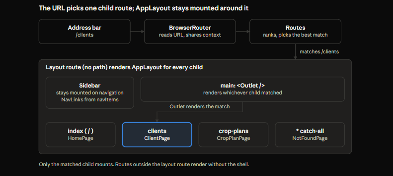

# Lab 06 — React Router & Application Shell Patterns

Nov 3, 2026 · @zhe

## How to use this doc

Lab 06 turned a single client-management screen into a navigable multi-page app. The one idea underneath every pattern here: **the URL becomes the state.** In 06a a `useState` value chose the page. In 06b the address bar does, and React Router reads it.

**Scope.** 06a built a static shell without a router, as a control experiment. 06b swapped in React Router (declarative mode). S0 to S3 restructured the CSS and styled the sidebar, Home and the 404 page. Client CRUD mechanics are unchanged and covered in the Lab 04 and Lab 05 docs.

**Numbering.** Patterns keep the P-numbers they were given during the lab (P1 to P60), so the chat history and this doc line up. They are grouped by topic, not by number.

**Layers.** Each mechanism is tagged where useful: JavaScript language, browser-web API, framework or library (React, React Router), or Zhe's own application abstraction.

**Tiers.** Tier 1 = understand mechanically. Tier 2 = understand purpose and failure modes. Tier 3 = look up when needed.

**Related notes.** Individual mistakes are in the mistake log; `useEffect`, closures and `<dialog>` have their own standalone notes. This doc references them instead of repeating them.

## Lab arc and decision log

The lab ran in three phases: build the shell by hand, replace the hand-built parts with the router, then restructure and style. Each phase closed with all of its contract items passing or explicitly deferred.

1. **06a — static shell.** AppLayout and Sidebar, `currentPage` in `useState`, a lookup table with a 404 fallback, the collapsible sidebar. Ended with a list of what state-only navigation cannot do (P10).
2. **06b — React Router.** R1 provider, R2 route table, R3 layout route and `<Outlet />`, R4 `<NavLink>`, R5 Home card links, R6 verification run.
3. **S0–S3 — structure and styling.** S0 split the CSS by owner, S1 sidebar with lucide icons, S2 Home cards, S3 the 404 page with an SVG illustration.

| Date | Decision | Reason |
| --- | --- | --- |
| 2026-11-03 | 404 renders inside the shell; full-screen version not adopted | The sidebar stays as a way out; full-screen would be a one-line route move (P30) |
| 2026-11-03 | Shared `.page` container in `global.css`; `.client-panel` loses its width and margin | Three consumers (Home, Clients, 404); the page owns placement (P54) |
| 2026-11-03 | CSS split: tokens, global, layouts, per-page, per-feature | Styles live with the lowest common owner of their markup (P42) |
| 2026-11-03 | Modifier convention: `block--modifier`, matching the dialogs | One convention across the codebase (P20, P46) |
| 2026-11-03 | D1: nav config module `src/app/navigation.js`; route table stays explicit | Removes path and label duplication across sidebar, cards and 404; keeps the route map readable (P40) |
| 2026-11-03 | D2 deferred: subview return pattern | No subviews exist yet; recommendation recorded (P39) |
| 2026-11-03 | D3: in-flight writes continue after navigating away; no blocking | Server is authoritative; blocking would need data mode (P38) |
| 2026-11-03 | Declarative mode; data mode rejected for now | Loaders and actions would compete with the existing Lab 04 data layer |
| 2026-11-03 | Collapse uses hide-with-CSS (option B), not unmount | Keeps sidebar state and allows the slide animation (P22) |
| 2026-11-03 | Home card navigation deferred from 06a to 06b | The router provides navigation; prop wiring would be thrown away |
| 2026-11-02 | Unknown page key renders a dedicated 404 page | Unknown input needs an explicit, verifiable default branch (P5) |
| 2026-11-02 | `ClientPage` is a thin wrapper; `ClientManagement` stays in `features/clients` | Page = placement, feature = mechanism (P3) |

## Composition and ownership

Every component in the shell answers one question: what does it own, and what does it receive? Getting that boundary right is what let the router slot in without rewriting pages.

**P1. Layout as a slot (tier 1, React).** A persistent frame receives varying content through `children` and never chooses it. Because the parent composes the page directly, it can pass props to the page without drilling them through the layout. In 06b the router fills the slot instead, through `<Outlet />` (P30).

**P2 / P19. State lives at the lowest common owner (tier 1, React).** List everyone who reads or changes a value; the state goes in the lowest component above all of them. The value goes down as props, change requests come up as callbacks. Both directions are needed: callback-only wiring cannot show the active item.

- `currentPage` (06a) lived in App because Sidebar, the main area and the Home cards all touched it.
- `collapsed` first belonged in Sidebar. When the expand button moved outside the sidebar, the set of consumers changed, so the state moved up to AppLayout.
- A component that never unmounts keeps its state across navigation. That is why the collapsed sidebar survives page changes.

**P3. Page = placement, feature = mechanism (tier 2, app abstraction).** `features/clients` owns client state, the API module, modals and tests, and knows nothing about routing. `pages/ClientPage.jsx` is a thin wrapper that decides where the feature appears. Crop plans will follow the same split.

**P6. Name callbacks by intent, not implementation (tier 2).** `onNavigate` hid that a `setState` sat behind it, so the backing mechanism could be swapped without touching consumers. `onCollapse` follows the same rule.

**P54. The page owns placement, the feature owns appearance (tier 2, CSS).** The shared `.page` container in `global.css` is applied by page components. Feature styles carry no width or outer margin. This is P3 applied to CSS: the client panel can now be embedded anywhere without dragging a fixed width along.

## Page identity and lookup

The set of valid pages must be defined in exactly one place. This lab broke that rule four times before fixing it, which makes P5 the most-tested pattern in the doc.

**P5. Closed set of keys with an explicit default branch (tier 1).** Unknown input gets a dedicated 404, not a blank screen. A chain of `&&` conditions cannot express a default; a ternary chain, a `switch` or a lookup with a fallback can. Violations observed: App vs Sidebar (`"crop-plans"`), click key vs comparison key inside one button, `"client"` vs `"clients"`, and paths in three files.

**P12. Configuration as an array of uniform records (tier 1, JS).** Each row has the same fields, with no wrapper keys. `{ home: { … } }` cannot be looped because you must already know the key to unwrap it.

**P13 / P28. Store components, render elements; know which an API wants (tier 2, React).** Your own config stores components (`icon: Sprout`), and you create the element at render time. A variable or member holding a component must be capitalized or dotted (`<SelectedPage />`, `<item.icon />`). React Router's `element` prop takes an element instead, so props can be passed inline.

**P14 / P16. Lookup with a fallback; functions are values (tier 1, JS).** `find` returns the row or `undefined`, and `undefined` is the 404 signal. `match?.component ?? Fallback` is the idiomatic form. A component is just a function, so it can sit in config, be chosen by a ternary or travel as a prop. `switch` also works but is a statement, so it cannot go inside JSX braces.

**P17. A placeholder is not "not found" (tier 2).** Crop Plans exists but is unbuilt, so it gets its own placeholder page. The 404 is reserved for unknown paths, so the fallback can be verified on its own.

**P40. A nav config module is the single source for navigation presentation (tier 2, app abstraction).** `src/app/navigation.js` holds path, label, icon and Home card text. Sidebar, Home and the 404 links read from it; the route table stays an explicit map in App. Path drift between config and route table shows up as a visible 404 on first click.

**P41. Group optional data into one nullable object (tier 2).** `homeCard: null` or `{ title, description }` makes "has a card" and "what the card says" one fact. A separate flag plus fields could disagree.

## Mount lifetime and async work

Navigating away destroys a page, but not the work it started. The server stays the source of truth, so a remount heals the UI; the only cost is a list that can be briefly stale.

**P4. Switching pages unmounts (tier 1, React).** When the main area stops rendering a page, React destroys it and its state: the loaded list, an open modal, a half-typed form. Coming back mounts a fresh copy and re-runs the fetch effect. Re-fetching on return is acceptable and deliberate. Known limitation: abandon the wait, navigate away, and return before the server commits, and the list is stale until the next fetch.

**P8. Rendering is not mounting (tier 1, React).** A parent's state change re-runs every child, so a `console.log` in a component body fires on every render. To observe lifetime, log in an effect with an empty dependency array and in its cleanup. Confirmed: Sidebar mounts once and never unmounts; ClientPage mounts and unmounts on every visit. In development, `StrictMode` adds one extra mount/unmount pair at startup.

**P9. Unmounting does not cancel async work (tier 2, JS + React).** A running async function is an ordinary promise chain that React does not own. It runs to completion after the page is gone; its `setState` calls are silently ignored (React 18+). Separately, stopping the wait on the client does not cancel the server's operation: the write still commits.

**P11 / P38. UI blocking only guards in-app navigation (tier 2, browser).** A modal overlay stops clicks inside your DOM. It cannot stop browser back, refresh or a typed URL. Once the router turns back into an in-app event, back unmounts ClientPage straight through the pending dialog. Tested in R6: the write completed, nothing errored, and forward after 5 s showed the record. Accepted as intended (D3). As far as known at the time, React Router's navigation-blocking hook needs data or framework mode.

## Collapsible sidebar

The sidebar collapses completely and an expand button appears in the main area. The state lives in AppLayout, and the sidebar stays mounted and is hidden with CSS so it can animate.

**P21. The control that undoes a state must survive that state (tier 1).** If the whole sidebar disappears, the expand button cannot live inside it. That one requirement moved `collapsed` from Sidebar up to AppLayout (P19). Exactly one of the two buttons exists at a time, and each sets the state in one direction, so no toggle is needed.

**P22. Unmount vs hide is a real choice (tier 2).**

|  | Unmount (conditional render) | Hide (CSS class) |
| --- | --- | --- |
| Component state | Destroyed on collapse | Kept |
| Exit animation | Impossible, element is gone | Easy with transitions |
| Keyboard / screen readers | Automatically unreachable | Must be hidden explicitly (P23) |
| Used for | The expand button (tiny, stateless) | The sidebar |

**P23. Hide with `visibility` plus a delayed transition (tier 2, CSS).** `visibility: hidden` removes content from the Tab order and from screen readers. Changing it instantly would cut the animation, so the collapsed rule delays it by the animation's 200 ms. CSS uses the transition declared on the state being moved to: collapsing waits, expanding shows content immediately.

**P24 / P49. Clip a fixed-width inner wrapper (tier 2, CSS).** The outer `.sidebar` animates its width and clips with `overflow: hidden`; `.sidebar-inner` keeps a fixed width so labels do not re-wrap mid-animation. The border sits on the inner wrapper, otherwise a 1 px line remains at width 0. `position: sticky` with `height: 100vh` keeps the sidebar still while long pages scroll.

**P50. Dimensions used in more than one rule become tokens (tier 2, CSS).** `--sidebar-width` keeps the outer and inner widths in sync. It is P5's single-source idea applied to CSS.

Accessibility details carried by the buttons: `aria-label` (icon-only), `aria-expanded`, `aria-controls="app-sidebar"`, and a reduced-motion rule that removes the transition. Moving focus to the expand button after collapsing is a recorded polish item.

## React Router mechanics

React Router replaced every 06a mechanism with a URL-driven equivalent, in declarative mode. The mapping below is the shortest way back into this lab.

| 06a (hand-built) | 06b (React Router) |
| --- | --- |
| `useState("home")` holds the page | The URL path holds the page |
| `setCurrentPage` / `onNavigate` | `<Link>` / `<NavLink>`, or the navigate hook |
| `pages.find(...)` with fallback | `<Routes>` ranks and picks a `<Route>` |
| `DefaultPage` fallback | Catch-all route, `path="*"` |
| AppLayout `children` slot | Layout route + `<Outlet />` |
| Comparing keys for the active class | `<NavLink>` reports `isActive` |

**P10. What state-only navigation cannot do (tier 1).** No URL for the current page, no history entries (back leaves the app), refresh and direct loading reset to Home, nothing can be linked or bookmarked. This list became the 06b requirements.

**P25 / P26. The router is a context provider; knowing the URL is not choosing a page (tier 1).** `<BrowserRouter>` wraps the app in `main.jsx`, reads the URL, listens for back and forward, and shares the location through context. Router hooks or links outside it throw. Reading the location renders nothing by itself; matching is a separate step. Typing a URL is a full page load (the direct-loading path), and Vite's dev server answers every path with `index.html`. A production host must be configured the same way.

**P27. A route table is a URL-keyed lookup with ranking (tier 1).** `<Route>` is configuration, not UI. `<Routes>` picks the most specific match regardless of order, so `*` only wins when nothing else matches. A route matches the full path, not a prefix. Trailing slashes and letter case are ignored by default (tier 3).

**P30 / P31 / P32. Layout routes, index and relative paths (tier 1–2).** A pathless parent route renders AppLayout; its children render into `<Outlet />`. Routes inside the parent get the shell, routes outside do not: the route table owns layout membership. `index` is the parent's own URL. Child paths without a leading slash resolve against the parent. A missing `<Outlet />` fails silently: shell renders, content area empty, no error.

**P33 / P34. Links are real anchors, intercepted; libraries can call your functions (tier 1).** `<NavLink>` renders `<a href>`. Plain clicks become in-app navigation with a history push; Ctrl, Cmd and middle clicks fall through, so new tabs work. Its `className` accepts a function that receives `{ isActive }`. `aria-current="page"` is added automatically.

**P35. Two matching rules (tier 2).** Routes match the full path; NavLink is active on a prefix. Without `end`, the Home link (`/`) would be active everywhere. The prefix rule is useful: inside a future `/clients/42`, Client Management stays highlighted.

**P36 / P37. Link vs navigate; absolute targets for cross-section links (tier 2).** User clicks something that goes somewhere: `<Link>` or `<NavLink>` (NavLink only where the active state is shown). Code decides to go somewhere after logic, such as after a save: the navigate hook. Relative `to` resolves against the current route; absolute `to` means the same thing from anywhere.

**P39. Return from subviews with an explicit parent link (tier 2, D2 recommendation).** `<Link to="/clients">` works after a direct load or a new tab. `navigate(-1)` leaves the app when there is no previous in-app entry. List filters worth restoring would go in the query string later.

## Route tree

Navigating from `/clients` to `/` swaps only the highlighted child; the layout route still matches, so AppLayout, the Sidebar and the collapsed state stay mounted.

## CSS architecture

Styles are organized by who uses the markup, exactly like state. Global files load first; layout, page and feature files load after them and can override.

| File | Holds | Why there |
| --- | --- | --- |
| `styles/tokens.css` | Colors, radii, type scale, `--sidebar-width` | Used everywhere |
| `styles/global.css` | Base reset, `.row` `.stack` `.actions`, `.page`, `.btn*`, `.icon*` | True primitives with several consumers |
| `layouts/layouts.css` | Shell and sidebar | Owned by the layout |
| `pages/HomePage.css`, `pages/NotFoundPage.css` | One page each | One consumer |
| `features/clients/ClientManagement.css` | Client panel, dialogs, forms, pending/success/notice | Clients only, for now |

**P7. CSS co-location gives ownership, not scoping (tier 2).** Importing a CSS file into a component puts its rules into the whole page. The file location says who owns the styles; every selector still applies globally. Global element selectors in a feature file style the entire app.

**P42. Styles live with the lowest common owner of their markup (tier 2).** Dialogs, forms and feedback styles stay in the client feature until crop plans actually needs them, then move with their components. The `.page` container moved to `global.css` the moment it had a third consumer.

**P43. Global styles load first (tier 2).** Import tokens and global CSS in `main.jsx` before `App`. Rules of equal specificity cascade in import order. `var(--x)` is resolved where it is used, so order does not matter for tokens.

**P44. Prefix feature layout classes, not component names (tier 2).** `.card`, `.title`, `.list` became `.client-panel`, `.client-panel-title`, `.client-list`. Component names like `.dialog` and `.input` stay unprefixed: they describe the component, and will be shared later.

**P20 / P46 / P48. Modifier convention and specificity (tier 2).** Convention: base class always present plus `block--modifier`. A single-class modifier has the same specificity as its base, so it wins only by coming later in the file. A pseudo-class adds specificity, so `.sidebar-link:hover` beats `.sidebar-link--active`; list `.sidebar-link--active:hover` explicitly. A compound like `.parent .btn` beats `.btn` by having two classes.

**P56. Element-neutral button styles (tier 2).** `.btn` carries `display: inline-flex`, `gap` and `text-decoration: none`, so it works on `<button>` and `<a>` alike. Choose the element by behavior, the class by appearance.

**P57. Flex `auto` margins absorb free space (tier 2).** Inside a flex column, a child with `margin: auto` shrinks to its content and centers. When `.page` took over placement, the client panel's leftover `margin: 24px auto` made it shrink; removing it let the panel stretch.

**P45. Verify restructuring as a zero-visual-diff refactor (tier 1, process).** Screenshot every state before moving CSS, including transient dialogs and banners, and compare after.

## Visual design patterns

The UI is monochrome with one gradient, and hierarchy comes from size, weight and muted color rather than decoration. These patterns describe the decisions, not the exact values, which live in the CSS files.

**P51. Hierarchy comes from contrast in size, weight and color (tier 2).** Brand name large and bold, tagline small and muted. Small uppercase text works for labels ("CONFIGURATION", "ERROR 404"); headings use sentence or title case. A label earns its place only if it adds information: "Forecast Platform Configuration" on Home was removed because it repeated the page.

**P53. Reserve color for a single meaning (tier 2).** The green-to-blue gradient (`--success` to `--info`) appears on the brand mark and the 404 planet only. Everything else stays black, white and grey, so the gradient reads as the signature.

**P52. A parent's state drives its children (tier 2, CSS).** `.home-card:hover .home-card-arrow` styles the arrow from the card's hover state. Pair every `:hover` with `:focus-visible` so keyboard users get the same feedback.

**P58. Show action hierarchy with visual weight (tier 2).** One filled primary action ("Go to Home"), quieter borderless secondary links. A variant with one consumer stays local to its page until a second page needs it.

**P59. Viewport units for roughly-centered placement (tier 3).** `padding-top: 12vh` (later `6vh`) on the 404 avoids a `calc()` that would depend on the shell's paddings.

**P55. A 404 explains and offers a way out (tier 2).** Show the path the user typed (`useLocation().pathname`), one primary way back, and secondary links from the nav config. React escapes text inside `{}`, so displaying a user-supplied path is safe; `dangerouslySetInnerHTML` would not be.

**P47. Icons in config are component references (tier 2).** `navItems` stores `House`, `Users`, `Sprout`; the sidebar, cards and 404 links render `<item.icon />`. Decorative icons get `aria-hidden` when their control already has a label. CSS width and height beat the SVG's own size attributes, so the global `.icon` class sizes lucide icons.

**P60. Decorative SVG as a component (tier 2–3).** The 404 illustration is inline SVG, `aria-hidden`, colored through CSS classes so `var()` tokens apply. Drawing order replaces z-index, so the ring is split into a back half drawn before the planet and a front half drawn after. `clipPath` keeps craters and shading on the planet; `transform-box: view-box` lets the satellite rotate around the planet's center. SVG `id`s are global to the document, so they are prefixed `nf-`.

## JavaScript and React language notes

These are the language-level facts that produced bugs or surprises in this lab. Each is small, but each one stopped progress until it was understood.

| Construct | Rule | Tier |
| --- | --- | --- |
| Arrow body `=> ( … )` vs `=> { … }` | Parentheses return automatically; braces need `return`. A missing return inside `.map()` fails silently because React renders `undefined` as nothing (P15) | 1 |
| Ternary on an object | `match ? a : b` tests truthiness: an object is truthy, `undefined` is falsy | 1 |
| `?.` and `??` | `match?.component ?? Fallback`: optional chaining returns `undefined` instead of throwing; `??` falls back only on `null`/`undefined`. `\|\|` also falls back on `0` and `""` | 1 |
| `filter` then `map` | Each returns a new array; neither changes the original | 1 |
| Named vs default export | `export const navItems` imports with braces; `export default` without. The wrong form gives `undefined` | 1 |
| `switch` | A statement, not an expression: it cannot go inside JSX braces. Use `return` in each case to avoid fall-through | 1 |
| Template literal class lists | `` `sidebar ${collapsed ? "sidebar--collapsed" : ""}` `` builds a space-separated class string | 1 |
| Event vs render errors | A throw in an event handler fails that call only; a throw during render can blank the tree (P29) | 2 |
| JSX whitespace | Whitespace between text and an element on the next line is dropped; `{" "}` restores the space | 3 |
| Text escaping | Text inside `{}` is escaped, so user-supplied strings render as characters, not HTML | 2 |
| React context | A provider shares a value with every descendant without props; hooks outside the provider throw (P25) | 2 |

## Pitfall index

Every bug hit during Lab 06, with the symptom you would see and the pattern that prevents it. Mistake-log entries cover the reasoning behind each.

| Symptom | Cause | Prevented by |
| --- | --- | --- |
| Clicking Crop Plans showed a blank main area | `&&` chain had no default branch | P5 |
| Crop Plans showed the 404 | Sidebar used `"crop-plans"`, App had no such key | P5, P40 |
| All three items highlighted on Home, none elsewhere | Every button compared against `"home"` (copy-paste) | P5, P12 (one variable per row via `.map`) |
| List could not be looped | Array of single-key wrapper objects | P12 |
| Client Management showed 404 | Key `"client"` vs check for `"clients"` | P5, P40 |
| Sidebar rendered no buttons, no error | `.map((page) => { <button/> })` with no `return` | P15 |
| Clicking a nav item threw "onNavigate is not a function" | Prop removed during R2; event error, app kept running | P29 (expected, temporary) |
| Stray "s" visible next to the title | Typo after `</h2>` | Visual check |
| "Persistence while collapsed" test could not be run | No navigation possible while sidebar hidden | Deferred to router; P11 |
| Hidden nav buttons reachable with Tab (in the failure check) | `visibility: hidden` removed | P23 |
| Home link active on every page (in the `end` experiment) | NavLink prefix matching on `/` | P35 |
| Client panel shrank to content width and sat lower | Leftover `margin: 24px auto` on a flex item | P54, P57 |
| Generic classes at risk of styling other pages | `.card`, `.title`, `.list` are global | P7, P44 |
| (Anticipated, not hit) Active link would change color on hover | `:hover` outranked the single-class modifier | P48 |

## Open items

Lab 06's exit gate is met: a working multi-page shell, client CRUD preserved, and a clean crop-plan placeholder. These items were consciously carried forward.

- [ ] D2: build the subview return pattern (explicit parent link) when the first subview such as `/clients/:id` exists
- [ ] Production hosting must answer every path with `index.html`, or refresh and direct links return a server 404
- [ ] Path strings remain in both `navigation.js` and the route table; a UI test asserting each nav path is not the 404 is a candidate for the postponed UI test suite
- [ ] Move focus to the expand button after collapsing the sidebar (keyboard polish)
- [ ] Promote dialog, form and write-feedback styles out of `features/clients` when crop plans becomes their second consumer (P42)
- [ ] Revisit the 770 px `.page` width when denser crop-plan screens arrive
- [ ] Revisit data mode only if loaders, actions or navigation blocking become necessary
