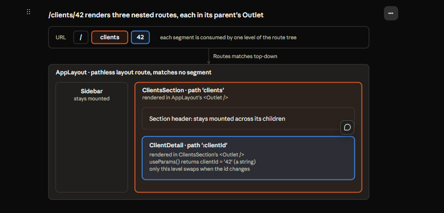

# How React Router Works — Routes, Outlet, Link and NavLink

Nov 4, 2026 · @zhe

## Mental model

React Router makes the URL the single source of truth for which screen is showing. Every component in this doc either reads the URL (`Routes`, `Route`, `Outlet`, `NavLink`'s active state) or changes it (`Link`, `NavLink`, `useNavigate`).

**What the browser provides (browser-web API layer).** The History API can change the address bar and push a history entry *without* reloading the page. When the user presses back or forward, the browser does not reload either; it fires an event that JavaScript can listen to. That is everything a client-side router needs.

**What React Router adds (library layer).** It wraps those browser mechanics in React terms: a provider that tracks the current location, a route table that turns a location into components, and link components that navigate without a reload.

**What stays yours (application layer).** Which paths exist, which component owns which path, and which layout wraps which pages. In GrowLytics that is the route table in `App.jsx` and the nav config in `src/app/navigation.js`.

The flow in one sentence: **the URL changes → the provider updates its location → `<Routes>` re-matches → the matched element renders into its parent's `<Outlet />`.**

This doc covers declarative mode, the mode GrowLytics uses. Data and framework modes add loaders, actions and pending states on top of the same ideas.

| Tier | Concepts |
| --- | --- |
| 1 — understand mechanically | `BrowserRouter`, `Routes`/`Route`, nested routes, `Outlet`, `Link`, `NavLink`, `useParams` |
| 2 — purpose and failure modes | Ranking, relative paths, `end`, `useNavigate`, `replace`, search params |
| 3 — look up when needed | `caseSensitive`, link `state`, outlet context, `reloadDocument`, optional segments |

## BrowserRouter: the provider

`<BrowserRouter>` holds the current location and shares it with everything inside it. It renders no UI of its own; it goes once, at the top of the tree, in `main.jsx`.

```jsx
createRoot(document.getElementById('root')).render(
  <StrictMode>
    <BrowserRouter>
      <App />
    </BrowserRouter>
  </StrictMode>,
)
```

It does three jobs:

1. Reads the URL from the browser when it first mounts.
2. Listens for back and forward, and updates its location when they happen.
3. Puts the location, and a way to change it, into **React context**, so any descendant at any depth can read it with a hook or a link component.

**Why context and not props.** Links, the route table, a page reading its URL params: they sit at different depths. Passing the location down as props to every one of them would be far worse than the `onNavigate` drilling in Lab 06a.

**Failure mode.** A router hook (`useLocation`, `useNavigate`, `useParams`) or a `<Link>` used outside the provider has no context to read, and throws. The error names the hook and says it must be used inside a router.

**Direct loading depends on the server.** Typing `/clients` and pressing Enter is a full page load: the browser asks the server for `/clients` before any React runs. Vite's dev server answers every path with `index.html`, then the provider reads the URL. A production host needs the same fallback, or refresh and shared links return the server's 404.

## Routes and Route: the route table

`<Routes>` is a lookup table keyed by the URL. It reads the current location from context, finds the best-matching `<Route>`, and renders that route's `element`. A `<Route>` renders nothing by itself; it is a row of configuration.

```jsx
<Routes>
  <Route path="/" element={<HomePage />} />
  <Route path="/clients" element={<ClientPage />} />
  <Route path="*" element={<NotFoundPage />} />
</Routes>
```

**`path` + `element`.** The path is what to match; the element is what to render. `element` takes an element (`<HomePage />`), not a component (`HomePage`), so props can be passed inline: `element={<ClientPage mode="edit" />}`.

**Matching is by ranking, not order.** Unlike `Array.find`, `<Routes>` scores every candidate and picks the most specific. Static segments (`clients`) outrank dynamic ones (`:clientId`), which outrank the catch-all (`*`). Moving `*` to the top changes nothing.

**A route matches the whole path.** `/clients` does not match `/clients/extra`. Only nested child routes or a splat (`clients/*`) handle deeper URLs.

**Defaults worth knowing (tier 3).** Matching ignores a trailing slash and is case-insensitive: `/CLIENTS/` matches `clients`. A `caseSensitive` prop on a route turns case-sensitivity on.

**`path="*"` is the catch-all.** It matches anything nothing else claimed, which makes it the 404. Whether the 404 gets the shell depends on where it sits in the tree (next section).

## Nested routes and nested URLs

Routes nest, and a URL is matched segment by segment down that tree. A parent route's path is the prefix of its children's URLs; each matched level renders, from the outside in.

The example below extends GrowLytics with a **hypothetical** client detail view, `/clients/42`, to show nesting with more than one level. It is not built yet.

```jsx
<Routes>
  <Route element={<AppLayout />}>                      {/* pathless layout */}
    <Route index element={<HomePage />} />              {/* /           */}
    <Route path="clients" element={<ClientsSection />}>  {/* /clients... */}
      <Route index element={<ClientList />} />           {/* /clients    */}
      <Route path=":clientId" element={<ClientDetail />} /> {/* /clients/42 */}
    </Route>
    <Route path="crop-plans" element={<CropPlanPage />} />
    <Route path="*" element={<NotFoundPage />} />
  </Route>
</Routes>
```

| URL | Render chain (outer → inner) |
| --- | --- |
| `/` | AppLayout → HomePage |
| `/clients` | AppLayout → ClientsSection → ClientList |
| `/clients/42` | AppLayout → ClientsSection → ClientDetail |
| `/crop-plans` | AppLayout → CropPlanPage |
| `/clients/42/oops` | AppLayout → NotFoundPage |

**Paths join.** A child path without a leading slash is relative: `clients` + `:clientId` = `/clients/:clientId`. A pathless layout route adds no segment at all; it only wraps.

**`index` = the parent's own URL.** At `/clients`, the URL stops at the parent, so the index child renders. Without an index route, `ClientsSection` would render with an empty outlet.

**Dynamic segments.** `:clientId` matches any one segment and captures it. Read it with `useParams()`:

```jsx
const { clientId } = useParams()   // "42" — always a string
```

Two things follow. Convert it if you need a number (`Number(clientId)`). And a valid-looking URL can name a client that does not exist: the route matched, so the 404 page will **not** appear. The page itself must handle "no such client".

**Rarer patterns (tier 3).** A splat `files/*` matches everything below it, read as `useParams()["*"]`. An optional segment `:lang?` may be present or absent.

## A nested URL, level by level



The colors pair each URL segment with the route level that consumes it: `clients` with ClientsSection, `42` with ClientDetail. The pathless AppLayout consumes nothing. Going from `/clients/42` to `/clients/43` swaps only the innermost box.

## Outlet: where the child appears

`<Outlet />` is the hole in a parent route's element where the matched child route renders. It is how a layout keeps its frame while the page inside it changes.

```jsx
function AppLayout() {
  return (
    <div className="app-layout">
      <Sidebar />
      <main className="app-content">
        <Outlet />
      </main>
    </div>
  )
}
```

**How it works.** When `<Routes>` matches `/clients/42`, it produces a chain: AppLayout → ClientsSection → ClientDetail. It renders the outermost element first. When React reaches that element's `<Outlet />`, the outlet reads from router context which child is next in the chain, and renders it there. That child's own `<Outlet />` renders the next level, and so on down.

**`children` vs `<Outlet />`.** With `children`, the parent component decides what goes in the slot. With `<Outlet />`, the router decides, based on the URL. AppLayout never receives the page as a prop.

**Mount lifetime.** Navigating from `/clients` to `/clients/42` keeps AppLayout and ClientsSection mounted, because their routes still match. Only the innermost level swaps. State kept in a layout (the collapsed sidebar, a section-level filter) survives navigation between its children.

**Missing outlet: a silent failure.** If a parent element forgets `<Outlet />`, the parent renders and its children never appear. There is no error and no warning. An empty content area with a clean console usually means a missing outlet.

**An outlet with nothing to show.** At `/clients` with no index route, the outlet renders `null`. That is why every section with children normally has an index route.

**Outlet context (tier 3).** `<Outlet context={value} />` passes a value to the child, read with `useOutletContext()`. Useful when a section loads something that all its children need.

## Link: navigating without a reload

`<Link to="/clients">` renders a real `<a href="/clients">` and intercepts plain clicks so the page does not reload. Use it whenever the *user* clicks something that goes somewhere.

**What happens on click.**

1. The user clicks the anchor.
2. If it is a plain left click, Link cancels the browser's default page load.
3. It pushes a new history entry and updates the router's location.
4. `<Routes>` re-matches and the outlets swap content. Nothing is fetched from the server.

Ctrl, Cmd, Shift and middle clicks are **not** intercepted, so "open in new tab" and "copy link" behave like any web link. Buttons with `onClick` navigation cannot do this.

**Absolute vs relative `to`.**

| `to` value | Rendered inside `/clients/42` | Goes to |
| --- | --- | --- |
| `"/crop-plans"` | anywhere | `/crop-plans` |
| `"edit"` | ClientDetail's route | `/clients/42/edit` |
| `".."` | ClientDetail's route | `/clients` (one route up) |

Relative paths resolve against the route the link is rendered in. By default `..` climbs the **route** tree, and pathless layout routes and index routes don't count as a level. `relative="path"` makes `..` remove one URL segment instead. Prefer absolute paths for links that cross between sections; they mean the same thing from anywhere.

**Other props.**

| Prop | Effect | Tier |
| --- | --- | --- |
| `replace` | Replaces the current history entry instead of pushing one; back skips it | 2 |
| `state` | Passes data invisibly to the next location, read via `useLocation().state`; lost on a new tab | 3 |
| `reloadDocument` | Forces a normal full page load | 3 |
| `to={{ pathname, search, hash }}` | Object form, for query strings and anchors | 3 |

## NavLink: a Link that knows if it is active

`<NavLink>` is a `<Link>` that also compares its `to` against the current URL and reports `isActive`. Use it only where the active state is shown, such as sidebar navigation; everywhere else, `<Link>` is enough.

**Active means prefix.** Without `end`, a NavLink is active when the URL *starts with* its path. With `end`, it must match exactly. The official docs show it this way ([NavLink docs](https://reactrouter.com/api/components/NavLink)):

| Link | URL | isActive |
| --- | --- | --- |
| `<NavLink to="/tasks" />` | `/tasks` | true |
| `<NavLink to="/tasks" />` | `/tasks/123` | true |
| `<NavLink to="/tasks" end />` | `/tasks` | true |
| `<NavLink to="/tasks" end />` | `/tasks/123` | false |

The prefix default is deliberate: inside `/clients/42`, the "Client Management" link stays highlighted. Note this is a **different rule** from route matching, which always matches the full path.

**The `/` exception.** Every URL starts with `/`, so a Home link would be active on every page. Current docs say `<NavLink to="/">` is treated as a special case and only matches at the root, effectively ignoring `end`. The `end={item.path === "/"}` in the GrowLytics sidebar is therefore harmless but redundant on current versions; keep it if older versions matter.

**Three ways to use the state.** Each prop can be a plain value or a function that receives `{ isActive }`:

```jsx
// className
<NavLink to="/clients" className={({ isActive }) => isActive ? "sidebar-link sidebar-link--active" : "sidebar-link"}>
  Clients
</NavLink>

// style
<NavLink to="/clients" style={({ isActive }) => ({ fontWeight: isActive ? 600 : 400 })}>
  Clients
</NavLink>

// children
<NavLink to="/clients">
  {({ isActive }) => <span>{isActive ? "● " : ""}Clients</span>}
</NavLink>
```

The library calls your function on every render with the current answer; your function returns the class, style or content.

**Free extras.** When active, NavLink adds `aria-current="page"`, so screen readers announce the current page. With a plain string `className`, it also adds an `active` class automatically.

**`isPending` (tier 3).** The docs also show `isPending`, but it is only available in data and framework modes. In declarative mode, only `isActive` applies.

## Hooks quick reference

Components cover most routing; these hooks cover the cases where your code, not a click, needs the URL. All of them must be called inside `<BrowserRouter>`.

| Hook | Returns | Reach for it when | Tier |
| --- | --- | --- | --- |
| `useParams()` | Dynamic segments, e.g. `{ clientId: "42" }` (strings) | A page needs the id in its URL | 1 |
| `useLocation()` | `{ pathname, search, hash, state }` | You need the current path, e.g. the 404 page showing what was typed | 2 |
| `useNavigate()` | A `navigate(to, options)` function | Code decides to navigate after logic, such as after a save or delete | 2 |
| `useSearchParams()` | `[searchParams, setSearchParams]` for `?key=value` | Filters or tabs that should survive refresh and be shareable | 2 |

**`useNavigate` vs `<Link>`.** If the user clicks something that goes somewhere, use `<Link>`: you get a real anchor and new-tab support. If navigation follows from logic, use `navigate`:

```jsx
const navigate = useNavigate()

async function handleSave() {
  await saveClient(draft)
  navigate("/clients")                    // push a new entry
  // navigate("/clients", { replace: true }) — replace the current one
  // navigate(-1)                         — history back
}
```

**`navigate(-1)` leaves the app on a direct load.** If the user opened the page from a bookmark or a new tab, there is no previous in-app entry, so back goes to whatever site they came from. For a "back to list" control, an explicit `<Link to="/clients">` is safer.

**Path params vs search params.** Path params identify *which* resource (`/clients/42`). Search params describe *how* to view it (`/clients?sort=name`). Both are strings, and both survive refresh because they live in the URL.

## Failure modes

Most router bugs are silent: something renders, just not what you expected. This table goes from the symptom you see to the cause.

| Symptom | Likely cause | Fix |
| --- | --- | --- |
| Error: hook "may be used only in the context of a router" | Hook or Link outside `<BrowserRouter>` | Wrap `<App />` in `main.jsx` |
| Shell renders, content area empty, no error | Parent element has no `<Outlet />` | Add the outlet where children belong |
| Section renders, its content area empty at the section's own URL | No `index` child route | Add an index route |
| Valid page shows the 404 | Path in the link and path in the route table differ (`/client` vs `clients`) | One source for paths; check the nav config |
| 404 appears without the sidebar | `*` route sits outside the layout route | Move it inside if it should have the shell |
| Home link highlighted on every page | Older version, `/` with prefix matching | Add `end` |
| Section link not highlighted on its subpages | `end` set on a section link | Remove `end` there; keep it for exact-only links |
| Refresh on `/clients` gives a server 404 in production | Host does not fall back to `index.html` | Configure the host's SPA fallback |
| `useParams().clientId === 42` is always false | Params are strings | Compare with `"42"` or convert with `Number()` |
| Unknown client id shows an empty page, not 404 | `:clientId` matched any value | Handle "not found" inside the detail page |
| Back button leaves the app from a subview | `navigate(-1)` after a direct load | Use an explicit parent `<Link>` |
| Page reloads on every click | Plain `<a href>` instead of `<Link>` | Use `<Link>` or `<NavLink>` |

## Sources

NavLink behavior (`end`, the `/` exception, render props, `isPending` mode note) and Link's `relative` option were checked against the official docs on 2026-11-04. The rest reflects stable declarative-mode behavior; check the docs for your installed version if something differs.

- [NavLink — React Router docs (current)](https://reactrouter.com/api/components/NavLink.md)
- [NavLink — React Router docs, v8.3.1](https://reactrouter.com/8.3.1/api/components/NavLink.md)
- [React Router docs home](https://reactrouter.com/docs)
