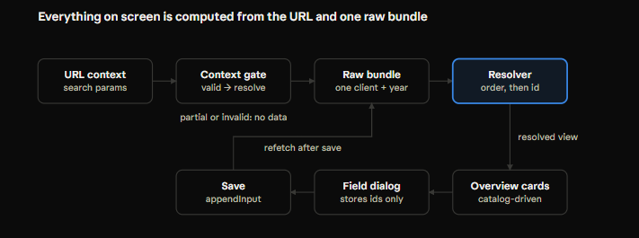

# Lab 07 Part A — Crop Plan Frontend Patterns

Nov 11, 2026 · @zhe

## At a glance



The URL and one raw bundle are the only stored inputs; the gate, the resolved view, the cards and the dialog's contents are all computed from them on every render. A save appends a row and refetches the bundle, so the screen updates by recomputing, not by patching state. Saving and refetching arrive in Part B; in Part A the bundle is the sample fixture.

## 1. Router mechanics

A route is state that lives in the address bar instead of in React memory. The router reads the URL, picks a component, and re-renders when the URL changes, exactly as a `useState` change would.

**Pattern matching.** `<Routes>` compares the pathname against every `<Route>` once per render. A segment starting with `:` matches any value and captures it, so one pattern covers unlimited URLs; nothing is generated, and nothing falls to the 404. `*` catches only what no pattern matched.

| Not-found kind | Cause | Handled by |
| --- | --- | --- |
| Router-level | No pattern matches the URL | The `*` route |
| Domain-level | The pattern matches, but the value does not exist (`client=99`) | The app's own validation (the context gate) |

**Params are always strings.** `useParams()` and `searchParams.get()` return strings or `null`. Converting them is the app's job, not the router's.

**Nested routes and `<Outlet />`.** For a nested URL, the router finds a match chain (parent, then child). `<Routes>` renders the parent's element and puts the rest of the chain into React context. `<Outlet />` reads that context and renders the next element, or nothing. It is a `children` slot filled by the URL instead of by JSX. A parent route without an `element` renders an `<Outlet />` by default.

- Failure mode: a child that matched but whose parent has no `<Outlet />` is invisible, with no error.
- Nested URLs do not require nested rendering: siblings under a pass-through parent share a URL prefix but replace each other on screen.

**Navigation is not a refresh.** `<Link>`, `navigate()` and `setSearchParams()` call the browser's History API and update the router's location state. React re-renders; nothing reloads. Only a real refresh restarts React and discards all component state.

**`setSearchParams` vs `navigate`.** `setSearchParams` navigates to the current pathname with a new query; `navigate` can change the pathname too. Both push a history entry. Passing an object to `setSearchParams` replaces the whole query; copying `new URLSearchParams(searchParams)` and editing the copy keeps the keys you don't touch.

**Package.** Since React Router v7, everything is imported from `react-router`; `react-router-dom` is only a compatibility re-export.

Layers: the History API and address bar are the browser; matching, params, context and `<Outlet />` are React Router; which URL a handler builds is the application.

## 2. State lifetime

URL state and component state are two separate stores. The URL survives refresh and steps through history; `useState` survives exactly as long as its component instance stays mounted.

**React identifies an instance by type and position, not by the data it shows.** The probe experiments showed it directly:

| Action | Result | Why |
| --- | --- | --- |
| Open a crop under the overview | Overview counter kept | The overview stayed at the same position |
| Durum → Canola | Crop counter kept | Same component, same position; only params changed |
| Change revision so the crop route no longer matches | Crop counter reset | The component unmounted; its state was destroyed |
| Refresh | Everything reset | React restarted |
| Back, then forward | Kept only if the component stayed mounted throughout | History stores URLs, not component state |

**`key` forces a fresh instance.** A changed `key` makes React unmount the old instance and mount a new one, resetting all of its state. It works on any element, not only list items. Put it on the component that owns the state, which often means splitting a component: an outer one reads the params, an inner one owns the state and receives the key.

**Resetting with `useEffect` is weaker.** An effect runs after a render, so there is one render where new params meet old state, and it only resets the variables you list.

**Unmounting is often the simplest reset.** When a component should disappear rather than restart, render it conditionally. The field dialog renders only while its context matches, so a context change unmounts it and destroys its draft. No `key` and no effect are needed.

**Rule: state lives in the lowest component whose lifetime should match the state's.** The field draft first lived in Overview, so it survived the dialog unmounting and could reappear after back and forward. Moving it into the dialog fixed that with no other code.

## 3. URL-owned context

The crop plan's context (client, year, revision) lives only in the URL's search params. No component keeps a copy in `useState`. Because the overview unmounts when the user navigates away, any context held in its state would be lost on return; the URL survives navigation, refresh and shared links.

**Path params vs search params.** A missing path segment means no match; a missing `?revision=` matches fine and arrives as `null`. Search params were chosen, so requiredness is enforced by the app, not the router. The router could never check validity anyway, only presence.

**Convert once, at the boundary, and keep missing as missing.**

```js
const yearParam = searchParams.get("year")                         // string or null
const forecastYear = yearParam === null ? null : Number(yearParam)  // number, NaN or null
```

- `Number(null)` is `0`, which invents a value, and `String(0) ?? ""` never falls back, because `String()` never returns `null`.
- Keep the raw string for a `<select>` value, since option values are strings. Use the converted number for logic.
- `??` is fine for display (`value={yearParam ?? ""}`), never for inventing context (`?? "2027"`).

**The context gate.** A pure function classifies the context as partial, invalid or valid before any data is touched. Data is resolved only when the gate says valid; calling the resolver earlier crashed on an unknown revision.

**Write only the keys you have.** `setSearchParams({ year: null })` writes the string `"null"`, which is truthy. Edit a copy of the params and set or delete keys explicitly.

**Dependent values: compute all consequences in the event handler.** Changing client or year must reset the revision. Doing it in the same navigation produces one history entry and no invalid in-between URL:

```js
next.set(key, value)
if (key === "client" || key === "year") {
    next.delete("revision")
    if (next.get("year") && next.get("client")) next.set("revision", "1")
}
setSearchParams(next)
```

A `useEffect` that resets the revision afterward would render one mismatched context, could start a fetch for it, and would add a second history entry that the back button lands on. Effects are for syncing with something outside React, such as fetching data for the URL's context; reactions to a user event belong in that event's handler.

## 4. Render snapshots and update priority

Every variable in a render is a snapshot. Setters, including `setSearchParams`, schedule future renders; they never change variables in the code that is already running.

**The Add crop bug.** The handler called `updateContext("revision", "1")` and then `startCropEdit(id)`, which stored `contextKey`. That `contextKey` was a `const` from the current render, still revision 3, so the draft never matched revision 1. Swapping the two calls changes nothing. This is the same lesson as reading `clientId` right after `setClientId`.

**Updates of the same priority batch; different priorities render separately.** As far as observed, React Router v7 schedules navigation updates inside `startTransition`, which marks them non-urgent. A plain `useState` update is urgent. The console log showed the order:

| Render | Caused by | URL | Draft |
| --- | --- | --- | --- |
| 1 | Before the click | Revision 4 | `null` |
| 2 | `setDraftCrop` (urgent) | Revision 4 | Set |
| 3 | Navigation (transition) | Revision 1 | Set |

Rule of thumb: within one event, urgent updates render together first, then transition updates render together, and that later render can be interrupted.

**Hide, don't clear.** A render-time rule that clears state on mismatch ("the user left this context") destroyed the draft in render 2, where the URL simply hadn't caught up. A derived rule that only hides on mismatch tolerates any in-between combination:

```js
const visibleDraftCropId =
    draftCrop !== null &&
    draftCrop.subContextKey === subContextKey &&   // client and year
    revisionId === "1"
        ? draftCrop.cropId
        : null
```

**Setting state during render is allowed only when guarded.** `if (mismatch) setDraftCrop(null)` during render makes React discard the output and re-render immediately; the condition prevents a loop. Use it only where the mismatch can't occur in an in-between render (here: client or year changed), and comment it, because it looks like a bug.

**Don't depend on render order or count.** StrictMode doubles some work in development, and scheduling can change between library versions. Write rendering that is correct for any combination of new state with old URL, or old state with new URL.

## 5. Data shape

The frontend stores only raw rows and catalogs; everything shown is derived from them. Designing the shape from the screens backward, not from a guessed API, is what made the rest of the lab possible.

**Raw table, view, dashboard.** Raw rows are like a fact table; the resolved object is a view computed per context; components are a dashboard that only reads the view. Components never know whether the view was hand-written, resolved locally or fetched.

**Arrays for order, objects for lookup.** Catalogs (categories, card groups, crops) are arrays because their order is the display order. Resolved data is an object keyed by crop id, then category key, because the UI looks values up. Rendering is a left join: iterate the catalog, look up `resolved[cropId][key]`, and an absent key becomes a missing value. Rows come from the catalog, so a missing value still gets a row.

- JavaScript lists integer-like object keys in ascending numeric order, regardless of insertion order. Never use `Object.keys` order for display.

**Identity vs order.** `revisionId` answers "is this the same revision?"; `order` answers "which revision comes first?" Compare ids with `===` and compare orders with `<` or subtraction. A string `order` would make `"10" <= "2"` true.

**Types follow meaning; strings only at the URL boundary.** Ids are integers, as the database produces them. `"1" === 1` is false, so a type mismatch at the boundary fails silently as "invalid."

**Zero is not missing.** Missing is the absence of a row; zero is a row with `value: 0` and full provenance. The distinction matters because a user must be able to override an inherited $35 rent with $0. Watch the operators:

- `value ?? "—"` keeps `0`; `value || "—"` turns it into `—`.
- `Number("")` is `0`, so an empty input must be rejected before converting.

**One representation per meaning.** No memo is `null`, never `""`; normalize on submit. A missing field is an absent key, so a lookup gives `undefined`.

**No registry when the data can answer.** A revision exists for a client and year once a row is committed in it. The crop set is global, so a crop's first row always lands in revision 1.

## 6. The resolver and its tests

The resolver is the foundation both screens and the forecast logic depend on, so it is a pure function with its own test suite.

**Sort once, first row wins.** Sort eligible rows by revision order, then id, both descending. Walking the sorted rows, the first row seen for a crop and category is the winner; every later row is older. This is the "row number = 1 per partition" idea, built without SQL.

```text
resolver(rows, targetRevisionId, revisions, categories)
  1. look up the target's order (unknown → return {})
  2. attach each row's order; keep order ≤ target order
  3. sort: different revision → by order desc; same revision → by id desc
  4. group by cropId, then categoryKey:
       first row  → winner = { ...row, isInherited, history: [row copy if local] }
       later rows → pushed to history only if row.revisionId === targetRevisionId
```

**Precedence: revision first, id second.** A revision 1 row with a higher id still loses to any revision 2 row at target 2 (RES-07).

**History holds only the target revision.** Without the `revisionId === target` check, rows from earlier revisions leaked into history (HIST-02). The winner is copied into its own history as a plain row; pushing the winner object itself would create a circular reference.

**Pure means: inputs as parameters, no mutation.** Catalogs are passed in rather than read from module scope, so tests can supply tiny ones. Rows are spread into new objects, never modified.

**Tests use small inline fixtures.** Each test builds the two to five rows it needs, so changing the sample data for UI work never breaks resolver tests. Each test is written out in full, without helpers.

| Test | Guards against |
| --- | --- |
| RES-01, RES-02, RES-03 | Wrong winner, lost independence between crops and categories |
| RES-04 (zero) | Zero falling through to an older revision |
| RES-05, RES-07 | Ties or high ids in older revisions changing the winner |
| Ignore later, RES-08 | Future revisions leaking in; invented values for missing fields |
| HIST-01, HIST-02 | Wrong history order; other revisions' rows in history |
| Empty input | Crash on no data |
| No mutation | Resolver adding fields to the caller's rows |

**No-mutation test pattern:** take `structuredClone(rows)` before the call, then `expect(rows).toEqual(snapshot)` after. Comparing the rows with themselves would always pass.

**A test must be able to fail.** The first RES-07 test had both rows with `id: 10`, so it passed even for a resolver that sorted by id alone. When a test passes immediately, check that its setup actually produces the case it names.

**Catalog consistency tests** guard the hand-maintained catalogs: every card-group key exists in `categories`, every category appears in exactly one group, keys are unique, the `prior.` prefix matches `cropYear`, and revision orders are unique.

## 7. Derived data vs stored state

Store the minimum that can't be computed; compute everything else in the component body on every render. Stored copies go stale; computed values can't.

| Value | Kind | Where it comes from |
| --- | --- | --- |
| Client, year, revision | Stored | URL search params |
| Raw rows | Stored | Fixture now, fetched bundle in Part B |
| Context gate state | Derived | `urlStates(...)` each render |
| Resolved data | Derived | `resolver(data, revision, …)` each render, only when valid |
| Offered revisions, Add crop options | Derived | From resolved data and catalogs |
| Which field is being edited | Stored | `editContext = { contextKey, cropId, categoryKey }` |
| Crop, category, field shown in the dialog | Derived | Looked up from `editContext` ids each render |
| Whether the dialog renders | Derived | `editContext.contextKey === contextKey` |
| Draft crop | Stored | `draftCrop = { subContextKey, cropId }` |
| Whether the draft card renders | Derived | Sub-key match, revision 1, and not yet in resolved data |
| Unsaved value and memo | Stored | `useState` inside the dialog |

**Store the key, not a copy of the row.** The first `editContext` held a snapshot of the resolved field. After a save and refetch, the dialog would have kept showing the old value. Storing only ids, and looking up the field each render, makes the dialog follow the data automatically.

**Signal you're storing derived data:** writing `setResolved(...)`, or copying props into state. If a value can be computed from what you already have, compute it.

**Promotion without code.** A draft crop becomes a real card with no "promote" step: after the first save and refetch the crop appears in the resolved data, and the draft card's render condition becomes false.

## 8. UI composition

The design converged on one page: when cards already show every resolved value, a separate crop page only duplicates them. Details belong in a dialog opened from the value itself.

**Design question that removed a screen:** "What would this panel show that the list next to it doesn't?" The crop editor and a split-view panel both repeated the card's ten values. The field dialog shows what the card can't: provenance details, memo, history and the edit form.

**A button that doesn't look like one.** Each field is a real `<button>` (keyboard and screen-reader access for free) with its button styling reset. Hover and focus reveal a pencil icon. Details:

- A `<button>` may contain only inline content, so the inner `<p>`s became `<span>`s displayed as blocks.
- A negative margin with matching padding extends the hover area without moving text off the grid.
- An absolutely positioned icon takes no layout space, so labels don't wrap when it appears.
- The `aria-label` speaks the indicator's meaning, since the dot itself is hidden from screen readers.

**Modal dialog pattern (reused from Lab 02).** `useRef` plus a `useEffect` syncing `showModal()` and `close()`; the `close` event calls the parent's close handler. `showModal()` focuses the first focusable element, so the value input is ready to type into. A modal makes the page behind it inert, which is what keeps the revision fixed while editing.

**Forms submit unless told otherwise.** A `<form>` with no `onSubmit` handler navigates on Save or Enter; with unnamed inputs, the new URL has an empty query and the whole context is lost. Always `event.preventDefault()` in `onSubmit`.

**Null-safe display.** `fieldInfo?.memo !== null` is `true` when `fieldInfo` is undefined, then `fieldInfo.memo` throws. `fieldInfo?.memo ?? "—"` handles both cases. Similarly, `(draft.memo ?? "").trim()` guards a memo that was never typed.

**Add crop.** A `<select>` with a disabled placeholder option acts as the button. Options contain text only, never components. Options exclude crops already shown, so duplicates can't be chosen. The draft reuses `CropCard` with `fields={{}}`, and every lookup naturally returns missing.

**Action vs choice shapes.** Rounded rectangles (`.btn`) perform actions; pills select a state (revisions). Add crop is an action, so it uses the button family.

**Display formatting is a pure helper.** `formatValue` uses `Intl.NumberFormat` (integers plain, other values to two decimals); `formatDate` uses `Intl.DateTimeFormat`, converting stored UTC to the viewer's local time.

## 9. CSS architecture

In Vite, every imported CSS file is global: importing `CropPlan.css` inside a crop component does not scope it. Two files that both define `.field` always collide, whatever folder they live in. Feature CSS files are organization, not isolation.

| File | Contains | Imported |
| --- | --- | --- |
| `styles/tokens.css` | Colors, radii, type scale, layout variables | Once in `main.jsx` |
| `styles/global.css` | Buttons, dialogs and variants, form controls, spinner, success and notice components | Once in `main.jsx`, after tokens |
| `features/clients/ClientManagement.css` | Client panel, pill, list | Client page |
| `features/crop-plan/CropPlan.css` | Workspace, crop cards, `.crop-field*`, field dialog parts | Overview |

**Name clashes:** generic names (`.field`, `.input`) belong to global CSS; feature-specific ones get a feature prefix (`.crop-field`).

**A variable defined on a class only applies inside that class.** The card's border and indicator first vanished because the `--cp-*` variables were defined on `.crop-plan` and the root `<div>` lacked that class; every declaration using them was dropped. Global tokens on `:root` avoid this.

**Layering by tone, not shadow.** Page (`--bg`) → workspace panel (`--surface-sunken`) → crop card (`--surface-card`, one new token) → hover (`--surface-button`). Each nested layer is a step lighter with a slightly stronger border, so cards stand out on a dark page without drop shadows.

**One color, one meaning.** Green is reserved for "saved in this revision"; focus rings use `--text`, matching the global `.btn` focus style.

**Accessible indicators:** a filled dot for local and a hollow ring for inherited, so shape carries the meaning and color only reinforces it.

**Debugging a style that doesn't apply:** inspect the element and check, in order, whether the wrapper exists in the markup, whether the rule is loaded, and whether a more specific rule crosses it out.

## 10. Mistakes and pitfalls

Each row is a bug that happened in this lab, its root cause, and the habit that prevents it.

| Symptom | Root cause | Habit |
| --- | --- | --- |
| Year dropdown showed 2026 with no year in the URL | `Number(null)` is `0`; no option matched, so the browser picked one | Convert only when present; keep `null` as `null` |
| `year=abc` classified as partial | `NaN` is falsy, so a truthiness check treated it as missing | Test presence with `=== null`, validity with `includes` |
| Page crashed on `revision=9` | Resolver ran before the gate; `find(...).order` on `undefined` | Gate first; resolve only when valid |
| Guard `=== null` never fired | `?.` produces `undefined`, not `null` | Know which empty value an expression returns |
| `revisions.sort()` reordered shared data | `.sort()` sorts in place | Copy first: `[...arr].sort()` or `toSorted()` |
| History included revision 1 rows at revision 2 | Every later row was pushed to history | Filter history by exact target revision |
| RES-07 test passed without testing anything | Both rows had the same id | Check that a test's setup produces its case |
| Test rows had `clientID` | Typo not caught, because tests didn't check it | Copy test rows from the real shape |
| Card border and indicator missing | CSS variables scoped to a class the root lacked | Put shared tokens on `:root` |
| Save would reload the page and lose the context | `<form>` without `preventDefault` | Always handle `onSubmit` |
| Saving without a memo threw | `null.trim()` | Normalize with `(x ?? "").trim()` |
| Opening a missing field threw | `undefined !== null` is true, then `.memo` on `undefined` | Use `?.` with `??` for display |
| Draft could reappear after back and forward | Draft state lived in the parent, not the dialog | State lives in the lowest component with the right lifetime |
| Dialog would show stale values after a save | Snapshot of resolved data stored in state | Store ids; look up per render |
| Draft crop never appeared at revision 1 | Stored the current render's `contextKey` before navigation | Variables are snapshots; setters don't change them |
| Draft wiped in the in-between render | Destructive clear on any mismatch; plus `ContextKey` typo | Hide on mismatch; clear only on changes that can't be in-between |
| Draft followed the user to another client | Clearing only in revision-button handlers | Bind state to context so every navigation route is covered |
| Draft card hidden when no crops existed | Draft rendered inside the non-empty branch | Empty state = no resolved crops and no visible draft |
| Crop name wrapped under the title in the dialog | Flex wrapper rule not reaching the element | Inspect: markup, then loaded rule, then specificity |

## 11. Decision record

Newest first. Each decision lists its main consequence; superseded decisions stay listed. Dates are reconstructed from working sessions and may be off by a day; correct them against your notes.

| Date | Decision | Consequence |
| --- | --- | --- |
| 2026-11-11 | Collapse Labs 07–11 into Lab 07 (frontend with fake service) and Lab 08 (full stack) | Resolver and tests counted in Lab 07; fewer handoffs |
| 2026-11-11 | Draft crop visibility: same client and year, and revision 1; cleared only when client or year changes | Survives the in-between render; first save can't land outside revision 1 |
| 2026-11-10 | Crop set is global; a crop's first input is always in revision 1; Add crop switches to revision 1 | Engine always has a revision 1 fallback; crop list identical across revisions |
| 2026-11-10 | Add crop is an inline select; one draft at a time; already shown crops are not offered | No duplicate check needed after selection |
| 2026-11-09 | Field dialog stores only ids; draft value lives inside the dialog | No stale snapshots; drafts end with the dialog |
| 2026-11-09 | Empty-value validation deferred to Part B | Known gap: an empty value currently logs as 0 |
| 2026-11-08 | Remove the crop editor page; each field on the card opens one dialog with edit and history | One route; G-01 enforced by the modal; supersedes 2026-11-04 |
| 2026-11-08 | Shared CSS moved to `styles/`; crop field classes prefixed `.crop-field` | No global name clashes |
| 2026-11-07 | Zero and missing stay distinct; history includes the winner first; resolver computes `isInherited` | Zero can override an inherited value |
| 2026-11-07 | Revision id for identity, order for precedence; integer ids; strings only at the URL | Comparator and filter use the right field |
| 2026-11-06 | No revision registry; revisions derived from data; all four offered once data exists | Revises G-03 and REV-01 |
| 2026-11-05 | Frontend resolves one `(client, year)` bundle; backend validates and appends; server assigns id and timestamp | Two resolvers (frontend and engine) must share test vectors and tie-break rule |
| 2026-11-05 | Two-stage overview: data loads only after client and year are chosen | Fetch unit is one client and year |
| 2026-11-04 | Context in search params; client or year change resets revision to 1 in the same navigation; no `??` defaults | Refresh and links reproduce the screen; app-level gate |
| 2026-11-04 | Crop editor as a sibling route; field editor as a dialog | Superseded 2026-11-08 |

### Known limitations carried into Part B

- `year=abc` is classified as partial, not invalid.
- The gate validates revisions against the full catalog, while offered revisions depend on the data.
- Crop card order follows numeric id, not catalog order.
- Forecast years are hard-coded.
- The field dialog's edit context is hidden, not cleared, on context change.
