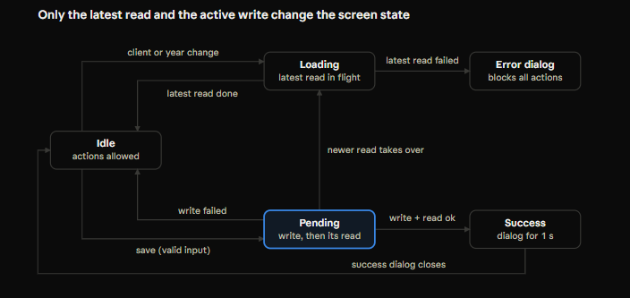

# Lab 07 Part B — Async Against a Fake Service

Nov 15, 2026 · @zhe

## 1. What Part B added

Part B connected the overview to a fake service shaped like the Lab 08 API: the plan loads per client and year, reads are sequenced so only the latest one counts, writes are locked and followed by a refetch, and invalid values are blocked before any request. Error classification and persistence across page reloads move to Lab 08, where they are tested with Vitest and pytest against real errors.

| Fake service function | Returns | Lab 08 equivalent |
| --- | --- | --- |
| `getCropPlan(clientId, forecastYear)` | All rows for that client and year, after 1000 ms | Bundle read route |
| `createRecord(row)` | The stored row with a new id, after 1000 ms | Append route |

The fake keeps its rows in a module-level variable, so a page reload resets it. It was kept deliberately minimal: polishing code that Lab 08 replaces adds nothing.

The walkthrough passed: loading, fast client switching, Add crop and its draft rules, first save, zero, negative, text and empty values, overriding inherited fields, inherited updates, double-click protection and Client Management regression.

## 2. At a glance



A read owns `loading` and a write owns `pending`; each clears only its own state, and only the latest read may act at all. When a newer read takes over during a write's refresh, the write steps aside instead of resetting the screen. Validation errors open the error dialog without any request, and their recovery returns to the field dialog with the draft intact.

## 3. Loading data for the URL's context

Fetched data must remember which context it belongs to. The plan is stored as `loadedPlan = { clientId, forecastYear, rows }`, and every render checks it against the URL before using it.

```js
const matchesCropPlanContext =
    loadedPlan?.clientId === clientId &&
    loadedPlan?.forecastYear === forecastYear

const data = matchesCropPlanContext ? loadedPlan.rows : []
```

**Why the rows live in state.** The chain raw rows → filtered data → resolved view starts with something that arrives later, after `await`. A value that arrives later and must update the screen needs `useState`: it is memory plus a re-render signal.

**Why not a module-level `let`.** Assigning to a module variable never triggers a render, so the screen would not update. It is also shared by every instance and survives unmounting, which is exactly the lifetime the plan should not have.

**The effect is keyed on client and year, not revision.** Changing the revision needs no request, because the bundle already holds every revision and the resolver recomputes locally.

```js
useEffect(() => {
    if (!clientId || !forecastYear) return
    const load = async () => {
        const result = await refresh()
        if (result === 'failed') setError(REFRESH_FAILURE_ERROR)
    }
    load()
}, [clientId, forecastYear])
```

**An effect can depend on any value read during render, not only state.** React compares the dependency values between renders. `clientId` comes from the URL, and it only changes through a re-render caused by the router's own state, so the effect sees the change.

**This is the legitimate kind of effect:** it syncs something outside React (the service) to the URL. Contrast with the revision reset in Part A, which was a reaction to a user event and belonged in the handler.

**Not loaded is not empty.** While the loaded plan doesn't match the URL, the resolved view is `{}`. Shown as "No crops configured" with a live Add crop, that would let a user add a crop the client already has. Traced risk with the final code:

| Situation | Exposure |
| --- | --- |
| First load, or client and year change | One paint before the effect sets loading |
| Read failed | Behind the modal error dialog; nothing can be clicked |
| Read skipped by a lock (the original bug) | Indefinite and interactive — removed with the lock |
| Older read overwrites a newer one | Indefinite and interactive — removed by read sequencing |

The remaining exposure is cosmetic, so a separate "not loaded" render state was deferred.

## 4. Read sequencing

Only the latest read may change the screen. Each read takes a number; when it finishes, it acts only if no newer read has started since.

```js
const refresh = async ({ partOfWrite = false } = {}) => {
    const currentRead = ++readNum.current
    setEditContext(null)
    setDraftCrop(null)
    if (!partOfWrite) setSysState('loading')
    try {
        const rows = await getCropPlan(clientId, forecastYear)
        if (currentRead === readNum.current) {
            setLoadedPlan({ clientId, forecastYear, rows })
            return 'succeeded'
        }
        return 'stale'
    } catch (err) {
        if (currentRead !== readNum.current) return 'stale'
        return 'failed'
    } finally {
        if (!partOfWrite && currentRead === readNum.current) setSysState('idle')
    }
}
```

**Three outcomes, each named.** `succeeded` and `failed` belong to the latest read; `stale` means a newer read superseded this one, so the caller does nothing. A bare `return` (giving `undefined`) made a superseded read look like a failure to `runWrite`.

| Scenario | Older read | Newer read | Screen |
| --- | --- | --- | --- |
| Fast switch, responses in order | `stale`; plan and state untouched | `succeeded` | Newer plan |
| Responses out of order | Arrives last; `stale`; no overwrite | `succeeded` | Newer plan |
| Older read fails | `stale`; no error | `succeeded` | Newer plan, no false error |
| Latest read fails | — | `failed`; error set | Error dialog |

**Why reads use no lock.** A lock refuses the newcomer. For a write that's right: a second request is a duplicate. For a read it's wrong: the second request is the newer view. With a read lock, switching from Farm A to Farm B within a second skipped B's read; A's plan loaded, and B never loaded at all.

|  | Two overlapping writes | Two overlapping reads |
| --- | --- | --- |
| Meaning | A duplicate | A newer view |
| Rule | The second must not happen | The second must win |
| Tool | Lock (`requestLock`) | Sequence number (`readNum`) |

**Why the fake service hid the bug.** Every fake response takes exactly 1000 ms, so responses always arrive in the order they were sent. Out-of-order arrival only appears with real network latency, so this was fixed by reading the code, not by the walkthrough.

**Lab 08 option:** with real `fetch`, an `AbortController` can cancel the older request instead of letting it finish and be ignored. Same rule, enforced at the network level.

**The `partOfWrite` option syntax.** `({ partOfWrite = false } = {})` destructures an optional settings object: the outer `= {}` covers `refresh()` with no argument, the inner `= false` covers an object without the key. Defaults replace only `undefined`, so `refresh(null)` would throw.

## 5. Writes

A write is a request followed by a read: append the row, then refetch the bundle, then show success. The screen never shows a saved value that the service hasn't confirmed and returned through a fresh read (G-12).

**`runWrite(action)` in order:**

1. **Guard:** refuse unless `sysState` is `idle`, no error is open, and `requestLock` is free.
2. **Take the lock** (`requestLock.current = true`), set `pending`, and number the request (`requestNum`).
3. **Await the action.** If the request number changed meanwhile, the result is stale: show a notice and stop.
4. **Refresh as part of the write:** `refresh({ partOfWrite: true })`, which doesn't touch `sysState`, because the write still owns it.
5. **Branch on the refresh result:** `succeeded` → `success` (the success dialog returns to `idle`); `failed` → `idle` plus "Change succeeded, refresh failed"; `stale` → see below.
6. **Catch:** any write failure → `idle` plus the unknown-outcome error, recovered by refreshing.
7. **Finally:** release the lock, but only if this request is still the latest.

**Each process owns its state.** A read and a write both need a "busy" signal, but they finish differently. A standalone read ends at `idle`; a write ends at `success` after its own read. If the write's refresh set `idle` in its `finally`, the screen would briefly look idle mid-write. The `partOfWrite` option tells the refresh it is a step inside a larger process and must leave `sysState` to the owner.

| Process | Sets | Clears |
| --- | --- | --- |
| Standalone read (latest only) | `loading` | `idle` in `finally` |
| Write | `pending` | `success` or `idle` in its own branches |
| Read inside a write | Nothing | Nothing |

**A stale write refresh: clear only what you own.** The write's refresh becomes stale only if a newer read starts during it, which happens when the browser's back button changes the client or year. Two wrong fixes and the right one:

- `setSysState('idle')` overrides the newer read's `loading`, so the screen looks idle while data loads.
- A bare `return` relies on an unwritten rule that every newer read will take over `sysState`; any future caller that doesn't would leave the write stuck in `pending`.
- The functional updater clears the write's own state and nothing else:

```js
if (refreshResult === 'stale') {
    setSysState((current) => current === 'pending' ? 'idle' : current)
    return
}
```

**Why the updater.** Variables in an async handler are snapshots from the render that created it, so `sysState` there is out of date. `setX(prev => ...)` receives the current state at the moment React applies the update. Use it whenever an update depends on the current value rather than the value at click time.

**Refresh clears the dialog and the draft.** Every refresh sets `editContext` and `draftCrop` to `null`, so a successful save closes the dialog and the draft card disappears once the crop is real. A side effect, accepted: saving any field also discards an unsaved draft crop.

## 6. Validation and error recovery

Invalid values are stopped before any request, and each error carries the recovery that fits it.

**Validation order in `handleFieldSubmit`:**

1. Empty or whitespace only → rejected (an empty string must never become `Number("") = 0`).
2. Convert with `Number(value)`; reject unless `Number.isFinite`. This rejects `NaN` and also `Infinity`, which `isNaN` lets through and which `JSON.stringify` would turn into `null`.
3. Negative → rejected. Zero is accepted.

The server repeats these checks in Lab 08; the frontend check is a convenience, the server's is the guarantee.

**Two recoveries:**

| Recovery | Used for | Effect |
| --- | --- | --- |
| `return-to-edit` | Validation errors | Error closes; the dialog and its draft stay |
| `refresh` | Unknown write outcome, failed reads, refresh after a successful write | Error closes; the plan reloads; the dialog closes |

An error with an unrecognized recovery falls back to `refresh` and is reported as unknown, so a typo in an error object can't leave the user without a way out.

**Every write failure is currently treated as unknown.** That is safe, because nothing unconfirmed is shown as saved, but a rejected input also loses its draft. Splitting rejected, retryable and unknown outcomes is deferred to Lab 08.

**Busy means nothing else can start.** `isSystemBusy` is true while loading, pending or an error is open. While busy: Esc is blocked (capture-phase keydown listener), the dialog's inputs and buttons are disabled, and `runWrite` refuses. A disabled Save also blocks Enter, because a form only submits implicitly when it has an enabled submit button. The pending dialog opens as a modal on top, so the field dialog is inert as well; the disabled buttons make that state visible.

## 7. Mistakes and pitfalls

Each row is a bug that happened or was caught in review during Part B.

| Symptom | Root cause | Habit |
| --- | --- | --- |
| `rawData is not defined` when deriving data | The rows arrived inside `refresh`, out of reach of render | Data that arrives later and drives the screen goes in state |
| A saved row never appeared after refresh | URL strings stored as ids, so the fake's numeric filter skipped the row | Convert URL values once, at the boundary, before any write |
| "The service isn't saving" | A log was missed among many re-renders | Check the data before the logic; log at one point and read it carefully |
| Draft card and real card shown together after the first save | Refresh cleared the edit context but not the draft | When a rule applies on every refresh, put it in `refresh` itself |
| A new client's plan never loaded after a fast switch | A read lock skipped the newer read | Reads use sequencing, not locks |
| An older response could overwrite a newer plan | Last response won, not last request | Number reads; only the latest may set state |
| A failed older read would show an error for the new client | `catch` didn't check staleness | Check staleness in every branch, including `catch` |
| A superseded write refresh showed "refresh failed" | Bare `return` gave `undefined`, treated as failure | Name every outcome, including `stale` |
| A proposed stale-branch fix could clear a newer read's loading, or leave `pending` stuck | Setting or skipping state based on assumptions about other callers | Clear only the state you own, with a functional updater |
| `setError` during render on a mismatch | Mismatch is normal while loading; a new object each render loops forever | Derive display from state; set errors only from failed requests |
| `Infinity` passed validation | `isNaN(Infinity)` is false | Use `Number.isFinite` |
| Fake-service polish proposed | Effort on code Lab 08 replaces | Fix only what affects behavior that survives the lab |

## 8. Decisions, limitations and Lab 08 handoff

### Decisions (newest first)

| Decision | Consequence |
| --- | --- |
| A stale write refresh clears only its own `pending`, via a functional updater | Never stuck, never overrides a newer read |
| Reads are numbered; every outcome is named (`succeeded`, `failed`, `stale`) | Only the latest read changes plan, state or errors |
| Writes keep `requestLock`; reads have no lock | Duplicate writes refused; newer reads always win |
| Error-outcome classification and fake failure injection deferred to Lab 08 | Tested against real errors with Vitest and pytest |
| Fake service kept minimal; no polish | Fixed timestamps and loose types in the fake are accepted |
| A separate "not loaded" render state deferred | Remaining exposure is one paint |
| Refresh clears the edit context and the draft | Dialog closes and draft disappears after each save |
| Validation: non-empty, finite, non-negative; zero allowed | Rejected values never reach the service |
| Plan stored with its context; displayed only when it matches the URL | Stale plans are never shown under a new context |

### Known limitations

- Every write failure is treated as an unknown outcome, so a rejected input loses its draft.
- Saving any field discards an unsaved draft crop.
- For one paint after a context change, the crops section can show as empty.
- The fake service resets on page reload; persistence after refresh (INT-06) can't be checked until Lab 08.
- Carried from Part A: malformed year treated as partial; revision validity vs offered revisions; crop card order; hard-coded years.

### Moves to Lab 08

1. Structured errors from the server and a classifier: rejected and retryable return to edit with the draft; unknown refreshes.
2. Server-side validation, id and UTC timestamp assignment, type parsing.
3. Persistence across reloads (INT-06).
4. Adapter tests for parsing and error classification; consider `AbortController` for superseded reads.
5. Open decisions: identical resubmission (D-13), tie-break agreement with the engine, revision 1 completeness for the engine, decimal storage.
