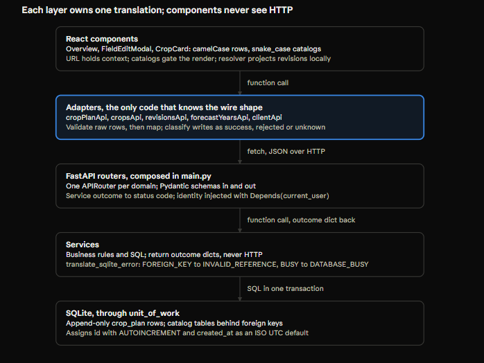

# Lab 08 — Crop Plan Full Stack Patterns

Nov 21, 2026 · @zhe

## 1. What Lab 08 delivered

SQLite and FastAPI replaced the fake service with no component changes beyond an import swap and field renames, and every Lab 07 behavior held. Along the way the backend was split into shared infrastructure and domain packages, and every catalog the crop plan reads (clients, crops, revisions, forecast years, categories) moved from `sampleData.js` to the database.

| Endpoint | Purpose | Success | Failures |
| --- | --- | --- | --- |
| `GET /crop-plan/{client_id}/{forecast_year}` | Raw rows for one workspace | 200, list | 422 bad path param, 500 |
| `POST /crop-plan` | Append one field value | 201, stored row | 422 `INVALID_VALUE` / `INVALID_REFERENCE` / Pydantic, 503 `SERVICE_BUSY`, 500 |
| `GET /crop-plan/categories` | Locked category catalog | 200, list | 500 |
| `GET /crops` | Crop catalog, by id | 200, list | 500 |
| `GET /revisions` | Revision catalog, by `revision_order` | 200, list | 500 |
| `GET /forecast-years` | Year catalog, ascending | 200, list | 500 |

**Exit gate evidence.** pytest covers services and routes for every domain, and Vitest covers every adapter. The manual walkthrough passed against the real backend: initialization, context switching under load, Add crop and its draft rules, inheritance, zero, history, rejected values with the draft preserved, busy rejection from a second writer, unknown outcome with the backend stopped, persistence after reload (INT-06), and catalogs read from the database. Client CRUD tests still pass.

## 2. At a glance



Each layer translates for the one above it. The adapter is the only frontend code that knows the backend's field names and status codes, and the router is the only backend code that knows HTTP.

## 3. Backend structure: shared vs domain

The backend was split the way React Router split the frontend: one composition file, and self-contained domains that never import each other.

```
app/
├── main.py            composition only: create app, CORS, include routers
├── config.py          DB_PATH, BUSY_TIMEOUT, DEFAULT_USER
├── conventions.py     OutcomeKind, DBErrorKind, BackendKeys
├── identity.py        current_user()
├── db/                sqlite_connection, sqlite_errors, schema.sql
├── clients/           router, schemas, service, naming
├── crop_plan/         router, schemas, service
├── crops/  revisions/  forecast_years/
```

**The test for "shared".** Ask whether the other domain would use it unchanged. `db/`, `config` and `identity` pass. `naming.py` (client-name normalization) fails, so it lives in `clients/`.

**Dependencies point one way: `main` → domains → shared.** A domain never imports another domain, and `db/` never imports a domain. Needing to break this is the signal that something sits in the wrong folder.

**Each domain keeps the three layers from Labs 04 and 05.** `router.py` translates outcomes into HTTP, `schemas.py` holds Pydantic models, `service.py` holds rules and SQL and returns outcome dicts. The route never touches SQLite; the service never touches HTTP.

**Move first, change later.** The restructure was a move-only refactor verified by the same test count passing before and after. Behavior changes came only once the suite was green on the new layout, so a red test always had one cause.

**The test layout mirrors the app.** Shared fixtures live in `tests/conftest.py`; domain fixtures live in `tests/<domain>/conftest.py`. Test filenames are unique across folders (`test_client_service.py`, `test_crop_plan_service.py`), which avoids pytest's "import file mismatch" between same-named files in different folders.

## 4. FastAPI `APIRouter`

A router is a container for a domain's routes that knows nothing about `app`. Without it, every domain would import `app` from the composition file, which is the backwards dependency.

```python
# app/clients/router.py
router = APIRouter(prefix="/clients", tags=["clients"])

@router.get("")                 # GET    /clients
@router.post("")                # POST   /clients
@router.patch("/{client_id}")   # PATCH  /clients/{client_id}

# app/main.py
app.include_router(clients_router)
```

**What changes in an endpoint.** The decorator becomes `@router.<method>`, and the path becomes relative to the prefix (`"/clients"` → `""`). Bodies, models, status codes and exceptions are untouched, which is why moving routes was low risk.

**`include_router` copies, it doesn't link.** At the moment it runs, each route is copied into `app` with the prefix glued on. The app ends up with one flat route list (visible in `/docs`). A route added to a router after it was included never appears, and nothing "above" an endpoint runs code or wraps its response.

| React Router | FastAPI |
| --- | --- |
| Parent `path` | `prefix` (concatenated) |
| Parent `element` + `<Outlet>` | No equivalent |
| Index route | A route with path `""` under the prefix |
| Loader or guard on the parent | `dependencies=[...]` on the router |
| Ranked matching, most specific wins | **First registered wins** |

**Pitfalls.**

- **Registration order.** `"/{client_id}"` registered before `"/summary"` swallows `/summary`, then fails `int` validation with a 422. Register fixed paths before parameterized ones. `/crop-plan/categories` (one segment) and `/crop-plan/{client_id}/{forecast_year}` (two) cannot collide.
- **Trailing slashes.** `""` and `"/"` under a prefix are different paths; FastAPI answers one with a 307 redirect to the other, which can drop CORS headers. Pick one style and match it in the adapter.
- **Path parameters can sit in the prefix.** `prefix="/clients/{client_id}/crop-plans"` hands `client_id` to every route under it.

**Where a catalog route lives follows its future.** `GET /crop-plan/categories` stays under crop plan because categories belong to it and are locked. Crops and revisions are their own domains (`/crops`, `/revisions`) because they will grow write routes and management screens.

## 5. Python import resolution and patching

Every test-path problem in this lab came from one fact: a module is cached by the **name** it was imported under, and a value copied at import time never sees a later patch.

**How `import app.main` resolves.** Python walks `sys.path`, a list of folders, looking for `app/main.py`. The loaded module is cached in `sys.modules` under `"app.main"`, and every later import of that name returns the same object.

**One file under two names is two modules.** With `pythonpath = ["app"]`, pytest put `backend/app/` on the path, so `app/main.py` was importable both as `app.main` and as `main`. Each name got its own module object, and patching one changed nothing in the other.

```toml
# pyproject.toml
[tool.pytest.ini_options]
pythonpath = ["."]   # backend/ on sys.path; every module has exactly one name: app.*, tests.*
```

`"."` is relative to the folder holding `pyproject.toml`, not the folder pytest runs from. `python -m pytest` also adds the current directory to `sys.path`; plain `pytest` does not, so the two can disagree.

**Patch where a value is read, not where it is defined.**

| Code in the router | What the router holds | Patch that works |
| --- | --- | --- |
| `from app.config import DB_PATH` | Its own copy, made at import | `app.clients.router.DB_PATH`, one per router |
| `DB_PATH = app.config.DB_PATH` at module level | Its own copy, made at import | Same; this is still a copy |
| `from app import config`, then `config.DB_PATH` inside the function | A reference to the module, read per request | `app.config.DB_PATH`, once for every router |

**Import time vs request time.** Module-level code runs once, when pytest collects the tests and imports `app.main`. The `api` fixture patches later, and the request runs later still. Only a lookup that happens inside the function, at request time, sees the patch.

```text
import time   router module loads   → module-level copy = "dev.db"
test time     fixture patches config → config.DB_PATH = tmp/test.db
request time  route runs             → copy still "dev.db";  config.DB_PATH → tmp/test.db
```

**The same rule covers every patched setting.** The blocker fixtures patch `app.config.BUSY_TIMEOUT`, which only works if `sqlite_connection.py` reads `config.BUSY_TIMEOUT` at call time. If it copied the value, busy tests would still pass, just slowly. `pytest --durations=5` exposes that.

**Prefer `from app import config` over `import app.config`.** The second binds the name `app` in the importing module, and in `main.py`, `app = FastAPI()` overwrites it.

**Diagnosing import trouble.**

- `ModuleNotFoundError: No module named 'app'` means no folder on `sys.path` contained `app/` for that run. Check the pytest header for `rootdir` and `configfile`.
- `poetry run pytest --collect-only -q` imports every test without running it, so import errors show up immediately.
- `"config" is unknown import symbol` came from Pylance, not Python. When the tests pass, the editor's search roots are wrong, not the code.
- A `ModuleNotFoundError` that appeared with no code change vanished after restarting VS Code: a stale terminal environment. A fresh terminal is a cheap first step.

## 6. Identity seam with `Depends`

Identity enters through one function at the route layer, so adding authentication later changes that function's body and nothing else. This is a temporary workaround until real identity exists.

```python
# app/config.py
DEFAULT_USER = "Test User"          # stand-in until authentication exists

# app/identity.py
from app import config

def current_user() -> str:
    """The single source of the acting user. Replace the body when auth exists."""
    return config.DEFAULT_USER      # read at call time, like DB_PATH

# a router
@router.post("", status_code=201, response_model=CropPlanData)
def create_crop_plan(payload: CropPlanCreateRequest, user: str = Depends(current_user)):
    result = create_record(config.DB_PATH, ..., modified_by=user)
```

**What `Depends` does.** On every request, FastAPI calls `current_user()` itself and passes the return value in as `user`. The route never calls it. Because the call happens per request, the value is always fresh.

**Why the seam sits in the route, not the service.** Identity will come from the request (a token or session), which is an HTTP concern. Later, `current_user` can declare its own dependencies, such as a header, and FastAPI resolves them; routes stay unchanged.

**Services take identity as a required parameter.** No default means a service records whoever it is told and never invents an identity. Its behavior is identical before and after auth: it receives a name from its caller. The old service defaults (`"TEST USER"` in one function, `"Test User"` in another) are gone for that reason.

**The frontend no longer sends `createdBy`.** Pydantic ignores undeclared fields, so a client-sent identity would be silently dropped. Removing it stops the frontend from implying it controls identity, and an API test confirms a client-supplied `modified_by` is ignored.

**Testing the seam with `dependency_overrides`.** It is a plain dictionary on `app` that FastAPI checks before calling a dependency. The key must be the same function object the routes use.

```python
@pytest.fixture
def as_user():
    app.dependency_overrides[current_user] = lambda: "Override User"
    yield "Override User"
    app.dependency_overrides.pop(current_user, None)   # must clean up
```

The dictionary lives on the one shared `app` and nothing resets it, so an override left in place leaks into every later test. Unlike `monkeypatch`, cleanup is manual, which is why it lives in a yield fixture. Overriding tests the seam that survives auth; monkeypatching `DEFAULT_USER` would test today's stand-in.

## 7. Append-only service and the outcome contract

Every write outcome must tell the frontend one of three things: it happened, it definitely did not happen, or nobody knows. Getting "definitely not" right is what keeps a user's draft alive.

| Service outcome | Cause | HTTP | Frontend class | UI recovery |
| --- | --- | --- | --- | --- |
| `CREATED` | Row inserted | 201 | Success | Refetch, success dialog |
| `INVALID_VALUE` | Negative value | 422 | Rejected | Return to edit, draft kept |
| `INVALID_REFERENCE` | Unknown client, crop, revision, category or year | 422 | Rejected | Return to edit, draft kept |
| (Pydantic) | Wrong type or missing field, before the handler | 422 | Rejected | Return to edit, draft kept |
| `DATABASE_BUSY` | Write lock timed out, rolled back | 503 | Rejected (no retries in Phase 1) | Return to edit, draft kept |
| `UNKNOWN` | Anything unrecognized | 500 | Unknown | Refresh first, never resubmit blindly |

**Foreign keys do the reference validation.** One insert with `PRAGMA foreign_keys=ON` checks all five references at once. `translate_sqlite_error` already maps the failure to `DBErrorKind.FOREIGN_KEY`; the service maps that to its own outcome. SQLite does not say which constraint failed, so the message names all candidates.

**One outcome name, one meaning.** `REFERENCED` in Client CRUD means "cannot delete, others point at this." A missing reference on insert is the opposite situation, so it got its own outcome, `INVALID_REFERENCE`, and a 422 rather than a 409. Now that crop plan rows reference clients, deleting such a client returns the real `REFERENCED`.

**Without a mapping, a definite rejection becomes "unknown."** Before `INVALID_REFERENCE` existed, a bad crop id fell through to `UNKNOWN` and a 500. The frontend would have refreshed and dropped a draft for a request that provably wrote nothing.

**The server owns `id`, `created_at` and `modified_by`.** The request schema doesn't declare them, so client-sent values are dropped. `id` comes from `AUTOINCREMENT`, which also guarantees increasing ids, the basis of the frontend tie-break. `created_at` comes from the column default.

**Append-only means no `UPDATE` or `DELETE` paths at all.** Two saves of the same field are two rows; history is preserved by construction. `(client, year, crop, revision, category)` is deliberately not unique.

**Validation lives in layers by decision, not by accident.** The frontend blocks empty, non-numeric and negative input. The service rejects negatives. Pydantic rejects non-numbers. `NaN` and `Infinity` are not checked: the browser's `JSON.stringify` turns them into `null`, which Pydantic rejects, and the backend assumes the frontend is its only writer. No database `CHECK` either, for the same reason. A second writer, such as an import script, would need both.

**A service catches `sqlite3.Error`, not `BaseException`.** `BaseException` also catches `KeyboardInterrupt`. Non-SQLite exceptions propagate and become a 500, which is the correct "unknown."

**The busy branch on reads is harmless but untested.** An uncommitted writer holds a reserved lock, which does not block readers in SQLite's default journal mode, so a read rarely returns busy. The branch stays for consistency; no read-busy tests exist.

## 8. Schema and catalogs

The database became the single source for every catalog, and each table follows the same conventions so a future management screen can treat them alike.

| Table | Key the crop plan stores | Editable later | Notes |
| --- | --- | --- | --- |
| `clients` | `client_id` (surrogate) | Yes, via Client Management | Empty is a valid state |
| `crops` | `crop_id` (surrogate) | Yes | `name_standardized` unique, hidden from the API |
| `revisions` | `revision_id` (surrogate) | Yes | `revision_order` unique, must be > 0 |
| `forecast_years` | `forecast_year` (natural key) | Yes | Must be > 2025; `id` hidden from the API |
| `crop_plan_categories` | `category_key` (natural key) | **No, locked** | Changing one changes engine logic |

**A foreign key can target a `UNIQUE` column, not only the primary key.** `crop_plan.forecast_year` references `forecast_years(forecast_year)`, so rows keep storing the real year. The URL, the bundle route `/crop-plan/1/2026` and the frontend all keep speaking years, and the surrogate id never leaves the backend.

**Locked vs extendable is a domain decision, recorded once.** Categories are part of the forecast engine's logic; crops, revisions, years and clients are data. That difference decides which catalogs get write routes later and which stay read-only forever.

**Timestamps are ISO 8601 UTC with a `Z`.** `datetime('now')` is already UTC, but its `2026-11-15 14:30:00` format parses inconsistently in browsers, usually as local time. The fix is a format, not a time zone:

```sql
modified_at TEXT NOT NULL DEFAULT (strftime('%Y-%m-%dT%H:%M:%SZ', 'now'))
```

A default that is an expression must be wrapped in parentheses.

**SQL details that bit.** Double quotes are identifiers in SQL; `"Zhe"` worked only because SQLite falls back to a string when no such column exists. Strings take single quotes. `executescript` needs a semicolon between statements, and every column definition before a `CONSTRAINT` needs its comma.

**Schema changes never reach an existing database.** `CREATE TABLE` runs only when `dev.db` is created. Tests build a fresh database from `schema.sql` every time, so they cannot catch a stale `dev.db`. Until there is a migration step, every `schema.sql` change means re-running `init_db.py` on a new file, which discards dev data.

**Seed data makes tests richer and changes assumptions.** Because `conftest.py` loads the whole `schema.sql`, every test database starts with crops, revisions, years and categories. Foreign key tests get real catalogs to hit, but a test that assumed an empty catalog would now be wrong. Clients are not seeded, so crop plan tests create them in a fixture.

## 9. Backend testing patterns

A fixture is injected by parameter name, runs once per test by default, and is shared by everything in that test that asks for it. That last property is what lets an API test insert rows with SQL and read them back over HTTP from the same database.

| Kind | Shape | Used for |
| --- | --- | --- |
| Plain fixture | `return` a value | `db_path`, `client_ids` |
| Fixture chain | A fixture asks for fixtures | `api` asks for `db_path` and `monkeypatch` |
| Yield fixture | Setup, `yield`, teardown (runs even on failure) | `write_blocker`, `as_user` |
| Factory fixture | `yield` or `return` a function | `write_blocker2`, `make_record` |
| Helper | Plain function with arguments, no fixtures | `committed_crop_plan(db_path)` |

**Fixture or helper?** A fixture when it needs setup, teardown or another fixture. A helper when it is just logic over arguments.

**Factory fixtures exist for timing.** A crop plan busy test needs a committed client first, then a held lock. `write_blocker` takes the lock during setup, so a client fixture set up after it would hit the lock and fail before the test starts. `write_blocker2` hands the test a function, so the test decides when the lock is taken. This is also why the blockers stay global: crop plan needs them too, and inserting into `clients` is incidental.

**Fixtures are scoped by folder.** A `conftest.py` provides fixtures to its folder and below, with no import. Shared fixtures (`db_path`, `api`, blockers) live at `tests/`; `client_ids`, `make_record` and `as_user` live in `tests/crop_plan/`.

**Arrange steps use direct SQL, not another domain's service.** `client_ids` inserts clients with SQL so a bug in the client service cannot break every crop plan test.

**Isolation from the real database is one patch.** `api` patches `app.config.DB_PATH`; every router reads it at request time (section 5). Getting that wrong meant tests silently wrote to `dev.db`.

**Assertions that cannot pass vacuously.**

- **Compare whole lists, not loops.** `for i, r in enumerate(results): assert ...` passes on `[]` and on a truncated list. `assert [r["forecast_year"] for r in results] == [2026, 2027, 2028, 2029]` checks length, membership and order in one line.
- **Exact field sets.** `set(row.keys()) == {...}` catches leaked fields; `col in row` does not. Guard the loop with `assert len(records) > 0`.
- **Prove order comes from the query.** Insert a row that sorts first but was inserted last (a revision with the highest id and lowest order). Where no such row can exist, as with crops ordered by id, no test can tell `ORDER BY` from scan order, so none was written; the `ORDER BY` stays anyway.
- **Isolate one cause per negative test.** A 503 body with a wrong code and a wrong message passes even if the message check is broken.
- **Assert the positive outcome.** `modified_by == "Override User"` says more than `modified_by != "ignore"`.
- **Assert nothing was written** after every rejection, using a helper that reads the table.
- **Parametrize independent cases.** Five invalid references in one sequential test report one failure per run; `@pytest.mark.parametrize` reports all five.

**Adjacent same-typed parameters swap silently.** `make_record` passed `memo, modified_by` positionally while the service had changed to `modified_by, memo`. Both are strings, so Python accepted it; the tests using that fixture never checked either field, so nothing failed. Passing them by keyword fixed it. Keyword-only parameters (`*` in the signature) would make a positional call fail loudly.

**Removing a default surfaces every caller.** Dropping `modified_by`'s default raised `TypeError` even in tests whose code path never used it, because Python checks arguments at call time. Those failures were the inventory of callers that relied on an invented identity.

## 10. Frontend adapter

The adapter is the only file that knows the backend's shape. It builds the request, checks the response, translates names and classifies the outcome, so components above it never change when the backend does.

**The bridge contract held because signatures were kept.** `getCropPlan(clientId, forecastYear)` and `createCropPlan(payload)` match the fake service's shapes. Swapping `fakeApi.js` for `cropPlanApi.js` in `Overview` was an import change.

**Validate first, then map.** The validator checks the backend's contract on raw snake\_case rows; mapping runs only on rows that pass. Below the mapping is backend shape, above it is frontend shape.

```js
const fromApiCropPlan = (row) => ({
    id: row.id,
    clientId: row.client_id,
    forecastYear: row.forecast_year,
    cropId: row.crop_id,
    revisionId: row.revision_id,
    categoryKey: row.category_key,
    value: row.value,
    createdBy: row.modified_by,   // a rename, not just a case change
    memo: row.memo,
    createdAt: row.created_at,
})
```

**List fields explicitly instead of a generic converter.** An explicit list doubles as an allowlist (unexpected fields are dropped) and can rename (`modified_by` → `createdBy`), which a regex camel-caser cannot.

**Translate where the shape differs, not everywhere.** Crop plan rows map to camelCase because components already speak camelCase. Catalog and configuration data stays snake\_case end to end and is returned unchanged.

**One bad row rejects the whole response.** `data.every(isValid)` either accepts the bundle or throws. A partially rendered plan is worse than an error.

**Write classification, by status.**

| Response | Adapter throws |
| --- | --- |
| `fetch` rejects, or `response.json()` fails | Unknown |
| 201 with a valid row | Nothing; returns the mapped row |
| 201 with an invalid row | Unknown |
| 503 with `SERVICE_BUSY` | `non-retryable`, backend message |
| 422 with `INVALID_VALUE` or `INVALID_REFERENCE` | `non-retryable`, backend message |
| 422 with an array `detail` (Pydantic) | `non-retryable` `INVALID_VALUE`, generic message |
| Anything else, including 500 and 404 | Unknown |

**Anything the adapter cannot positively classify is unknown, never success and never rejection.** That rule is what makes the UI's refresh-first recovery safe.

**There are two shapes of 422.** Your own errors send `detail: {code, message}`. Pydantic sends `detail` as an array of `{type, loc, msg, input}`, before the handler runs. `Array.isArray(data?.detail)` tells them apart; both mean nothing was written.

**Optional chaining guards only what follows it.** `data.detail?.loc.includes("value")` threw, because `detail` was the array, `.loc` on it was `undefined`, and `.includes` ran on `undefined`. Errors thrown outside the `try` escape as raw errors instead of `ApiError`s.

**Three bugs from one class: a value nobody checked.** `memo === null` named a variable that didn't exist (`cp.memo` was meant), so every memo-less row threw a `ReferenceError`. `response.json()` without `await` returned a Promise, so `Array.isArray` was always false. `Overview` used `ApiError` without importing it, so every failed write died inside its own `catch`. Each was invisible on the happy path.

**Take an object, not positional arguments.** Four adjacent integer ids are an easy swap, and the backend would accept a swapped crop and revision if both exist. An object parameter removes the risk and matches the fake's `createRecord(payload)`.

## 11. Frontend adapter testing with Vitest

Adapter tests replace `fetch` itself and script its reply, so no backend runs. They check exactly the adapter's job: what it sends, how it reads the reply and how it classifies the outcome.

| pytest | Vitest |
| --- | --- |
| `def test_...` | `it('...', async () => {...})` inside `describe` |
| `assert x == y` | `expect(x).toEqual(y)` |
| `pytest.raises` | `await expect(promise).rejects.toMatchObject({...})` |
| `monkeypatch.setattr` | `vi.stubGlobal('fetch', vi.fn())` |
| `@pytest.mark.parametrize` | `it.each([...])` |
| Teardown after `yield` | `afterEach(() => vi.unstubAllGlobals())` |

```js
beforeEach(() => { vi.stubGlobal('fetch', vi.fn()) })
afterEach(() => { vi.unstubAllGlobals() })      // a global stub leaks like dependency_overrides

it('builds the GET URL from clientId and forecastYear', async () => {
    fetch.mockResolvedValue(new Response(JSON.stringify([]), { status: 200 }))
    await getCropPlan(7, 2026)
    expect(fetch).toHaveBeenCalledWith('http://127.0.0.1:8000/crop-plan/7/2026')
})
```

**Use a real `Response`.** Node 18+ provides it, so `.json()` behaves as in the browser, including failing on `new Response('not JSON')`. A hand-made `{ status, json }` object is the fallback.

**Three ways to script `fetch`.** `mockResolvedValue(response)` returns a reply; `mockRejectedValue(new TypeError('Failed to fetch'))` simulates an unreachable server or a CORS block; a malformed body tests the parse failure.

**The mock records what was sent.** `fetch.mock.calls[0]` holds `[url, options]`. `JSON.parse(options.body)` compared with `toEqual` checks the outgoing translation without depending on key order; comparing `JSON.stringify` strings breaks if the mapper reorders keys.

**Choose inputs that cannot be confused.** `getCropPlan(1, 1)` cannot catch a swapped URL template; `getCropPlan(7, 2026)` can, because the swap gives `/2026/7`.

**`toEqual` for mapped results, not `toMatchObject`.** `toMatchObject` passes when the result merely contains the listed fields, so a misspelled `createdBy` or `createdAt` mapping goes unnoticed. `toEqual` checks every field and rejects extras.

**Test the whole list is rejected, not a list of one.** Each invalid-row case puts a valid row first, then the bad one. Setting a field to `undefined` makes `JSON.stringify` drop the key, so "missing" is genuinely missing on the wire.

**Turn a rejection into a value to inspect.** `promise.then(() => { throw ... }, (err) => err)` returns the error, and fails loudly if the promise resolves instead.

**Regression tests name the bug they guard.** A row with `memo: null` guards the `ReferenceError`; a categories test expecting an array guards the missing `await`.

**Mark tests that encode a policy.** The `revision_order` and `forecast_year > 2025` boundary cases carry a comment saying to update them if the rule changes, which made them easy to find when the rule did change twice.

## 12. Catalog loading and the initialization gate

The workspace renders only once every catalog has loaded. Until then the page shows "Initializing" or an initialization error, and nothing else runs.

```js
const [clients, categories, revisions, crops, forecast_years] = await Promise.all([
    getClients(), getCropPlanCategory(), getRevisions(), getCrops(), getForecastYears(),
])
```

**Catalogs and the bundle have different lifecycles.** Catalogs are needed once, change rarely and don't depend on the URL. The bundle depends on client and year. So catalogs get their own load, their own status (`loading` | `ready` | `error`) and their own read sequencing (`catalogReadNum`), separate from `refresh`.

**Gating the render also fixes the URL gate.** `urlStates` compares the URL against catalog lists. Run against empty lists, every complete URL classifies as `invalid`, which would flash "This link doesn't match" on every load. Rendering the workspace only when `catalog.status === 'ready'` means the gate never runs on empty data.

**The bundle waits for the catalogs.** Its effect is keyed on `[catalog.status, clientId, forecastYear]` and returns early until `ready`. After a failed initialization and a successful retry, the status change reruns it, so the URL's workspace loads with no extra code.

**All or nothing.** The page cannot work without any one catalog, so `Promise.all` failing on the first error matches reality. Recovery has its own value, `refresh-catalog`, because the existing `refresh` reloads the crop plan, not the catalogs.

**"Every mount", not "every browser refresh".** An effect with `[]` runs whenever `Overview` mounts, including navigating back from Client Management. That is useful: a client added there appears in the selector on return. In development, Strict Mode mounts twice; the first catalog read returns `stale` and is ignored.

**An effect must call the function it defines.** The first version defined `initialLoad` inside the effect and never called it, so the page showed "Initializing" forever.

**Migrating a catalog means finding every reader.** `FieldEditModal` still imported `clients` from `sampleData.js` and threw for a client that existed only in the database. The final check is a grep for `sampleData` imports: only `cardGroups` remains in app code, because it groups locked category keys.

**Empty is a valid catalog state.** A fresh installation has zero clients, and that is normal, not a failure. The "catalogs must be non-empty" rule was dropped; an empty table is a successful read returning `[]`.

**Frontend rules must match backend rules.** A validator stricter than the database rejects the entire catalog when one row breaks its rule, and with all-or-nothing loading the page cannot start. `revision_order > 0` and `forecast_year > 2025` are deliberate application rules, and the boundary tests document them.

## 13. Integration debugging

The most misleading failures came from the boundary between layers, where the message names one layer and the cause sits in another.

**A backend 500 looks like a CORS error in the browser.** When a route raises an unhandled exception, as these routes do on purpose for `UNKNOWN`, Starlette's error handler builds the 500 outside `CORSMiddleware`. The response has no `Access-Control-Allow-Origin` header, the browser blocks it, and DevTools reports CORS. When only one endpoint "fails CORS", the middleware is fine; check the server log.

| Symptom | Real cause | How it was confirmed |
| --- | --- | --- |
| CORS error on `/forecast-years` only | `no such table: forecast_years` in a stale `dev.db` | uvicorn traceback; opening the URL directly (same origin) |
| `ModuleNotFoundError: No module named 'app'` with no code change | Stale VS Code terminal environment | Gone after restarting VS Code |
| Pylance: `"config" is unknown import symbol` | Editor search roots, not Python | Tests passed with the same import |
| Tests wrote to `dev.db` | Module-level copy of `DB_PATH` | Leftover test rows; section 5 |

**Three ways to see the real response.** The server terminal shows the traceback. Opening the endpoint URL directly is same-origin, so CORS doesn't apply. `sqlite3 dev.db ".tables"` shows what the file actually contains.

**The adapter behaved correctly even while the message misled.** The blocked response made `fetch` reject, which became `REFRESH_ERROR`, so the page showed the initialization error instead of rendering without years.

**Manual failure injection that worked.**

- **Rejected writes:** temporarily disable frontend validation and submit a negative or non-numeric value. The draft must survive.
- **Busy:** add a delay inside the unit of work, then save the same field from two tabs. One UI instance cannot overlap its own writes, because the request lock refuses the second.
- **Unknown:** stop uvicorn, then save. The dialog must offer Refresh, not Close. Restart and reload to confirm earlier commits persisted.
- **Stale reads:** with real latency, refresh one client and immediately switch to another. The newer workspace must win.

**The truly ambiguous case can't be reproduced by hand.** Stopping the backend before a save produces "unknown" where nothing happened. A commit followed by a lost response needs the server killed between commit and reply. The adapter's network-rejection test plus refresh-first recovery cover it.

## 14. Mistakes and pitfalls

Most bugs in this lab passed every happy-path check and surfaced only on a failure path, a second caller or a fresh database.

| Mistake | Effect | Fix | Lesson |
| --- | --- | --- | --- |
| Fixture patched `main.DB_PATH` after the move | `AttributeError`, or a patch no route reads | Patch `app.config.DB_PATH`; routers read it per request | Patch where read |
| `DB_PATH = app.config.DB_PATH` at module level | Tests silently hit `dev.db` | Look it up inside the function | Module-level assignment is a copy |
| `pythonpath = ["app"]` | Same file importable as `main` and `app.main` | `pythonpath = ["."]` | One module, one name |
| `memo: str` required in the request | Every memo-less save got a 422 | `str \| None = None` | Match the schema to what the client sends |
| `created_at` missing from the response model | Field silently filtered out | Declare it | `response_model` drops undeclared fields |
| Foreign key error fell to `UNKNOWN` | Definite rejection read as "maybe committed" | `INVALID_REFERENCE`, 422 | Map every known failure |
| `REFERENCED` reused for a missing reference | One name, two opposite meanings | Separate outcome | One outcome, one meaning |
| `make_record` swapped `memo` and `modified_by` | Wrong data stored, no test failed | Pass by keyword | Same-typed neighbors swap silently |
| `enumerate` loops in assertions | Pass on `[]` or a short list | Compare whole lists | Assertions must fail on empty |
| `memo === null` (undeclared variable) | `ReferenceError` on every memo-less row | `cp?.memo === null` | Test the null case |
| `response.json()` without `await` | Categories always failed | `await` | A Promise is not an array |
| `detail?.loc.includes` on an array | Raw `TypeError` escaped classification | Look inside the array | `?.` guards only the step after it |
| `ApiError` not imported in `Overview` | Failed writes showed nothing | Import it | A crash inside `catch` loses the error |
| Unknown outcome given `return-to-edit` | Invited a duplicate append | Keep `refresh` | Unknown means maybe committed |
| `revision.order` renamed in some readers only | Resolver would return `{}` silently | Rename every reader, run resolver tests | Grep every reader of a renamed field |
| `initialLoad` defined, never called | "Initializing" forever | Call it | Effects must invoke what they define |
| `FieldEditModal` read `sampleData` clients | Threw for a database-only client | Pass the catalog in | Grep for the old source |
| Stale `dev.db` after a schema change | 500 shown as a CORS error | Re-run `init_db.py` | Tests never see `dev.db` |

**Two patterns behind most of these.** First, values copied once (an import, a module-level assignment, a seeded file) don't follow later changes. Second, code paths no test exercises (a null field, a failure branch, a second caller) hide bugs that the happy path never reaches.

## 15. Decision record

Decisions made during Lab 08, newest first.

| Date | Decision | Reason |
| --- | --- | --- |
| At close | `revision_order` must be > 0, enforced by the frontend validator | The app assumes revisions start at 1 |
| At close | `forecast_year` must be > 2025 | Forecast data will never be backfilled |
| 2026-11-16 | Catalogs load all or nothing before the workspace renders | The page can't work without any one; avoids the false "invalid link" flash |
| 2026-11-16 | Bundle load waits for `catalog.status === 'ready'` | URL validity is unknown until catalogs exist |
| 2026-11-16 | Empty catalogs are valid; no non-empty rule | A fresh installation has zero clients |
| 2026-11-16 | Catalog data stays snake\_case end to end; crop plan rows map to camelCase in the adapter | Translate only where components already use another shape |
| 2026-11-16 | `forecast_years` API response omits `id` | `crop_plan` references the natural key; the surrogate id never leaves the backend |
| 2026-11-16 | Revisions ordered by `revision_order`, crops by `id`, years ascending | Precedence, current card order, selector order |
| 2026-11-16 | Every write failure classifies as `non-retryable` or unknown; no retries in Phase 1 | Retries are out of scope; `SERVICE_BUSY` keeps its code for later |
| 2026-11-16 | Any Pydantic 422 is a rejection with a generic `INVALID_VALUE` message | Nothing was written; frontend validation makes it rare |
| 2026-11-16 | `createCropPlan` takes one payload object | Avoids swapped ids; matches the fake's signature |
| 2026-11-15 | All frontend renames done together after the backend | One pass instead of churn per layer |
| 2026-11-15 | Identity via `Depends(current_user)` reading `config.DEFAULT_USER`; services require it | One seam to replace when auth exists |
| 2026-11-15 | Categories locked; crops, revisions, years and clients extendable | Categories are engine logic; the rest is data |
| 2026-11-15 | `GET /crop-plan/categories` under crop plan; `/crops`, `/revisions`, `/forecast-years` as own domains | Ownership and future write routes |
| 2026-11-15 | `forecast_years` table, referenced by `forecast_year` | Replaces the hard-coded year list; keeps years in URLs and rows |
| 2026-11-15 | Missing reference → `INVALID_REFERENCE`, 422 | Definite rejection, distinct from `REFERENCED` |
| 2026-11-15 | Timestamps as `strftime('%Y-%m-%dT%H:%M:%SZ', 'now')` | Unambiguous UTC in every browser |
| 2026-11-15 | No `NaN`/`Infinity` check and no database `CHECK` on `value` | The frontend is the only writer, and the browser can't send them |
| 2026-11-15 | Bundle read as `GET /crop-plan/{client_id}/{forecast_year}` | Client and year identify the bundle |
| 2026-11-15 | Routers read `config.DB_PATH` at request time; tests patch it once | One patch point for every domain |
| 2026-11-15 | Backend split into shared infrastructure and domain packages | A second domain needed its own routes, schemas and services |
| 2026-11-15 | Blockers stay global; table-free `BEGIN IMMEDIATE` blocker deferred | Both domains need them; the insert into `clients` is incidental |

## 16. Known limitations and open decisions

Phase 1 ships with these accepted limitations; the open decisions below must be settled or explicitly moved to the backlog.

### Accepted limitations

| Limitation | Effect | Revisit |
| --- | --- | --- |
| "First revision" hard-coded as id `1` / order `1` in four places in `Overview` | A revision with a lower order or a different first id would start new crops in the wrong revision | When revisions become editable |
| No migrations | Every `schema.sql` change means re-creating `dev.db` and losing dev data | Before any shared or persistent database |
| Identity is a constant | Every row records `DEFAULT_USER` | When authentication exists |
| No `NaN`/`Infinity` or database `CHECK` on `value` | A second writer could store invalid values | When anything besides the frontend writes |
| No write retries | `SERVICE_BUSY` returns to edit; the user resubmits | If busy becomes common |
| Generic message for Pydantic 422s | A malformed id is reported as a value problem | If it ever happens in practice |
| Crop plan and Client Management show write progress differently | One `pending` phase vs pending then loading | If consistency matters to users |
| Table-free write blocker deferred | Busy tests depend on the `clients` table | If the `clients` schema changes |
| Adapter test helpers copied in three files | Duplication across test files | When a fourth adapter appears |

### Open decisions

| Decision | Notes |
| --- | --- |
| Tie-break shared with the forecast engine | Frontend uses highest id within the winning revision; the engine uses latest timestamp. They must agree. |
| Identical value and memo resubmission (D-13) | New row or no-op. Currently a new row. |
| Decimal representation | `REAL` in SQLite, numbers in the frontend; storage precision undecided. |
| Does the engine need every category in revision 1? | If yes, a completeness rule is needed, which the spec excludes. |
| `AbortController` for superseded reads | Read sequencing already prevents wrong data; aborting would save bandwidth. |

### Backlog notes from this lab

- Keyword-only parameters in `create_record` and other services with adjacent same-typed arguments.
- Merge `make_record` and `use_create_record` into one factory.
- Read-busy behavior, if ever needed, settled by an experiment against `unit_of_work`.
- Rename `sampleData.js` to reflect that it now holds test fixtures and `cardGroups`.
