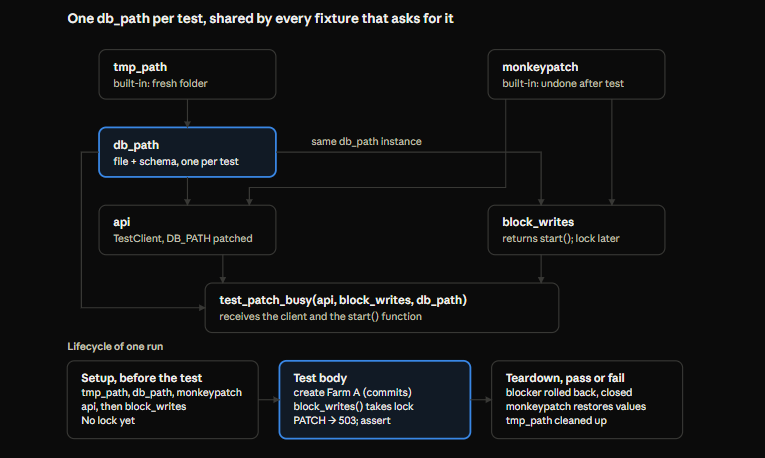

# Python Unit Testing with pytest — Database, Service and API Layers

Oct 26, 2026 · @zhe

## Scope

This doc collects the pytest mechanics and testing patterns used to cover the GrowLytics Client CRUD backend at three layers: the database layer (`unit_of_work`, `translate_sqlite_error`), the service layer (`client_service.py`), and the API layer (FastAPI routes). Frontend testing uses a different toolchain and gets its own doc.

**Why tests replaced manual checking.** Every finding from the Lab 05 notebook experiments (rollback scope, ID non-reuse, lock contention, foreign-key enforcement) is now a test that reruns in under a second. A code change no longer needs a manual click-through to know whether it broke something.

**The three layers and what each one proves:**

| Layer | Test file | Proves | Does not re-prove |
| --- | --- | --- | --- |
| Database | `test_unit_of_work.py`, `test_sqlite_errors.py` | Commit and rollback scope, FK enforcement, each SQLite error maps to the right neutral kind | Business rules |
| Service | `test_client_service.py`, `test_modify_client.py`, delete tests | Each operation returns the right outcome and leaves the right committed state | Translation details already covered below it |
| API | `test_api.py` | Each outcome becomes the right HTTP status and error envelope (the contract) | Normalization, rollback, ID rules already covered below it |

Each layer tests its own responsibility and trusts the layer under it, because that layer has its own tests. That keeps every test short and every failure pointing at one place.

**How to read:** sections 2 to 6 are pytest mechanics, independent of this project. Sections 7 to 9 are the patterns per layer, with the project's own tests as examples. Section 10 is the pitfalls met along the way. Section 11 is a checklist and cheat sheet.

## Setup

Run everything from `backend/`, with `pyproject.toml` telling pytest where the `app` package lives; most "cannot import" errors come from running from the wrong folder.

**Install:** `pip install pytest httpx` (`httpx` is what FastAPI's `TestClient` is built on).

**Layout:**

```
backend/
├── pyproject.toml
├── app/                 # the code under test, imported as app.*
└── tests/
    ├── __init__.py      # empty; lets tests import tests.helpers
    ├── conftest.py      # fixtures shared by every test file
    ├── helpers.py       # plain helper functions (insert_client, committed_names)
    └── test_*.py
```

**`pyproject.toml`:**

```toml
[tool.pytest.ini_options]
pythonpath = ["."]
testpaths = ["tests"]
```

`pythonpath = ["."]` adds `backend/` to Python's import path while tests run, so `from app.db.sqlite_connection import unit_of_work` resolves. `testpaths` tells pytest where to look.

**Running:**

| Command | Runs |
| --- | --- |
| `pytest` | Every test |
| `pytest -v` | Every test, one line per test with its name |
| `pytest tests/test_api.py` | One file |
| `pytest tests/test_api.py::test_patch_busy` | One test |
| `pytest -x` | Stops at the first failure |
| `pytest -k busy` | Only tests whose names contain "busy" |

**Reading the output:** each test shows as `.` (passed), `F` (failed), `s` (skipped) or `E` (error in a fixture, before the test body ran). For a failure, pytest prints the failing line, both sides of the comparison, and the traceback.

**Read which step failed before changing anything.** The traceback's line number tells you whether the failure happened in the arrange step (the test setup is wrong), the act step (the code raised), or an assert (the code's result is wrong). In the `modify_client` busy test, the blocker's own INSERT failed NOT NULL during arrange; nothing about the code under test was wrong.

## Core mechanics

A test is a function whose name starts with `test_`; it passes if it finishes without an exception and fails if an `assert` is false or anything raises.

**Discovery.** pytest collects files named `test_*.py` under `testpaths`, and inside them, functions named `test_*`. Each function runs separately, so one test's failure never stops another.

**Plain `assert`.** No special assertion methods are needed. When an assert fails, pytest rewrites it to show both sides:

```python
assert committed_names(db_path) == ["Farm A"]
# E  AssertionError: assert ['Farm A', 'Farm B'] == ['Farm A']
```

**Assert messages.** A second argument after a comma is printed only on failure. For HTTP tests, printing the body explains most wrong statuses at once:

```python
assert response.status_code == 201, response.text
```

**The arrange / act / assert shape.** Every test in this project follows it:

1. Arrange: build the state the test needs (a fresh database, an existing client).
2. Act: perform exactly one operation under test.
3. Assert: check the result and the resulting state.

One act per test means a failure names one behavior.

**Parametrize: one test, many inputs.** Each row becomes its own test, reported separately by `pytest -v`:

```python
@pytest.mark.parametrize("blank", ["", "   ", "\t\n "])
def test_whitespace_only_name_is_rejected(db_path, blank):
    result = append_client(db_path, blank)
    assert result[OUTCOME] == OutcomeKind.INVALID_NAME
```

A row can also document a known limitation, such as `("   ", "")` in the `string_normalize` tests: if behavior changes, the test notices.

**Placeholders: skip, never an empty body.** An unwritten test with `pass` as its body passes, reporting coverage that does not exist. Use `pytest.skip("TODO")` so it shows as `s` until written. A false green is worse than no test.

**Expected values state the claim.** Write the expected value as the behavior you mean (`== []` for "nothing committed"). If an expected value has to be bent to match the output, such as `== [[]]`, inspect the code that produced the output before accepting it.

## Fixtures

A fixture is a function pytest calls for your test; you request it by naming it as a parameter. Fixtures build the state a test needs, share it across fixtures within one test, and clean it up afterwards.

**Five rules that explain every fixture behavior met here:**

1. pytest reads the test's parameters and finds a fixture for each name.
2. Dependencies are built first: `api` needs `db_path` and `monkeypatch`, and `db_path` needs `tmp_path`.
3. Each fixture is created at most once per test. When `api` and `block_writes` both need `db_path`, they receive the same instance, which is why the routes and the blocker point at the same file.
4. A `yield` fixture splits into setup (before `yield`), the value the test receives, and teardown (after `yield`), which runs when the test ends, pass or fail.
5. When nothing else decides, fixtures are set up in the order the test lists them.



Everything before the test body is setup, so a fixture that takes a lock during setup holds it before the test's own arrange step runs. That is why the busy tests use a factory fixture.

**`conftest.py`.** Fixtures defined in `tests/conftest.py` are available to every test file without importing. Plain helper functions, which tests call directly, go in `tests/helpers.py` instead; `conftest.py` is not meant to be imported.

**`yield` fixtures replace `try/finally`.** Cleanup after `yield` runs even when the test fails, so locks and connections are always released:

```python
@pytest.fixture
def write_blocker(db_path, monkeypatch):
    monkeypatch.setattr("app.db.sqlite_connection.BUSY_TIMEOUT", 0.1)
    blocker = sqlite3.connect(db_path, autocommit=False)
    blocker.execute("INSERT INTO clients (name, name_standardized, modified_by) VALUES (?, ?, ?)",
                    ("Blocker", "blocker", "Test"))
    yield blocker               # lock already held when the test starts
    blocker.rollback()
    blocker.close()
```

**Factory fixtures: setup the test triggers itself.** When setup must happen partway through a test, the fixture yields a function instead of a value. The test calls it after arranging:

```python
@pytest.fixture
def block_writes(db_path, monkeypatch):
    monkeypatch.setattr("app.db.sqlite_connection.BUSY_TIMEOUT", 0.1)
    blockers = []

    def start():
        blocker = sqlite3.connect(db_path, autocommit=False)
        blocker.execute("INSERT INTO clients (name, name_standardized, modified_by) VALUES (?, ?, ?)",
                        ("Blocker", "blocker", "Test"))
        blockers.append(blocker)

    yield start
    for blocker in blockers:
        blocker.rollback()
        blocker.close()


def test_patch_busy(api, block_writes, db_path):
    client_id = create(api, "Farm A")["id"]          # arrange: no lock yet
    block_writes()                                    # now the lock is held
    response = api.patch(f"/clients/{client_id}", json={"name": "Farm Z"})
    assert_error(response, 503, "SERVICE_BUSY")
    assert committed_names(db_path) == ["Farm A"]    # pending writes do not block readers
```

The `blockers` list lets teardown close every blocker the test started, even if it called `start()` twice or failed halfway. With a factory, the test body states when the lock begins, instead of relying on fixture order.

## Built-in fixtures: `tmp_path` and `monkeypatch`

`tmp_path` gives every test its own empty folder, and `monkeypatch` changes a value for one test and restores it afterwards, even if the test fails. Together they make each test isolated and repeatable.

### `tmp_path`: a fresh database per test

`tmp_path` is a `pathlib.Path` to a new directory unique to one test, cleaned up by pytest later. The project's `db_path` fixture builds on it:

```python
@pytest.fixture
def db_path(tmp_path):
    path = tmp_path / "test.db"
    setup = sqlite3.connect(path, autocommit=True)
    setup.executescript(SCHEMA_SQL)
    setup.close()
    return str(path)
```

This is the notebook rule "one database file per experiment" applied automatically: no test can see another test's rows or locks. The setup connection uses `autocommit=True` so `executescript` runs with no transaction rules interfering.

A file with no schema at all is equally useful: `db_without_schema` returns `str(tmp_path / "empty.db")`, and every statement against it fails with "no such table", an honest database error without any mocking.

### `monkeypatch`: change a value for one test

```python
monkeypatch.setattr("app.main.DB_PATH", db_path)
monkeypatch.setattr("app.db.sqlite_connection.BUSY_TIMEOUT", 0.1)
```

The first argument is a dotted path: module, then attribute. After the test, both values are restored automatically.

**Patch the name where it is looked up, not where it is defined.** `from app.config import DB_PATH` copies the name into `app.main`, and the routes read `app.main.DB_PATH`. Patching `app.config.DB_PATH` would change a name the routes never read, and every test would quietly hit the real database file.

**A patch only works if the code reads the name at call time.** Two Python rules decide this:

| Code | When `BUSY_TIMEOUT` is read | Patchable? |
| --- | --- | --- |
| `def get_connection(db_path, timeout=BUSY_TIMEOUT)` | Once, when Python defines the function | No: the default is already stored |
| `def get_connection(db_path, timeout=None):` then `if timeout is None: timeout = BUSY_TIMEOUT` | On every call | Yes |
| A route body that uses `DB_PATH` | On every call | Yes |

Default argument values are evaluated once, at definition. Names used inside a function body are looked up each time it runs. The `timeout=None` pattern exists so tests can shorten the busy timeout to 0.1 s instead of waiting 5 s per contention test.

**Hidden constants become settings.** Needing to patch a value is often a sign it should be a parameter. Making `timeout` a parameter of `get_connection` and `unit_of_work` was a change the tests forced, and it improved the code.

## Testing exceptions: `pytest.raises`

`pytest.raises` is a context manager that expects an exception: the test fails if nothing is raised or if a different class is raised. Around a unit of work it must sit outside, so the exception passes through the rollback before the test catches it.

```python
def test_rolls_back_on_any_exception(db_path):
    with pytest.raises(ValueError):
        with unit_of_work(db_path) as conn:
            insert_client(conn, "Farm A")
            raise ValueError("oops")
    assert committed_names(db_path) == []
```

**Keeping the exception: `exc_info`.** `as exc_info` keeps the caught exception, available as `exc_info.value`, so the test can classify it after it has passed through the unit of work:

```python
with pytest.raises(sqlite3.IntegrityError) as exc_info:
    with unit_of_work(db_path) as conn:
        insert_client(conn, "Farm A")
        insert_client(conn, "FARM   a")
assert translate_sqlite_error(exc_info.value) == DBErrorKind.UNIQUE
assert committed_names(db_path) == []
```

**Why the nesting order matters.** An exception travels outward and stops at the first matching handler. With `pytest.raises` inside the unit of work, it would catch the error first; the `with` block would then end normally and `unit_of_work` would commit the first insert. That is the same mechanism as the original swallowed-error bug, where a `try/except` inside the `with` block made a failed unit of work commit. The nesting in these tests therefore checks the lesson itself: if anyone reverses it, the committed-state assert fails.

**Matching is by class.** `pytest.raises(X)` accepts `X` and any subclass, the same `isinstance` rule as `except X`. `pytest.raises(sqlite3.Error)` would accept both `IntegrityError` and `OperationalError`; naming the precise class (`IntegrityError` for a constraint, `OperationalError` for a lock) makes the test say more.

**Exceptions that are converted, not raised.** Service functions catch database errors and return outcomes, so service tests assert on return values (`result[OUTCOME] == OutcomeKind.DUPLICATED`), not on raised exceptions. `pytest.raises` belongs to layers that let exceptions propagate: the database layer here.

## Database-layer patterns

Database tests check two things every time: that the error was classified correctly, and what actually persisted. The second assert matters as much as the first, because "the right error and nothing committed" is the real guarantee.

**Verify state with an independent reader.** `committed_names` opens its own unit of work and reads directly with SQL:

```python
def committed_names(db_path):
    with unit_of_work(db_path) as conn:
        return [row[0] for row in conn.execute("SELECT name FROM clients ORDER BY id")]
```

It can only see committed data, so it reports what persisted, not what is pending on another connection. It is the observer connection from experiment D, and it never ends someone else's transaction, which was the trap when an earlier `rows` helper called `rollback()` on the writing connection.

**What each database test covers:**

| Test | Arrange | Act | Assert |
| --- | --- | --- | --- |
| Commits on success | Fresh database | Insert inside `unit_of_work` | `committed_names == ["Farm A"]` |
| Rolls back on any exception | Fresh database | Insert, then `raise ValueError` | `ValueError` raised; nothing committed |
| FK enforcement on | Fresh database | `PRAGMA foreign_keys` | Reads back 1 |
| Unique violation | Fresh database | Two inserts, normalized duplicate | `UNIQUE`; nothing committed |
| NOT NULL | Fresh database | Insert without `name_standardized` | `NOT_NULL`; nothing committed |
| Referenced delete (1811) | Client and note | Delete the client | `FOREIGN_KEY` |
| Orphan insert (787) | Fresh database | Note for a missing client | `FOREIGN_KEY` |
| Lock contention | Writer holds the lock | Second unit of work writes | `BUSY`; nothing committed |
| Non-SQLite error | — | `translate_sqlite_error(ValueError())` | `UNRECOGNIZED` |

**Commit the arrange step separately when the test must check what survived.** If the arrange and the failing act share one unit of work, the rollback undoes the arrange too, and the test cannot tell "the referenced client survived" from "everything was rolled back." Arranging in its own committed unit of work lets the final assert show pre-existing data intact (AT-36: referenced Delete is blocked).

**Simulating contention honestly.** A raw connection in `autocommit=False` runs an uncommitted write and holds the write lock; the code under test then hits it. With `timeout=0.1`, the test finishes in a fraction of a second. Always release the blocker in teardown or `finally`, so a failing assert does not leave a lock behind.

**Forcing an unrecognized error without mocks.** Point the code at `db_without_schema`: the database is real and the error is real, so the test exercises the true path from exception to `UNRECOGNIZED`.

**Test-only tables stay in tests.** A dependent table such as `client_note`, needed only for FK tests, belongs in a fixture, not in `schema.sql`, which also builds the real database.

## Service-layer patterns

Service tests assert on the returned outcome and on the committed state, and arrange with already-tested service calls. Each operation gets one test per outcome it can produce.

**Arrange with tested functions, verify with an independent one.** `append_client` is already tested, so it is a reliable way to create existing data; each call commits on its own, giving a separate arrange step for free. Verification uses `committed_names`, not `client_list`, so a bug in one service function cannot hide a bug in another.

```python
def test_normalized_duplicate_keeps_original(db_path):
    append_client(db_path, "Farm A")
    result = append_client(db_path, "  FARM   a ")
    assert result[OUTCOME] == OutcomeKind.DUPLICATED
    assert committed_names(db_path) == ["Farm A"]
```

**Outcomes per operation, as tests:**

| Operation | Outcomes covered |
| --- | --- |
| `client_list` | `REFRESHED` empty; `REFRESHED` after create |
| `append_client` | `CREATED` with fields and generated ID; two distinct IDs; `DUPLICATED`; `INVALID_NAME` (parametrized blanks); `UNKNOWN`; `DATABASE_BUSY`; response has only `id`, `name`, `modified_by` |
| `modify_client` | `UPDATED`; `NOT_FOUND`; `DUPLICATED` against another client; `UPDATED` when renaming to its own name in different case; `INVALID_NAME`; `DATABASE_BUSY` |
| `remove_client` | `DELETED`; deleted ID not reused; `NOT_FOUND`; `REFERENCED`; `DATABASE_BUSY`; `UNKNOWN` |

**No false success.** Every failure test asserts `RESULT not in result`: a failed operation must never carry a payload that looks like a created or updated client.

**Assert the outcome, not only the state.** In the own-name rename test, checking `committed_names` alone would pass even if the service returned `DUPLICATED` while the row changed. The route decides the HTTP response from the outcome, so the outcome is the claim under test.

**Edge cases worth a test of their own:**

- Renaming a client to its own name in different case ("Farm A" to "FARM A") must succeed. A unique constraint compares against other rows only; this is the first place a uniqueness check could wrongly reject a valid edit.
- Deleting the highest ID and inserting again must give a larger ID. This turns experiment C into a permanent guarantee: if `AUTOINCREMENT` is ever dropped, the test fails and says why (G-01).

**Compare against enum members, never literals.** `result[OUTCOME] == OutcomeKind.UPDATED`, not `== "updated"`. `StrEnum` members equal their string values, so a literal still works, but a misspelled literal fails silently, while a misspelled member raises `AttributeError`.

**Tests catch the bugs a generic outcome hides.** The first version of `modify_client` called `SELECT change()` (the function is `changes()`), and every update returned `UNKNOWN` quietly. The first "rename existing client" test exposes it immediately; writing tests alongside the function, not after, is what keeps that window short.

## API-layer patterns (FastAPI `TestClient`)

API tests check the contract: does each outcome become the right status and error envelope? Business rules are already covered by the service tests, so each API test maps to one row of the HTTP contract.

**`TestClient` calls the app in-process.** No server, browser or network: requests go straight to the `app` object.

```python
from fastapi.testclient import TestClient
from app.main import app

response = api.post("/clients", json={"name": "Farm A"})
response.status_code      # HTTP status
response.json()           # parsed body
response.content          # raw bytes (b"" for a 204)
response.text             # body as text, useful in assert messages
```

**Fixtures that point the routes at a test database:**

```python
@pytest.fixture
def api(db_path, monkeypatch):
    monkeypatch.setattr("app.main.DB_PATH", db_path)
    return TestClient(app)

@pytest.fixture
def api_no_raise(db_without_schema, monkeypatch):
    monkeypatch.setattr("app.main.DB_PATH", db_without_schema)
    return TestClient(app, raise_server_exceptions=False)
```

**`raise_server_exceptions=False` for the 500 path.** By default, `TestClient` re-raises any exception a route does not handle, so the test fails with the traceback. To test the unknown path the way a browser experiences it, a 500 response, turn re-raising off.

**Helpers that mirror the frontend adapter:**

```python
def create(api, name):
    response = api.post("/clients", json={"name": name})
    assert response.status_code == 201, response.text
    return response.json()

def assert_error(response, status, code):
    assert response.status_code == status, response.text
    detail = response.json()["detail"]
    assert detail["code"] == code
    assert isinstance(detail["message"], str)
```

`assert_error` checks exactly what `isValidErrorData` checks in `clientApi.js`: the code matches and the message is a string. The tests therefore verify the contract as the frontend reads it, and a change to the envelope breaks a test before it breaks the UI.

**One test per contract row:** GET empty and after create (asserting on the response body, since GET is the subject); POST 201 with exactly `id`, `name`, `modified_by`, 409 `DUPLICATE_CLIENT`, 422 `INVALID_CLIENT_NAME`, 503 `SERVICE_BUSY`, 500; PATCH 200, 404 `CLIENT_NOT_FOUND`, 409, 422, 503; DELETE 204 with an empty body, 404, 409 `CLIENT_REFERENCED`, 503.

**State the contract, not incidental details.** Check response keys with a set (`set(body) == {"id", "name", "modified_by"}`), because the contract is "exactly these fields," not "in this order."

**What `TestClient` cannot test: CORS.** CORS is enforced by the browser, which is absent here. A manual click-through from the frontend remains the only check that the browser accepts the responses.

## Pitfalls log

Every pitfall below was met while writing these tests or the code they cover. Most share one root: a test that looked right but was not checking what its name claimed.

| Pitfall | What happened | Lesson |
| --- | --- | --- |
| Exception caught inside the `with` block | A `try/except` inside `unit_of_work` consumed the error, the block ended normally, and the first insert committed | A context manager only reacts to exceptions that reach it; catch outside |
| Rollback in a read helper | `rows(conn)` called `rollback()` on the writing connection and erased the writes under inspection | A transaction belongs to the connection; only the unit of work may end it |
| Test label vs actual check | "Inserting FARM a" omitted `name_standardized` and hit NOT NULL instead of the unique rule | Check that the arrange step can actually reach the behavior named |
| Blocker fails during arrange | The busy test's blocker INSERT violated NOT NULL, so the test failed before the act | Read the traceback's line: arrange, act, or assert |
| Helper with the wrong shape | Expected values had to be written `[[]]` to match a helper's output | An expected value states the claim; bending it hides a helper bug |
| Placeholder that passes | An empty test body reports coverage that does not exist | Use `pytest.skip("TODO")` until written |
| Fixture order and setup-time locks | `write_blocker` took the lock during setup, so the test's own arrange step got 503 | Use a factory fixture when setup must happen mid-test |
| Patching the definition, not the lookup | Patching `app.config.DB_PATH` would leave routes on the real database | Patch the name in the module that reads it |
| Patching a default argument | `timeout=BUSY_TIMEOUT` is fixed at definition time | Use `timeout=None` and resolve the value inside the function |
| State checked instead of outcome | The own-name rename test only checked committed names | Assert the outcome the caller acts on |
| Subject not asserted | `test_get_after_create` checked the database, not GET's response | In the test about X, assert on X's output |
| Order-dependent field check | `list(keys) == [...]` encodes serialization order | Compare sets when the contract is "exactly these fields" |
| Generic outcome hiding a typo | `SELECT change()` made every update `UNKNOWN` without a traceback | Write tests alongside the function; log before converting errors |
| Busy GET not reproducible with a pending write | A pending write does not block readers in default journal mode | A busy read needs `BEGIN EXCLUSIVE`, and WAL mode removes even that |

## Quick reference

**Checklist for a new test:**

- [ ] The name says the behavior: `test_<operation>_<situation>`.
- [ ] It uses a fresh database fixture (`db_path`, or `db_without_schema` for forced errors).
- [ ] Arrange commits separately when the test must check that existing data survived.
- [ ] Exactly one act.
- [ ] It asserts the outcome or status the caller acts on, using enum members, not literals.
- [ ] It asserts committed state through an independent reader (`committed_names`).
- [ ] Failure cases assert no false success payload (`RESULT not in result`).
- [ ] `pytest.raises` sits outside any unit of work.
- [ ] Locks are released in teardown or `finally`.
- [ ] It was seen failing once (break the code briefly, or check the assert against a wrong value), so a pass means something.

**Idioms:**

| Need | Idiom |
| --- | --- |
| Same test, several inputs | `@pytest.mark.parametrize("name", [...])` |
| Unwritten test | `pytest.skip("TODO")` |
| Expect an exception | `with pytest.raises(Class) as exc_info:` then `exc_info.value` |
| Fresh folder per test | `tmp_path` |
| Change a value for one test | `monkeypatch.setattr("module.NAME", value)` |
| Setup plus cleanup | A fixture with code before and after `yield` |
| Setup triggered mid-test | A factory fixture that yields a function |
| Fixtures shared by all files | `tests/conftest.py` (never imported directly) |
| Plain helper functions | `tests/helpers.py`, imported as `from tests.helpers import ...` |
| Call FastAPI routes | `TestClient(app)`; `api.get/post/patch/delete(url, json=...)` |
| Get a 500 instead of a raised error | `TestClient(app, raise_server_exceptions=False)` |
| Show the body when a status assert fails | `assert response.status_code == 201, response.text` |

**Commands:** `pytest` · `pytest -v` · `pytest -x` · `pytest -k busy` · `pytest tests/test_api.py::test_patch_busy`
