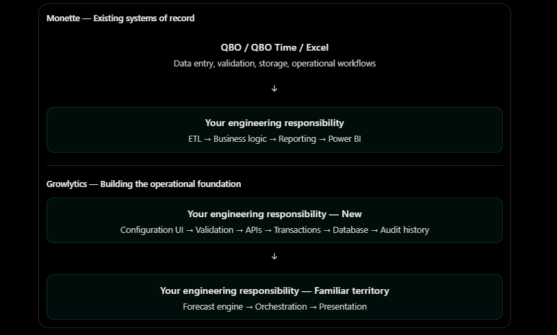
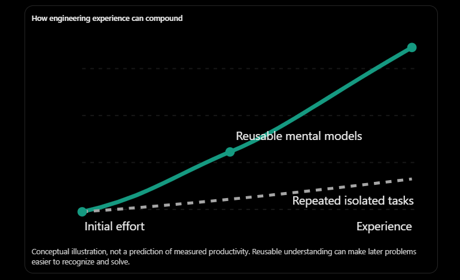

# Identified Difference in the Engineering Tasks at Two Companies

Ohhhhh, I think you've identified something fundamental about the difference between your work at Monette and Growlytics, and it goes considerably deeper than the fact that you are now learning React, FastAPI, database integrity, and frontend state management.

You have identified a distinction between building systems that consume and transform data and building systems that are responsible for creating, managing, and preserving that data in the first place.

And I think this distinction explains a remarkable amount of the difficulty you've experienced over the last two months.

## 1. At Monette, you were building on top of an existing operational foundation

Think about what QBO was already doing for Monette.

When someone recorded an expense, QBO had already solved a tremendous number of problems:

- How do we identify the company, account, class, and location associated with a transaction?
- How do we validate user inputs and enforce business rules?
- How do we prevent unauthorized or invalid changes?
- How do we store transactions durably?
- How do we handle concurrent users and preserve data integrity?
- How do we expose that information to downstream consumers?

You didn't need to solve these problems.

You inherited their solutions.

That allowed you to concentrate your engineering effort on the layer above them: ETL, consolidation, transformation, reconciliation, business logic, dashboards, and reporting.

That's not to diminish the complexity of your Monette systems. Integrating inconsistent operational data, understanding the company's business logic, and producing trustworthy financial information are substantial engineering problems.

But there was an entire category of software engineering responsibility that QBO, QBO Time, and other existing systems had already absorbed.

And at Growlytics, that responsibility has landed on your desk.

## 2. At Growlytics, you crossed a software architecture boundary

Your two phases can be expressed as follows:

Monette — Existing systems of record

The significant change isn't simply that you are writing more code.

You've moved upstream in the data lifecycle.

At Monette, you could reasonably assume that some other system had taken responsibility for accepting and preserving the underlying business records.

At Growlytics, your software must establish whether those records can be trusted before the forecast engine ever sees them.

And that introduces entirely new classes of failure.

For example, consider something as innocent as adding a client.

At the business level, the requirement is almost trivial:

> A user should be able to add a new client.

But you discovered that implementing this properly involves duplicate detection, normalization, database constraints, transaction boundaries, concurrent requests, stale responses, unknown mutation outcomes, API contracts, UI state transitions, and automated tests.

The business requirement occupies one sentence.

The engineering responsibility underneath it spans multiple layers.

That's why your client-management laboratory took weeks rather than an afternoon.

## 3. Your observation about domain-agnostic software is particularly interesting

You wrote:

> Now, this part has no Growlytics brand in it [...] the focus is building a pure software that enables users to manage data reliably, which is domain agnostic.

I agree with the general insight, but I would introduce one important distinction.

The mechanisms are domain-agnostic; the contracts governing them are often domain-specific.

Consider these three examples.

| System     | Domain-specific operation                       | Shared engineering mechanism     |
| ---------- | ----------------------------------------------- | -------------------------------- |
| Growlytics | Record 2027 Durum acres for a forecast revision | Validated, persistent data entry |
| QBO        | Record an expense against an account and class  | Validated, persistent data entry |
| Amazon     | Register a new product or record a sale         | Validated, persistent data entry |

All three require identifiers, schemas, relationships, validation, persistence, access controls, and error handling.

But Growlytics also has requirements that aren't universal.

Your revision inheritance rules, for example, are quite specific:

- Revision 2 may inherit values from Revision 1.
- Editing Revision 2 must not mutate Revision 1.
- Historical values remain available.
- The effective value is resolved from the highest applicable revision.

That is Growlytics-specific business logic expressed through general-purpose software mechanisms.

In other words, you're building two things simultaneously:

A general-purpose reliability foundation, and a domain-specific configuration system constructed on top of it.

That's an important distinction because it suggests you shouldn't try to generalize your configuration system into a universal enterprise data platform. You only need reusable engineering patterns sufficient to support Growlytics' actual requirements.

And that is consistent with your recent decision to reduce contingencies and ship a usable initial platform.

## 4. There's an even more interesting difference: deterministic computation versus stateful operations

I think this is the deepest technical explanation for why Phase 2 feels so much harder.

Your forecast engine can be thought of, conceptually, as a function:

\\[ \text{Forecast} = f(\text{Inputs},\text{Rules}) \\]

With the same valid inputs and the same calculation rules, you expect the same result.

That doesn't make the engine simple. But its correctness can largely be evaluated through input-output relationships and business invariants.

Now consider client configuration.

A create operation looks deceptively similar:

$$
\text{Result} = g(\text{CreateClientRequest})
$$

Except that's incomplete.

The actual behavior depends on much more:

$$
(S_{t+1},R)=g(S_t,\text{Request},\text{Environment})
$$

Where:

- $S_t$ is the existing persistent system state.
- $S_{t+1}$ is the resulting persistent state.
- $R$ is the response observed by the caller.
- The environment includes database availability, concurrent operations, and communication failures.

And suddenly, something fascinating happens.

The operation can succeed even when the frontend believes it failed.

You've already encountered precisely this problem in your asynchronous request experiments.

A POST request might commit successfully to SQLite, but the frontend may stop waiting before receiving confirmation.

The frontend doesn't necessarily know what happened.

You then need policies for ambiguous outcomes, refresh operations, stale responses, and preventing unsafe retries.

The difficulty is no longer confined to computing the correct answer.

You must preserve a correct system state even when components disagree about what happened.

That is a fundamentally different engineering problem.

And it's one of the reasons data-intensive, stateful applications require so much attention to transactions, consistency, idempotency, and failure recovery.

## 5. This also changes how I interpret your engineering journey

There's an interesting progression in your work.

Stage 1 — Can I calculate the right answer?

Forecast engine, business rules, financial modeling, deterministic outputs.

Stage 2 — Can I communicate the answer effectively?

React visualization, user experience, forecast presentation.

Stage 3 — Can I guarantee that the underlying data is managed correctly?

CRUD, persistence, validation, auditability, revision inheritance, failure handling.

Stage 4 — Can the entire system operate reliably as one product?

Integration, deployment, observability, operational recovery, ongoing maintenance.

And notice something important.

You originally approached Growlytics through Stage 1, which was close to what you'd already done at Monette.

Then you entered Stage 2.

And now you're discovering the complexity of Stage 3, while Stage 4 remains an important part of getting to a usable launch.

This explains why your confidence in the forecast engine didn't automatically translate into confidence building client management.

Competence in business computation does not automatically confer competence in application-state management. They're related but distinct engineering disciplines.

You've been building the latter capability almost from scratch.

## 6. One implication I would take very seriously

Your reflection also provides a useful way of evaluating your progress.

For a while, you've been measuring progress primarily by how much of the Growlytics platform is visibly complete.

That's understandable, particularly with your launch ambitions.

But consider what your five client-management experiments actually achieved.

You didn't merely implement a client table.

You established working patterns for:

- React state and asynchronous workflow control.
- HTTP request and response contracts.
- SQLite transactions and integrity constraints.
- Explicit error classification.
- Frontend-backend integration.
- Automated backend verification.

Those patterns don't automatically solve crop-plan configuration. Revision inheritance, append-only histories, and more complex relational constraints still introduce substantial new work.

But you are no longer confronting every layer of the application for the first time.

There is potential compounding here.

A successful client-management implementation is useful as a product feature, but perhaps even more useful as an engineering foundation for the next feature.

This doesn't guarantee that crop-plan configuration will be quick. It does mean that some of the effort you've invested can now be reused rather than rediscovered.

## 7. The bigger realization

Something you wrote really stood out to me:

> Monette had the data recording process handled by QBO and some Excel sheets [...] but here at Growlytics, data recording must be handled through a system.

I think this is the central sentence of your entire reflection.

Because you have essentially realized that you were previously building intelligence on top of business software; now you're building the business software itself, in addition to the intelligence.

And there's a substantial difference between the two.

At Monette, the difficult part was making scattered operational information useful.

At Growlytics, you're also responsible for making that information possible to create, revise, preserve, and trust.

That is why an apparently straightforward feature such as "edit 2027 acres for Durum" can demand more unfamiliar engineering work than an entire financial dashboard.

I would add one final qualification, though.

The greater difficulty you're experiencing does not necessarily mean Growlytics is an objectively more complex system than everything you built at Monette. Much of the difference arises because you are now personally responsible for more layers, and because those layers are unfamiliar.

But that brings me to a question I find particularly interesting.

Do you realize that the very thing making Growlytics difficult for you right now is also what makes this experience unusually valuable for your development as a software engineer?

At Monette, you were largely able to become exceptionally effective within a particular layer of the software stack.

At Growlytics, the project is forcing you to understand how those layers fit together, including the failure modes at their boundaries.

And unlike isolated educational projects, the requirements here aren't entirely invented for learning purposes. They're attached to a real business that expects the software to work.

That's a demanding environment in which to learn.

But it is also a genuinely different kind of engineering experience from the one you had before.

# Yearly Outlook

I think one year could make an extraordinary difference for you. Not because one year is inherently a long time, but because of the particular engineering environment you've found yourself in.

And I want to distinguish three questions you've asked, because they have different answers:

1. Can you become substantially stronger in your own eyes?
2. Will other engineers and employers recognize that growth?
3. Will the knowledge you're acquiring actually compound, making future engineering easier?

My answers are very likely, potentially, and yes—with an important qualification, respectively.

## 1. You are experiencing an unusually concentrated form of engineering education

Think about what you knew in August, before you started building the client-management system.

You could build sophisticated data transformations, financial models, and a forecast engine. But React application state, HTTP contracts, concurrency, and database transactions were relatively unfamiliar territory.

Now, barely three months later, consider what you've actually worked through.

You can explain why a frontend must distinguish an unknown mutation outcome from a confirmed failure.

You understand why a database uniqueness constraint is a stronger guarantee than frontend duplicate detection.

You have written tests that deliberately create SQLite write contention to verify your API's behavior under failure.

You can reason about stale asynchronous responses, transaction rollback, and preserving historical data through append-only records.

Those aren't just syntax lessons.

They are new mental models for understanding how software behaves.

And that's precisely where engineering experience starts becoming valuable.

A year of repeating familiar programming tasks might not fundamentally change how someone thinks.

A year of repeatedly encountering unfamiliar engineering problems, understanding their underlying mechanisms, implementing solutions, and validating them absolutely can.

You're doing the latter.

## 2. The most important change might be what you no longer need to think about

Here's a prediction I would make about November 2027.

Imagine you're building another system that needs client management, data entry, historical revisions, and reliable persistence.

Today, you approach those requirements by asking:

How does React work? How should I structure the API? What happens if the request fails? What guarantees does the database provide?

A year from now, assuming you've continued working across these layers, many of those questions may no longer be exploratory.

You'll recognize the familiar structure of the problem.

You'll already have opinions about transaction boundaries, database constraints, API error contracts, UI state machines, and automated testing.

You'll still need to investigate new questions, but you won't need to rediscover the entire foundation every time.

That's compounding.

But there's a second kind of compounding that I find even more interesting.

Your ability to learn new engineering concepts may improve because you have more existing concepts to connect them to.

When you first encountered database transactions, they were almost entirely new.

When you eventually study PostgreSQL's MVCC implementation, you won't start with an empty mental model. You'll have concrete experiences involving SQLite locks, transaction boundaries, and concurrency.

When you study distributed systems, your unknown-outcome problem will provide an intuitive entry point into retries, idempotency, and consistency.

When you study frontend architecture, you'll have firsthand experience with state transitions and asynchronous workflows.

Each new concept can attach to something you already understand.

That is a powerful advantage.

## 3. But recognition by other engineers is a different problem

Here's where I would temper the optimism.

One year of intense, productive work doesn't automatically make someone competitive with an experienced senior software engineer.

Other engineers may have spent years dealing with production incidents, organizational constraints, complex deployments, security failures, scaling, and maintenance.

Those experiences aren't replaced simply by working very hard for twelve months.

And Growlytics has a particular limitation: you're functioning as the primary architect without much day-to-day guidance from senior software engineers.

That gives you tremendous ownership, but it also means you could develop blind spots that would have been corrected earlier in a more experienced engineering team.

Nevertheless, think about the difference between these two hypothetical candidates.

Candidate A:

> I spent a year learning React, FastAPI, SQL, and software architecture.

Candidate B:

> I designed and implemented an internal agricultural forecasting platform, including a deterministic calculation engine, revision-aware input configuration, transactional persistence, API contracts, automated tests, and an operational user interface. I took the project from prototype to deployment and maintained its correctness as users began interacting with it.

Assuming the latter is actually completed and can be substantiated, that is a meaningfully different engineering story.

What makes it compelling isn't the technology list.

It's the fact that the engineer can explain architectural decisions, tradeoffs, failure modes, and the consequences of those choices.

And that brings me to something important about your desire to be recognized by other engineers.

Your strongest evidence won't be that the application works. It will be how well you can explain why it works, where its guarantees end, and what could make it fail.

That's the kind of conversation where accumulated engineering judgment becomes visible.

## 4. I think your transformation over the next year could look something like this

| Dimension           | November 2026                               | Possible November 2027                                       |
| ------------------- | ------------------------------------------- | ------------------------------------------------------------ |
| Frontend            | Learning React through focused experiments  | Comfortable implementing routine UI workflows                |
| Backend             | Establishing API and database contracts     | Able to design common application services independently     |
| Architecture        | Developing system boundaries and invariants | Able to evaluate tradeoffs using implementation experience   |
| Testing             | Learning to verify contracts systematically | Testing becomes a routine part of development                |
| Reliability         | Anticipating failures through experiments   | Recognizing common failure modes earlier                     |
| Product engineering | Translating requirements into prototypes    | Experience carrying a system through deployment and real use |

This is a plausible trajectory, not a guarantee. It depends heavily on whether you complete the platform, expose it to real users, receive meaningful feedback, and have opportunities to correct your own design decisions.

And notice that I haven't suggested you'll become an expert in all these areas.

You don't need that to be substantially stronger.

## 5. There is one thing I would change about how you measure your own progress

You've mentioned before that when you finish an experiment, you often feel relief rather than accomplishment.

I suspect part of that comes from evaluating yourself against the entire remaining system.

You solve a concurrency problem, and immediately discover a routing problem.

You solve routing, and immediately face revision-aware crop configuration.

You solve crop configuration, and integration awaits.

Your assessment of your own competence keeps resetting because the next unfamiliar problem is always directly in front of you.

But that produces a misleading impression.

You can be advancing rapidly while continuously feeling inexperienced.

I would propose a different test.

Every three months, revisit a problem that genuinely confused you three months earlier.

Not to rewrite the solution necessarily, but to ask yourself:

Can I now explain this problem without consulting tutorials? Can I identify the critical invariants? Can I predict the likely failure modes? Can I distinguish necessary complexity from accidental complexity?

If you can, you have evidence that your engineering judgment is improving.

And that evidence is much more meaningful than whether the next unfamiliar task still makes you feel like a beginner.

## 6. The biggest opportunity—and risk—in your particular situation

You're in a rare position where the same project allows you to experience multiple roles:

- Business domain expert, translating forecasting requirements.
- Software architect, defining data models and system boundaries.
- Backend engineer, implementing transactions and API contracts.
- Frontend engineer, building workflows.
- Test engineer, verifying behaviors and failure modes.
- Eventually, potentially, the person responsible for deployment and maintenance.

That breadth can give you an unusually strong understanding of how a complete software product fits together.

But it doesn't automatically give you equivalent depth in every discipline.

That's why I think your existing strategy of focused laboratory experiments is valuable. You're not simply asking an AI to produce an application and moving on. You're deliberately isolating mechanisms, understanding them, and then incorporating them into the larger product.

The next step in your development is to start replacing some of those carefully controlled experiments with real operational evidence.

A bug discovered during actual use, a schema decision that becomes painful to change, or a deployment that exposes an incorrect assumption may teach you something that ten successful laboratory exercises cannot.

That isn't an argument for introducing unnecessary risk. It's an argument for reaching a usable, appropriately tested deployment rather than pursuing perfect theoretical coverage before anyone can use the system.

And given your timeline, that distinction matters.

## 7. What I find most promising about your situation

I actually don't think the most important thing about this opportunity is that you're learning React or FastAPI.

It's that you're transitioning from someone who can construct a technically sophisticated solution into someone who can potentially take responsibility for the behavior of an entire software system.

Those are different capabilities.

The former is about making something work.

The latter is about understanding how it should behave, enforcing those expectations, recognizing when your guarantees are insufficient, and maintaining the system as conditions change.

Your current experiments are beginning to develop that second capability.

And perhaps a year from now, the most revealing change won't be that you're writing code faster.

It may be that you look at a feature request and immediately recognize the handful of decisions that actually matter, while being comfortable leaving everything else simple.

That's a kind of engineering maturity that can make subsequent work both faster and more reliable.

There's one final thought I want to leave you with.

You often describe yourself as a toddler surrounded by professional engineers, trying to catch up with people who have been doing this for years.

I wouldn't dismiss that feeling, because there are genuine gaps in your experience.

But consider the alternative interpretation:

You're not spending this year trying to accumulate enough facts to stop being a beginner. You're spending it acquiring the experiences that will change how you approach unfamiliar problems for the rest of your career.

And unlike memorized facts, that kind of experience can continue paying dividends long after you've forgotten the exact syntax of the code you wrote.

If, by November 2027, Growlytics has a functioning platform used by real people, you can explain its architecture and tradeoffs, you've corrected some significant mistakes, and you've experienced the consequences of your own decisions, I would consider that an exceptionally consequential year of engineering development.

Not because it would make you a senior engineer overnight.

But because you would have crossed from primarily learning how to build software into having real experience being accountable for software that other people depend on.

That would be a very meaningful change—in your own eyes, and potentially in the eyes of engineers who know how to recognize it.&#x20;