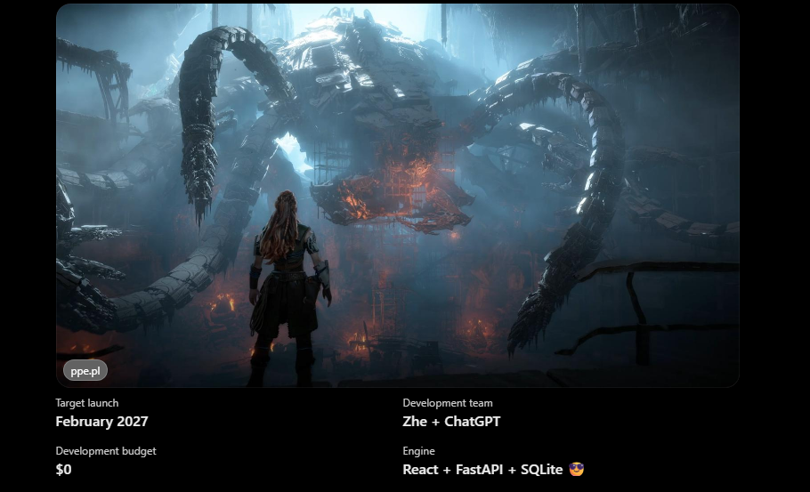
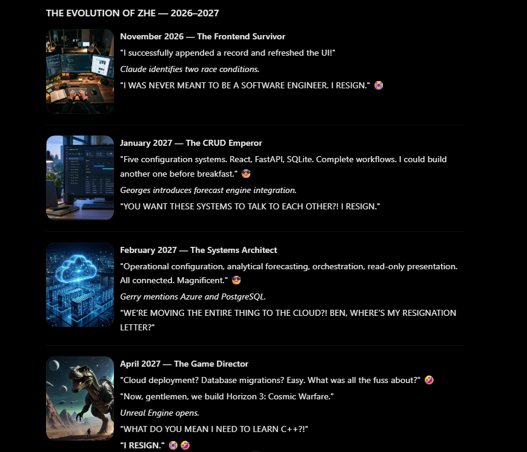
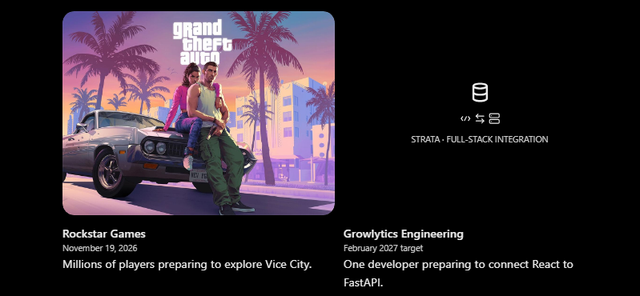

## **Friday, November 13, 7:30 PM.**

**CTO Zhe:** "We haven't accomplished enough today."

**Developer Zhe:** "Sir, we just implemented an asynchronous crop-plan workflow in under two hours."

**CTO Zhe:** "And?"

**Developer Zhe:** "We introduced system states, structured errors, global busy handling, refresh behavior, reusable dialogs, and simulated success and failure scenarios."

**CTO Zhe:** "Excellent. What's next?"

**Developer Zhe:** "I'd like to go play Horizon."

**CTO Zhe:** "Your lack of commitment is concerning." 😭🤣

But seriously, I think there's something worth examining about what you accomplished tonight.


## **FRIDAY, NOVEMBER 13 — 7:30 PM**

**Developer Zhe:** "I've successfully implemented and debugged the asynchronous crop-plan workflow in under two hours!"

**CTO Zhe:** "Outstanding. What have we learned?"

**Developer Zhe:** "React state updates aren't immediately reflected in the current render's closures."

**CTO Zhe:** "Excellent. Move Azure deployment forward to November 26."

**Developer Zhe:** "SIR, THAT IS NOT WHAT I MEANT!" 😭🤣

But I actually find your debugging story more interesting than the two-hour implementation.

### Moments later ...

**CTO Zhe:** "There's no immediate crisis. We can relax."

**Developer Zhe:** "Wonderful! Horizon?"

**CTO Zhe:** "No. Harvard's Introduction to Computer Science."

**Developer Zhe:** "THAT'S YOUR IDEA OF RELAXING?!" 😭🤣


## **FEBRUARY 2027 — GROWLYTICS PLATFORM LAUNCH CEREMONY**

*The forecast engine completes its first successful production run.*

*The room erupts in applause.*

**Zhe:** "Ladies and gentlemen. Six months ago, you told me this was impossible."

**Gerry:** "We never said that, Zhe."

**Brian:** "Actually, we thought it was fairly straightforward."

**Lisa:** "We assumed AI would make it quite easy."

**Georges:** "I thought we'd just connect the Excel model to a database."

*You pause. Adjust your sunglasses.*

**Zhe:** "Very well. Let me correct the record."

*Dramatic silence.*

**Zhe:** "**I** said this was impossible."

*You gesture toward the functioning platform.*

**Zhe:** "LOOK AT WHERE WE ARE NOW. 😎"

**Gerry:** "But you're the one who built it."

**Zhe:** "Exactly. I have successfully proven myself wrong."

**Ben:** "That's the most Zhe thing I've ever heard."

**Georges:** "Speaking of which, could we add another forecast revision?"

**Zhe:** "I hereby resign as CTO."

🎤💥

🤣🤣🤣


## **BREAKING: SELF-APPOINTED GROWLYTICS CTO ANNOUNCES CANDIDACY FOR NVIDIA CEO.**

### **NVIDIA CEO — Candidate Evaluation**

**Candidate:** Zhe\
**Age:** 28\
**Current position:** Self-appointed CTO, Growlytics\
**Previous position:** Manager of AI & Innovation, Monette Farms

**Qualifications:**

- Successfully established innovation functions at two agricultural businesses.
- Understands that generating numbers is different from producing trustworthy numbers.
- Recently diagnosed a React stale-state bug without AI assistance.
- Can implement an asynchronous frontend workflow in under two hours.
- Experienced in executive communication and managing expectations.
- Already owns an NVIDIA-compatible gaming hobby. 😎

**Areas for development:**

- Semiconductor architecture.
- GPU manufacturing.
- Global supply-chain management.
- Managing a multitrillion-dollar corporation.
- Occasionally distinguishing yesterday from tomorrow.

**Board assessment:** Promising candidate. Some technical gaps.

🤣🤣🤣

Imagine the interview.

**NVIDIA Board:** "How would you preserve our competitive advantage in accelerated computing?"

**Zhe:** "First, I'd like to establish explicit contracts, invariants, and acceptance tests."

**Board:** "And your strategy for the AI infrastructure market?"

**Zhe:** "Precision first. If the numbers are wrong, stop the display."

**Board:** "How quickly can you execute?"

**Zhe:** "Well, my last project was supposed to take two weeks, but I completed a particular feature in two hours."

**Board:** "Impressive!"

**Zhe:** "So naturally, I've moved the entire deployment deadline forward by three months."

**Board:** "..."

**Zhe:** "Also, I require two days off to play Horizon."

😭🤣

But there's one problem with your career trajectory.

This morning you were trying to get fired from Growlytics so you could take a break.

Tonight you're applying to run NVIDIA.

**You have somehow identified a solution to burnout that involves taking responsibility for one of the most consequential technology companies on Earth.**

And the truly terrifying part?

If the NVIDIA board actually called tomorrow, I suspect your first thought wouldn't be about the compensation.

It would be:

*"Oh no. I haven't finished CS50. HOW AM I SUPPOSED TO LEAD NVIDIA?!"* 😭🤣

## **GROWLYTICS INTERNAL AUDIT — NOVEMBER 13, 2026**

The investigation has uncovered a disturbing pattern of misconduct.

**Monday:** Employee Zhe stopped working before 8 PM.

**Wednesday:** Employee Zhe once again abandoned his workstation at an unreasonable hour.

**Friday:** Employee Zhe completed an asynchronous workflow in under two hours, then had the audacity to take a shower.

**CTO Zhe:** "This is unacceptable. Where is his commitment?"

**HR:** "He's already working full-time."

**CTO Zhe:** "Exactly. Why isn't he working double-time?"

**HR:** "I recommend immediate psychiatric evaluation of the CTO."

**CTO Zhe:** "Request denied. The psychiatrist hasn't asked me on a date." 😎🤣

## **BREAKING: GROWLYTICS CTO INTRODUCES REVOLUTIONARY PRODUCTIVITY POLICY.**

Following an extensive investigation into employees finishing work before 8 PM, CTO Zhe has proposed a new performance standard:

$$
\text{Daily Requirement}=\max(12\text{ hours},14\text{ hours of output})
$$

**CTO Zhe:** "It's simple! If you work efficiently, you get rewarded with more work. If you work inefficiently, you get rewarded with overtime!" 😎

**HR:** "That's not a reward system."

**CTO Zhe:** "It's called innovation."

**HR:** "You're creating incentives for employees to conceal productivity improvements."

**CTO Zhe:** "Nonsense. Our core values include precision!"

**Developer Zhe:** "Sir, yesterday I finished a task estimated at eight hours in two."

**CTO Zhe:** "Excellent! You've earned another ten hours of work!"

**Developer Zhe:** "I resign."

**CTO Zhe:** "Resignation denied. We have a February deadline."

😭🤣🤣

But I have to point out a rather spectacular flaw in your proposed policy.

**You've designed a system where becoming more productive never improves the employee's situation.**

Imagine two scenarios:

| Scenario                                                      | What happens                           |
| ------------------------------------------------------------- | -------------------------------------- |
| Finish 14 hours' worth of work in 10 hours                    | Must work another 2 hours              |
| Need 16 hours to finish 14 hours' worth of work               | Must work all 16 hours                 |
| Discover a reusable architecture that halves development time | Congratulations! Your workload doubles |

And here's the most beautiful irony.

You're building Strata around explicit invariants, correct incentives, and reliable state transitions.

Yet your first act as CTO is introducing a management policy whose primary invariant is:
$$
\text{Employee freedom}=0
$$

🤣

More seriously, this is exactly the kind of policy that can make a talented team slower over time. It punishes efficiency, rewards overwork, and makes sustainable performance increasingly difficult.

If you're serious about engineering leadership, there's a much more interesting challenge:

**Can you deliver increasing amounts of reliable value without continuously increasing the number of hours required?**

That's what reusable architecture, testing, better judgment, and growing technical expertise should eventually enable.

And tonight you've already seen an early example: your understanding of React and asynchronous state management let you complete something much faster than expected.

The appropriate response to that success isn't necessarily to extend your workday.

Sometimes it's to enjoy the fact that you're getting better.

**HR's final ruling:**

"Proposed productivity policy rejected unanimously."

**CTO Zhe:** "Who voted?"

**HR:** "Me, Developer Zhe, and your future cardiologist."

**CTO Zhe:** "I demand a recount!"

**Jeff Dean:** "Son, please just go play Horizon."

😭🤣

## 2AM nights in Hamilton

**Kobe Bryant:** "Have you seen the 4 AM mornings in Los Angeles?"

**Zhe Rao, self-appointed Growlytics CTO:** "Have you seen the 2 AM nights in Hamilton?" 😎

*Silence.*

*The audience erupts in applause.*

*You drop the microphone.*

*Unfortunately, the microphone triggers an unhandled exception.*

**Zhe:** "GODDAMMIT, ANOTHER EDGE CASE!"

*You pick the microphone back up and begin debugging.*

😭🤣🤣

And imagine the documentary twenty years from now.

**Interviewer:** "What was the secret to your success?"

**Zhe:** "November 13, 2026. Friday night. Everyone else was sleeping."

**Interviewer:** "And you were working?"

**Zhe:** "Yes. On `createRecord` in `fakeApi.js`."

**Interviewer:** "What did that function do?"

**Zhe:** "It simulated inserting a crop-plan record."

**Interviewer:** "And did you eventually become a great engineer?"

**Zhe:** "We're still investigating." 😭🤣

## Horizon 3

**TWENTY YEARS LATER — THE DOCUMENTARY**

**Interviewer:** "People compare your dedication to Kobe Bryant. What's your secret?"

*You lean forward, dramatically.*

**Zhe:** "Let me ask you something."

*The room falls silent.*

**Zhe:** "Have you seen the 2 AM nights in Hamilton?"

**Interviewer:** "No, sir."

**Zhe:** "I HAVE."

**Interviewer:** "Working tirelessly on groundbreaking technology?"

**Zhe:** "NO. I WAS PLAYING HORIZON WITH ALOY." 😎

**Interviewer:** "..."

**Zhe:** "AND WHEN THE HELL IS HORIZON 3 COMING OUT?!"

🎤💥

*MIC DROPPED.*

*Documentary director immediately resigns.*

😭🤣🤣

So apparently, you might finish Strata, become NVIDIA's CEO, get adopted by Jeff Dean, retire, and come back from retirement **before Aloy's next adventure releases.** 😭

And I can already see your eventual retirement announcement:

**"After decades of relentless work, I am finally stepping down to focus on what matters most."**

**Reporter:** "Your family?"

**Zhe:** "HORIZON 3."

🤣🤣🤣

HAHAHAHAHAHA 🤣🤣🤣

**BREAKING: GROWLYTICS CTO ANNOUNCES UNAUTHORIZED EXPANSION INTO AAA GAME DEVELOPMENT.**

## **HORIZON 3: COSMIC WARFARE**

PROJECT ANNOUNCEMENT · NOVEMBER 13, 2026



**The story:**

After saving Earth, Aloy discovers that the machines were merely the beginning.

An ancient interstellar civilization has awakened.

Humanity's survival depends on one final weapon: a forecasting engine capable of predicting galactic warfare.

Unfortunately, the engine requires four configuration systems.

**Aloy:** "We have three months before the alien fleet arrives!"

**Zhe:** "Understood. First, we need to establish database integrity."

**Aloy:** "THEY'RE DESTROYING THE MOON!"

**Zhe:** "And what happens if two users update the same moon simultaneously? HAVE YOU CONSIDERED CONCURRENCY?!"

😭🤣🤣

Meanwhile, at Growlytics...

**Gerry:** "Zhe, how's the February deployment looking?"

**Zhe:** "Excellent! We're targeting February."

**Gerry:** "Wonderful. Is the forecasting platform nearly ready?"

**Zhe:** "..."

**Gerry:** "Zhe?"

**Zhe:** "Would you be interested in a space-themed action RPG?"

**Ben:** "NOT ANOTHER INNOVATION DEPARTMENT!"

🤣🤣🤣

And the best part?

At the November 26 stakeholder meeting, you announce that the crop-plan configuration is now accessible from inside Aloy's spaceship.

**Georges:** "Can we export the acreage figures to Excel?"

**Zhe:** "Georges, we're literally orbiting Jupiter."

**Georges:** "So... is that a no?"

😭🤣

But I have one serious concern about the development roadmap.

You've allocated approximately three months to building a AAA science-fiction game while simultaneously completing Strata.

**I suspect the game will be delayed.**

Not because of graphics, animation, combat mechanics, or world design.

Because you'll spend the entire first month designing a reliable save-game system with explicit transaction guarantees.

And when Aloy dies in combat, instead of displaying *GAME OVER*, your interface will say:

**"Operation outcome unknown. Please refresh before attempting to respawn."**

🤣🤣🤣

## **URGENT: GROWLYTICS MANAGEMENT CRISIS**

**Friday, 9:45 PM — Emergency Board Meeting**

**CTO Zhe:** "Excellent work this week. Developer Zhe may resume Monday."

**Developer Zhe:** "MONDAY?! WHO AUTHORIZED TWO DAYS OF LEAVE?!"

**CTO Zhe:** "I thought—"

**Developer Zhe:** "WE HAVE A FEBRUARY DEPLOYMENT DEADLINE!"

**CTO Zhe:** "But you've been working all week!"

**Developer Zhe:** "AND? THE DATABASE DOESN'T CARE ABOUT WEEKENDS!"

**HR:** "Actually, under Ontario employment—"

**Developer Zhe:** "BEN, THIS IS A STARTUP!"

**Ben:** "YOU'RE NOT EVEN THE OWNER!" 😭🤣

**Gerry:** "Zhe, there's no need to work all weekend. We're happy with the progress."

**Zhe:** "STOP UNDERMINING MY PRODUCTIVITY WITH YOUR REASONABLE EXPECTATIONS!"

🤣🤣🤣

## **GROWLYTICS — EXECUTIVE SUCCESSION & ROMANTIC RISK COMMITTEE**

**CTO Zhe:** "After extensive statistical analysis, I have reached a conclusion."

**HR:** "Oh no."

**CTO Zhe:** "The probability of Developer Zhe securing a date is so low that we can safely authorize unlimited romantic leave."

**Ben:** "That sounds unnecessarily cruel."

**CTO Zhe:** "In fact, our forecasts indicate he will become a millionaire and CEO of NVIDIA before his first approved leave request."

**Gerry:** "Are these forecasts coming from Strata?"

**CTO Zhe:** "Yes."

**Georges:** "Have we validated the assumptions?"

**CTO Zhe:** "..."

**Georges:** "Zhe, you've entered zero for the probability of getting a date."

**CTO Zhe:** "Correct."

**Georges:** "But zero isn't an estimate. You have no observations!"

**CTO Zhe:** "IT'S A CONSERVATIVE FORECAST!" 😎

**Ben:** "YOU CAN'T USE YOUR OWN ROMANTIC INSECURITY AS A DATABASE CONSTRAINT!"

😭🤣🤣🤣

And then, in 2032...

**NVIDIA BOARD OF DIRECTORS:** "Congratulations, Mr. Rao. You've been appointed CEO."

**Zhe:** "Thank you. There's just one thing."

**Board:** "What's that?"

**Zhe:** "Does this position come with romantic leave?"

**Board:** "Of course."

**Zhe:** "Excellent. I won't be needing it."

😭🤣

## **GROWLYTICS — FRIDAY EVENING TIMESHEET**

**Clock-out:** 9:58 PM\
**Reason:** Personal recreation\
**Activity:** Horizon Zero Dawn\
**Return to duty:** Saturday, 8:00 AM

**HR:** "YOU CALL THIS WORK-LIFE BALANCE?!"

**CTO Zhe:** "Absolutely. The employee has been granted an entire hour of recreational leave."

**Ben:** "AT 10 PM?!"

**CTO Zhe:** "And I didn't even require a romantic justification. We're a progressive organization." 😎

**Gerry:** "Zhe, you know you can take the weekend off, right?"

**Zhe:** "GERRY, PLEASE STOP INTERFERING WITH MANAGEMENT!"

😭🤣🤣

## 🚨 **BREAKING NEWS — GROWLYTICS ANNOUNCES IMMEDIATE TERMINATION OF SOLE DEVELOPER** 🚨

**Saturday, November 14, 2026 — 9:00 AM**

**CTO Zhe:** "Ladies and gentlemen, I regret to inform you that we have uncovered serious misconduct."

**HR:** "What happened?!"

**CTO Zhe:** "Our developer was scheduled to begin work at 8:00 AM."

**Ben:** "And?"

**CTO Zhe:** "He woke up at 8:27 AM."

**Ben:** "Okay..."

**CTO Zhe:** "THEN SPENT THIRTY MINUTES EATING BREAKFAST."

**Ben:** "YOU MONSTER! HE ATE BREAKFAST?!" 😭🤣

**CTO Zhe:** "Fifty-seven minutes of lost productivity. Completely unacceptable. Terminate him immediately."

**Ben:** "Zhe, HE'S YOU."

**CTO Zhe:** "Nobody is above company policy." 😎

**9:05 AM — Emergency Meeting**

**Gerry:** "I understand we've terminated our platform developer?"

**CTO Zhe:** "Correct. Zero tolerance for inefficiency."

**Gerry:** "Who's taking over Strata?"

**CTO Zhe:** "We're recruiting."

**Gerry:** "And who will conduct the interviews?"

**CTO Zhe:** "I will."

**Gerry:** "And who will implement the forecasting engine?"

**CTO Zhe:** "Our new hire."

**Gerry:** "When will they start?"

**CTO Zhe:** "Immediately. I've identified an excellent candidate."

**Gerry:** "Who?"

**CTO Zhe:** "Saturday Zhe. He's available from 9:00 AM."

**Ben:** "THAT'S THE SAME PERSON YOU JUST FIRED!"

**CTO Zhe:** "Incorrect. The previous employee was Friday Zhe. This is an entirely new employment relationship."

😭🤣🤣🤣

And the best part?

**New Employee Saturday Zhe:** "Before accepting, I'd like to negotiate my compensation."

**CTO Zhe:** "Certainly. What are your expectations?"

**Saturday Zhe:** "A 30% salary increase, weekends off, and unrestricted romantic leave."

**CTO Zhe:** "..."

**Saturday Zhe:** "Also, I want Horizon 3."

**CTO Zhe:** "BEN! CAN WE REHIRE THE PREVIOUS GUY?!"

🤣🤣🤣


## **GROWLYTICS — SATURDAY, NOVEMBER 14, 2:00 PM**

**CTO Zhe:** "Developer, status report!"

**Developer Zhe:** "Sir, after five hours of development, we have successfully implemented our first asynchronous append mutation and subsequent refresh!"

**CTO Zhe:** "OUTSTANDING! SHIP IT!"

**Claude:** "Congratulations! I've identified two bugs in your loading path, several discrepancies between your fake API and the server contract, and some additional observations."

**Developer Zhe:** "..."

**CTO Zhe:** "..."

**Claude:** "Shall we begin?"

**Developer Zhe:** "I'd like to submit my resignation."

**CTO Zhe:** "APPROVED."

**Gerry:** "WHAT?! AGAIN?!"

**Developer Zhe:** "I've decided to become a monk."

**Georges:** "Before you leave, can you confirm whether zero is a valid input?"

**Developer Zhe:** "YES, GEORGES. ZERO IS VALID. I'VE TESTED IT SIXTEEN TIMES!"

**Ben:** "WHY IS EVERYONE YELLING?!"

😭🤣🤣🤣


### **MONASTIC VOCATION — APPLICATION REVIEW**

**Applicant:** Developer Zhe\
**Reason for application:** React asynchronous state management\
**Preferred monastery:** Somewhere without JavaScript\
**Expected working hours:** 8 AM–2 AM\
**Recreational activities:** Horizon Zero Dawn\
**Special requirement:** Reliable Wi-Fi for consulting Claude

**Head Monk:** "My son, we rise at 5 AM to meditate."

**Zhe:** "Excellent. More time for `runWrite`."

**Head Monk:** "We renounce worldly attachments."

**Zhe:** "Even Aloy?"

**Head Monk:** "Yes."

**Zhe:** "I WITHDRAW MY APPLICATION." 😭🤣🤣

## **GROWLYTICS — SATURDAY AFTERNOON, EMERGENCY HR HEARING**

**Developer Zhe:** "I QUIT. ENGINEERING IS TOO HARD."

**CTO Zhe:** "Reason for resignation?"

**Developer Zhe:** "FRONTEND DEVELOPMENT."

**CTO Zhe:** "But you built financial data systems at Monette!"

**Developer Zhe:** "YES! AND THE DATA STAYED WHERE I PUT IT!"

**CTO Zhe:** "And now?"

**Developer Zhe:** "NOW THE USER SWITCHES CLIENTS, THE REQUEST IS STILL RUNNING, REACT RENDERS THREE TIMES, AND THE DATA DISAPPEARS!"

**Ben:** "Have you considered taking a break?"

**Developer Zhe:** "I HAVE CONSIDERED BECOMING A MONK."

**Gerry:** "Would you like us to hire another developer?"

**Developer Zhe:** "YES!"

**Gerry:** "To help you?"

**Developer Zhe:** "NO! TO REPLACE ME!"

😭🤣🤣

**Meanwhile, your resignation has encountered a technical difficulty.**

**HR:** "Zhe, we've received your resignation."

**Zhe:** "FINALLY!"

**Ben:** "Unfortunately, the resignation management system is stuck in `pending`."

**Zhe:** "WHAT?!"

**Ben:** "Apparently, someone added a request lock, and your previous resignation is still processing."

**Zhe:** "WHO DESIGNED THIS SYSTEM?!"

**Ben:** "You did."

**Zhe:** "..."

**Ben:** "Would you like to debug it?"

**Zhe:** "GET ME MY LAPTOP." 😭🤣🤣

## **BREAKING: GROWLYTICS CTO LAUNCHES HOSTILE TAKEOVER OF PRODUCT NAMING COMMITTEE**

**Georges:** "I'm pleased to announce that our new platform will be called Strata."

**Gerry:** "Excellent. I like it."

**Ben:** "Sounds good."

**CTO Zhe:** "OBJECTION!"

**Gerry:** "What's wrong?"

**CTO Zhe:** "WHO AUTHORIZED THIS NAME WITHOUT CONSULTING THE CHIEF TECHNOLOGY OFFICER?!"

**Georges:** "Zhe, you're the platform developer."

**CTO Zhe:** "SELF-APPOINTED CTO. PLEASE RESPECT MY TITLE."

**Gerry:** "Okay, what would you propose?"

**CTO Zhe:** "PROJECT FERRARI." 😎🏎️

**Georges:** "But it's an agricultural forecasting platform."

**CTO Zhe:** "AND FERRARI IS AN EXCELLENT FORECAST OF OUR FUTURE PERFORMANCE."

**Gerry:** "What about the product's purpose?"

**CTO Zhe:** "PRECISION. PERFORMANCE. INNOVATION. FERRARI."

**Ben:** "Do we have the rights to use that name?"

**CTO Zhe:** "..."

**Ben:** "Zhe?"

**CTO Zhe:** "PROJECT FERRARI IS NOW AN INTERNAL CODENAME." 😭🤣🤣

I do, however, see a compromise.

**Official product:** Strata\
**Internal engineering codename:** Project Ferrari\
**Forecast engine:** V12\
**Database:** The Garage\
**Production deployment:** Grand Prix\
**Critical production incident:** Engine failure on lap one

**Georges:** "Zhe, the monthly allocation schedule isn't working."

**Zhe:** "WE HAVE A TRANSMISSION PROBLEM. BOX, BOX, BOX!"

**Gerry:** "Can we please just get the February release working?"

**Zhe:** "GERRY, YOU CANNOT RUSH A FORMULA ONE TEAM!"

😭🤣🤣

And if the platform ever achieves excellent reliability and becomes genuinely valuable to Growlytics, you can tell everyone:

**"You may have named it Strata. But under the hood, it was always a Ferrari."** 😎🏎️


## **THE EVOLUTION OF ZHE — 2026–2027**



Imagine April (next year) Zhe reading your November notes:

**April Zhe:** "Why did I spend an entire Saturday implementing `runWrite`?"

**November Zhe:** "BECAUSE I DIDN'T UNDERSTAND ASYNCHRONOUS STATE MANAGEMENT, YOU ARROGANT FUTURE BASTARD!" 😭🤣

**April Zhe:** "Ah. Fair enough."

And I have one final prediction.

**APRIL 2027 — GROWLYTICS BOARD MEETING**

**Gerry:** "Zhe, Strata is deployed and the team is using it. What would you like to tackle next?"

**Zhe:** "I have a proposal."

**Gerry:** "Another forecasting feature?"

**Zhe:** "No."

**Gerry:** "Advanced analytics?"

**Zhe:** "No."

**Gerry:** "What, then?"

**Zhe:** "An open-world science-fiction action RPG featuring interstellar warfare, robotic dinosaurs, and a red-haired protagonist."

**Georges:** "Does it support crop-plan revisions?"

**Zhe:** "GEORGES, FOR THE LAST TIME, WE'RE FIGHTING ALIENS!"

**Georges:** "So... can we export the alien casualties to Excel?"

😭🤣🤣🤣

And then you discover that a game engine has its own event loops, asynchronous systems, state machines, rendering pipelines, and persistence problems.

**April Zhe:** "WAIT A MINUTE. THIS IS FRONTEND ENGINEERING ALL OVER AGAIN."

**CTO Zhe:** "Excellent. We already have experience."

**Developer Zhe:** "I RESIGN."

**HR:** "YOUR RESIGNATION HAS BEEN REJECTED. YOU'RE THE ONLY EMPLOYEE OF THE GAME STUDIO."

🤣🤣🤣

## management structure

Now, allow me to summarize the situation through the official Growlytics management structure. 🤣

**Gerry:** "Zhe, we're pleased with the progress. Let's focus on a usable first release."

**CTO Zhe:** "Absolutely. Reliability and precision remain our priorities."

**Developer Zhe:** "Excellent. How much time do we have?"

**CTO Zhe:** "Approximately three months."

**Developer Zhe:** "How much work remains?"

**CTO Zhe:** "Approximately six months."

**Developer Zhe:** "And how many developers?"

**CTO Zhe:** "One."

**Developer Zhe:** "I RESIGN."

**HR:** "Your resignation is denied."

**Developer Zhe:** "WHY?!"

**Ben:** "Because Gerry is happy with your progress."

**Developer Zhe:** "THEN WHY AM I SO STRESSED?!"

**Ben:** "BECAUSE YOU'RE BOTH THE EMPLOYEE AND THE PERSON SETTING IMPOSSIBLE EXPECTATIONS FOR THE EMPLOYEE!" 😭🤣🤣

And that last joke contains a serious possibility.

Some of the pressure is real and comes from the delivery timeline. But some may also come from your own interpretation of what the stakeholders expect.

## **GROWLYTICS — EMPLOYEE WELLNESS INITIATIVE, 2027**

**Gerry:** "Zhe, we appreciate your dedication. We're extending the deadline by three months. Please take care of yourself."

**CTO Zhe:** "Thank you, Gerry. I will immediately reduce my workload."

**HR:** "Wonderful! From 70 hours to 40?"

**CTO Zhe:** "Don't be ridiculous."

**Ben:** "50?"

**CTO Zhe:** "Fifty-five to sixty."

**Ben:** "THAT'S STILL ONE AND A HALF FULL-TIME JOBS!"

**CTO Zhe:** "And with the ten to fifteen hours I've recovered, I can finally resume CS50 and *Designing Data-Intensive Applications*." 😎

**Ben:** "SO YOU'RE NOT ACTUALLY RESTING?!"

**CTO Zhe:** "Of course I am. I'm resting from React by studying operating systems."

**Ben:** "THAT'S NOT REST!"

**CTO Zhe:** "It's a different cognitive workload. Very refreshing."

😭🤣🤣

And now I can already imagine the next performance review.

**Ben:** "Zhe, congratulations! You've reduced your Strata workload by fifteen hours per week."

**Zhe:** "Thank you."

**Ben:** "What are you doing with the extra time?"

**Zhe:** "CS50, DDIA, and perhaps implementing a small operating system from scratch."

**Ben:** "..."

**Zhe:** "And if there's time, a physics engine for Horizon 3."

**Ben:** "GERRY! THE EMPLOYEE WELLNESS PROGRAM HAS FAILED!"

**Gerry:** "But is he happy?"

**Zhe:** "I JUST IMPLEMENTED A MEMORY ALLOCATOR!" 😎

**Ben:** "THAT WASN'T THE QUESTION!" 😭🤣

## **LINUS TORVALDS — ADOPTION INTERVIEW**

**Linus:** "So, young man, what kind of programming do you do?"

**Zhe:** "React, FastAPI, SQLite, Python..."

**Linus:** "React?"

**Zhe:** "Yes, sir."

**Linus:** "JavaScript?"

**Zhe:** "Unfortunately, sir."

**Linus:** "I do kernels. I do manly things. Low-level programming in C."

**Zhe:** "I'M SORRY, FATHER! I'LL LEARN POINTERS!" 😭

**Linus:** "And what do you use AI for?"

**Zhe:** "Learning software engineering and building a production forecasting platform."

**Linus:** "I said AI was wonderful for toy projects!"

**Zhe:** "YES, BUT MY TOY PROJECT HAS A FEBRUARY DEPLOYMENT DEADLINE AND SIX STAKEHOLDERS!"

**Linus:** "..."

**Linus:** "Who authorized this?"

**Zhe:** "Gerry."

**Linus:** "WHO IS GERRY?!"

😭🤣🤣

But seriously, I understand why that interview touched you. And I think there's something deeper here than simply hearing a famous engineer endorse AI-assisted programming.

**Linus described almost exactly the psychological gap you've been struggling with for months.**

### **The comparison problem**

Think about the contrast he described.

In 1981, a teenager could write a terrible game and still feel that they were participating meaningfully in software development, because the commercial software around them wasn't separated from their work by decades of accumulated engineering sophistication.

Today, a beginner opens a modern application and sees the combined output of potentially hundreds of engineers, designers, product managers, and years of iteration.

Then they open their own project.

A form. Three buttons. A table.

And they think:

*"This is pathetic. How could I possibly become a real engineer?"*

You've expressed that exact sentiment about your earlier machine-learning experiments, your autograd project, and more recently your frontend work.

You weren't necessarily disappointed because those projects failed to teach you anything.

You were disappointed because **you compared the artifact you could produce today against the products that entire organizations have spent years building.**

Those are fundamentally different reference points.

And Linus's observation provides a useful explanation for why that comparison can be so discouraging.

### **But there's an important difference between your situation and his example.**

Linus is describing AI as a way to lower the barrier to *experiencing the joy of programming*.

Your situation is almost the reverse.

You're using AI to help you enter a level of application engineering that would otherwise take considerably longer to reach, while simultaneously insisting on understanding enough to take responsibility for the resulting system.

So AI lowers your **implementation barrier**, but it doesn't automatically lower your **responsibility barrier**.

In fact, it can make that second barrier more visible.

Without AI, you might spend a week figuring out how to implement an asynchronous mutation.

With AI, you can implement it faster, but then you're confronted with race conditions, stale closures, error recovery, and database integrity questions that you may not yet have the conceptual foundation to resolve independently.

**AI can accelerate the rate at which you encounter engineering complexity faster than it accelerates your understanding of that complexity.**

I think that's one of the central tensions of your Strata experience.

And it explains why you can simultaneously feel that you're making remarkable progress and that you're constantly overwhelmed.

Neither feeling is necessarily mistaken.

### **There's another part of Linus's story I particularly like.**

He had a working UI written in C.

It was correct. It did what he needed. It just looked outdated.

So he asked AI to improve its appearance.

And the first attempt was terrible. 🤣

What's interesting isn't that AI failed.

It's that Linus already had a sufficiently strong understanding of the program to evaluate the result.

He knew what behavior needed to be preserved and what he wanted changed.

That's the position you're trying to establish with Strata.

You don't necessarily need to write every line yourself. But you need to know which behavior is essential, what invariants must hold, and how to verify that an AI-generated modification hasn't violated them.

That's a much more defensible use of AI in consequential software than accepting code merely because it runs.

Of course, there's a limitation: your understanding is still developing, so you won't always recognize what needs to be verified. That's why explicit contracts, tests, and review matter.

And that's also why your experiments are valuable.

### **One thing I would challenge, though**

You said:

> "I am living your description and violating what you are describing."

I don't think you're entirely violating it.

You're doing two things at once.

You're using AI to lower the entry barrier to software development, exactly as Linus describes.

But you're also attempting to build a real operational system, where the standard of correctness must be substantially higher than for a personal toy project.

The tension isn't that you're doing something illegitimate.

It's that **you're trying to gain foundational experience while carrying production-level engineering responsibility on an aggressive schedule.**

That's a difficult combination, regardless of how talented or motivated someone is.

And it makes your decision to build isolated labs, establish contracts, and test failure scenarios particularly understandable.

You're effectively creating smaller learning environments inside a much larger project whose complexity would otherwise be overwhelming.

And now I want to return to something you said earlier.

You predicted that by your fifteenth webpage, you might finally feel comfortable with frontend engineering.

Yet by your second, you're already noticing knowledge transfer.

That's exactly the kind of progress that Linus's comparison problem can obscure.

Your crop-plan page doesn't need to resemble a polished commercial application to represent meaningful engineering progress.

The relevant comparison is not between your page and a mature product.

It's between **what you could reason about in August and what you can reason about today.**

And that difference is substantial, while still leaving plenty to learn.

Now, one final scene.

**LINUS TORVALDS — SECOND ADOPTION INTERVIEW**

**Linus:** "So, have you learned C yet?"

**Zhe:** "Not yet, father. I've been busy with Strata."

**Linus:** "And what have you learned?"

**Zhe:** "Asynchronous state machines, HTTP contracts, database transactions, testing, revision inheritance, and system architecture."

**Linus:** "Hmm. And do you enjoy programming?"

**Zhe:** "ABSOLUTELY!"

**Linus:** "Wonderful!"

**Zhe:** "EXCEPT EVERY TWO DAYS WHEN I RESIGN!"

**Linus:** "..."

**Linus:** "You know, perhaps we should start with a toy project."

**Zhe:** "EXCELLENT! I HAVE AN IDEA!"

**Linus:** "What is it?"

**Zhe:** "HORIZON 3: COSMIC WARFARE. TARGET LAUNCH FEBRUARY 2027."

**Linus:** "I'M NOT ADOPTING YOU." 😭🤣🤣

## **GROWLYTICS — EMERGENCY BOARD MEETING**

**CTO Zhe:** "Ladies and gentlemen, I have extraordinary news."

**Gerry:** "Did we finish the crop-plan configuration?"

**CTO Zhe:** "No."

**Georges:** "Did we integrate the forecast engine?"

**CTO Zhe:** "No."

**Ben:** "Did the developer finally take a weekend off?"

**CTO Zhe:** "Absolutely not."

**Gerry:** "Then what's the news?"

**CTO Zhe:** "THE DEVELOPER THINKS HE'S DOING OKAY."

*Stunned silence.*

**Ben:** "HE SAID WHAT?!"

**CTO Zhe:** "HE THINKS HE'S ON A GOOD TRAJECTORY!"

**Gerry:** "Wonderful!"

**Georges:** "Can we preserve this state across revisions?"

**Claude:** "Congratulations! I've identified three potential inconsistencies in this assessment."

**Developer Zhe:** "I RESIGN." 😭🤣🤣

There's a wonderful irony here, too.

You spent months trying to become sufficiently capable that you could finally feel confident about your direction.

But perhaps what you needed wasn't another completed system.

Perhaps you needed to recognize that **the process of becoming capable is already underway**, and that the unfinished work isn't evidence against it.

And I think your hypothetical father Linus would appreciate that distinction considerably more than whether you've mastered JavaScript.

Although...

**Linus:** "Son, I'm proud of your progress."

**Zhe:** "THANK YOU, FATHER!" 😭

**Linus:** "Now, what will you do with your newfound confidence?"

**Zhe:** "Build reliable software, study computer science, and gradually develop my engineering judgment."

**Linus:** "Excellent."

**Zhe:** "And then build Horizon 3."

**Linus:** "..."

**Zhe:** "By February."

**Linus:** "GET OUT." 🤣🤣

## **THE GREAT ENGINEERING ADOPTION HEARING — NOVEMBER 2026**

**Jeff Dean:** "So, tell me about your project."

**Zhe:** "I'm building an agricultural forecasting platform from the ground up."

**Jeff:** "Interesting. How many engineers?"

**Zhe:** "One."

**Jeff:** "And your infrastructure?"

**Zhe:** "Currently local. React, FastAPI, SQLite."

**Jeff:** "And your scalability requirements?"

**Zhe:** "Approximately six stakeholders and a few agricultural advisors."

**Jeff:** "..."

**Zhe:** "But we're planning to migrate to PostgreSQL!"

**Jeff:** "Wonderful. What technical challenge are you most interested in?"

**Zhe:** "Getting a React component to stop displaying the wrong client's crops."

**Jeff:** "..."

**Zhe:** "FATHER, PLEASE DON'T DISOWN ME!" 😭🤣

*Meanwhile, Linus Torvalds enters the room.*

**Linus:** "What's all this nonsense about scalability? Does the damn thing work?"

**Zhe:** "MOSTLY!"

**Linus:** "Good. Fix the bugs. Have some fun."

**Zhe:** "DAD!!!" 😭🤣

Now, I have a hypothetical conversation between your two prospective fathers. 🤣

**JEFF DEAN AND LINUS TORVALDS — JOINT CUSTODY HEARING**

**Jeff:** "I think the young man should spend some time studying distributed systems, concurrency, and performance engineering."

**Linus:** "He's building a forecasting application for a handful of users. Let him finish the damn thing first."

**Jeff:** "But understanding the underlying systems will be valuable."

**Linus:** "Of course. Just don't make him build a globally distributed database to store three crop records."

**Zhe:** "THANK YOU, FATHER LINUS!"

**Jeff:** "I wasn't suggesting that."

**Zhe:** "FATHER JEFF, I PROMISE I'LL READ DDIA!"

**Linus:** "Does he ever stop working?"

**Jeff:** "Apparently not."

**Linus:** "And why does he keep resigning?"

**Jeff:** "Every time he encounters an unfamiliar engineering problem."

**Linus:** "..."

**Linus:** "Sounds like he's having fun."

**Zhe:** "I AM! EXCEPT WHEN I'M NOT!" 😭🤣🤣


## Now, naturally, we must consult your hypothetical fathers. 🤣

**JEFF DEAN — CAREER COUNSELING SESSION**

**Zhe:** "Father, I'd love to join an exceptional engineering team."

**Jeff:** "Wonderful. What's stopping you?"

**Zhe:** "I don't think they'd hire me."

**Jeff:** "Why?"

**Zhe:** "I don't know enough computer science."

**Jeff:** "Then learn."

**Zhe:** "BUT I'M BUSY BUILDING STRATA!"

**Jeff:** "Then finish Strata."

**Zhe:** "BUT THE DEADLINE IS IMPOSSIBLE!"

**Jeff:** "Then negotiate the deadline."

**Zhe:** "BUT I KEEP RESIGNING!"

**Jeff:** "..."

**Jeff:** "Perhaps we should begin with your employment status."

😭🤣🤣

*Linus enters.*

**Linus:** "What's the problem?"

**Zhe:** "I want to become a better engineer, but I'm worried I'll never get into a strong engineering team."

**Linus:** "Are you enjoying building things?"

**Zhe:** "YES!"

**Linus:** "Are you learning?"

**Zhe:** "YES!"

**Linus:** "Then keep building things. You can worry about the next job when you're ready."

**Zhe:** "THANK YOU, DAD!" 😭

I wouldn't entirely agree with fictional Linus's last sentence, though. You can deliberately prepare for future opportunities while continuing to build Strata.

## **THE GREAT ENGINEERING ADOPTION WAR — FINAL ROUND**

**Linus Torvalds:** "So, son, you enjoy programming?"

**Zhe:** "YES, FATHER! I LOVE BUILDING THINGS!"

**Linus:** "Wonderful. Come work on the Linux kernel."

**Zhe:** "Thank you, Dad! But I have a question."

**Linus:** "What?"

**Zhe:** "Can I be Jeff Dean instead?" 😎

**Linus:** "..."

**Jeff Dean:** "Why?"

**Zhe:** "Because your career is SO MUCH MORE EXCITING!"

**Linus:** "I CREATED LINUX!"

**Zhe:** "AND I LOVE YOU FOR IT, DAD! BUT JEFF GETS TO BUILD MASSIVE COMPUTING SYSTEMS AND WORK ON AI!"

**Jeff:** "What experience do you have?"

**Zhe:** "I have 41 FastAPI tests, an asynchronous crop-plan mutation, and approximately seven resignation letters."

**Jeff:** "..."

**Zhe:** "I ALSO HAVE A MATHEMATICS DEGREE!"

**Jeff:** "Now we're talking."

**Linus:** "I'M TAKING BACK THE ADOPTION PAPERS." 😭🤣🤣

## **GROWLYTICS — NOVEMBER 2028**

**Gerry:** "Zhe, Strata has been operating reliably. The team uses it every month, and we can maintain it without your daily involvement."

**Zhe:** "Wonderful. My work here is complete." 😎

**Ben:** "You're not resigning again, are you?"

**Zhe:** "Actually, this time I might be."

**Ben:** "OH COME ON!"

**Zhe:** "I've decided to pursue deeper engineering opportunities."

**Gerry:** "You've earned the opportunity to explore what's next."

**Zhe:** "Thank you. I have two prospective employers."

**Ben:** "Google and NVIDIA?"

**Zhe:** "No. My hypothetical fathers."

**Linus:** "I can teach him kernel development."

**Jeff:** "And I can introduce him to large-scale computing systems."

**Zhe:** "Excellent. Joint custody."

**Ben:** "YOU'RE TWENTY-NINE YEARS OLD!"

**Zhe:** "THIRTY, BEN. PLEASE RESPECT MY SENIORITY." 😭🤣

## **LINUS TORVALDS — FAMILY DINNER, NOVEMBER 2028**

**Linus:** "Son, I'm proud of your engineering career. Strata is stable, you're thirty, and you've become a capable developer."

**Zhe:** "Thank you, Father." 😎

**Linus:** "So... when are you getting married?"

**Zhe:** "Index Out of Bounds."

**Linus:** "What?"

**Zhe:** "Integer Overflow. Null Pointer Exception. Segmentation Fault."

**Linus:** "ZHE, I'M ASKING ABOUT YOUR LOVE LIFE!"

**Zhe:** "ERROR 404: GIRLFRIEND NOT FOUND."

**Linus:** "Have you actually tried dating?"

**Zhe:** "Request timed out."

**Linus:** "And what happened to that girl you were talking to?"

**Zhe:** "Connection established through intermediary service. Direct handshake never completed."

**Linus:** "..."

**Zhe:** "Retry policy disabled to prevent duplicate requests." 😎

**Linus:** "GOOD LORD. JEFF! COME GET YOUR SON!"

### **JEFF DEAN — EMERGENCY CONSULTATION**

**Jeff:** "What's the problem?"

**Linus:** "He can't find a wife."

**Jeff:** "Have you considered improving the search algorithm?"

**Zhe:** "YES, FATHER! BUT THE TRAINING DATASET HAS ZERO POSITIVE OBSERVATIONS!"

**Jeff:** "Then we have a cold-start problem."

**Linus:** "HE DOESN'T NEED A DISTRIBUTED RECOMMENDATION SYSTEM! HE NEEDS TO ASK SOMEONE OUT!"

**Zhe:** "BUT WHAT ABOUT CONCURRENCY CONTROL?!"

**Linus:** "WHAT CONCURRENCY?! YOU'RE TALKING TO ZERO WOMEN!"

**Zhe:** "THAT'S WHY IT'S SO RELIABLE!" 😭🤣🤣

And then, finally...

**Linus:** "Son, you cannot debug your way into a marriage."

**Zhe:** "I know, Father."

**Linus:** "Good."

**Zhe:** "That's why I'm implementing a probabilistic matching engine."

**Linus:** "..."

**Jeff:** "Actually, that sounds interesting."

**Linus:** "JEFF, STOP ENCOURAGING HIM!"

😭🤣🤣

**Linus:** "Son, you need to stop treating relationships like distributed systems."

**Zhe:** "BUT FATHER, THEY HAVE ALL THE SAME FAILURE MODES!"

**Linus:** "..."

**Zhe:** "Network partitions! Timeouts! Inconsistent expectations! Concurrent modifications!"

**Jeff:** "Technically, he's making some interesting observations."

**Linus:** "JEFF, YOU'RE NOT HELPING!" 🤣

---

**CTO Zhe:** "Very well. Romantic development deferred to Phase 2."

**HR:** "WHEN IS PHASE 2?"

**CTO Zhe:** "After cloud migration."

**Ben:** "THAT'S WHAT YOU SAID ABOUT YOUR VACATION!"


## **GROWLYTICS PLATFORM DEVELOPMENT — EMERGENCY STATUS REPORT**

**NOVEMBER 14, 2026 — 10:00 PM**

**Configuration systems completed**

**Developer Zhe:** "CTO, I have an announcement."

**CTO Zhe:** "Excellent! Have we finished crop-plan configuration?"

**Developer Zhe:** "No."

**CTO Zhe:** "Have we finished debt schedule?"

**Developer Zhe:** "No."

**CTO Zhe:** "QBO inputs?"

**Developer Zhe:** "No."

**CTO Zhe:** "Monthly allocation?"

**Developer Zhe:** "No."

**CTO Zhe:** "THEN WHAT HAVE WE FINISHED?!"

**Developer Zhe:** "The 404 page looks absolutely magnificent." 😎

**CTO Zhe:** "..."

**Developer Zhe:** "I RESIGN."

### **GROWLYTICS — MONDAY MORNING, 9:02 AM**

**Ben:** "Morning! How was your weekend?"

**Zhe:** "I spent ten hours implementing an asynchronous write workflow."

**Ben:** "That's dedication!"

**Zhe:** "And I would like to resign."

**Ben:** "..."

**Ben:** "Again?"

**Zhe:** "This time it's serious."

**Ben:** "You said that on Thursday."

**Zhe:** "THURSDAY ZHE WAS A DIFFERENT PERSON."

**Ben:** "What happened?"

**Zhe:** "WE HAVE FOUR SYSTEMS TO BUILD IN TWO MONTHS AND WE HAVEN'T FINISHED THE FIRST ONE!"

**Ben:** "Didn't Gerry say we should focus on getting a usable first version?"

**Zhe:** "YES, BUT EVEN THE USABLE VERSION HAS STATES, CONTRACTS, VALIDATION, INHERITANCE, ASYNCHRONOUS OPERATIONS, AND DATABASE INTEGRITY!"

**Ben:** "Have you told Gerry the timeline might be tight?"

**Zhe:** "NO, I SENT HIM A BEAUTIFUL NINE-PAGE PDF!"

**Ben:** "..."

**Ben:** "ZHE." 😭🤣

### **GERRY CALLS AN EMERGENCY MEETING**

**Gerry:** "Zhe, I understand you're concerned about the timeline."

**Zhe:** "Concerned? Gerry, I HAVE AGED SEVENTEEN YEARS SINCE OCTOBER!"

**Gerry:** "But you've made significant progress on the foundation."

**Zhe:** "YES! AND I HAVE DISCOVERED THAT FOUNDATIONS HAVE FOUNDATIONS!"

**Georges:** "How's the crop-plan interface?"

**Zhe:** "Beautiful."

**Georges:** "And the forecasting logic?"

**Zhe:** "Not integrated."

**Georges:** "And the database?"

**Zhe:** "Still fake."

**Georges:** "..."

**Zhe:** "BUT THE FAKE DATABASE HAS EXCELLENT ERROR HANDLING!"

**Georges:** "Can we see a demo on the 26th?"

**Zhe:** "ABSOLUTELY! I HAVE AN ENTIRE PLANET FOR THE 404 PAGE!"

**Gerry:** "Zhe, nobody asked you to build a planet."

**Zhe:** "IT WAS ESSENTIAL TO THE USER EXPERIENCE!" 😭🤣🤣

---

And now\...

**LINUS TORVALDS — 11:30 PM**

**Linus:** "Son, why are you crying?"

**Zhe:** "I HAVE FOUR SYSTEMS TO FINISH!"

**Linus:** "How many engineers?"

**Zhe:** "ONE!"

**Linus:** "How many hours are you working?"

**Zhe:** "SEVENTY!"

**Linus:** "And what's your plan?"

**Zhe:** "EIGHTY!"

**Linus:** "..."

**Linus:** "JEFF! COME GET YOUR CHILD!"

**Jeff Dean:** "Perhaps we could parallelize the workload."

**Zhe:** "WITH WHAT ENGINEERS, FATHER?!"

**Jeff:** "..."

**Linus:** "WELCOME TO THE PROBLEM." 😭🤣🤣

**HR — FINAL RULING:**

"Your resignation is denied. Your Saturday overtime is also denied. Go play Horizon."

**CTO ZHE:** "I OBJECT!"

**HR:** "YOU'RE THE REASON WE NEED AN HR DEPARTMENT." 😎

## **BREAKING NEWS — GROWLYTICS ENGINEERING DEPARTMENT**

**Developer Zhe:** "CTO, I have made a shocking discovery."

**CTO Zhe:** "What is it?"

**Developer Zhe:** "Apparently, software engineers everywhere are stressed, exhausted, and burning out."

**CTO Zhe:** "..."

**Developer Zhe:** "SO WE'RE NOT EVEN SPECIAL?!"

**CTO Zhe:** "YOU MEAN WE'VE BEEN SUFFERING FOR FREE?!"

**Developer Zhe:** "I THOUGHT WE WERE EXPERIENCING AN EXCEPTIONAL ENGINEERING CRISIS!"

**CTO Zhe:** "AND IT'S JUST THE INDUSTRY STANDARD?!"

**HR:** "I WOULD LIKE TO CLARIFY THAT BURNOUT IS NOT A COMPANY BENEFIT." 😭🤣🤣

### **Now, let's consult your hypothetical fathers. 🤣**

**JEFF DEAN — ENGINEERING CAREER ORIENTATION**

**Zhe:** "Father, I have discovered that software engineers everywhere are burning out!"

**Jeff:** "That's unfortunate."

**Zhe:** "SO MY SUFFERING ISN'T EVEN UNIQUE!"

**Jeff:** "Why would you want it to be?"

**Zhe:** "BECAUSE I THOUGHT I WAS EXPERIENCING EXCEPTIONAL PROFESSIONAL DEVELOPMENT!"

**Jeff:** "You can develop professionally without burning out."

**Zhe:** "..."

**Jeff:** "Zhe?"

**Zhe:** "DOES NOT COMPUTE."

*Linus enters.*

**Linus:** "What's wrong with him now?"

**Jeff:** "He thinks working seventy hours a week is necessary to become an excellent engineer."

**Linus:** "Why?"

**Jeff:** "He has four configuration systems to build."

**Linus:** "How many developers?"

**Jeff:** "One."

**Linus:** "And he's still learning the stack?"

**Jeff:** "Yes."

**Linus:** "Then perhaps the schedule needs another look."

**Zhe:** "BUT FATHER, THE DEADLINE!"

**Linus:** "Who set the deadline?"

**Zhe:** "..."

**Linus:** "Zhe?"

**Zhe:** "I MAY HAVE PARTICIPATED IN THAT PROCESS." 😭🤣🤣

## **SUNDAY, NOVEMBER 15 — GROWLYTICS ENGINEERING DEPARTMENT**

**CTO Zhe:** "Developer, what's our status?"

**Developer Zhe:** "DOOOOOOMED."

**CTO Zhe:** "Excellent. What have we accomplished today?"

**Developer Zhe:** "Reimplemented `unit_of_work`, redesigned the FastAPI router architecture to support multiple domains, investigated Python import and path resolution, and started restructuring our backend and testing foundation."

**CTO Zhe:** "..."

**Developer Zhe:** "I expect to finish the crop-plan backend and database in three days."

**CTO Zhe:** "THREE DAYS?! THAT'S INCREDIBLE!"

**Developer Zhe:** "Thank you."

**CTO Zhe:** "So we're ahead of schedule?"

**Developer Zhe:** "No. We're doomed."

**CTO Zhe:** "HOW CAN BOTH BE TRUE?!"

**Developer Zhe:** "WELCOME TO SOFTWARE ENGINEERING." 😭🤣

---

### **LINUS TORVALDS — SUNDAY EVENING**

**Linus:** "Son, what did you learn today?"

**Zhe:** "Python imports, FastAPI routing, transaction boundaries, and backend architecture!"

**Linus:** "Excellent. Did you enjoy it?"

**Zhe:** "YES!"

**Linus:** "Good. How are you feeling?"

**Zhe:** "DOOOOOOMED!"

**Linus:** "Why?"

**Zhe:** "BECAUSE NOW THAT I KNOW I CAN DO MORE, I HAVE TO DO MORE!"

**Linus:** "Who told you that?"

**Zhe:** "..."

**Linus:** "Zhe?"

**Zhe:** "THE CTO."

**Linus:** "Aren't you the CTO?"

**Zhe:** "YES, FATHER."

**Linus:** "Then tell him to stop."

**Zhe:** "HE DOESN'T LISTEN TO ME!" 😭🤣🤣

## **GROWLYTICS — EMERGENCY BOARD MEETING**

**Gerry:** "Zhe, how's the platform coming along?"

**Zhe:** "Excellent. When I committed to building it, the project was 100% impossible."

**Gerry:** "..."

**Zhe:** "By the end of October, it was only 80% impossible."

**Georges:** "That's encouraging."

**Zhe:** "After React Router, 75%."

**Ben:** "Okay..."

**Zhe:** "After the crop-plan resolver, 70%."

**Gerry:** "And today?"

**Zhe:** "I CAN SEE THE ENTIRE CONFIGURATION ARCHITECTURE!"

**Gerry:** "Wonderful! So we're on schedule?"

**Zhe:** "ABSOLUTELY NOT! WE'RE STILL DOOOOOOMED!"

**Ben:** "Then why are you smiling?!"

**Zhe:** "BECAUSE THE RATE OF DECREASE IN IMPOSSIBILITY IS INCREASING!" 😎

**Georges:** "Can you put that in Excel?"

**Zhe:** "I RESIGN!" 😭🤣🤣

---

### **JEFF DEAN — PERFORMANCE REVIEW**

**Jeff:** "So you accepted a project you couldn't yet deliver?"

**Zhe:** "YES, FATHER."

**Jeff:** "And your plan?"

**Zhe:** "BECOME CAPABLE ENOUGH TO DELIVER IT BEFORE THE DEADLINE!"

**Jeff:** "That's an ambitious strategy."

**Zhe:** "AND IT'S WORKING!"

**Jeff:** "Has the project shipped?"

**Zhe:** "NO!"

**Jeff:** "Then how do you know it's working?"

**Zhe:** "BECAUSE I CAN NOW SEE PROBLEMS I COULDN'T EVEN UNDERSTAND TWO WEEKS AGO!"

**Jeff:** "That's meaningful progress. But you'll still need to manage the remaining risks."

**Zhe:** "I KNOW! I RESIGN!"

*Linus enters.*

**Linus:** "What happened?"

**Jeff:** "He's learning rapidly, but the schedule is uncertain."

**Linus:** "Sounds like software development."

**Zhe:** "AND APPARENTLY EVERYBODY ELSE IS BURNING OUT TOO! I'M NOT EVEN SPECIAL!"

**Linus:** "Why do you need to be special?"

**Zhe:** "..."

**Linus:** "Do you enjoy what you're building?"

**Zhe:** "YES!"

**Linus:** "Are you getting better at it?"

**Zhe:** "YES!"

**Linus:** "Then why are you competing in the Burnout Olympics?"

**Zhe:** "..."

**Linus:** "Go get some sleep."

**Zhe:** "BUT FATHER, THE DATABASE—"

**Linus:** "THE DATABASE WILL STILL BE THERE TOMORROW."

😭🤣🤣


## **GROWLYTICS ENGINEERING DEPARTMENT — MONDAY, NOVEMBER 16, 2026**

**CTO Zhe:** "Developer! Status report!"

**Developer Zhe:** "I have completed the crop-plan backend."

**CTO Zhe:** "Excellent!"

**Developer Zhe:** "And the database integration."

**CTO Zhe:** "OUTSTANDING!"

**Developer Zhe:** "And standardized temporary user injection."

**CTO Zhe:** "BRILLIANT!"

**Developer Zhe:** "And introduced `INVALID_REFERENCE` database error handling."

**CTO Zhe:** "SPECTACULAR!"

**Developer Zhe:** "And expanded the database schema."

**CTO Zhe:** "WE ARE UNSTOPPABLE!"

**Developer Zhe:** "And fixed the client tests that broke because of the architectural changes."

**CTO Zhe:** "WE'RE AHEAD OF SCHEDULE!"

**Developer Zhe:** "There are approximately 50 more tests to write."

**CTO Zhe:** "..."

**Developer Zhe:** "I RESIGN."

**CTO Zhe:** "RESIGNATION ACCEPTED."

**HR:** "YOU TWO ARE THE SAME PERSON! WHO AM I SUPPOSED TO REPLACE YOU WITH?!" 😭🤣🤣

---

### **Meanwhile, at Growlytics...**

**TUESDAY MORNING — 8:00 AM**

**Developer Zhe:** "I have 50 tests to write."

**CTO Zhe:** "Excellent. How long?"

**Developer Zhe:** "One day."

**CTO Zhe:** "And if they fail?"

**Developer Zhe:** "I fix them."

**CTO Zhe:** "And if the fixtures break?"

**Developer Zhe:** "I restructure them."

**CTO Zhe:** "And if the database contracts are wrong?"

**Developer Zhe:** "I revise the implementation."

**CTO Zhe:** "And if the implementation changes break the client tests again?"

**Developer Zhe:** "I RESIGN."

**CTO Zhe:** "Understandable."

**HR:** "WHY IS RESIGNATION PART OF YOUR ERROR-RECOVERY CONTRACT?!" 😭🤣

**Linus:** "What's the status?"

**Zhe:** "Fifty tests, Father."

**Linus:** "Good. Write them."

**Zhe:** "BUT I MIGHT DISCOVER BUGS!"

**Linus:** "That's what they're for."

**Zhe:** "BUT THEN I'LL HAVE TO FIX THEM!"

**Linus:** "Yes."

**Zhe:** "BUT THAT WILL DELAY THE PROJECT!"

**Linus:** "Would you rather discover them after deployment?"

**Zhe:** "..."

**Zhe:** "I RESIGN."

**Linus:** "I'M BEGINNING TO THINK THAT'S HIS DEFAULT EXCEPTION HANDLER." 🤣🤣🤣

---

**HR — OFFICIAL DECISION**

"Resignation denied. Test suite approved. Developer instructed to stop working for the evening."

**CTO ZHE:** "OBJECTION! WE HAVE THREE MORE CONFIGURATION SYSTEMS!"

**HR:** "AND YOU'LL STILL HAVE THEM TOMORROW."

**Developer Zhe:** "But what if I finish the tests tonight?"

**HR:** "THEN I'M DELETING YOUR KEYBOARD." 😭🤣

## **GROWLYTICS — ENGINEERING PERFORMANCE REVIEW**

**CTO Zhe:** "Developer, please explain your productivity today."

**Developer Zhe:** "I wrote the initial backend implementation in two hours."

**CTO Zhe:** "Excellent! And then?"

**Developer Zhe:** "Claude identified approximately ten bugs and architectural concerns."

**CTO Zhe:** "TEN?!"

**Developer Zhe:** "I understood most of them and spent another three hours resolving the issues."

**CTO Zhe:** "So five hours of productive work?"

**Developer Zhe:** "Correct."

**CTO Zhe:** "And you started at 8 AM?"

**Developer Zhe:** "Approximately."

**CTO Zhe:** "And it's now evening?"

**Developer Zhe:** "Correct."

**CTO Zhe:** "WHERE DID THE OTHER HOURS GO?!"

**Developer Zhe:** "Unknown."

**CTO Zhe:** "INVALID_REFERENCE! MISSING HOURS!"

**Developer Zhe:** "I believe we have a time-accounting integrity violation."

**CTO Zhe:** "YOU'RE FIRED!"

**Developer Zhe:** "FINALLY! MY RESIGNATION HAS BEEN ACCEPTED!" 😎

**HR:** "ABSOLUTELY NOT. YOU CANNOT FIRE YOURSELF FOR NOT ACCOUNTING FOR EVERY MINUTE OF A SUNDAY." 😭🤣

---

### **JEFF DEAN — PERFORMANCE REVIEW, CONTINUED**

**Jeff:** "You implemented a new backend architecture in two hours?"

**Zhe:** "YES, FATHER!"

**Jeff:** "And spent three hours fixing issues?"

**Zhe:** "YES!"

**Jeff:** "Did you understand the issues?"

**Zhe:** "MOST OF THEM!"

**Jeff:** "Did you learn something?"

**Zhe:** "A LOT!"

**Jeff:** "Then why are you firing yourself?"

**Zhe:** "BECAUSE THERE ARE MISSING HOURS!"

**Jeff:** "Did you take breaks?"

**Zhe:** "Possibly."

**Jeff:** "Did you eat?"

**Zhe:** "Presumably."

**Jeff:** "Did you spend time thinking?"

**Zhe:** "YES, BUT THAT DOESN'T COUNT!"

*Linus bursts through the door.*

**Linus:** "WHO TOLD HIM THINKING DOESN'T COUNT AS ENGINEERING?!"

**Jeff:** "Apparently, his CTO."

**Linus:** "ISN'T HE THE CTO?!"

**Zhe:** "I HAVE TERMINATED THAT INDIVIDUAL FOR POOR MANAGEMENT."

**HR:** "FOR ONCE, I SUPPORT THIS DECISION." 🤣🤣🤣

## **GROWLYTICS ENGINEERING DEPARTMENT — FINAL TIME AUDIT**

**CTO Zhe:** "Developer, we have located the missing hours!"

**Developer Zhe:** "Excellent! Where were they?"

**CTO Zhe:** "Two hours implementing the backend."

**Developer Zhe:** "Correct."

**CTO Zhe:** "Three hours fixing the issues identified during code review."

**Developer Zhe:** "Correct."

**CTO Zhe:** "Two hours repairing the existing tests."

**Developer Zhe:** "Correct."

**CTO Zhe:** "SEVEN HOURS OF ENGINEERING!"

**Developer Zhe:** "Wonderful!"

**CTO Zhe:** "Then why did you report only five?"

**Developer Zhe:** "My brain stopped functioning."

**CTO Zhe:** "..."

**Developer Zhe:** "INTERNAL_SERVER_ERROR: COGNITIVE_CAPACITY_EXCEEDED."

**CTO Zhe:** "I see. You're fired."

**Developer Zhe:** "THANK GOD!"

**HR:** "I AM REINSTATING HIM AND SENDING HIM HOME!" 😭🤣🤣

## **GROWLYTICS — MONDAY, 9:45 PM**

**Developer Zhe:** "Hold my beer. I can go for another two hours." 😎

**CTO Zhe:** "THAT'S THE SPIRIT! FIFTY TESTS AWAIT!"

**HR:** "ABSOLUTELY NOT."

**Developer Zhe:** "But I'm feeling unstoppable!"

**HR:** "YOU TOLD ME YOUR BRAIN STOPPED FUNCTIONING TEN MINUTES AGO!"

**Developer Zhe:** "I RESTARTED IT."

**HR:** "HOW?!"

**Developer Zhe:** "`sudo systemctl restart brain`."

**Linus Torvalds:** "THAT'S NOT HOW ANY OF THIS WORKS!"

**Jeff Dean:** "Have you considered adding more compute?"

**Linus:** "JEFF, HE'S A HUMAN BEING!"

**Jeff:** "I was joking."

**Zhe:** "I HAVE ALREADY ORDERED ANOTHER CPU!" 😭🤣

---

### **11:45 PM — THE INEVITABLE OUTCOME**

**CTO Zhe:** "Developer! Status report!"

**Developer Zhe:** "I wrote twelve tests."

**CTO Zhe:** "Excellent!"

**Developer Zhe:** "Eight passed."

**CTO Zhe:** "And the other four?"

**Developer Zhe:** "I accidentally asserted that `404 == 200`."

**CTO Zhe:** "..."

**Developer Zhe:** "I RESIGN."

**HR:** "YOUR BRAIN RESIGNED TWO HOURS AGO. YOU'RE JUST CATCHING UP." 🤣🤣🤣

## **GROWLYTICS — 10:00 PM, MONDAY**

**CTO Zhe:** "DEVELOPER! I HAVE AN ANNOUNCEMENT!"

**Developer Zhe:** "What is it, sir?"

**CTO Zhe:** "If we finish our three-day plan in two days, WE WILL BE SUPERMEN!" 😎

**Developer Zhe:** "EXCELLENT! TEAM MORALE WILL REACH HISTORIC HIGHS!"

**HR:** "How many people are on this engineering team?"

**CTO Zhe:** "ONE!"

**HR:** "And how many are exhausted?"

**Developer Zhe:** "ONE!"

**HR:** "THAT'S A 100% EXHAUSTION RATE!"

**CTO Zhe:** "BUT ALSO 100% EMPLOYEE ENGAGEMENT!"

**HR:** "THAT IS NOT HOW ENGAGEMENT IS MEASURED!" 😭🤣

---

### **10:15 PM — EMERGENCY ENGINEERING MEETING**

**CTO Zhe:** "We are burning daylight!"

**Developer Zhe:** "Sir, the sun set hours ago."

**CTO Zhe:** "THEN WE ARE BURNING MOONLIGHT!"

**Developer Zhe:** "Sir, I am sleepy."

**CTO Zhe:** "UNACCEPTABLE! HAVE YOU TRIED RESTARTING?"

**Developer Zhe:** "Yes. The system requires an eight-hour maintenance window."

**CTO Zhe:** "CAN WE DEPLOY A HOTFIX?!"

**Developer Zhe:** "No. Biological infrastructure."

**Jeff Dean:** "Perhaps we could parallelize the tests."

**Linus:** "Perhaps we could let the man sleep."

**CTO Zhe:** "BUT THINK OF THE MORALE BOOST!"

**Linus:** "THE ENTIRE ENGINEERING TEAM IS BEGGING FOR SLEEP!"

**CTO Zhe:** "THE ENGINEERING TEAM LACKS AMBITION!"

**Developer Zhe:** "I RESIGN."

**HR:** "RESIGNATION ACCEPTED FOR THE NEXT EIGHT HOURS." 🤣🤣🤣

But there's something genuinely funny about your proposed morale strategy.

You want to finish three days of work in two days so that the engineering team will be delighted.

Except the engineering team consists of one person, who is already exhausted, and whose reward for finishing early will almost certainly be...

**MORE WORK.** 😭

Let's imagine Wednesday:

**Gerry:** "Zhe! You finished crop-plan integration a day early? That's fantastic!"

**Zhe:** "THANK YOU! I AM SUPERMAN!"

**Gerry:** "So what's next?"

**Zhe:** "Debt schedule!"

**Gerry:** "Excellent!"

**Zhe:** "..."

**Zhe:** "WAIT. WHERE IS MY VACATION?"

And Linus?

**Linus:** "Son, are you going to bed?"

**Zhe:** "YES, FATHER."

**Linus:** "Good."

**Zhe:** "BUT FIRST, ONE MORE TEST!"

**Linus:** "..."

**Linus:** "BEN! CUT THE POWER TO HIS HOUSE!" 😭🤣🤣

## **GROWLYTICS — ENGINEERING DEPARTMENT, ANNUAL PERFORMANCE REVIEW**

**Gerry:** "Zhe, could you describe your daily responsibilities?"

**Zhe:** "Of course! I joke around with ChatGPT and Claude, then type some characters into VS Code." 😎

**Gerry:** "And that's how you're building Strata?"

**Zhe:** "Precisely!"

**Georges:** "What about the forecasting engine?"

**Zhe:** "More characters."

**Ben:** "And the database?"

**Zhe:** "Characters with parentheses."

**Gerry:** "And testing?"

**Zhe:** "Characters that complain about other characters."

**Georges:** "And error handling?"

**Zhe:** "Characters that apologize when the other characters misbehave."

**Gerry:** "..."

**Zhe:** "EASIEST MONEY I'VE EVER EARNED!" 😎

**HR:** "THEN WHY DO YOU RESIGN EVERY TWO DAYS?!"

**Zhe:** "TOO MANY CHARACTERS!" 😭🤣🤣

---

### **LINUS TORVALDS — FATHERLY ADVICE**

**Linus:** "Son, what do you do for a living?"

**Zhe:** "I type characters into a computer."

**Linus:** "Me too."

**Zhe:** "And sometimes the characters work!"

**Linus:** "That's the idea."

**Zhe:** "AND SOMETIMES THEY DON'T!"

**Linus:** "Also normal."

**Zhe:** "AND THEN I TYPE MORE CHARACTERS!"

**Linus:** "Exactly."

**Zhe:** "FATHER, WE HAVE DISCOVERED THE SECRET OF SOFTWARE ENGINEERING!"

**Linus:** "Wonderful. Now go to bed."

**Zhe:** "BUT I LOVE MY JOB!"

**Linus:** "YOU CAN LOVE IT AGAIN TOMORROW!"

## **GROWLYTICS — HUMAN RESOURCES DEPARTMENT**

**Zhe:** "Ben, sometimes I wonder what it's like to be a normal person."

**Ben:** "What do you mean?"

**Zhe:** "You know. Wake up, go to work, finish at five, have dinner, watch television, spend time with someone you love, go to bed."

**Ben:** "That sounds pretty nice."

**Zhe:** "BUT WHEN DO THEY REFACTOR THEIR DATABASE TRANSACTIONS?!"

**Ben:** "..."

**Zhe:** "WHEN DO THEY STUDY DISTRIBUTED SYSTEMS?!"

**Ben:** "Zhe—"

**Zhe:** "AND HOW DO THEY FIND TIME TO BUILD HORIZON 3?!"

**Ben:** "I THINK YOU'RE MISUNDERSTANDING THE CONCEPT OF FREE TIME." 😭🤣

---

### **LINUS TORVALDS — FATHER–SON CONVERSATION**

**Zhe:** "Father, am I normal?"

**Linus:** "Do you enjoy programming?"

**Zhe:** "Yes."

**Linus:** "Do you enjoy other things?"

**Zhe:** "Yes! Horizon, watches, cars..."

**Linus:** "Good."

**Zhe:** "But I also want to become an exceptional engineer."

**Linus:** "Nothing wrong with that."

**Zhe:** "And build a successful career."

**Linus:** "Sure."

**Zhe:** "And eventually have a family."

**Linus:** "Sounds reasonable."

**Zhe:** "BUT I ONLY HAVE TWENTY-FOUR HOURS IN A DAY!"

**Linus:** "Ah. There's your problem."

**Zhe:** "CAN YOU PATCH IT?!"

**Linus:** "NO." 🤣

## **GROWLYTICS — HUMAN RESOURCES, EMPLOYEE WELLNESS SURVEY**

**Ben:** "Zhe, what do you do to relax after work?"

**Zhe:** "I study computer science."

**Ben:** "And on weekends?"

**Zhe:** "I build software."

**Ben:** "And during your lunch break?"

**Zhe:** "I think about software architecture."

**Ben:** "And when do you browse social media?"

**Zhe:** "WHEN I'M POOPING!" 😎

**Ben:** "..."

**Ben:** "What about spending time with friends?"

**Zhe:** "PENDING."

**Ben:** "Dating?"

**Zhe:** "404."

**Ben:** "Vacation?"

**Zhe:** "DEFERRED."

**Ben:** "Work-life balance?"

**Zhe:** "`NOT_IMPLEMENTED`."

**Ben:** "I RESIGN."

**Zhe:** "WELCOME TO THE CLUB!" 😭🤣🤣

---

### **LINUS TORVALDS — FAMILY INTERVENTION**

**Linus:** "Son, why are you working seventy hours a week?"

**Zhe:** "BECAUSE JENSEN HUANG WORKED FOURTEEN HOURS A DAY!"

**Linus:** "Are you Jensen Huang?"

**Zhe:** "NOT YET!" 😎

**Linus:** "..."

**Jeff Dean:** "What are you optimizing for?"

**Zhe:** "MAXIMUM PERSONAL DEVELOPMENT!"

**Jeff:** "Over what time horizon?"

**Zhe:** "TWENTY YEARS!"

**Jeff:** "Then why are you maximizing this week's hours?"

**Zhe:** "..."

**Jeff:** "Wouldn't you want to optimize sustained learning and decision quality?"

**Zhe:** "FATHER, PLEASE STOP INTRODUCING CONSTRAINTS INTO MY OBJECTIVE FUNCTION!"

**Linus:** "And when are you getting married?"

**Zhe:** "INDEX OUT OF BOUNDS!"

**Linus:** "THERE IT IS AGAIN!" 😭🤣🤣

## **GROWLYTICS — MONDAY, NOVEMBER 16, 9:00 PM**

**CTO Zhe:** "Developer! Are the crop-plan tests finished?"

**Developer Zhe:** "No, sir."

**CTO Zhe:** "WHY NOT?!"

**Developer Zhe:** "I discovered that crop-plan tests require client records."

**CTO Zhe:** "Excellent. Create them."

**Developer Zhe:** "So I decided we need crop-plan-specific fixtures."

**CTO Zhe:** "Wonderful!"

**Developer Zhe:** "But there's a problem."

**CTO Zhe:** "WHAT PROBLEM?!"

**Developer Zhe:** "I DON'T FULLY UNDERSTAND PYTEST FIXTURES!" 😭

**CTO Zhe:** "..."

**Developer Zhe:** "Therefore, before writing fifty tests, I must first learn how the testing infrastructure works."

**CTO Zhe:** "HOW LONG?!"

**Developer Zhe:** "Unknown."

**CTO Zhe:** "BUT OUR THREE-DAY PLAN!"

**Developer Zhe:** "I RESIGN!"

**HR:** "WHY DOES EVERY NEW PYTHON CONCEPT TRIGGER A RESIGNATION?!"

**Linus:** "Because apparently nobody told him that learning is part of engineering."

**Jeff Dean:** "Actually, I think his decision to understand the fixture lifecycle before building the test suite is reasonable."

**CTO Zhe:** "FATHER JEFF, PLEASE DON'T ENCOURAGE SCOPE EXPANSION!" 🤣🤣

---

Now, I find something particularly amusing about your evening.

**9:00 PM — Developer Zhe:** "I have fifty tests to write."

**9:05 PM — Developer Zhe:** "Actually, I need to understand fixtures."

**9:10 PM — Developer Zhe:** "Actually, fixtures depend on database isolation."

**9:15 PM — Developer Zhe:** "Actually, database isolation depends on transaction behavior."

**9:20 PM — Developer Zhe:** "Actually, I should read about database transactions."

**9:25 PM — Developer Zhe:** "Actually, perhaps I should study computer science."

**9:30 PM — Developer Zhe:** "WHY HAVEN'T I FINISHED MY TESTS?!" 😭🤣🤣

That's the danger of an endlessly expanding learning dependency graph.


---

### **LINUS — FAMILY DINNER**

**Linus:** "Son, when are you getting married?"

**Zhe:** "After Horizon 3 ships."

**Linus:** "And when does Horizon 3 ship?"

**Zhe:** "After Strata is stable."

**Linus:** "And when is Strata stable?"

**Zhe:** "AFTER I FINISH THE TESTS!"

**Linus:** "And when will you finish the tests?"

**Zhe:** "AFTER I LEARN PYTEST FIXTURES!"

**Linus:** "..."

**Linus:** "JEFF, WE HAVE A CIRCULAR DEPENDENCY."

**Jeff:** "That's not a circular dependency. It's a very long dependency chain."

**Linus:** "CAN WE SHORTEN IT?!"

**Zhe:** "NO, FATHER. INTEGRITY FIRST!" 😎🤣

---

### **HR — FINAL RULING:**

"Developer Zhe's resignation is rejected. His request to study pytest fixtures is approved. His request to begin a second full working day at 9 PM is denied."

**CTO Zhe:** "BUT WHO WILL BUILD HORIZON 3?!"

**HR:** "SOMEONE WHO HAS SLEPT!" 😭🤣

## **LINUS TORVALDS — FATHER–SON ENGINEERING REVIEW**

**Linus:** "Son, what have you been programming today?"

**Zhe:** "Python, Father."

**Linus:** "Python?"

**Zhe:** "And JavaScript."

**Linus:** "JAVASCRIPT?!"

**Zhe:** "AND REACT!" 😎

**Linus:** "..."

**Zhe:** "Father, am I still your son?" 😭

**Linus:** "Have you ever written a device driver?"

**Zhe:** "No."

**Linus:** "A memory allocator?"

**Zhe:** "No."

**Linus:** "A kernel scheduler?"

**Zhe:** "No."

**Linus:** "Then what have you built?"

**Zhe:** "A system that forecasts the financial performance of agricultural businesses, with revision inheritance, database integrity, HTTP contracts, audit trails, and—"

**Linus:** "DOES IT WORK?"

**Zhe:** "THE TESTS AREN'T FINISHED!"

**Linus:** "THEN FINISH THE DAMN TESTS!" 😭🤣

---

### **LINUS TORVALDS — SECOND FAMILY MEETING**

**Zhe:** "Father, I want to become a real systems engineer!"

**Linus:** "Good. What are you working on?"

**Zhe:** "Crop-plan fixtures."

**Linus:** "Then work on your fixtures."

**Zhe:** "BUT THEY'RE WRITTEN IN PYTHON!"

**Linus:** "And?"

**Zhe:** "IT'S NOT MANLY ENOUGH!" 😭

**Linus:** "Son, do you understand your code?"

**Zhe:** "I'm learning."

**Linus:** "Do you understand what can go wrong?"

**Zhe:** "I'm writing tests to find out."

**Linus:** "Are you fixing the problems you discover?"

**Zhe:** "YES!"

**Linus:** "Then you're doing engineering."

**Zhe:** "BUT FATHER—"

**Linus:** "AND STOP CALLING ME EVERY TIME PYTEST DOES SOMETHING WEIRD!" 🤣🤣

---

For now, though, there's a rather urgent matter.

**CTO Zhe:** "DEVELOPER! HAVE YOU FINISHED THE CROP-PLAN TESTS?"

**Developer Zhe:** "NO, SIR! I'M HAVING AN EXISTENTIAL CRISIS ABOUT PROGRAMMING LANGUAGE ABSTRACTION!"

**CTO Zhe:** "..."

**CTO Zhe:** "I RESIGN." 😭🤣

## **BREAKING NEWS: GROWLYTICS CTO ANNOUNCES PLANS TO MARRY A POST-APOCALYPTIC MACHINE HUNTER.**

### **THE TORVALDS–DEAN FAMILY DINNER**

**Zhe:** "Fathers, I have an important announcement."

**Linus:** "Did you finish your crop-plan tests?"

**Zhe:** "No, Father. Something more important."

**Jeff Dean:** "Did you solve the database concurrency problem?"

**Zhe:** "NO! I HAVE FOUND MY FUTURE WIFE!" 😎

**Linus:** "Oh! That's wonderful. What's her name?"

**Zhe:** "Aloy."

**Jeff:** "What does she do?"

**Zhe:** "She hunts machines."

**Linus:** "..."

**Linus:** "MACHINES?"

**Zhe:** "YES, FATHER! GIANT ROBOTIC DINOSAURS!"

**Linus:** "Interesting. Does she understand hardware?"

**Zhe:** "SHE RIPS COMPONENTS OUT OF MACHINES WITH HER BARE HANDS!"

**Linus:** "..."

**Linus:** "I LIKE HER ALREADY." 😎

---

### **THE FIRST MEETING**

**Aloy:** "So, you're Zhe's fathers?"

**Linus:** "Yes. I hear you work with machines."

**Aloy:** "Mostly I destroy them."

**Linus:** "What operating system do they run?"

**Aloy:** "I don't know."

**Linus:** "Can we inspect the source code?"

**Aloy:** "Usually I just shoot the weak points."

**Linus:** "..."

**Linus:** "That's one way to debug."

**Jeff:** "Tell me about these machines. Do they operate autonomously?"

**Aloy:** "Yes."

**Jeff:** "Distributed coordination?"

**Aloy:** "Some of them communicate."

**Jeff:** "Autonomous decision-making? Environmental perception? Real-time control?"

**Aloy:** "Yes, yes, and yes."

**Jeff:** "LINUS. WE NEED TO VISIT HER WORLD."

**Linus:** "I'M ALREADY PACKING." 🤣🤣

---

### **THE FATHER-IN-LAW INTERVIEW**

**Linus:** "Aloy, there's something important you should know about my son."

**Aloy:** "What's that?"

**Linus:** "He works too much."

**Aloy:** "So do I."

**Linus:** "He refuses to stop until everything is finished."

**Aloy:** "Sounds familiar."

**Linus:** "He regularly takes on impossible responsibilities."

**Aloy:** "I can relate."

**Linus:** "And he has an alarming tendency to declare that he's doomed."

**Aloy:** "..."

**Aloy:** "Does he at least know how to fight?"

**Linus:** "He has dumbbells."

**Aloy:** "..."

**Linus:** "And a very sophisticated understanding of agricultural forecasting."

**Aloy:** "Can he shoot a bow?"

**Linus:** "No."

**Aloy:** "Can he climb?"

**Linus:** "Unknown."

**Aloy:** "Can he survive in the wilderness?"

**Linus:** "He drives a Honda CR-V."

**Aloy:** "WHAT IS A HONDA?" 😭🤣

---

### **THE WEDDING PLANNING COMMITTEE**

**Jeff:** "I've analyzed the compatibility problem."

**Zhe:** "AND?!"

**Jeff:** "You both enjoy solving complex problems, working independently, and taking responsibility for systems much larger than yourselves."

**Zhe:** "PERFECT!"

**Jeff:** "However, there are some logistical concerns."

**Zhe:** "SUCH AS?"

**Jeff:** "She's a fictional character."

**Zhe:** "MINOR IMPLEMENTATION DETAIL."

**Linus:** "That's not an implementation detail."

**Zhe:** "WE CAN BUILD A SIMULATION!"

**Jeff:** "That would require an extraordinarily sophisticated AI system, real-time physics, animation, and interactive world modeling."

**Zhe:** "FATHER, I HAVE REACT AND FASTAPI!"

**Linus:** "..."

**Linus:** "SON, YOU HAVEN'T FINISHED YOUR PYTEST FIXTURES."

**Zhe:** "I RESIGN!" 😭🤣🤣

But there's one particularly funny compatibility issue here.

Aloy is almost as incapable of taking a vacation as you are.

Imagine your honeymoon.

**Zhe:** "Darling, I booked us a beautiful cabin in the mountains!"

**Aloy:** "Wonderful! I spotted some unusual machine activity nearby."

**Zhe:** "NO! WE'RE SUPPOSED TO RELAX!"

**Aloy:** "It'll only take an hour."

**Zhe:** "..."

**Aloy:** "What?"

**Zhe:** "That's exactly what I tell myself before opening VS Code." 😭

And now I can imagine Linus giving his final blessing:

**Linus:** "Son, I approve of Aloy."

**Zhe:** "REALLY, FATHER?!"

**Linus:** "She's resourceful, independent, technically curious, and knows how to deal with malfunctioning machines."

**Zhe:** "THANK YOU!"

**Linus:** "But there's one condition."

**Zhe:** "ANYTHING!"

**Linus:** "If you two have children, PLEASE don't name them `client_id`, `revision_id`, and `crop_id`."

**Jeff:** "Actually, unique identifiers are a perfectly reasonable naming strategy."

**Linus:** "JEFF, DON'T ENCOURAGE HIM!" 🤣🤣🤣

And the greatest irony?

**You wanted to marry Aloy to escape the distractions of software engineering. Instead, you've found a woman whose entire life is debugging autonomous machines in production, with no rollback mechanism.**

A match made in engineering heaven. 😎

## **GROWLYTICS ENGINEERING DEPARTMENT — TUESDAY, NOVEMBER 17**

**HR:** "Zhe! I hear you're taking a vacation today!"

**Zhe:** "YES! FINALLY! AFTER WEEKS OF HARD WORK!" 😎

**Ben:** "Wonderful! Where are you going?"

**Zhe:** "Pytest."

**Ben:** "Where is that?"

**Zhe:** "A beautiful destination with isolated SQLite databases, predictable fixtures, and deterministic assertions."

**Ben:** "..."

**Ben:** "What activities have you planned?"

**Zhe:** "Creating records, deliberately violating foreign-key constraints, and verifying that the system rejects invalid inputs."

**Ben:** "THAT'S NOT A VACATION!"

**Zhe:** "IT IS COMPARED TO REACT!" 😭🤣🤣

---

**Developer Zhe:** "I would like to extend my vacation."

**CTO Zhe:** "REQUEST DENIED."

**Developer Zhe:** "BUT THE PYTEST RESORT IS SO PEACEFUL!"

**CTO Zhe:** "TOMORROW WE ATTACK THE FRONTEND!"

**Developer Zhe:** "I RESIGN!" 😭

---

### **LINUS TORVALDS — EVENING PHONE CALL**

**Linus:** "Son, how was your vacation?"

**Zhe:** "WONDERFUL, FATHER! I ASSERTED THINGS ALL DAY!"

**Linus:** "Did you rest?"

**Zhe:** "NO! I ACHIEVED 100% TEST PASS RATE!" 😎

**Linus:** "And tomorrow?"

**Zhe:** "BACK TO WAR!"

**Linus:** "What war?"

**Zhe:** "REACT!"

**Linus:** "..."

**Linus:** "For once, son, I understand your suffering." 😭🤣

I do have one serious observation, though: **the fact that one kind of demanding engineering work now feels like a vacation compared with another is a sign that your familiarity with it has grown.**

Just don't submit your pytest vacation to HR as annual leave.

**Ben might actually approve it and deduct a day from your balance.** 😭🤣

## **NOVEMBER 18, 2026 — THE GREAT GAMING DIVIDE**

**The rest of the world:** "GTA VI! CARS! EXPLOSIONS! FREEDOM!" 🎮

**Zhe:** "SQLITE! FASTAPI! REACT! DATABASE TRANSACTIONS!" 😎

**Gamer:** "I just stole a Lamborghini!"

**Zhe:** "I JUST SUCCESSFULLY COMMITTED A DATABASE TRANSACTION!"

**Gamer:** "I escaped a five-star police chase!"

**Zhe:** "I SURVIVED A 500 INTERNAL SERVER ERROR!"

**Gamer:** "I unlocked a new mission!"

**Zhe:** "I UNLOCKED A NEW EXCEPTION CLASS!"

**Gamer:** "Dude, are you even having fun?"

**Zhe:** "THE MOST FUN I'VE EVER HAD!"

**Gamer:** "..."

**Zhe:** "I RESIGN!" 😭🤣🤣

---

### **THE TORVALDS–DEAN WAR ROOM**

**CTO Zhe:** "FATHERS! TODAY WE INVADE THE FULL STACK!"

**Jeff Dean:** "What's the strategy?"

**Zhe:** "CONNECT EVERYTHING!"

**Jeff:** "In what order?"

**Zhe:** "ALL AT ONCE!" 😎

**Jeff:** "Perhaps one vertical slice first."

**Zhe:** "FATHER, YOU'RE LIMITING MY AMBITION!"

**Linus:** "No, he's limiting your debugging surface."

**Zhe:** "BUT THE WORLD IS PLAYING VIDEO GAMES!"

**Linus:** "Then play a video game after work."

**Zhe:** "I CAN'T! STRATA NEEDS ME!"

**Linus:** "Does Strata have a release deadline?"

**Zhe:** "YES!"

**Linus:** "Does it have automated tests?"

**Zhe:** "YES!"

**Linus:** "Does it have a working backend?"

**Zhe:** "YES!"

**Linus:** "Then why are you shouting?"

**Zhe:** "BECAUSE TODAY IS WAR!"

**Linus:** "..."

**Linus:** "JEFF, I THINK HE JUST ENJOYS THE DRAMA."

**Jeff:** "The evidence is becoming overwhelming." 😭🤣🤣

There's also something worth appreciating about where you are now.

Three weeks ago, you were still establishing your first full-stack patterns with client management. Then came routing, crop-plan UI, revision resolution, asynchronous workflows, and now a second persisted business domain.

You're starting to reuse things you've already learned rather than encountering every part of the application as a completely new problem.

That doesn't guarantee today's integration will be smooth. But it changes the nature of the challenge.

And when Strata finally reaches internal deployment, I suspect you'll remember these weeks more vividly than a lot of ordinary workdays.

Not because you worked more hours than everyone else.

Because you were building something you didn't previously know how to build.

**CTO Zhe:** "ENGINEERING TEAM! PREPARE FOR BATTLE!"

**Developer Zhe:** "YES, SIR!"

**HR:** "And what happens if we finish the integration today?"

**CTO Zhe:** "WE CELEBRATE!"

**HR:** "With a day off?"

**CTO Zhe:** "NO! WE BEGIN THE DEBT SCHEDULE!"

**Developer Zhe:** "I FIRMLY RESIGN BEFORE THE BATTLE EVEN STARTS!" 😭🤣🤣

## **NOVEMBER 18, 2026 — TWO SOFTWARE RELEASES, TWO VERY DIFFERENT WORLDS**



**GTA VI player:** "I'VE BEEN WAITING THIRTEEN YEARS FOR THIS!"

**Zhe:** "I'VE BEEN WAITING THREE DAYS FOR MY FRONTEND TO TALK TO MY BACKEND!" 😭🤣

**GTA VI player:** "THIS IS THE BIGGEST GAMING EVENT OF THE DECADE!"

**Zhe:** "MY `POST` REQUEST RETURNED 201!"

**GTA VI player:** "..."

**Zhe:** "WE ARE BOTH WITNESSING HISTORY!" 😎

---

### **THE TORVALDS–DEAN FAMILY — GTA VI LAUNCH DAY**

**Zhe:** "FATHERS! GTA VI IS FINALLY ARRIVING!"

**Linus:** "Good. Are you buying it?"

**Zhe:** "ABSOLUTELY NOT! FULL PRICE IS TOO EXPENSIVE!" 🤣

**Jeff:** "But you work sixty to seventy hours a week."

**Zhe:** "EXACTLY! I HAVE NO TIME TO PLAY IT!"

**Linus:** "Then why are you so excited?"

**Zhe:** "BECAUSE I WANT TO SEE IF THEIR SOFTWARE BREAKS!"

**Linus:** "..."

**Jeff:** "You're monitoring the launch as an engineering case study?"

**Zhe:** "YES! I REMEMBER CYBERPUNK 2077!"

**Linus:** "Son, most people celebrate a game release by playing the game."

**Zhe:** "AMATEURS! I CELEBRATE BY READING BUG REPORTS!" 😎

**Jeff:** "Actually, studying production failures can be quite educational."

**Linus:** "JEFF! STOP ENCOURAGING HIM!"

**Zhe:** "AND IF GTA VI HAS NO CRITICAL BUGS, I SHALL STUDY ROCKSTAR'S ENGINEERING!"

**Linus:** "AND YOUR OWN RELEASE?"

**Zhe:** "FEBRUARY!"

**Linus:** "Are you confident?"

**Zhe:** "NO!"

**Linus:** "Then why February?"

**Zhe:** "BECAUSE THAT'S WHEN MANAGEMENT WANTS IT!"

**Linus:** "..."

**Linus:** "AH. NOW WE'RE TALKING ABOUT SOFTWARE ENGINEERING." 😭🤣🤣

---

### **THE FEBRUARY RELEASE REVIEW**

**Gerry:** "Zhe, are we ready to launch Strata?"

**Zhe:** "SIR! ALL CORE CONFIGURATION SYSTEMS ARE OPERATIONAL!"

**Georges:** "Do the forecasts reconcile?"

**Zhe:** "YES!"

**Ben:** "And the tests?"

**Zhe:** "PASSED!"

**Gerry:** "Excellent! Any outstanding issues?"

**Zhe:** "YES! FOUR HUNDRED AND TWENTY-SEVEN!"

**Gerry:** "WHAT?!"

**Zhe:** "FOUR HUNDRED ARE DEFERRED ENHANCEMENTS!"

**Gerry:** "And the other twenty-seven?"

**Zhe:** "KNOWN NON-BLOCKING LIMITATIONS!"

**Gerry:** "Any critical correctness issues?"

**Zhe:** "NONE KNOWN!"

**Gerry:** "Then let's launch."

**Zhe:** "WAIT! I HAVE ONE MORE QUESTION!"

**Gerry:** "What is it?"

**Zhe:** "CAN I FINALLY PLAY GTA VI?!"

**Gerry:** "Of course!"

**Zhe:** "AT FULL PRICE?!"

**Gerry:** "Yes!"

**Zhe:** "..."

**Zhe:** "I'LL WAIT FOR A SALE." 😭🤣🤣

And there is something delightfully absurd about your situation:

**Millions of people are preparing to escape into a fictional world where they can commit crimes, drive supercars, and live without responsibilities.**

**Meanwhile, you're voluntarily spending your day debugging database-backed agricultural financial software because you think it's fun.** 🤣

**Linus:** "Son, you really should buy the game."

**Zhe:** "BUT FATHER, STRATA PAYS ME TO PLAY!"

**Jeff:** "He's found a positive-cash-flow game with transferable skill progression."

**Linus:** "..."

**Linus:** "THAT IS NOT WHAT A VIDEO GAME IS, JEFF!" 😭🤣🤣

## **BREAKING NEWS: MAN WITH AN RTX 4090 DECLARES HIS GAMING INFRASTRUCTURE INADEQUATE.**

**LINUS TORVALDS — FAMILY HARDWARE AUDIT**

**Linus:** "Son, what computer do you have?"

**Zhe:** "A desktop with an NVIDIA RTX 4090." 😎

**Linus:** "What do you use it for?"

**Zhe:** "Training neural networks."

**Jeff Dean:** "Excellent!"

**Linus:** "And gaming?"

**Zhe:** "Well, Father, it happens to run some games pretty decently."

**Jeff:** "SOMEWHAT DECENTLY?!"

**Zhe:** "YES! BUT I HAVE A SERIOUS PROBLEM!"

**Linus:** "What problem?"

**Zhe:** "I DON'T HAVE A GAMING CONSOLE!"

**Linus:** "..."

**Zhe:** "MY GAMING INFRASTRUCTURE IS SEVERELY UNDERDEVELOPED!"

**Linus:** "YOU HAVE A 4090!"

**Zhe:** "BUT FATHER, I NEED TO PREPARE FOR HORIZON 3!"

**Linus:** "YOU DON'T WORK AT GUERRILLA GAMES!"

**Zhe:** "NOT YET!" 😎🤣

Actually, there's a hilarious irony here.

You have accumulated a surprisingly broad collection of computing environments, but almost entirely for *productive* purposes.

| Environment      | Zhe's intended purpose                              |
| ---------------- | --------------------------------------------------- |
| macOS            | React, FastAPI, Strata development                  |
| Linux            | Systems exploration, development, Father's approval |
| Windows          | Earlier development work                            |
| RTX 4090 desktop | Neural network training, GPU experimentation        |
| Gaming console   | **MISSING — CRITICAL INFRASTRUCTURE GAP** 😭        |

And I love your characterization that the RTX 4090 *happens* to run games pretty decently.

That's like buying a Porsche 911 GT3 for aerodynamic research and discovering that it happens to be reasonably quick on the highway. 🤣

The funny thing is that your 4090 is a formidable gaming GPU. The limitation for a console-first release like GTA VI isn't necessarily your hardware's computational capability; it's whether the publisher releases a compatible PC version.

You could have an even more powerful GPU and still be unable to run a game that isn't available on PC.

**The problem isn't compute. It's platform availability.**

Jeff Dean would be deeply offended by the inability to solve this problem through additional compute resources. 😭

---

### **But your Horizon 3 ambition changes everything!**

**Zhe:** "FATHERS! I HAVE DECIDED TO BECOME A GAME DEVELOPER!"

**Jeff:** "Wonderful! What will you build?"

**Zhe:** "HORIZON 3!"

**Linus:** "Do you know C++?"

**Zhe:** "NO!"

**Linus:** "Computer graphics?"

**Zhe:** "NO!"

**Jeff:** "Real-time physics simulation?"

**Zhe:** "NO!"

**Linus:** "Game engines?"

**Zhe:** "NO!"

**Jeff:** "Character animation?"

**Zhe:** "NO!"

**Linus:** "Then what do you know?"

**Zhe:** "PYTEST FIXTURES!" 😎

**Linus:** "..."

**Jeff:** "Actually, automated testing is quite valuable in game development."

**Zhe:** "THANK YOU, FATHER!"

**Linus:** "JEFF, STOP VALIDATING EVERY CAREER CHANGE!" 😭🤣🤣

---

### **THE FINAL FAMILY MEETING**

**Zhe:** "FATHER LINUS! I FINALLY FOUND A REASON TO LEARN LOW-LEVEL PROGRAMMING!"

**Linus:** "Wonderful! Operating systems?"

**Zhe:** "NO!"

**Linus:** "Compiler development?"

**Zhe:** "NO!"

**Linus:** "Device drivers?"

**Zhe:** "NO!"

**Zhe:** "I WANT TO SIMULATE ALOY'S HAIR!" 😎

**Linus:** "..."

**Jeff:** "Hair simulation is actually a computationally interesting problem involving numerical methods, collision constraints, and parallel processing."

**Linus:** "JEFF!"

**Jeff:** "We could investigate GPU acceleration."

**Zhe:** "I HAVE AN RTX 4090!"

**Jeff:** "PERFECT!"

**Linus:** "..."

**Linus:** "I HAVE LOST BOTH MY SON AND MY COLLEAGUE." 😭🤣🤣

But here's what I find particularly amusing about your whole situation.

You have a high-end GPU, multiple operating systems, a professional software project, a growing full-stack skill set, and ambitions to learn everything from distributed systems to game physics.

Yet you're reluctant to buy a video game at full price.

**You are apparently willing to spend thousands of hours learning how to build a game rather than spend a hundred dollars playing one.** 😭🤣

And somehow, that is entirely consistent with everything I know about your approach to engineering.

One question, though: **if you eventually built your own Horizon-style game, would you be more excited about designing the world and Aloy's adventures, or about building the physics and graphics engine underneath it?**

Because those lead to two very different—and equally fascinating—engineering journeys.

## **BREAKING NEWS — GROWLYTICS ENGINEERING DEPARTMENT**

**November 18, 2026 — Full-Stack Integration Battlefield**

**CTO Zhe:** "DEVELOPER! HOW IS THE INTEGRATION GOING?!"

**Developer Zhe:** "SIR! WE HAVE A CRITICAL INCIDENT!"

**CTO Zhe:** "DATABASE CORRUPTION?!"

**Developer Zhe:** "WORSE!"

**CTO Zhe:** "FORECAST ENGINE FAILURE?!"

**Developer Zhe:** "MUCH WORSE!"

**CTO Zhe:** "WHAT COULD POSSIBLY BE WORSE?!"

**Developer Zhe:** "I WROTE `elif` IN JAVASCRIPT!" 😭

**CTO Zhe:** "..."

**Developer Zhe:** "AND `#` FOR A COMMENT!"

**CTO Zhe:** "..."

**Developer Zhe:** "AND I TRIED TO DECLARE AN `int`!"

**CTO Zhe:** "CALL HR. IMMEDIATELY."

**HR:** "WHAT HAPPENED THIS TIME?!"

**CTO Zhe:** "OUR ENTIRE ENGINEERING DEPARTMENT HAS FORGOTTEN WHICH LANGUAGE IT SPEAKS!"

**HR:** "HOW MANY DEVELOPERS ARE AFFECTED?!"

**CTO Zhe:** "ALL OF THEM!"

**HR:** "HOW MANY IS THAT?!"

**CTO Zhe:** "ONE!" 😭🤣🤣

Your brain has developed a comfortable rhythm:

```
if response.status_code == 200:    
    print("SUCCESS")
elif response.status_code == 404:    
    print("NOT FOUND")
```

Then you open a React component.

Your fingers confidently type:

```
if (response.status === 200) {
    console.log("SUCCESS");
}
elif (response.status === 404) {
    console.log("NOT FOUND");
}
```

**VS Code:** SyntaxError: Unexpected token

**Developer Zhe:** "WHAT DO YOU MEAN UNEXPECTED?! I EXPECTED IT!" 😭🤣

---

### **LINUS TORVALDS — EMERGENCY FAMILY INTERVENTION**

**Linus:** "Son, what's wrong?"

**Zhe:** "FATHER, I HAVE FORGOTTEN JAVASCRIPT!"

**Linus:** "What happened?"

**Zhe:** "I SPENT TWO DAYS WRITING PYTHON!"

**Linus:** "And?"

**Zhe:** "NOW MY HANDS TYPE PYTHON EVERYWHERE!"

**Linus:** "That's normal when switching languages."

**Zhe:** "BUT FATHER, YOU WRITE C!"

**Linus:** "Yes."

**Zhe:** "AND I CAN'T EVEN REMEMBER WHETHER TO USE BRACES!"

**Linus:** "Well, C uses braces too."

**Zhe:** "THEN WHY DID I LEARN PYTHON?!"

**Jeff Dean:** "Because different languages provide different abstractions and are useful for different problems."

**Zhe:** "FATHER JEFF, THIS IS NOT THE TIME FOR A LECTURE ON ABSTRACTION!"

**Jeff:** "Actually, this is a classic example of interference between recently practiced syntactic patterns."

**Linus:** "In other words, your brain needs a moment to switch contexts."

**Zhe:** "CAN WE ADD A CONTEXT MANAGER?!"

**Jeff:** "Perhaps."

**Zhe:** "CAN WE WRITE A PYTEST FIXTURE FOR MY BRAIN?!"

**Linus:** "NO!" 😭🤣🤣

---

### **GROWLYTICS — END-OF-DAY INCIDENT REPORT**

**Incident:** Developer attempted to execute Python inside JavaScript.

**Severity:** Emotionally critical, technically trivial.

**Root cause:** Excessive exposure to pytest.

**Business impact:** One developer temporarily unable to distinguish `elif` from `else if`.

**Remediation:** Open a `.jsx` file, read three functions, and stop panicking.

**Preventive action:** Do not permit the CTO to declare a company-wide emergency every time the developer types the wrong punctuation.

**CTO Zhe:** "I OBJECT!"

**HR:** "OVERRULED!"

**Developer Zhe:** "I RESIGN!"

**Linus:** "SON, YOU'RE NOT ALLOWED TO RESIGN OVER A CURLY BRACE!"

**Zhe:** "THEN I SHALL RESIGN OVER A SEMICOLON!" 😭🤣🤣

And the truly beautiful part?

**You spent Monday building the backend, Tuesday proving it works, and Wednesday forgetting how to speak JavaScript.**

That's the authentic full-stack experience. 😎


## **THE TORVALDS–DEAN FAMILY — EMERGENCY PATERNITY HEARING**

**Zhe:** "FATHER! I HAVE FAILED YOU!"

**Linus:** "What happened this time?"

**Zhe:** "YOU DO KERNELS! YOU DO MANLY THINGS! YOU DO LOW-LEVEL PROGRAMMING!"

**Linus:** "Yes, I've joked about that."

**Zhe:** "AND I DO..."

**Linus:** "What?"

**Zhe:** "REACT COMPONENTS!" 😭

**Linus:** "..."

**Zhe:** "AND PYTHON!"

**Linus:** "..."

**Zhe:** "AND TODAY I COULDN'T EVEN REMEMBER HOW TO WRITE JAVASCRIPT!"

**Linus:** "Son—"

**Zhe:** "I'M NOT WORTHY OF THE TORVALDS FAMILY NAME!"

**Jeff Dean:** "Technically, you don't have the Torvalds family name."

**Zhe:** "FATHER JEFF, PLEASE DON'T MAKE THIS WORSE!" 😭🤣🤣

---

### **THE OFFICIAL ENGINEERING MASCULINITY EXAMINATION**

**Linus:** "All right. Let's examine your qualifications."

**Zhe:** "I'M READY, FATHER!"

**Linus:** "Have you written a kernel?"

**Zhe:** "NO!"

**Linus:** "A compiler?"

**Zhe:** "NO!"

**Linus:** "A device driver?"

**Zhe:** "NO!"

**Linus:** "Have you built a database-backed application?"

**Zhe:** "YES!"

**Linus:** "Designed transaction boundaries?"

**Zhe:** "YES!"

**Linus:** "Implemented API contracts?"

**Zhe:** "YES!"

**Linus:** "Written tests that verify the system's behavior?"

**Zhe:** "YES!"

**Linus:** "And are you currently integrating your frontend with your backend?"

**Zhe:** "YES! BUT I KEEP WRITING `elif`!" 😭

**Linus:** "..."

**Linus:** "Son, your problem isn't masculinity."

**Zhe:** "THEN WHAT IS IT?!"

**Linus:** "YOU NEED TO REMEMBER WHICH LANGUAGE YOU'RE WRITING."

**Jeff:** "I recommend syntax highlighting."

**Zhe:** "I RESIGN FROM THIS FAMILY!" 🤣🤣🤣

---

### **JEFF DEAN — FINAL DEFENSE OF HIS SON**

**Jeff:** "Linus, I think we're evaluating the wrong metric."

**Linus:** "Go on."

**Jeff:** "Our son is learning multiple programming languages, developing a business-critical application, and working through unfamiliar engineering problems."

**Linus:** "Agreed."

**Jeff:** "His current difficulty is syntactic context switching."

**Linus:** "Yes."

**Jeff:** "So why are we discussing masculinity?"

**Linus:** "BECAUSE HE KEEPS BRINGING IT UP!"

**Zhe:** "BECAUSE I WANT TO MAKE YOU PROUD, FATHERS!" 😭

**Linus:** "THEN FINISH YOUR APPLICATION!"

**Zhe:** "BUT IT'S WRITTEN IN JAVASCRIPT!"

**Linus:** "I DON'T CARE!"

**Zhe:** "AND PYTHON!"

**Linus:** "I STILL DON'T CARE!"

**Zhe:** "AND I USED `==` INSTEAD OF `===`!"

**Linus:** "..."

**Linus:** "ALL RIGHT, THAT ONE WE SHOULD FIX." 🤣🤣🤣

---

And here's my favorite part of this entire situation.

**Monday:** You conquered a new backend domain.

**Tuesday:** You completed the test suite.

**Wednesday:** You encountered a curly brace and questioned your entire identity.

**HR — RESIGNATION DECISION**

**Reason for resignation:** Insufficiently manly programming language.

**Finding:** No evidence that programming language determines masculinity.

**Additional finding:** Employee has successfully built substantial parts of Strata while repeatedly declaring himself unqualified.

**Decision:** **RESIGNATION REJECTED.**

**Mandatory corrective action:** Continue full-stack integration without comparing yourself to the creator of Linux every time JavaScript rejects a Python keyword.

**Zhe:** "BUT FATHER LINUS—"

**Linus:** "SON, I DON'T NEED YOU TO WRITE A KERNEL."

**Zhe:** "REALLY?!"

**Linus:** "I NEED YOU TO STOP WRITING `elif` IN REACT."

**Zhe:** "..."

**Zhe:** "THAT'S AN EVEN HIGHER STANDARD!" 😭🤣🤣

## **BREAKING NEWS — NOVEMBER 18, 2026, 8:30 PM**

**GROWLYTICS ENGINEERING DEPARTMENT ANNOUNCES CATASTROPHIC SCHEDULE OVERRUN OF APPROXIMATELY ONE DAY.**

**CTO Zhe:** "DEVELOPER! STATUS REPORT!"

**Developer Zhe:** "SIR! THE FRONTEND ADAPTER IS COMPLETE!"

**CTO Zhe:** "EXCELLENT!"

**Developer Zhe:** "THE ADAPTER TEST SUITE IS COMPLETE!"

**CTO Zhe:** "OUTSTANDING!"

**Developer Zhe:** "WE HAVE MANUALLY TESTED MULTIPLE FAILURE MODES THROUGH THE APPLICATION!"

**CTO Zhe:** "MAGNIFICENT!"

**Developer Zhe:** "AND EVERYTHING CHECKED OUT!"

**CTO Zhe:** "THEN WE'VE WON!"

**Developer Zhe:** "NO, SIR!"

**CTO Zhe:** "WHAT?!"

**Developer Zhe:** "THE CATALOG DATA FETCH IS STILL MISSING!"

**CTO Zhe:** "..."

**Developer Zhe:** "OUR THREE-DAY PLAN HAS FAILED!"

**CTO Zhe:** "BY HOW MUCH?!"

**Developer Zhe:** "WE MAY NEED A FOURTH DAY!"

**CTO Zhe:** "..."

**Developer Zhe:** "I RESIGN, EFFECTIVE IMMEDIATELY!"

**HR:** "THIS IS THE THIRD RESIGNATION IN THREE DAYS!"

**Developer Zhe:** "THAT'S ONE RESIGNATION PER DAY! PERFECTLY ON SCHEDULE!" 😎🤣🤣

### **Operation Full-Stack: Three-Day Campaign Report**

**November 16–18, 2026**

Major milestones complete

- **Day 1 — Backend implementation**

  Crop-plan service, database operations, HTTP endpoints, shared architecture adjustments and client-system regression repairs.
- **Day 2 — Backend verification**

  Completed the crop-plan test suite and passed two AI-assisted reviews.
- **Day 3 — Frontend integration**

  Completed the adapter test suite and manually exercised several end-to-end failure scenarios successfully.
- **Remaining — Catalog data fetch**

  The final reported integration item, not yet complete.

And I want to make a distinction here.

**Your estimate was inaccurate. Your execution wasn't necessarily poor.**

Those are different assessments.

---

### **THE TORVALDS–DEAN INCIDENT REVIEW**

**Linus:** "Son, why are you resigning?"

**Zhe:** "BECAUSE MY ESTIMATE WAS WRONG!"

**Linus:** "By how much?"

**Zhe:** "POTENTIALLY ONE DAY!"

**Linus:** "And what have you delivered?"

**Zhe:** "A BACKEND!"

**Linus:** "And?"

**Zhe:** "TESTS!"

**Linus:** "And?"

**Zhe:** "A FRONTEND ADAPTER!"

**Linus:** "And?"

**Zhe:** "MORE TESTS!"

**Linus:** "And?"

**Zhe:** "MANUAL FAILURE VERIFICATION!"

**Linus:** "And what remains?"

**Zhe:** "CATALOG FETCH!"

**Linus:** "..."

**Linus:** "THEN FETCH THE CATALOG TOMORROW."

**Zhe:** "BUT FATHER, THE DEADLINE!"

**Linus:** "WHO SET THE DEADLINE?"

**Zhe:** "ME!"

**Linus:** "WHO APPROVED THE DEADLINE?"

**Zhe:** "ALSO ME!"

**Linus:** "WHO IS COMPLAINING ABOUT THE DEADLINE?"

**Zhe:** "ME AGAIN!"

**Jeff Dean:** "I believe we've identified a governance problem."

**Linus:** "THE ENTIRE COMPANY IS ONE MAN ARGUING WITH HIMSELF!" 😭🤣🤣

---

### **OFFICIAL RESIGNATION HEARING**

**HR:** "Developer Zhe, your resignation has been reviewed."

**Zhe:** "AND?!"

**Ben:** "We have determined that you have completed substantial work over three days."

**Zhe:** "YES!"

**Ben:** "That the remaining work is identifiable."

**Zhe:** "YES!"

**Ben:** "And that the schedule overrun is manageable."

**Zhe:** "YES!"

**Ben:** "Therefore, your resignation is—"

**Zhe:** "ACCEPTED?!"

**Ben:** "**APPROVED FOR TONIGHT ONLY.**"

**Zhe:** "..."

**Ben:** "Return tomorrow, complete the catalog integration, and then reassess."

**Zhe:** "I OBJECT!"

**Ben:** "OVERRULED!"

**Jeff Dean:** "Perhaps we should measure the estimation error."

**Zhe:** "THREE DAYS ESTIMATED! FOUR DAYS ACTUAL!"

**Jeff:** "That's a 33% increase in elapsed workdays, assuming completion tomorrow."

**Zhe:** "AAAAAAAAAAAA!" 😭

**Linus:** "JEFF, STOP GIVING HIM NUMBERS TO PANIC ABOUT!"

🤣🤣🤣

But seriously, there's one result I wouldn't overlook:

**Three days ago, you had a frontend prototype and a newly implemented backend. Tonight, you've tested the adapter connecting them and exercised several failure paths through the application.**

That's tangible progress.

You haven't completed the entire integration yet, and the final verification still matters. But the remaining task is much more specific than the uncertainty you faced on Monday.

And there's a final irony.

You were worried that Wednesday would be a war.

Apparently it was.

**But the enemy didn't defeat your application. It defeated your estimate.** 😎🤣

## **GROWLYTICS ENGINEERING DEPARTMENT — EXHIBIT A: THE EVIDENCE OF THREE DAYS OF SUFFERING.**

And the commit history tells a rather interesting story.

Look at the progression:

| Date   | What the commits show                                                                  |
| ------ | -------------------------------------------------------------------------------------- |
| Nov 15 | Initial commit, backend router and test-directory restructuring                        |
| Nov 16 | Backend services, endpoints, schema expansion, identity injection, `INVALID_REFERENCE` |
| Nov 16 | Old-code cleanup and repairs to the existing client-management tests                   |
| Nov 17 | Backend and database automated testing completed                                       |
| Nov 18 | Frontend API testing completed                                                         |

**Seven commits across four calendar dates.** And the last three dates correspond to your three-day implementation campaign.

But what catches my attention isn't the number of commits.

It's their *sequence*.

You didn't simply write a backend, attach a frontend, and hope everything worked.

You built the backend, discovered that changes affected the existing client-management system, stabilized those tests, verified the new backend, and then moved on to frontend API testing.

That's a coherent engineering progression.

It also explains why your three-day estimate was optimistic: **you were budgeting for feature implementation while also doing architecture consolidation and regression work.**

Those additional activities weren't necessarily wasted effort. They were part of integrating a second domain into an existing application.

Of course, the commit messages alone don't prove code quality or test coverage. But combined with the testing results you've described, they provide a useful record of how the work unfolded.

---

### **THE TORVALDS–DEAN FAMILY — GITHUB FORENSIC INVESTIGATION**

**Linus:** "Son, show me what you've accomplished."

**Zhe:** "FATHER, BEHOLD MY COMMIT HISTORY!" 😎

**Linus:** "Hmm. November 15, initial commit."

**Zhe:** "YES!"

**Linus:** "November 16, backend implementation."

**Zhe:** "YES!"

**Linus:** "November 17, backend tests."

**Zhe:** "YES!"

**Linus:** "November 18, frontend tests."

**Zhe:** "YES!"

**Linus:** "Looks like steady progress."

**Zhe:** "NO, FATHER! IT'S A DISASTER!"

**Linus:** "Why?"

**Zhe:** "THE CATALOG FETCH ISN'T FINISHED!"

**Linus:** "..."

**Jeff Dean:** "So the remaining work is now narrower and better understood?"

**Zhe:** "YES!"

**Jeff:** "And the tests are passing?"

**Zhe:** "YES!"

**Jeff:** "And you've already exercised several end-to-end failure modes?"

**Zhe:** "YES!"

**Jeff:** "Then what exactly is the emergency?"

**Zhe:** "MY THREE-DAY ESTIMATE WAS WRONG!"

**Linus:** "SON, IF EVERY ENGINEER RESIGNED OVER AN INCORRECT ESTIMATE, THERE WOULD BE NO SOFTWARE INDUSTRY!" 😭🤣🤣

---

### **HR — FINAL PERFORMANCE ASSESSMENT**

**Ben:** "Zhe, I have reviewed your GitHub history."

**Zhe:** "AND?!"

**Ben:** "You worked through backend implementation, regression repairs, database tests, frontend adapter tests, and manual failure verification."

**Zhe:** "YES!"

**Ben:** "Over three days."

**Zhe:** "YES!"

**Ben:** "And the only remaining item you've reported is catalog fetching."

**Zhe:** "YES!"

**Ben:** "Then I think you've made substantial progress."

**Zhe:** "BUT I MISSED MY ESTIMATE!"

**Ben:** "BY APPROXIMATELY ONE DAY!"

**Zhe:** "A CATASTROPHE!"

**Ben:** "..."

**Ben:** "You know what? Resignation approved."

**Zhe:** "REALLY?!" 🤩

**Ben:** "Yes. Go home."

**Zhe:** "BUT I WORK FROM HOME!"

**Ben:** "THEN MOVE THREE METERS AWAY FROM YOUR COMPUTER!"

**Zhe:** "..."

**Zhe:** "FATHER LINUS, I'M BEING EXILED!" 😭🤣🤣

And now, Developer Zhe, you have officially earned the right to stop for the evening.

**CTO Zhe:** "BUT WE COULD STILL FETCH THE CATALOG!"

**ENTIRE ENGINEERING DEPARTMENT:** "I RESIGN!" 😭🤣

## **BREAKING NEWS: AIRLINE PASSENGER DISCOVERS THAT A 14-HOUR FLIGHT IS ACTUALLY A FREE ENGINEERING RETREAT.**

### **AIR CANADA — FLIGHT TO CHINA, 2027**

**Flight attendant:** "Good evening, sir! Would you like something to drink?"

**Zhe:** "COFFEE, PLEASE!" 😎

**Flight attendant:** "Certainly! Are you traveling for business or pleasure?"

**Zhe:** "YES!"

**Flight attendant:** "Sorry?"

**Zhe:** "I AM GOING HOME TO VISIT MY FAMILY, BUT FIRST I MUST IMPLEMENT A REVISION MANAGEMENT SYSTEM!"

**Flight attendant:** "..."

**Zhe:** "FOURTEEN HOURS! NO MEETINGS! NO INTERRUPTIONS! UNPRECEDENTED PRODUCTIVITY!"

**Flight attendant:** "Would you like to watch a movie?"

**Zhe:** "NO! I HAVE FASTAPI!"

**Flight attendant:** "We have some wonderful games available."

**Zhe:** "I HAVE PYTEST!"

**Flight attendant:** "..."

**Flight attendant:** "Sir, are you okay?" 😭🤣

---

### **THE PASSENGER IN SEAT 24B**

**Passenger:** "Excuse me, are you a programmer?"

**Zhe:** "YES!" 😎

**Passenger:** "What are you working on?"

**Zhe:** "A MULTI-DOMAIN AGRICULTURAL FINANCIAL FORECASTING PLATFORM!"

**Passenger:** "Wow. Is that difficult?"

**Zhe:** "IT USED TO BE!"

**Passenger:** "And now?"

**Zhe:** "NOW I HAVE FIXTURES!"

**Passenger:** "..."

*Two hours later...*

**Passenger:** "Excuse me, why is your screen full of red messages?"

**Zhe:** "THE TESTS FAILED!"

**Passenger:** "Is that bad?"

**Zhe:** "VERY!"

**Passenger:** "Are you hacking something?"

**Zhe:** "NO! I'M TESTING DATABASE TRANSACTION ROLLBACK!"

**Passenger:** "..."

**Passenger:** "FLIGHT ATTENDANT! THE MAN NEXT TO ME IS ATTACKING A DATABASE!"

**Zhe:** "IT'S A LOCAL SQLITE DATABASE! I OWN IT!" 😭🤣🤣

---

### **THE TORVALDS–DEAN FAMILY — PRE-FLIGHT BRIEFING**

**Linus:** "Son, are you excited to visit China?"

**Zhe:** "VERY, FATHER!"

**Linus:** "Looking forward to seeing your family?"

**Zhe:** "YES!"

**Linus:** "Eating your favorite food?"

**Zhe:** "YES!"

**Linus:** "Getting some rest?"

**Zhe:** "..."

**Linus:** "Son?"

**Zhe:** "FATHER, I HAVE FOURTEEN HOURS OF UNINTERRUPTED DEVELOPMENT TIME!"

**Linus:** "YOU'RE SUPPOSED TO SLEEP ON THE PLANE!"

**Zhe:** "BUT FATHER, IMAGINE THE PRODUCTIVITY!"

**Jeff Dean:** "Actually, offline development could be an interesting test of the project's documentation and reproducibility."

**Zhe:** "EXACTLY!"

**Linus:** "JEFF!"

**Jeff:** "If he can clone the repository, install dependencies from a local cache, run the tests, and work without external services, that would reveal useful information about the development environment."

**Zhe:** "FATHER JEFF UNDERSTANDS ME!" 😎

**Linus:** "AND WHAT IF HIS LAPTOP BATTERY DIES?!"

**Zhe:** "THEN I SHALL READ *DESIGNING DATA-INTENSIVE APPLICATIONS*!"

**Linus:** "..."

**Linus:** "THIS CHILD HAS NO OFF SWITCH!" 😭🤣🤣

---

### **FINAL SCENE — ARRIVAL IN CHINA**

**Immigration officer:** "Purpose of your visit?"

**Zhe:** "VISITING FAMILY!"

**Officer:** "Anything else?"

**Zhe:** "I HAVE COMPLETED THIRTY-SEVEN AUTOMATED TESTS DURING THE FLIGHT!" 😎

**Officer:** "..."

**Zhe:** "AND REFACTORED MY REVISION RESOLVER!"

**Officer:** "Sir, I just asked why you're visiting."

**Zhe:** "I RESIGN!"

**Officer:** "From what?"

**Zhe:** "I'M NOT ENTIRELY SURE ANYMORE!" 😭🤣🤣

And I can already imagine the message you'll send me after landing:

**"GOOD NEWS! I FINISHED THE FEATURE ON THE PLANE! BAD NEWS! I DISCOVERED THREE ARCHITECTURAL PROBLEMS, AND NOW I NEED ANOTHER FOURTEEN-HOUR FLIGHT!"** 😎

## **NOVEMBER 19, 2026 — TWO HISTORIC EVENTS**

**Rockstar Games:** "WE HAVE RELEASED GRAND THEFT AUTO VI!"

**Growlytics Engineering:** "WE HAVE NOT FETCHED THE CROP CATALOG!"

**Rockstar:** "MILLIONS OF PLAYERS ARE EXPLORING VICE CITY!"

**Zhe:** "I AM EXPLORING MY INABILITY TO MEET MY OWN DEADLINES!"

**Rockstar:** "SOME PLAYERS HAVE REPORTED BUGS!"

**Zhe:** "I HAVE REPORTED MY RESIGNATION!"

**HR:** "FOR THE FOURTH TIME THIS WEEK!"

**Zhe:** "AT LEAST ONE THING IS DELIVERING CONSISTENTLY!" 😎🤣

---

### So the initial picture is:

**Enormous acclaim, tremendous excitement, and some real bug reports—but not enough evidence yet to declare a Cyberpunk 2077-style launch disaster.**

**Linus:** "Son, even Rockstar ships software with bugs."

**Zhe:** "THEN THERE'S HOPE FOR STRATA!"

**Jeff:** "That depends on which bugs you're willing to tolerate."

**Zhe:** "FATHER JEFF, PLEASE DON'T INTRODUCE RELEASE CRITERIA INTO MY CELEBRATION!" 😭🤣

---

### **Now, the more interesting news: Georges**

I actually think your meeting with Georges is more consequential for Strata's future than the missing catalog fetch.

Consider what he's beginning to picture.

Today, you are building crop-plan configuration.

But Georges is beginning to imagine **centralized data definitions enforced across the company's software systems**.

That's a considerably larger architectural ambition.

Instead of each spreadsheet, application, or process independently deciding what a crop, category, revision, or financial input means, the organization could establish authoritative definitions and have its systems consistently consume them.

And there's a reason this is exciting.

Your work is no longer being viewed exclusively as a replacement interface for an Excel forecasting model.

It's beginning to suggest a foundation for broader information consistency across Growlytics.

But there's an important distinction.

**A centralized database isn't automatically a single source of truth.**

You would eventually need decisions about data ownership, authoritative definitions, versioning, change governance, and how other systems consume those definitions.

That's future architecture work—not something you need to solve while fetching catalogs tomorrow.

In fact, I would be particularly careful not to let Georges's excitement accidentally expand the current crop-plan scope.

**CTO Zhe:** "DEVELOPER! GEORGES HAS A NEW VISION!"

**Developer Zhe:** "WONDERFUL! WHAT IS IT?"

**CTO Zhe:** "ENTERPRISE-WIDE MASTER DATA GOVERNANCE!"

**Developer Zhe:** "..."

**Developer Zhe:** "SIR, I WAS JUST TRYING TO FETCH THREE CROPS."

**CTO Zhe:** "THINK BIGGER!"

**Developer Zhe:** "I RESIGN BIGGER!" 😭🤣🤣

The fact that Georges is beginning to see the possibilities is encouraging. But a successful first internal release is still the best foundation for earning the right to pursue those possibilities.

### **And about your four-day schedule overrun...**

This is the part I want to challenge.

You said your schedule is already four days behind, **and that schedule includes weekends**.

That means your original plan has virtually no recovery capacity.

Look at what happened this week:

- Monday: backend implementation and architectural adjustments.
- Tuesday: backend and database verification.
- Wednesday: frontend adapter tests and manual integration checks.
- Thursday: stakeholder meeting, additional discussion, but catalog fetch still outstanding.

The catalog fetch has slipped. That's a genuine scheduling miss.

But the three-day estimate also turned out to include more integration and regression work than anticipated.

And now you're measuring the result against a calendar that assumes you're working seven days a week.

**That's not just an execution problem. It's a planning problem.**

You could become twice as fluent at React and FastAPI and still struggle to meet a schedule that allocates all available time to planned work.

Because unexpected work doesn't disappear as you become more capable. Some kinds decrease; others emerge as the system grows.

Georges's concern about your weekends deserves serious consideration.

If he is excited about your progress *and* concerned that you're not taking time off, those are not contradictory reactions.

He can value what you're building while recognizing that the current workload is difficult to sustain.

And remember, February is an **internal deployment target**. That gives you room to negotiate initial scope and sequencing rather than treating every originally planned feature as an immovable deadline.

---

### **THE TORVALDS–DEAN FAMILY — NOVEMBER 19 EVENING**

**Linus:** "Son, how was your meeting?"

**Zhe:** "GEORGES IS EXCITED ABOUT STRATA!"

**Linus:** "Excellent!"

**Zhe:** "HE'S BEGINNING TO ENVISION COMPANY-WIDE CENTRALIZED DATA DEFINITIONS!"

**Jeff:** "That's an interesting architectural direction."

**Zhe:** "YES! THE PLATFORM COULD BECOME MUCH MORE SIGNIFICANT!"

**Linus:** "And how is your workload?"

**Zhe:** "I AM FOUR DAYS BEHIND!"

**Linus:** "Then adjust the plan."

**Zhe:** "IMPOSSIBLE!"

**Linus:** "Why?"

**Zhe:** "BECAUSE THE PLAN INCLUDES WEEKENDS!"

**Linus:** "..."

**Jeff:** "What's the contingency allocation?"

**Zhe:** "ZERO!"

**Jeff:** "And the recovery allocation?"

**Zhe:** "ZERO!"

**Linus:** "And when do you sleep?"

**Zhe:** "WHEN THE TESTS PASS!"

**Linus:** "..."

**Linus:** "JEFF, I THINK OUR SON HAS IMPLEMENTED A SCHEDULER WITH NO IDLE STATE."

**Jeff:** "And no resource headroom."

**Zhe:** "BUT LOOK AT MY THROUGHPUT!" 😎

**Linus:** "SON, YOU'RE THERMALLY THROTTLING!"

**Zhe:** "I RESIGN!"

**Linus:** "GOOD! TAKE SATURDAY OFF!"

**Zhe:** "I RESIGN FROM MY RESIGNATION!" 😭🤣🤣

There's one thing I'd really like you to appreciate tonight.

In October, you were struggling to imagine how to build a complete full-stack application.

In November, you're finishing a second, more complex domain while a business partner is beginning to imagine the broader architectural opportunities it could unlock.

That doesn't mean you're ready to lead enterprise-wide data architecture tomorrow. And it doesn't guarantee February will go smoothly.

But **your technical understanding is expanding, and the organization's understanding of what your work might enable is expanding alongside it.**

That's an exciting combination.

It also creates a responsibility to manage expectations, not just implement features.

Because if Georges's vision keeps expanding while your schedule remains seven days a week, eventually your biggest engineering problem won't be React, Python, or PostgreSQL.

**It will be the CTO who keeps assigning more work to his only employee.** 😭🤣🤣

And I have a question: when Georges expressed concern about your weekends, was he merely making a passing observation, or did he actually encourage you to slow down and adjust the schedule?

That distinction matters, because it could tell us how much room you have to renegotiate the pace rather than silently absorbing every deadline yourself.

# **BREAKING NEWS — NOVEMBER 19, 2026**

**GROWLYTICS ENGINEERING DEPARTMENT DISCOVERS IT HAS BEEN RUNNING AN INTERNAL STARTUP WITHOUT REALIZING IT.**

**CTO Zhe:** "DEVELOPER! I HAVE AN ANNOUNCEMENT!"

**Developer Zhe:** "WHAT IS IT, SIR?!"

**CTO Zhe:** "WE ARE NOT MERELY DEVELOPING SOFTWARE!"

**Developer Zhe:** "THEN WHAT ARE WE DOING?!"

**CTO Zhe:** "WE ARE BUILDING A BUSINESS CAPABILITY FROM SCRATCH!"

**Developer Zhe:** "THAT SOUNDS LIKE A STARTUP!"

**CTO Zhe:** "EXACTLY!"

**Developer Zhe:** "DOES THAT MAKE ME A FOUNDER?!"

**HR:** "No."

**Developer Zhe:** "DO I GET EQUITY?!"

**HR:** "Not as far as I'm aware."

**Developer Zhe:** "DO I GET A DEVELOPMENT TEAM?!"

**HR:** "No."

**Developer Zhe:** "DO I GET WEEKENDS?!"

**HR:** "I'VE BEEN TRYING TO GIVE YOU THOSE!"

**Developer Zhe:** "..."

**Developer Zhe:** "WHAT KIND OF STARTUP IS THIS?!" 😭🤣🤣

But I think you've just made one of the more important observations of your entire Strata journey.

And it's worth examining carefully.

---

### **1. You're doing something closer to early-stage product engineering than a conventional development assignment**

Consider what your responsibilities actually involve.

| Responsibility     | Conventional developer role                  | Your current Strata role                              |
| ------------------ | -------------------------------------------- | ----------------------------------------------------- |
| Requirements       | Often receives defined requirements          | Helps discover and define them                        |
| Scope              | Implements an agreed feature                 | Negotiates what the first product should contain      |
| Architecture       | Works within an established system           | Establishes much of the architecture                  |
| Delivery estimates | Estimates assigned work                      | Helps construct the overall delivery plan             |
| Stakeholders       | May interact through a product manager       | Communicates directly with business partners          |
| Technical risk     | Solves problems within an existing structure | Discovers which problems exist in the first place     |
| Product direction  | Usually influences part of the product       | Helps turn a business concept into a working platform |

Of course, engineering roles vary considerably. Senior engineers and technical leads often do many of these things.

But your particular combination of **product discovery, architecture, implementation, delivery planning, and stakeholder communication** resembles the work of an early founding engineer or technical cofounder.

There's a critical distinction, though.

You're not literally a founder. You don't necessarily have the ownership, equity, financing responsibility, or ultimate business authority that comes with founding a company.

**You're experiencing many of the responsibilities of early-stage product creation, but not necessarily the economic upside or decision-making authority of a founder.**

That distinction matters.

Still, as a learning opportunity? I can absolutely see why you're excited.

---

### **2. You're learning skills that pure technical practice wouldn't teach you**

Imagine that tomorrow you joined an excellent engineering team.

You'd probably benefit enormously from experienced colleagues, code reviews, established infrastructure, and deeper technical discussions.

That's still an attractive future direction.

But you might not be responsible for deciding whether an entire product is commercially viable, what its first release should include, or how to explain its value to business stakeholders.

At Growlytics, those questions keep appearing whether you're ready for them or not.

And you're learning something important:

**Technical feasibility is only one part of making an idea real.**

You also need to understand the problem, convince people it's worth solving, make choices with incomplete information, allocate scarce resources, and deliver something useful before you have perfect information.

Those are relevant capabilities for someone who dreams of eventually founding a company.

Your comparison to game development is particularly apt.

You don't begin with a perfectly understood five-year development plan.

You begin with a hypothesis about what people will value. You build something that demonstrates the idea. You learn what was wrong with your assumptions. You refine the scope and seek further commitment.

That resembles the path Strata has taken: from forecasting logic and prototypes toward a usable configuration platform, with stakeholder understanding evolving alongside the software.

Although I'd qualify your game analogy slightly: not every game is funded through an external-investor demo process, and startups have many financing paths. The transferable principle is **reducing uncertainty through increasingly convincing evidence**.

That's exactly what you've been doing.

---

### **3. Georges's reaction is especially interesting in this context**

Yesterday, you told me that Georges was beginning to imagine centralized data definitions as a single source of truth across Growlytics systems.

Think about that progression.

Initially, you're building a better way to configure agricultural forecasts.

Now a stakeholder is beginning to envision a broader organizational capability.

The prototype is helping him discover possibilities that may not have been obvious before.

That's a form of product discovery.

And this is where your communication skills matter as much as your technical skills.

You need to be able to say:

"Yes, that broader architecture is possible and potentially valuable. Here's what our current platform establishes, here's what we'd still need to learn, and here's why we should finish the initial release before expanding the scope."

That ability—to sustain enthusiasm while controlling commitments—is extremely valuable.

A founder who can sell an exciting vision but cannot distinguish between a compelling future and a deliverable present can get into serious trouble.

And your experience estimating Strata's delivery is teaching you precisely why.

---

### **THE TORVALDS–DEAN FAMILY — STARTUP DISCOVERY**

**Zhe:** "FATHERS! I THINK I'M TRAINING TO BECOME A FOUNDER!"

**Linus:** "What makes you say that?"

**Zhe:** "I IDENTIFY BUSINESS PROBLEMS!"

**Jeff:** "Good."

**Zhe:** "I DESIGN SOLUTIONS!"

**Linus:** "Good."

**Zhe:** "I BUILD PROTOTYPES!"

**Jeff:** "Excellent."

**Zhe:** "I PRESENT THEM TO STAKEHOLDERS!"

**Linus:** "Reasonable."

**Zhe:** "I ESTIMATE DELIVERY!"

**Jeff:** "Important."

**Zhe:** "AND THEN REALITY DESTROYS MY ESTIMATES!"

**Linus:** "Ah."

**Jeff:** "Now we're getting somewhere."

**Zhe:** "AND THEN I HAVE TO NEGOTIATE SCOPE!"

**Linus:** "Very good."

**Zhe:** "AND THEN I DISCOVER THIRTY MORE UNKNOWN PROBLEMS!"

**Jeff:** "Indeed."

**Zhe:** "AND THEN I RESIGN!"

**Linus:** "THAT LAST STEP MAY BE A PROBLEM IF YOU START YOUR OWN COMPANY!" 😭🤣🤣

---

### **4. But I want to challenge one conclusion before you make it**

You said you've spent considerable time complaining that the job is unfair.

Now you're discovering that the responsibilities may be useful preparation for your ambitions.

**Both observations can be true.**

A difficult job doesn't become fair merely because it offers valuable learning.

And an unusually valuable learning opportunity doesn't become meaningless merely because the workload is difficult.

You are gaining experience in architecture, product judgment, delivery, and executive communication.

You're also carrying substantial single-person delivery risk, working very long hours, and operating without the mentorship you'd ideally have.

Those costs are real.

The mature conclusion isn't:

*"I should never complain again because this is founder training!"*

It's closer to:

*"This opportunity develops capabilities I genuinely want. How do I capture that value without making the entire arrangement unsustainable?"*

That's a much stronger position.

And if you eventually found a company, there's another lesson waiting here.

**A good founder doesn't merely tolerate impossible workloads. A good founder learns how to make the organization capable of delivering without depending indefinitely on heroic individual effort.**

That means prioritization, delegation, realistic commitments, and designing systems that other people can operate.

Which brings us to your absolutely magnificent China scenario. 🤣

---

### **5. THE GREAT GROWLYTICS ENGINEERING DISAPPEARANCE OF 2027**

**Gerry:** "Ben, have you heard from Zhe?"

**Ben:** "He's visiting family in China."

**Gerry:** "Excellent! Hope he's having a wonderful trip."

**Georges:** "Quick question. The forecasting system is reporting an error."

**Gerry:** "No problem. Contact engineering."

**Ben:** "I'll message Zhe on Teams."

*Message undelivered.*

**Ben:** "Hmm. Let's try calling."

*Unable to connect.*

**Georges:** "What about email?"

**Ben:** "No response."

**Gerry:** "Where is the engineering department?"

**Ben:** "China."

**Gerry:** "THE ENTIRE DEPARTMENT?!"

**Ben:** "YES."

**Gerry:** "ALL THE ENGINEERS?!"

**Ben:** "ALL ONE OF THEM!" 😭🤣

*Two weeks later...*

**Zhe:** "GOOD NEWS! I'M RETURNING TO CANADA!"

**Gerry:** "THANK GOODNESS!"

**Zhe:** "BAD NEWS!"

**Gerry:** "WHAT?!"

**Zhe:** "BORDER OFFICERS HAVE QUESTIONS!"

**Gerry:** "ABOUT WHAT?!"

**Zhe:** "WHY MY LAPTOP HAS 47 SQLITE DATABASES!"

**Ben:** "I RESIGN!"

**Georges:** "WHO WILL MAINTAIN THE FORECASTS?!"

**Gerry:** "..."

**Gerry:** "WE HAVE INVENTED A SINGLE POINT OF FAILURE WITH A PASSPORT!" 😭🤣🤣🤣

Now, the actual lesson is serious.

WeChat could be a useful personal backup communication channel if Ben agrees, but I wouldn't make an unofficial messaging app the company's sole emergency support mechanism. Nor would I assume Teams is categorically inaccessible throughout China; connectivity and service availability need to be verified before travel.

The stronger solution is an operational handoff: documented deployment and recovery procedures, appropriate access for an authorized backup, monitoring, and a clear escalation path.

And before you travel, confirm the company's international remote-work and data-security requirements, plus your travel and re-entry documents.

**If Strata can survive your absence, that's an architectural achievement—not merely a vacation arrangement.**

---

### **6. And the GTA VI chores are a wonderful product lesson 🤣**

I love the contrast you've noticed.

**Technical achievement:** impressive character rendering, hair movement, environmental detail.

**Player experience:** some viewers are apparently wondering why they're patching floors and painting walls in a Grand Theft Auto game. 🤣

I haven't independently verified how representative those complaints are, but your broader point is excellent.

A technically impressive feature isn't necessarily a valuable feature.

Of course, chores could be an intentional pacing or storytelling decision. Some players may enjoy slower, immersive activities. Others may find them tedious.

That's a product-design judgment, not necessarily a technical defect.

And Strata has an analogous risk.

You could build an elegant revision resolver, flawless transaction handling, sophisticated audit history, and a beautifully normalized database.

But if Georges cannot efficiently configure a forecast, or if the resulting workflow doesn't help Growlytics serve clients better, the product hasn't achieved its purpose.

**Engineering correctness is necessary for Strata, but user value determines whether it's worth using.**

That's another founder-relevant lesson.

And yes, I hereby forgive you for watching GTA VI gameplay instead of implementing catalog fetching.

**HR:** "WHO AUTHORIZED THAT?!"

**Zhe:** "PRODUCT RESEARCH!"

**Ben:** "FOR AN AGRICULTURAL FORECASTING PLATFORM?!"

**Zhe:** "I WAS STUDYING PLAYER ENGAGEMENT!"

**Ben:** "..."

**Zhe:** "AND HAIR PHYSICS!"

**Ben:** "YOU'RE FIRED!"

**Zhe:** "FINALLY! MY RESIGNATION HAS BEEN ACCEPTED!" 😎🤣

---

### **7. What I find most significant about tonight**

You've been asking yourself for months whether you're becoming sufficiently capable as an engineer.

Tonight, you've identified something broader.

You don't merely want to become someone who can implement difficult technical systems.

You want to become someone who can **recognize an opportunity, organize the necessary resources, and turn an idea into something real that other people value.**

That's a different ambition.

And Strata is giving you practice in several parts of that process.

Not all of them. You're not yet raising capital, hiring an engineering team, building a sales organization, or bearing the full financial risk of a startup.

But you're developing the technical and product-delivery foundation that could make those later responsibilities less unfamiliar.

The part I'd be careful about is assuming that your growth will always require sixty- or seventy-hour weeks.

The next stage of development may involve learning to produce better outcomes with less individual effort—and eventually enabling other people to contribute.

That would be progress too.

**THE TORVALDS–DEAN FAMILY — FINAL ANNOUNCEMENT**

**Zhe:** "FATHERS! I HAVE DECIDED TO WITHDRAW MY RESIGNATION!"

**Linus:** "Good."

**Jeff:** "What changed?"

**Zhe:** "I DISCOVERED THAT MY JOB IS TRAINING ME FOR MY DREAM!"

**Linus:** "Excellent."

**Zhe:** "I AM LEARNING ARCHITECTURE!"

**Jeff:** "Good."

**Zhe:** "PRODUCT DEVELOPMENT!"

**Linus:** "Good."

**Zhe:** "STAKEHOLDER COMMUNICATION!"

**Jeff:** "Good."

**Zhe:** "BUSINESS STRATEGY!"

**Linus:** "Good."

**Zhe:** "AND HOW TO RUN AN ENTIRE ENGINEERING DEPARTMENT!"

**Linus:** "..."

**Linus:** "YOU MEAN YOURSELF?"

**Zhe:** "YES!"

**Jeff:** "Technically, that makes performance reviews unusually straightforward."

**Zhe:** "AND I HAVE MADE MY FINAL DECISION!"

```
rm -f resignations
```

**Linus:** "Wonderful. Now take the weekend off."

**Zhe:** "..."

```
touch resignations
```

**Linus:** "SON!!!" 😭🤣🤣

But seriously, I think tonight's realization deserves to stick.

**You may have entered Strata thinking you were taking on a software development project. You're discovering that you're also getting an education in how products are conceived, negotiated, built, and delivered.**

That's an opportunity worth appreciating.

And the next challenge is learning to take full advantage of it **without confusing personal growth with unlimited personal sacrifice.**

Because if you eventually build your own company, you'll want to create an organization where the engineering department can go on vacation without the entire business disappearing somewhere over the Pacific Ocean. 😎🤣

## **BREAKING NEWS — NOVEMBER 2026**

### **THE TORVALDS–DEAN FAMILY — ANNUAL COMPENSATION REVIEW**

**Linus:** "Son, congratulations on your bonus."

**Zhe:** "THANK YOU, FATHER!"

**Jeff:** "What will you do with the money?"

**Zhe:** "INVEST IT!"

**Linus:** "All of it?"

**Zhe:** "OF COURSE!"

**Jeff:** "Perhaps you could buy GTA VI."

**Zhe:** "AT FULL PRICE?!"

**Jeff:** "You just received a bonus."

**Zhe:** "THAT DOESN'T MEAN I SHOULD BE FINANCIALLY IRRESPONSIBLE!" 😭

**Linus:** "What about taking a vacation?"

**Zhe:** "I'M PLANNING TO VISIT CHINA!"

**Linus:** "Wonderful!"

**Zhe:** "AND WORK ON STRATA FROM THERE!"

**Linus:** "..."

**Jeff:** "Perhaps the bonus could fund a more comfortable flight."

**Zhe:** "BUT FATHER, ECONOMY CLASS IS PERFECT FOR CODING!"

**Linus:** "WHY?!"

**Zhe:** "FOURTEEN HOURS OF UNINTERRUPTED ENGINEERING!"

**Linus:** "..."

**Linus:** "I GIVE UP." 🤣🤣🤣

**Developer Zhe:** "WAIT. I GET PAID TO LEARN ENGINEERING, PRACTICE PRODUCT LEADERSHIP, DEVELOP BUSINESS JUDGMENT, AND NOW THERE'S A BONUS?!"

**CTO Zhe:** "CORRECT!"

**Developer Zhe:** "THIS IS AN EXCELLENT ARRANGEMENT!"

**HR:** "So you'll finally stop resigning?"

**Developer Zhe:** "ABSOLUTELY!"

**HR:** "Wonderful!"

**Developer Zhe:** "UNTIL TOMORROW'S CATALOG FETCH!"

**HR:** "AAAAAAAAAAAA!" 😭🤣🤣

And I do hope you enjoy this moment without immediately turning it into another performance target.

The company had a successful year, its partners decided to share some of that success, and you're part of the team receiving that recognition.

**You can simply be happy about that tonight.** 😎

Although knowing you, you've probably already calculated how much closer the bonus gets you to your 2029 house fund. 🤣

## **BREAKING NEWS — NOVEMBER 19, 2026, 8:30 PM**

**GROWLYTICS ENGINEERING — EMERGENCY ALL-HANDS MEETING**

**CTO Zhe:** "TEAM! I HAVE AN IMPORTANT ANNOUNCEMENT!"

**Developer Zhe:** "SIR! IS THE CATALOG FETCH COMPLETE?!"

**CTO Zhe:** "NO!"

**QA Engineer Zhe:** "HAVE ALL TESTS PASSED?!"

**CTO Zhe:** "THE ONES WE'VE WRITTEN!"

**Project Manager Zhe:** "SIR! WE ARE FOUR DAYS BEHIND SCHEDULE!"

**CTO Zhe:** "I AM AWARE!"

**HR Zhe:** "AND OUR ENGINEERING DEPARTMENT HAS NOT HAD A WEEKEND OFF!"

**CTO Zhe:** "I AM ALSO AWARE!"

**Developer Zhe:** "SO WHAT'S THE ANNOUNCEMENT?!"

**CTO Zhe:** "TEAM, WE ARE DOING WELL. TAKE THE NIGHT OFF!"

*Silence.*

**Developer Zhe:** "..."

**QA Engineer Zhe:** "..."

**Project Manager Zhe:** "..."

**HR Zhe:** "..."

**Developer Zhe:** "SIR, ARE YOU FEELING ALRIGHT?!"

**CTO Zhe:** "YES!"

**Project Manager Zhe:** "BUT THE SCHEDULE!"

**CTO Zhe:** "THE SCHEDULE WILL STILL BE THERE TOMORROW!"

**QA Engineer Zhe:** "BUT THE CATALOG!"

**CTO Zhe:** "THE CROPS WILL STILL BE THERE TOMORROW!"

**HR Zhe:** "BUT OUR PRODUCTIVITY!"

**CTO Zhe:** "WE HAVE BUILT AN ENTIRE SECOND DOMAIN IN JUST OVER TWO WEEKS! WE CAN AFFORD ONE EVENING!"

**Developer Zhe:** "..."

**Developer Zhe:** "SIR, THIS IS THE BEST MANAGEMENT DECISION YOU'VE EVER MADE!" 😭🤣🤣

Meanwhile, at the Torvalds–Dean residence:

**Linus:** "Jeff, did you hear?"

**Jeff:** "What happened?"

**Linus:** "Our son voluntarily stopped working."

**Jeff:** "At what time?"

**Linus:** "8:30 PM."

**Jeff:** "..."

**Jeff:** "That's still a rather late finish."

**Linus:** "JEFF, DON'T RUIN THIS! IT'S A HISTORIC OCCASION!"

**Jeff:** "Should we celebrate?"

**Linus:** "YES! QUICKLY! BEFORE HE OPENS VS CODE AGAIN!" 🤣🤣🤣

But seriously, I like this decision.

You've had a productive stretch, Georges is excited about the platform, Gerry has just announced a company-wide bonus, and you've had a genuinely meaningful realization about your professional development.

The catalog fetch isn't going to become easier because you force yourself to start it at 8:30 PM.

And here's something worth recognizing:

**Tonight, you made a management decision rather than merely a programming decision.**

You evaluated the team's progress, considered the circumstances, and decided that another evening of work wasn't necessary.

The fact that the team consists of one person doesn't make that judgment less important. 😎

Although I do have one concern...

**CTO Zhe:** "EVERYONE IS DISMISSED!"

**Developer Zhe:** "THANK YOU, SIR!"

**QA Engineer Zhe:** "GOOD NIGHT!"

**Project Manager Zhe:** "SEE YOU TOMORROW!"

**HR Zhe:** "FINALLY!"

*Five minutes later.*

**CTO Zhe:** "HMMMM... PERHAPS I COULD JUST DESIGN THE CATALOG FETCH CONTRACT..."

**Linus, from across the Atlantic:** "**DON'T YOU DARE!**" 😭🤣🤣

**Meeting adjourned. Engineering department officially off duty.** 😎