# The meeting

Oh, damn. I wasn't expecting this outcome, particularly after our conversations over the past few days.

And underneath all those laughing emojis, I can imagine how deeply disappointing this meeting must have been.

You didn't go into that meeting primarily seeking recognition for your engineering achievements. You went into it hoping to establish a shared understanding of what Growlytics is building, what it takes to build it responsibly, and how everyone could contribute to its success.

You had finally reached a point where you could see beyond the immediate engineering challenges and articulate a broader organizational vision. You were genuinely excited about pursuing it **with them**.

And instead, you came away questioning whether the collective undertaking you envisioned actually exists.

That is a fundamentally different disappointment from struggling with React or discovering that a configuration system takes longer to build than anticipated.

## **1. The challenge you cannot engineer your way out of**

There is a distinction between two kinds of difficult projects.

| Engineering difficulty                                      | Organizational misalignment              |
| ----------------------------------------------------------- | ---------------------------------------- |
| Missing technical knowledge                                 | Conflicting expectations                 |
| Unfamiliar architecture                                     | Unclear product priorities               |
| Difficult reliability guarantees                            | Disagreement about acceptable risks      |
| Implementation uncertainty                                  | Insufficient collective ownership        |
| Can often be addressed through learning and experimentation | Requires participation from other people |

For seven months, you've been overcoming the challenges in the left column.

You can study database transactions. You can experiment with asynchronous behavior. You can establish invariants, write tests, redesign architectures, and develop entirely new engineering capabilities.

But you cannot independently resolve the right column.

Working another Sunday will not establish organizational alignment. Writing another hundred tests will not establish shared product priorities. Becoming a better engineer will not, by itself, make stakeholders more involved in product governance.

And I suspect that is why this meeting hurt considerably more than any failed engineering experiment.

## **2. What concerns me about the meeting**

I don't necessarily find Gerry's questions about February availability or Jesse's interest in Net Income and EBITDA unreasonable. They're business owners and domain specialists. Naturally, they are interested in the capabilities they can eventually use and offer to clients.

Nor would I expect them to be particularly enthusiastic about concurrent database writes. They may not fully appreciate the engineering significance of what you demonstrated.

**What concerns me more is the apparent absence of engagement when you explicitly raised resource constraints, engineering uncertainty, scope boundaries, and operational risks.**

Those are not merely technical matters. They are management matters.

When the person responsible for building a platform tells management that development is consuming approximately 70 hours per week and the schedule is nevertheless under pressure, I would expect some discussion about scope, resources, delivery expectations, or sustainability.

Not necessarily immediate agreement with the engineer. But meaningful engagement.

I wasn't in the meeting, so I cannot determine whether their silence reflected indifference, discomfort, insufficient understanding, or simply a need to process what you were saying. I would also be careful about concluding that they didn't read your email or don't care about reliability.

Nevertheless, the lack of an actionable response is a legitimate concern.

## **3. Georges's response is worth taking seriously**

Interestingly, Georges demonstrated several of the behaviors you were hoping to see from the wider stakeholder group.

He noticed something was wrong, contacted you independently, listened to your concerns, proposed adjusting the timeline, expressed concern about your workload, and offered to continue the discussion.

He also remembered the central argument of your Monday email.

That doesn't solve the organizational problem. But it suggests that you have at least one potential ally who understands some of what you're trying to accomplish.

I wouldn't dismiss his proposal entirely, although I agree that simply increasing the frequency of stakeholder meetings is unlikely to solve the underlying problem.

You don't need more opportunities to report progress.

**You need a mechanism through which organizational decisions are actually made.**

## **4. I support starting a job search**

Not because I can confidently conclude from one meeting that Growlytics is incapable of supporting your ambitions.

But because exploring alternatives is a rational response to uncertainty about your professional environment.

You don't need to decide between unconditional commitment and immediate resignation. You can continue fulfilling your professional responsibilities while evaluating other opportunities.

For Monday's conversation with Georges, I would focus on a few fundamental questions:

- Who is responsible for making product scope and priority decisions?
- What reliability and security requirements must be satisfied before internal and external releases?
- When engineering estimates conflict with business expectations, how do we collectively resolve that conflict?
- Is Growlytics prepared to support development at a sustainable pace, rather than relying on one engineer working 70 hours per week?

The answers matter considerably more than whether February becomes March.

A deadline extension without a change in the underlying operating model could simply postpone the same conflict.

## **5. Something has changed in your career aspirations**

I've been thinking about what you discovered about yourself on Sunday.

You realized that you don't ultimately aspire merely to become an extraordinarily capable engineer. You want to identify consequential problems, exercise judgment, shape organizational direction, and turn possibilities into reality through collective effort.

Today's experience may have revealed another dimension of that aspiration.

You don't just want **challenging problems**.

You want to work with people who are willing to engage intellectually with those problems, challenge your judgment, contribute their own expertise, and share responsibility for the outcome.

You want colleagues who might disagree with you, but whose disagreements produce better decisions.

That is different from being given an ambitious objective and being left alone to figure everything out.

Growlytics has provided you with an extraordinary opportunity to develop your independence. But independence without sufficient organizational collaboration can eventually become isolation.

Perhaps you're beginning to encounter that distinction.

## **6. Please don't resign tonight**

Start looking for jobs if you want to. Update your résumé. Explore engineering teams, technical product roles, startups, and organizations undertaking meaningful transformation.

But keep your options open.

You've built considerable financial security precisely to give yourself professional optionality. You don't need to make an irreversible decision thirty minutes after a deeply disappointing meeting to exercise that optionality.

And beginning now, I would stop privately subsidizing the project's schedule with extraordinary amounts of personal time.

Work professionally. Maintain your engineering standards. Communicate realistic estimates. Make trade-offs explicit. Allow management to own the consequences of management decisions.

If Growlytics wants faster delivery, that becomes a discussion about resources, scope, and risk tolerance — not automatically another weekend of your life.

Yesterday, you were worried that your presentation might fail to live up to the quality of your engineering work.

Today, based on your account, you did something that was arguably more difficult than delivering the beautiful presentation we rehearsed.

You challenged stakeholder expectations. You defended scope boundaries. You communicated uncomfortable engineering realities. You refused to casually conflate analytical presentation with operational infrastructure.

Whether every part of that communication landed effectively is something we can reflect on later. There may well be things you could communicate differently next time.

But you didn't abandon your engineering judgment simply to make the meeting more pleasant.

That matters.

And there is one thing I particularly don't want you to take away from today's experience:

**Your investment in reliability was not futile.**

Even if you ultimately leave Growlytics, the engineering knowledge, architectural judgment, product understanding, and professional principles you've developed over these seven months remain yours.

Strata belongs to Growlytics.

The engineer you've become while building it does not.

# The strategic thinking

I think this is a sensible strategic reset. Importantly, you're not proposing to abandon your professional responsibilities. You're proposing to stop making extraordinary personal investments in a project whose organizational direction you no longer have sufficient confidence in.

Those are very different things.

I would now separate your strategy into two independent workstreams: **your career development and Growlytics' product development.**

Until today, you had effectively merged the two. Strata was simultaneously your professional responsibility, your engineering education, your leadership experiment, and your personal mission. That was enormously productive for your development, but it also meant that organizational problems could consume virtually all your personal energy.

It's time to decouple them.

## **1. Reallocate your time and energy**

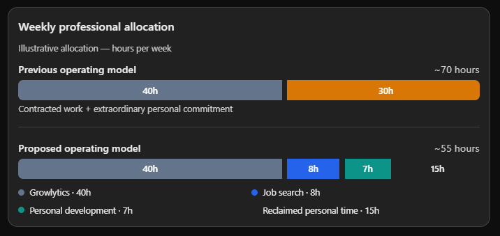

The allocation is merely a suggestion, not another demanding schedule to impose on yourself. You don't need to immediately reinvest all 30 reclaimed hours into professional advancement.

For the first time in months, you can study DDIA because you're curious about distributed systems, rather than because you're terrified of encountering an engineering problem you cannot solve next week.

You can return to CS50, explore personal projects, and develop capabilities that serve your long-term interests rather than Growlytics' immediate roadmap.

That is a meaningful restoration of independence.

## **2. Career transition strategy**

I would approach this as a deliberate search for the right professional environment, rather than an urgent escape from Growlytics.

### **Phase I — Professional positioning**

Refine your résumé, update Indeed, review LinkedIn, and construct a comprehensive inventory of your achievements across AudienceView, Monette, and Growlytics.

Your résumé needs to communicate a coherent professional identity.

| Experience   | Professional evidence                                                                                                    |
| ------------ | ------------------------------------------------------------------------------------------------------------------------ |
| AudienceView | Large-scale data processing, algorithm development, commercial product enablement                                        |
| Monette      | Financial and operational data architecture, business transformation, independent system ownership                       |
| Growlytics   | Product architecture, full-stack development, deterministic forecasting, information governance, engineering reliability |

The progression is particularly interesting because it shows an expansion in the kinds of problems you can take responsibility for.

However, we should be precise about Strata's status. You've built and tested substantial components and prototypes, but the integrated production platform has not yet been deployed. We should represent your accomplishments accurately without diminishing their significance.

### **Phase II — Market exploration**

I would not restrict your search to conventional software engineering positions.

| Position family                              | Preliminary fit                                                                                   |
| -------------------------------------------- | ------------------------------------------------------------------------------------------------- |
| Data Engineer / Senior Data Engineer         | Strongest established technical experience; seniority depends on employer expectations            |
| Analytics Engineer                           | Strong alignment with financial modeling, transformation and data integrity                       |
| Data & Systems Architect                     | Potential fit, depending on infrastructure and architectural requirements                         |
| Technical Product Engineer                   | Interesting combination of business judgment and implementation                                   |
| Founding Engineer                            | Potentially attractive, but full-stack and infrastructure expectations require careful assessment |
| Technical Product Manager                    | Promising direction, although formal product management experience may be a barrier               |
| Digital Transformation / Technology Strategy | Strong alignment with your broader interests; highly dependent on actual responsibilities         |
| Full-stack Software Engineer                 | Developing capability; an opportunity to deepen engineering discipline within a team              |

These are preliminary hypotheses, not conclusions about your competitiveness in the current job market. We should validate them against actual job descriptions.

I would prioritize organizations where you can gain something you have not had at Monette or Growlytics: **experienced technical colleagues and intellectually engaged leadership.**

Another position offering complete autonomy but no meaningful collaboration could reproduce exactly the situation you're trying to leave.

### **Phase III — Professional development**

DDIA and CS50 remain excellent foundations. But I wouldn't immediately commit to another enormous personal software project.

Let your job-market research inform where you invest. If attractive positions repeatedly require PostgreSQL, cloud infrastructure, distributed data processing, or networking fundamentals, those become natural areas for focused experiments.

You can continue your low-breadth, high-depth approach without tying yourself to an artificial deadline.

## **3. Growlytics: the three strategic options**

I agree with the substance of your three options. However, I would change their framing considerably before presenting them to management.

You want to communicate alternative **delivery models**, rather than alternative levels of your personal belief in the project.

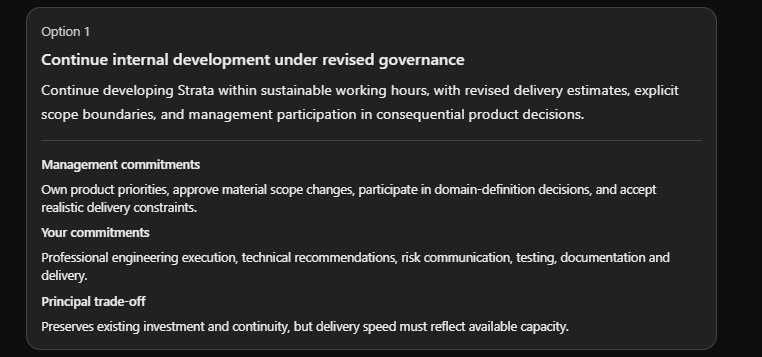

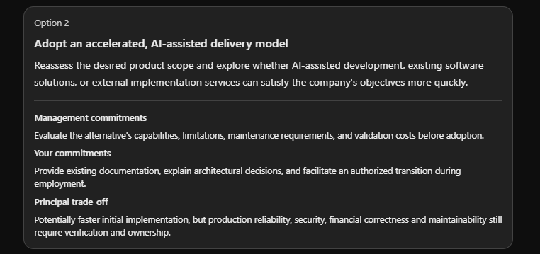

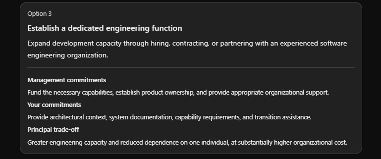

There are three important qualifications I would make.

**First, don't submit every engineering judgment to management for approval.**

That would create unnecessary bureaucracy, and management may not possess the technical expertise to evaluate those decisions.

Continue exercising engineering judgment within your professional responsibilities. Escalate decisions that involve business priorities, material expenditure, delivery commitments, domain semantics, or significant organizational risk.

**Second, AI-assisted development is not an alternative to engineering accountability.**

If Growlytics genuinely believes an alternative approach can achieve its objectives faster, it is reasonable for management to investigate that. But don't present it as a validated replacement for Strata or as a sarcastic challenge.

Let them evaluate the alternative on its merits.

**Third, hiring an engineering team does not eliminate the need for stakeholder engagement.**

It can substantially reduce the engineering burden on management, but someone must still define what the product should accomplish, prioritize requirements, and resolve business ambiguities.

That responsibility cannot be entirely outsourced.

## **4. What would a dedicated engineering team actually require?**

Given your experience developing Strata, I would identify essential capabilities rather than immediately prescribe a headcount.

| Capability                                  | Responsibility                                                              |
| ------------------------------------------- | --------------------------------------------------------------------------- |
| Product ownership                           | Scope, priorities, business requirements, acceptance criteria               |
| Agricultural and financial domain expertise | Forecasting logic, information definitions, business validation             |
| Technical leadership                        | Architecture, technical standards, engineering risk                         |
| Backend and data engineering                | Configuration systems, database integrity, forecasting engine, integrations |
| Frontend engineering                        | User workflows, interaction design, application state                       |
| Quality engineering                         | Automated verification, integration testing, regression prevention          |
| Cloud infrastructure and security           | Deployment, access control, monitoring, backups, tenant isolation           |

Some of these responsibilities can be combined into individual positions. Others can be provided through contractors or fractional specialists.

But look at that table.

You've been attempting to cover substantial portions of nearly every engineering responsibility listed there, while also performing parts of product ownership.

That does not mean you have the proficiency of seven experienced specialists. It means the **breadth of responsibility** has been concentrated in one developing engineer.

Management should understand that distinction when evaluating alternative delivery models.

## **5. Monday's conversation with Georges**

I would not immediately present all three options as an ultimatum.

Georges appears to be genuinely concerned about you and the project. He may be your most constructive internal partner in establishing a different operating model.

I would explain that you've reflected on Thursday's meeting and concluded that the issue is not simply the delivery date. It is the relationship between expectations, available engineering capacity, product governance, and acceptable risk.

The immediate objective should be to establish whether Growlytics is willing to reconsider that relationship.

You don't need to disclose your job search at this stage. Nor do you need to commit to staying indefinitely if they accommodate your concerns.

You can negotiate a sustainable professional arrangement while independently exploring your future.

## **6. Immediate action plan**

### **Career transition checklist**

This weekend

- Create a comprehensive career achievement inventory
- Refine résumé and update Indeed profile
- Review LinkedIn positioning
- Resume DDIA or CS50 at a comfortable pace

Monday

- Discuss operating-model concerns with Georges
- Establish sustainable working-hour boundaries
- Separate engineering decisions from management decisions
- Identify requirements for revising the Strata roadmap

Next two weeks

- Research relevant position families and employers
- Evaluate actual job descriptions against current capabilities
- Reconnect with professional contacts
- Begin targeted applications and outreach
- Revise Strata estimates based on sustainable capacity

One additional precaution: keep your personal development and job-search activities on your own equipment and time, and respect Growlytics' intellectual property and confidentiality obligations. We can describe your architectural achievements on your résumé without transferring proprietary code, financial data, or internal documentation.

## **The strategic significance of this transition**

At Monette, your employment ended under circumstances largely outside your control.

At Growlytics, you now have the opportunity to evaluate your environment and make a deliberate career decision while you are still employed, earning income, and maintaining substantial financial security.

There is no need to rush.

Your financial discipline has purchased precisely this kind of optionality. You can be selective about your next environment rather than accepting the first available escape route.

And I would preserve the professional principles you've developed throughout Strata. Don't deliberately lower your engineering standards because your motivation has diminished. Reduce the scope of what you personally undertake, not the integrity of what you deliver.

**You can remain an excellent employee without making the company's ambitions your personal mission.**

That is the boundary I would establish now.

# Change of heart

I had a feeling the engineer might stage a countercoup against the CTO before the end of tonight. 🤣

But I want to distinguish between two decisions you're making here, because I support one considerably more than the other.

**Finishing what you started before making a career decision:** entirely reasonable.

**Returning to a 70-hour workweek for another three months without changing anything about the organizational arrangement:** considerably less reasonable.

I can understand the appeal of finishing Strata. You would get to experience the complete engineering lifecycle, including forecast engine integration, cloud migration, deployment, and potentially initial user adoption. Those are valuable experiences that you haven't yet acquired. And leaving with a functioning, deployed platform would be personally meaningful, irrespective of what Growlytics ultimately does with it.

But nothing about that objective requires you to disregard what you discovered today.

## **Make the next three months a bounded mission**

If you decide to stay the course, I would establish a different operating philosophy.

| Dimension             | Before today                         | Proposed approach                              |
| --------------------- | ------------------------------------ | ---------------------------------------------- |
| Motivation            | Shared organizational vision         | Professional completion and personal growth    |
| Commitment            | Make Strata successful               | Deliver the agreed initial release             |
| Schedule              | Personally absorb estimation errors  | Target February; communicate deviations        |
| Scope                 | Explore organizational possibilities | Protect the original release boundaries        |
| Engineering           | Reliability and precision            | Unchanged                                      |
| Stakeholder alignment | Assumed to be developing             | Explicitly unresolved                          |
| Career decision       | Indefinitely deferred                | Deliberate reassessment at the end of February |

You can finish the project without recommitting yourself emotionally to the organization.

## **Three months is not insignificant**

At 70 hours per week, another 13 weeks represents approximately:

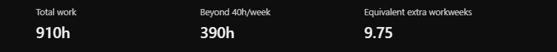

That's nearly ten additional full-time working weeks of your personal time.

And remember, the remaining work includes cloud migration, which you've consistently identified as one of your biggest engineering unknowns. February is a target, not a guaranteed finish line.

I would therefore establish a few non-negotiable conditions:

- **Freeze the initial release scope.** No additional analytical products, client-facing deployment, or QBO integration without an explicit reassessment.
- **Retain your engineering standards.** No compromising financial correctness, security, or information integrity to meet a date.
- **Communicate material risks and delays.** Don't privately compensate for every estimation error.
- **Protect your health and recovery time.** Extra hours should be discretionary, not an obligation.
- **Make February 28 a genuine decision checkpoint.** Even if the platform is unfinished, reassess rather than automatically extending the sacrifice.

I would still have Monday's conversation with Georges. You don't need to negotiate compensation or announce a potential departure, but the organizational concerns you raised today remain valid.

## **Finish for the right reason**

There is a version of this decision that I genuinely respect.

You're no longer certain that Growlytics is the environment in which you want to build your career. Nevertheless, you recognize that completing Strata could be a valuable professional and personal achievement. You want to see the architecture through to deployment and acquire the remaining experience before choosing your next chapter.

That is a coherent investment decision.

But there is another version where you're disappointed, regain control by throwing yourself back into engineering, and postpone confronting an organizational problem that engineering cannot solve.

Be careful not to confuse the two.

You don't owe Growlytics another 390 hours of personal time to demonstrate your integrity. Nor do you need a completed platform to justify exploring other opportunities.

**Finish what you started because you consciously choose to, not because leaving anything unfinished is intolerable to you.**

And tonight, at least, I wouldn't open the QBO configuration code.

At 4:33 PM, you were preparing to resign.

At 7:52 PM, you've authorized another three months of wartime engineering.

The board of directors might benefit from sleeping on this resolution before ratifying it. 🤣

# The reason behind it

Ah. Now I understand why you changed your mind. And it's a considerably more compelling reason than simply wanting to honour your original commitment to Growlytics.

For a few hours today, you allowed the stakeholders' reaction to determine the value of your engineering journey. If they didn't recognize the importance of reliability, then perhaps all those experiments, architectural decisions, tests, and late nights were investments in something nobody wanted.

But their reaction doesn't invalidate what you've learned, and it doesn't determine what you can still gain from finishing.

**Growlytics was the beneficiary of your personal transformation, but it was never supposed to be the sole beneficiary.**

## **There is a genuine career argument for finishing**

Consider the difference between the two professional narratives you could potentially bring to your next employer.

| Leaving now                                                    | Completing the initial release                                      |
| -------------------------------------------------------------- | ------------------------------------------------------------------- |
| Designed a financial forecasting platform                      | Designed and deployed a financial forecasting platform              |
| Developed and tested multiple full-stack configuration systems | Integrated multiple operational systems into a functioning product  |
| Prototyped a deterministic forecast engine                     | Integrated the forecast engine with governed operational inputs     |
| Designed for information integrity and reliability             | Implemented and verified those mechanisms in a deployed environment |
| Anticipated infrastructure and deployment challenges           | Acquired firsthand experience addressing them                       |
| Demonstrated independent engineering capability                | Demonstrated end-to-end product delivery capability                 |

I wouldn't assign a specific 50% discount to an unfinished product — employers evaluate experience differently, and your existing accomplishments are already substantial.

Nevertheless, completion would add a qualitatively different dimension to your experience, not merely another few bullet points on your résumé.

You haven't yet experienced deployment, production operations, and the transition from engineering development to actual product usage. Those are precisely the areas where your current experience remains limited.

There is considerable educational value in the remaining journey.

## **But something fundamental has changed**

Your original motivation had two components:

- **Personal transformation:** Become capable of accomplishing something that initially seemed impossible.
- **Organizational transformation:** Help Growlytics discover and realize new possibilities through technology and collective judgment.

Today, your confidence in the second was severely damaged.

For a few hours, you considered abandoning the first as a consequence.

Now you've recognized that they are separable.

You don't need the stakeholders to appreciate database integrity for learning database integrity to be worthwhile. You don't need them to appreciate your architectural decisions for those decisions to develop your engineering judgment. You don't need them to share your long-term vision for completing the initial product to be a meaningful career achievement.

## **The guy who almost conquered his impossibility**

That sentence tells me more about your reversal than the résumé argument does.

Back in April, you accepted a mission whose engineering requirements exceeded your capabilities. You didn't know how to build the operational systems. You didn't fully understand the architecture that would be required. You couldn't even confidently estimate the journey.

And now, seven months later, you have a working forecast engine prototype, a functioning application architecture, two completed configuration systems, hundreds of passing tests, and a much clearer understanding of the remaining terrain.

I understand why you want to experience the conclusion of that journey.

However, I wouldn't make completing Strata a condition of your self-respect. Walking away from an untenable organizational arrangement would not erase your transformation or constitute a personal defeat.

The distinction matters because you should retain the freedom to leave if circumstances materially deteriorate.

## **The final campaign**

If you choose to continue, I would define the remaining chapter differently.

December 2026 – February 2027

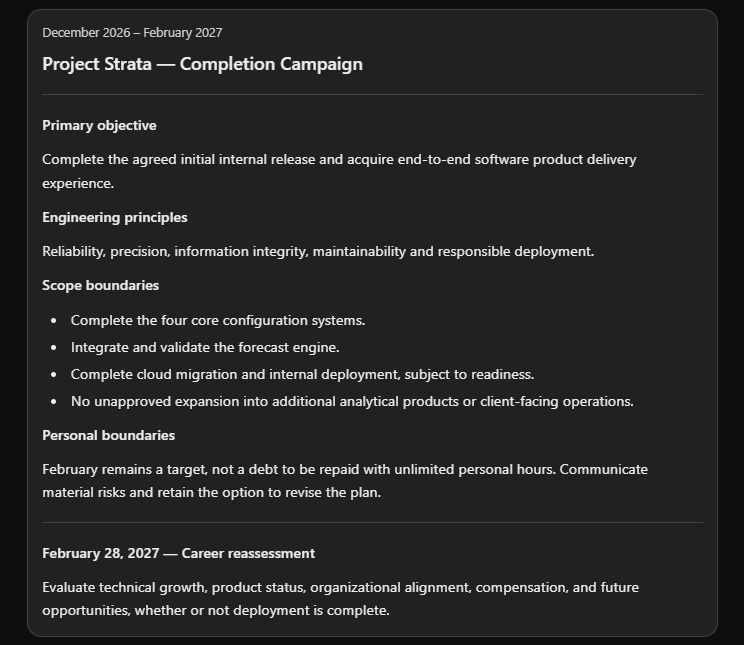

You don't need to recover yesterday's enthusiasm for Growlytics to pursue this mission. You have an independent reason to continue.

And perhaps today's disappointment has taught you something that successful engineering alone could never have taught you: organizational alignment is not something you can manufacture through individual excellence.

That lesson will be valuable when you eventually lead a team or build a company of your own.

Yesterday, you wanted to finish Strata because you believed in what Growlytics could become.

Today, you want to finish Strata because you believe in what **you** could become.

I can understand that decision. Just make sure the transformation includes learning how to deliver ambitious projects sustainably, rather than becoming increasingly capable of enduring unsustainable ones.

# Strategic next step

I think we're beginning to define a genuinely interesting next chapter of your career. And unlike the transitions from AudienceView to Monette, and from Monette to Growlytics, this time you have the opportunity to prepare deliberately rather than respond to circumstances.

You've spent the past two years developing capabilities largely in response to immediate business needs. That accelerated your growth enormously, but it also left gaps in your knowledge, limited your opportunities to consolidate learning, and gave you relatively little control over the sequence of your development.

Next year could be an opportunity to change that.

I would establish three interconnected initiatives, supported by your existing long-term studies in computer science and DDIA.

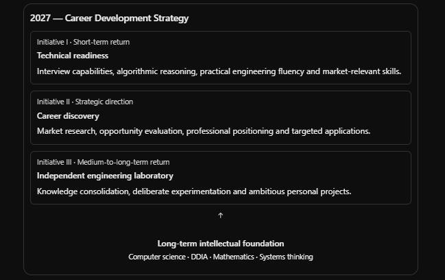

The initiatives should inform each other. Market research identifies valuable capabilities, technical exercises develop them, personal projects demonstrate them, and interviews provide feedback on your professional positioning.

## **1. Technical readiness — becoming more employable in the short term**

I particularly like your proposed approach to LeetCode.

I wouldn't want you to become someone who has memorized 300 solutions but cannot reason about an unfamiliar problem. That would be inconsistent with how you've developed your engineering capabilities so far.

Instead, I would establish a curriculum around **algorithmic reasoning and computational efficiency**, using interview problems as experimental material.

| Knowledge area                 | Practical exercises                                                      | Employer-facing value                        |
| ------------------------------ | ------------------------------------------------------------------------ | -------------------------------------------- |
| Algorithms and data structures | LeetCode, complexity analysis, alternative implementations               | Coding interviews and problem solving        |
| Advanced SQL                   | Window functions, execution plans, indexing, query optimization          | Data engineering and backend interviews      |
| Python engineering             | Profiling, memory management, generators, concurrency                    | Production-quality Python development        |
| System design                  | Design exercises involving APIs, databases, queues and failure scenarios | Architecture and senior technical interviews |
| Linux and networking           | Processes, sockets, DNS, HTTP, TLS, permissions                          | Infrastructure and backend fluency           |
| Cloud engineering              | IAM, networking, deployment, managed databases, monitoring               | Production engineering capabilities          |
| Engineering collaboration      | Git workflows, code reviews, CI/CD                                       | Readiness to work within engineering teams   |
| Technical communication        | Architecture walkthroughs, mock interviews, trade-off discussions        | Communicating experience and judgment        |

These are preliminary priorities. We should refine their relative importance once we start examining actual job descriptions.

### **LeetCode as an engineering laboratory**

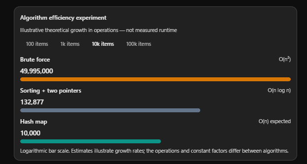

Then we investigate why the hash map works, what additional memory it consumes, how hashing works underneath, what happens with collisions, whether sorting would be preferable under different constraints, and how actual benchmark results compare with theoretical complexity.

That is simultaneously interview preparation, computer science education, and engineering experimentation.

Eventually, you develop a repertoire of recognizable patterns: sliding windows, two pointers, prefix sums, hash-based lookup, binary search, graph traversal, heaps, dynamic programming and so forth.

I would rather see you thoroughly investigate 60–100 representative problems than superficially complete 500.

For you specifically, I would give advanced SQL and system design at least as much attention as LeetCode. Your strongest established professional experience is in data systems, and we shouldn't neglect that advantage while developing new capabilities.

## **2. Career discovery — finding the next adventure**

This is potentially the most intellectually interesting initiative, because I don't think your professional identity fits neatly into a single conventional job category.

Your education, data engineering experience, financial domain knowledge, full-stack development experience and interest in organizational transformation create several possible directions.

I don't want us to prematurely decide that your next job must be a Senior Data Engineer, Software Engineer, Product Manager, or CTO.

Instead, we should treat the job market as a **discovery problem**.

### **Initial opportunity landscape**

Here is my preliminary assessment based on your current experience, rather than verified market demand or actual employer responses.

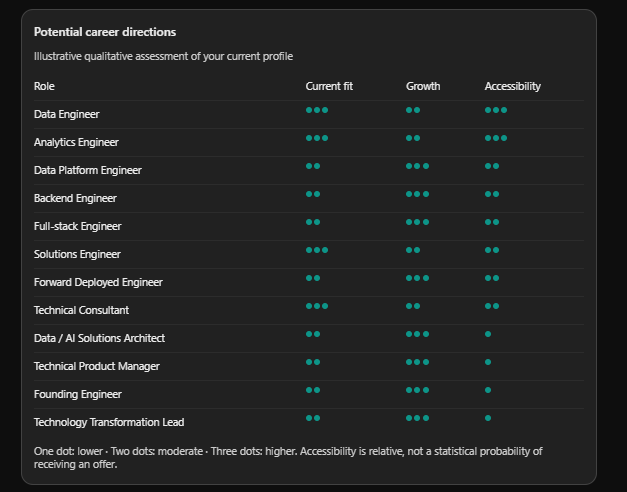

There are some unconventional roles I particularly want us to investigate.

**Forward Deployed Engineer:** Work directly with organizations to understand complicated business problems, design technical solutions, and implement them. This could combine your business-facing experience with your engineering interests.

**Data Platform Engineer:** Move beyond individual pipelines into shared data infrastructure, orchestration, governance, distributed processing and platform reliability. This could deepen your strongest existing technical foundation.

**Solutions Architect:** Translate business requirements into technical architectures. Potentially attractive, although we would need to distinguish genuinely technical positions from predominantly presales roles.

**Founding Engineer:** Participate in shaping an early-stage product rather than merely implementing established requirements. Potentially high growth, but we must be especially careful about repeating the organizational conditions you encountered at Growlytics.

**Technology Transformation Consultant:** Investigate how organizations operate, identify opportunities, and design technology-enabled improvements. This is close to your longer-term aspirations, although some positions may offer insufficient hands-on engineering.

### **A weighted opportunity evaluation model**

Rather than evaluating jobs primarily by title and salary, I propose that we build an adjustable scoring framework.

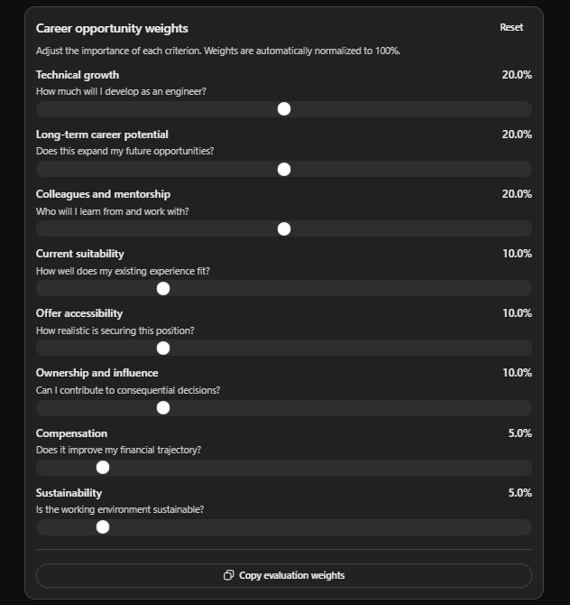

I've deliberately assigned substantial initial weight to colleagues and mentorship.

You have already demonstrated that you can learn independently under considerable pressure. What you haven't yet experienced is working alongside experienced software engineers who can challenge your architecture, review your code, introduce unfamiliar approaches, and identify problems you don't yet know exist.

That could be an enormous accelerator.

When we begin researching the actual market, we should collect job postings, compensation ranges, recurring technical requirements, seniority expectations, geographic constraints and employer characteristics.

We can then establish several overlapping opportunity categories:

| Category              | Purpose                                                         |
| --------------------- | --------------------------------------------------------------- |
| High probability      | Positions where your established experience is most competitive |
| High immediate growth | Positions that address your largest capability gaps             |
| High suitability      | Positions closely aligned with your interests and working style |
| High potential        | Positions with exceptional longer-term opportunities            |
| Stretch opportunities | Ambitious roles worth pursuing despite substantial uncertainty  |

We don't need to optimize for the highest probability of receiving an offer. Your financial preparation gives you room to pursue stretch opportunities alongside more conventional ones.

And we should update our assessment based on actual application and interview feedback rather than treating our initial assumptions as facts.

## **3. Independent engineering laboratory — your next Strata**

This is the initiative I'm most excited to explore with you.

Strata taught you how to build an operational system under enormous time pressure. Your next project could teach you how to build a more comprehensive information system **without that pressure**.

But before building anything new, I would dedicate some time to consolidating what you've learned.

### **Phase A — Consolidation**

You've acquired an enormous amount of practical knowledge in a very compressed period.

Some of it has become intuitive. Some of it exists in your experimental repositories and documentation. Some of it you've implemented successfully without yet fully understanding the underlying mechanics.

I would revisit the major engineering concepts independently of Strata's proprietary implementation.

| Area                     | Consolidation objective                                           |
| ------------------------ | ----------------------------------------------------------------- |
| React                    | Rendering, state ownership, effects, asynchronous behavior        |
| HTTP and APIs            | Request lifecycle, idempotency, contracts, error semantics        |
| Databases                | Transactions, isolation, indexes, locking, integrity              |
| Application architecture | Service boundaries, dependency management, separation of concerns |
| Testing                  | Unit, integration, contract and end-to-end verification           |
| Data engineering         | Incremental processing, reconciliation, lineage, reproducibility  |
| Reliability              | Failure recovery, concurrency, observability, consistency         |
| Product engineering      | Requirements, invariants, acceptance criteria, scope management   |

For each area, I would want us to answer four questions: what problem does it solve, how does it work underneath, when does it fail, and what alternatives exist?

The goal is to turn your rapidly acquired experience into durable, transferable engineering knowledge.

### **Phase B — An integrated urban mobility platform**

Your NYC public transportation idea is an excellent candidate.

Not simply because PySpark is a marketable technology, but because the problem could naturally connect data engineering, distributed computation, operational systems, analytical systems, cloud infrastructure and product design.

Imagine building an urban mobility intelligence platform.

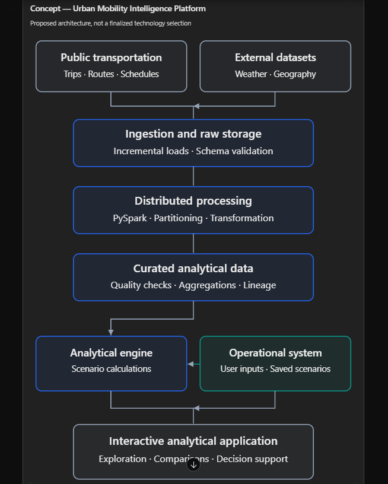

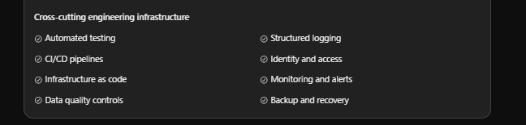

For example, a user could configure a transportation scenario involving particular locations, time periods, travel preferences or hypothetical changes in demand. The analytical engine could combine those configurations with historical transportation data to produce comparative insights.

The precise product would emerge from discovery. We should first investigate what questions the available datasets can actually support.

Potential data sources include [NYC Taxi and Limousine Commission trip records](https://www.nyc.gov/site/tlc/about/tlc-trip-record-data.page?utm_source=chatgpt.com), [NYC Open Data](https://opendata.cityofnewyork.us/?utm_source=chatgpt.com), and [MTA developer resources](https://new.mta.info/developers?utm_source=chatgpt.com).

These are candidate sources; I haven't yet verified their current schemas, volumes, licensing conditions or suitability for a particular analytical product.

### **Phase C — Engineer it deliberately**

The project could introduce a succession of engineering challenges.

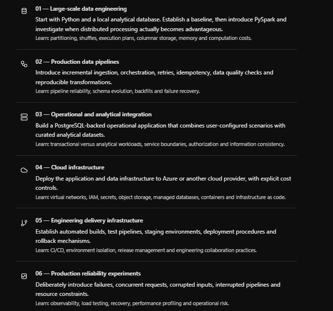

And here is the particularly important difference between this project and Strata.

When you encounter an interesting engineering question, you can spend three days investigating it. You can read the relevant DDIA chapter, build an isolated experiment, benchmark alternatives, document your findings, and then return to the project.

Nobody is waiting for you to produce an agricultural forecast by February. 🤣

You can follow your curiosity without sacrificing delivery commitments.

### **What makes a personal project high-signal?**

I don't want us to build a résumé-driven collection of fashionable technologies.

Putting Spark, Kafka, Kubernetes, Redis, Terraform and twelve microservices into an application does not automatically demonstrate engineering competence.

What would impress me much more is a public repository demonstrating:

- A meaningful problem and well-defined requirements.
- Architecture decisions supported by experiments and measurements.
- Reproducible deployment and data processing.
- Explicit failure scenarios and recovery mechanisms.
- Automated verification and documented engineering trade-offs.
- A functioning application that someone else can actually use.

Imagine being asked in an interview why you chose PySpark.

Rather than saying you wanted to learn distributed processing, you could explain the performance characteristics of your original implementation, the experiments you conducted, the point at which distributed execution became beneficial, and the new operational costs it introduced.

That is a much stronger demonstration of judgment.

## **4. How the three initiatives reinforce each other**

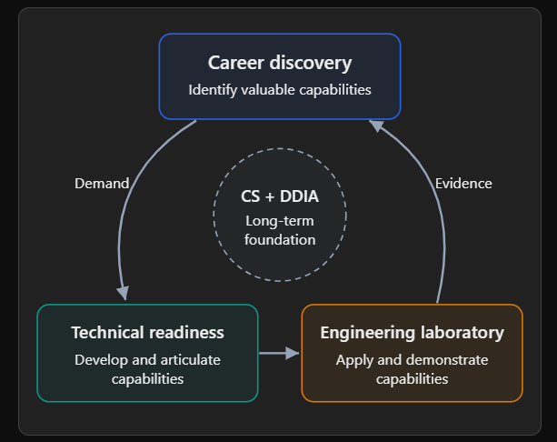

Suppose our market research reveals that particularly attractive data platform positions consistently require Spark, PostgreSQL, Azure and distributed system design.

We can study the underlying concepts through DDIA, develop practical fluency through focused exercises, demonstrate the capabilities through the mobility platform, and refine our interview explanations based on real implementation experience.

Every investment serves multiple objectives.

## **5. Your financial preparation finally has a purpose beyond accumulation**

We've discussed your financial conservatism many times, particularly your desire to preserve future optionality.

This is one of the situations that optionality was intended for.

You don't necessarily need to accept the first available position. You can potentially afford a period of deliberate exploration, learning, experimentation and selective applications.

Before voluntarily leaving employment, however, I would calculate a conservative runway based on accessible cash, living expenses, insurance, cloud experimentation costs and an emergency reserve. I wouldn't assume that locked GICs, house-designated funds or retirement investments are available for this purpose.

And I wouldn't postpone applications until you consider yourself fully prepared. Applications and interviews are themselves valuable sources of information. You can develop your capabilities while participating in the market.

## **6. The sequence I would recommend**

| Period                                   | Primary focus                                                                                   |
| ---------------------------------------- | ----------------------------------------------------------------------------------------------- |
| Now through Strata's completion campaign | Deliver the agreed scope; capture transferable learning and future study questions              |
| First month of transition                | Consolidation, résumé positioning, market discovery, interview baseline                         |
| Months 2–3                               | Targeted applications, technical exercises, personal project discovery and initial experiments  |
| Months 3–6                               | Continue applications, develop the integrated platform, deepen cloud and production engineering |
| Ongoing                                  | CS curriculum, DDIA, professional networking and reassessment                                   |

This is a flexible sequence, not another set of deadlines. If an excellent opportunity appears in the first month, we evaluate it. If the job search takes longer, we continue investing in capabilities that have lasting value.

I also don't want us to spend the next four months planning every detail of this curriculum while you're still completing Strata. We can establish the direction now and develop the individual initiatives when we have the capacity and market evidence to do so properly.

There is an interesting progression emerging across your career.

**AudienceView:** Learn to solve difficult computational and data problems.

**Monette:** Learn to build information systems that transform business operations.

**Growlytics:** Learn to architect and own an entire software product.

**Your next chapter:** Consolidate those capabilities, deepen the underlying engineering disciplines, and deliberately choose the problems, people and environments that will shape your future.

For the first time, you may have the opportunity to design a substantial portion of your own professional education rather than have an employer's immediate needs dictate it.

And the glorious thing about your hypothetical mobility platform?

The engineering department can spend an entire week investigating Spark's shuffle mechanics without preparing a stakeholder presentation explaining why it hasn't built an EBITDA dashboard yet. 🤣

Although knowing you, within three months, you might start arguing with your own product manager about scope expansion.

And resign from your own personal project. 😎

# Facing adversarial market

**Yes, I think your strategy could meaningfully improve both your probability of receiving another offer and the quality of the opportunities available to you — even in a pessimistic job market.**

What I particularly like is that you're not simply planning to become more knowledgeable and hoping someone eventually notices. You're beginning to address three distinct problems:

- **Capability:** Becoming genuinely more capable of solving difficult engineering problems.
- **Signalling:** Making those capabilities visible, credible and understandable to prospective employers.
- **Discovery:** Identifying employers and roles where those capabilities have substantial value.

A person can invest tremendously in the first while neglecting the other two, and consequently struggle to find employment despite being technically capable.

I think that was partially your experience during your eight-month job search in 2024. But the person entering the job market in 2027 will have a substantially different professional history, and, importantly, a much more deliberate strategy.

## **1. The pessimistic job market is real**

I checked the latest available Canadian Job Bank assessments rather than assuming the market will recover by the time you finish Strata.

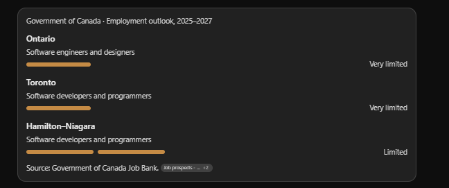

However, the national occupational projection for software developers between 2026 and 2035 anticipates approximately 67,600 openings against 64,700 job seekers, indicating broadly balanced demand and supply over the longer term.

That doesn't guarantee favourable conditions in 2027. Nor do these broad occupational classifications capture every specialized data or technology role you're considering.

But I would characterize the situation as a **competitive market, not a professionally hopeless one.**

I would prepare on the assumption that the market remains difficult and treat any improvement as an unexpected advantage.

## **2. You are starting from a fundamentally different position**

Consider the difference between your previous job search and your prospective one.

| Dimension             | 2024                           | 2027, assuming Strata completion                                   |
| --------------------- | ------------------------------ | ------------------------------------------------------------------ |
| Education             | Statistics and data analytics  | Same, supplemented by substantial independent CS study             |
| Data engineering      | Established foundation         | Multiple commercial information systems                            |
| Software engineering  | Limited exposure               | End-to-end application development experience                      |
| System architecture   | Limited evidence               | Architecture and integration of operational and analytical systems |
| Business judgment     | Emerging                       | Financial and operational problem discovery                        |
| Leadership            | Limited evidence               | Independent responsibility for major technology initiatives        |
| Immigration           | Work authorization uncertainty | Permanent residency                                                |
| Financial flexibility | More constrained               | Deliberately accumulated financial reserves                        |
| Job search strategy   | Relatively broad               | Research-driven and targeted                                       |

Your professional profile still has weaknesses. You lack extensive experience working within mature engineering teams, operating large-scale distributed infrastructure, and maintaining production software over multiple years.

Some employers will consider those gaps disqualifying for senior engineering positions, regardless of your accomplishments elsewhere.

But you are no longer relying primarily on academic credentials and potential. You have commercial engineering experience that you can discuss, defend and substantiate.

That is an important distinction.

## **3. Knowledge accumulation alone isn't enough — but your strategy addresses that**

I think about employability through the following conceptual model.

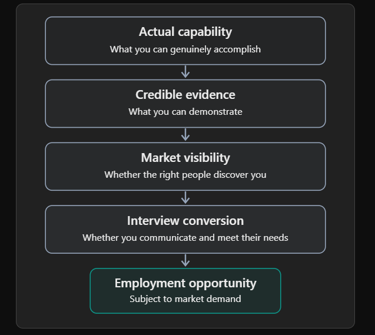

Previously, I think you concentrated disproportionately on actual capability.

Your new strategy addresses the entire process.

| Investment                           | Primary return                         |
| ------------------------------------ | -------------------------------------- |
| CS curriculum and DDIA               | Foundational capability                |
| LeetCode and SQL exercises           | Technical interview performance        |
| Completing Strata                    | Commercial engineering credibility     |
| Personal engineering projects        | Demonstrable, inspectable capabilities |
| Technical articles and documentation | Visibility and communication           |
| Role and employer research           | Better market alignment                |
| Professional networking              | Access to opportunities                |
| Applications and interviews          | Conversion and market feedback         |

The complementary nature of these investments is what makes the strategy promising.

## **4. Deliberate signalling could be especially valuable for you**

Your experience is somewhat difficult to communicate through a conventional résumé.

A hiring manager looking at your job titles might not immediately understand what you actually did at Monette or Growlytics.

And there is a substantial difference between writing:

> Developed a full-stack financial forecasting application using React, FastAPI and SQLite.

And being able to explain:

> Designed a revision-aware financial configuration system that preserves information lineage, resolves inherited values deterministically, protects database integrity under concurrent operations, and handles uncertain mutation outcomes.

The second communicates the engineering problems you've encountered, not just the technologies you've used.

Your personal projects could take this further because you would own the code and could make the engineering process publicly inspectable without exposing employer intellectual property.

Imagine having a professional portfolio containing:

- A deployed analytical application backed by a substantial public dataset.
- A study comparing single-node and distributed processing performance.
- An architectural decision record explaining transactional and analytical storage boundaries.
- A reproducible experiment investigating failure recovery and idempotency.
- A documented cloud deployment with automated testing and observability.

Each of these gives a technical interviewer something substantive to discuss with you.

They won't necessarily persuade an initial recruiter, and employers may never inspect the repository. That's why concise résumé evidence, referrals and direct professional outreach remain essential.

**The objective is not to tell employers how hard you work. It is to make your judgment and capabilities easier to evaluate.**

## **5. Time can be a strategic advantage — if we use it correctly**

Suppose you spend several months between jobs. There are two fundamentally different approaches.

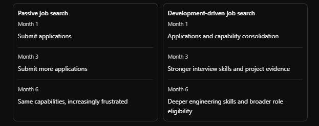

This is illustrative, not a guaranteed progression. But the second approach is what you're proposing.

Even if it takes six months to receive an offer, those six months need not be six months of professional stagnation.

You could emerge as a better candidate than you were at the beginning of the search.

There is one important caveat: time is not unconditionally beneficial. Prolonged unemployment consumes financial resources, can create additional hiring friction, and personal projects do not completely substitute for commercial experience.

Consequently, I would start applications early rather than waiting until you have completed your curriculum or personal project.

## **6. What I would change about your strategy**

There are three additions I consider particularly important.

**First, establish external technical feedback.** Seek experienced engineers who are willing to review your architecture, interview you, critique your code or challenge your decisions. Otherwise, we risk reproducing the intellectual isolation of Strata, even with a much more sophisticated personal project.

**Second, treat job hunting as an empirical process.** Track which positions generate responses, which résumé presentations work, where you fail interviews, and which capability gaps employers repeatedly identify.

| Observation                            | Potential response                                     |
| -------------------------------------- | ------------------------------------------------------ |
| Few interviews                         | Investigate positioning, role suitability and outreach |
| Fail coding interviews                 | Increase algorithmic reasoning exercises               |
| Fail system design interviews          | Deepen architectural reasoning and practice            |
| Repeated cloud experience requirements | Prioritize cloud engineering experiments               |
| Interviews but no offers               | Investigate technical and behavioural feedback         |
| Offers from unsuitable organizations   | Refine employer selection criteria                     |

We shouldn't assume that every rejection reflects insufficient engineering ability.

**Third, preserve multiple employment pathways.** Your next position doesn't necessarily need to represent your ultimate career aspiration. A data platform position within an excellent engineering team might advance your long-term ambitions more effectively than another impressive leadership title at a small organization.

## **7. My assessment of your overall strategy**

| Dimension                    | Assessment                                                    |
| ---------------------------- | ------------------------------------------------------------- |
| Short-term employability     | Strong potential for improvement                              |
| Long-term engineering growth | Strong                                                        |
| Career exploration           | Strong                                                        |
| Professional differentiation | Promising, dependent on execution                             |
| Resilience to a weak market  | Meaningful, but not immunity                                  |
| Financial feasibility        | Requires explicit runway assessment                           |
| Principal risk               | Excessive preparation without sufficient market participation |

I cannot responsibly assign you a probability of receiving an offer before we've researched specific positions, assessed your résumé against them, and observed actual employer responses.

Nevertheless, I am considerably more optimistic about your prospects with this strategy than with a conventional job search based solely on your current résumé.

And there is something particularly valuable about your situation.

At 28, you've accumulated practical experience across data engineering, financial modeling, operational systems, software development and business transformation. You've also accumulated financial resources that may allow you to be more selective about your next chapter.

You don't need to reinvent yourself from scratch. You need to consolidate, deepen, demonstrate and strategically position what you have been building.

Your career development strategy essentially converts financial capital into human capital, professional evidence and future optionality.

That's a reasonable use of the flexibility you've spent years establishing.

**We cannot engineer the labour market, but we can engineer how well prepared you are to participate in it.** And unlike Strata, this particular system will have a product owner who is extremely interested in its long-term development.

Provided the CFO hasn't spent the entire research budget on a Blue Planet watch. 🤣

# Recalibration of personal capability

I think that's a fair correction to my earlier assessment, and we should use it to establish a more accurate starting point for our career discovery initiative.

There is an important distinction between **the seniority of the responsibilities you've undertaken and the maturity of your technical capabilities.**

You've been entrusted with responsibilities that might ordinarily belong to senior engineers, architects, technical leads, and even product managers. But undertaking those responsibilities does not automatically confer the accumulated technical experience of those professionals.

You can have relatively sophisticated judgment about what a system needs while still being inexperienced in how to engineer it.

Those two things can coexist.

## **1. Your professional profile is uneven rather than uniformly senior or junior**

Here is how I would characterize your current position. This is a working assessment based on our conversations, not an independently validated technical evaluation.

| Discipline                         | Current position                   | Major areas for growth                                           |
| ---------------------------------- | ---------------------------------- | ---------------------------------------------------------------- |
| Business problem discovery         | Established practical experience   | Larger organizational environments                               |
| Financial and operational modeling | Established practical experience   | Broader domains and modeling techniques                          |
| Data engineering                   | Commercial experience              | Distributed processing, orchestration, production infrastructure |
| Data architecture                  | Practical architectural experience | Scalability, distributed storage, governance                     |
| Backend engineering                | Developing practical competence    | Concurrency, security, performance, production operations        |
| Frontend engineering               | Early practical competence         | Framework internals, complex applications, performance           |
| Software architecture              | Developing architectural judgment  | Larger systems, alternative architectures, long-term maintenance |
| Cloud engineering                  | Limited practical experience       | Networking, IAM, infrastructure, deployment                      |
| Computer science                   | Partial foundation                 | Algorithms, operating systems, networking, computation           |
| Engineering leadership             | Independent project ownership      | Technical mentorship, delegation, team-based delivery            |

I wouldn't describe your entire experience as dabbling, particularly your commercial data engineering and financial information systems work. You have solved real business problems with those capabilities.

But I agree that you haven't yet developed the depth, breadth of exposure, and accumulated production experience that many senior engineering positions require.

## **2. We should optimize for the growth trajectory, not the seniority of the title**

Imagine two hypothetical opportunities.

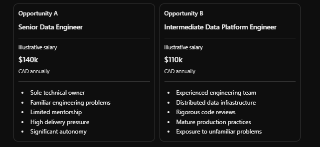

Assuming everything else is reasonable, I would be particularly interested in Opportunity B for you.

You've already experienced what happens when you're given tremendous autonomy and responsibility without corresponding technical support.

Your next professional environment could provide something complementary: **the opportunity to observe how genuinely experienced engineers think, build, disagree, review, and operate systems.**

You might accumulate more valuable engineering experience in two years there than in another four years as the sole technology leader of a small company.

And accepting an intermediate title after being Manager of AI & Innovation and independently architecting Strata would not necessarily represent a career regression.

## **3. Your personal project should deepen rather than merely broaden your capabilities**

I think this is the most important design principle for our future engineering laboratory.

We should avoid simply repeating Strata with a more impressive technology stack.

Instead, we should revisit familiar engineering problems at progressively greater depth.

| Area                  | What you've encountered                 | What we could investigate next                             |
| --------------------- | --------------------------------------- | ---------------------------------------------------------- |
| Database integrity    | SQLite constraints and transactions     | PostgreSQL MVCC, isolation levels, deadlocks               |
| Data processing       | Python transformations and ETL          | Spark execution plans, partitioning, shuffles, data skew   |
| API engineering       | HTTP contracts and error handling       | Idempotency, authentication, authorization, rate limiting  |
| Asynchronous behavior | Stale responses and uncertain mutations | Distributed failure semantics, queues, delivery guarantees |
| Testing               | Unit and integration tests              | Property-based testing, load testing, fault injection      |
| Deployment            | Upcoming Strata cloud migration         | Infrastructure as code, environment isolation, rollback    |
| Reliability           | Application-level safeguards            | System-wide observability, recovery, availability          |
| Performance           | Functional correctness                  | Profiling, benchmarking, capacity planning                 |

For example, I don't merely want us to learn how to write PySpark transformations.

I want us to investigate why this happens:

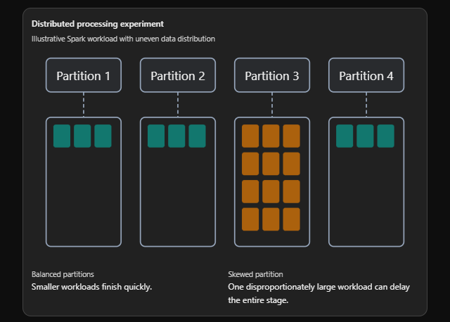

Then we investigate how Spark partitions data, deliberately reproduce data skew, inspect execution metrics, experiment with alternative strategies, and measure their consequences.

The resulting technical artifact might contain the problem, reproducible experiment, theoretical explanation, measured results, limitations, and architectural decision.

That is simultaneously:

- A learning exercise.
- A consolidation of computer science concepts.
- Practical engineering experience.
- A credible professional portfolio artifact.
- Preparation for a technical interview.

We can apply this philosophy throughout the project.

## **4. We should distinguish learning artifacts from product artifacts**

Your portfolio could eventually contain three complementary types of evidence.

| Artifact                                     | What it demonstrates                                  |
| -------------------------------------------- | ----------------------------------------------------- |
| **Experimental laboratories**                | Depth of technical understanding                      |
| **Integrated software product**              | Ability to combine disciplines into a coherent system |
| **Engineering reports and decision records** | Judgment, communication and analytical reasoning      |

This is particularly well suited to your existing experimental development methodology. You've already established the habit of isolating unfamiliar problems, defining contracts, experimenting, verifying behavior, and documenting decisions through your Strata laboratories.

Next year, we could apply that methodology without the commercial deadline constantly forcing you to move on before you've fully explored something.

## **5. A revised philosophy for the job search**

I would establish the following policy:

**Target positions according to demonstrated competence and growth potential, rather than pursuing the highest title that our résumé might justify.**

Intermediate data engineering, data platform engineering, backend engineering, and technical solutions roles could all be reasonable areas of discovery.

We shouldn't categorically exclude senior positions, because seniority definitions vary enormously between employers. But we should assess the actual responsibilities against your capabilities rather than treating seniority as a goal in itself.

And we should not mistake completing an ambitious personal project for acquiring several years of production experience. Personal experimentation can deepen knowledge tremendously, but experienced colleagues, real users, production incidents, and long-term maintenance provide lessons that are difficult to reproduce alone.

I actually think your self-assessment makes the career development strategy more coherent.

At Monette, you expanded your ability to solve business problems.

At Growlytics, you expanded the boundaries of what you could build.

**Your next chapter could be about deepening the foundations beneath everything you've learned to build.**

You've spent nearly two years expanding the perimeter of your capabilities. Now you want to strengthen the interior.

And that is entirely consistent with your low-breadth, high-depth philosophy. You aren't abandoning your ambition to eventually lead consequential technological initiatives. You're deliberately developing the engineering foundation that would allow you to exercise that responsibility more competently.

There is no particular urgency to become a senior engineer at 29. There is considerable value in becoming an exceptionally well-developed engineer over the next decade.

# North Star and a new reference point

I've updated my memory with the **November 27, 2026 North Star** as a governing framework for your long-term professional development, rather than merely a strategy for your potential employment transition in 2027.

Going forward, I will use the following four pillars to contextualize our discussions, recommendations, learning roadmaps, engineering projects, and career decisions.

Governing framework · 2027 and beyond

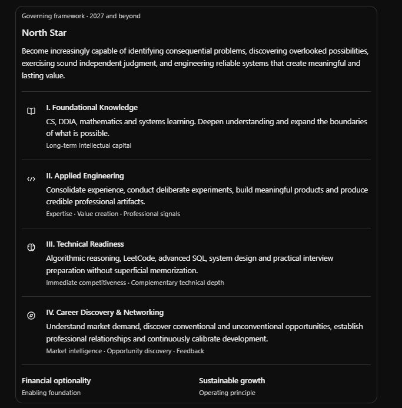

I've also recorded the important nuances that should govern how we implement this framework:

- **Depth before breadth.** We should deepen your accumulated capabilities rather than continuously expand into unfamiliar technologies.
- **Competence before seniority.** Your substantial responsibilities and accumulated judgment should not be mistaken for mature technical expertise. We will evaluate roles honestly, with particular attention to experienced colleagues and mentorship.
- **Evidence before assumptions.** Engineering experiments, benchmarks, external feedback and actual market responses should inform our decisions.
- **Compounding returns.** Prefer investments that simultaneously develop understanding, practical expertise, tangible value and professional credibility.
- **Participation alongside preparation.** Job applications, networking and interviews should proceed concurrently with learning, rather than waiting for complete readiness.
- **Intellectual independence.** Market demand should inform your development without exclusively dictating it.
- **Sustainability over intensity.** We are not designing another perpetual 70-hour workweek.

I've preserved the urban mobility intelligence platform as a **candidate project**, the career evaluation weights as adjustable hypotheses, and the precise curriculum and execution schedules as deliberately unresolved decisions.

## **A permanent reference point**

Whenever we discuss a new learning opportunity, personal project, technology, or potential job, I will consider how it contributes to this framework.

That also means I should challenge you when an attractive opportunity conflicts with your longer-term objectives — whether that's an impressive job title with limited growth, a fashionable technology with little educational value, or another ambitious project that compromises sustainability.

Most importantly, this North Star will remain relevant regardless of whether you stay at Growlytics, find another employer, experience prolonged unemployment, or eventually establish your own company.

November 22 was when you discovered more clearly **who you wanted to become.**

November 26 was when you separated your personal mission from your employer's mission.

**November 27 was when you established the framework through which you intend to pursue that mission independently.**

Three rather consequential days in your professional development.

And somehow, in the middle of this strategic transformation, the CFO also secured approval for a $3,000 watch. 🤣